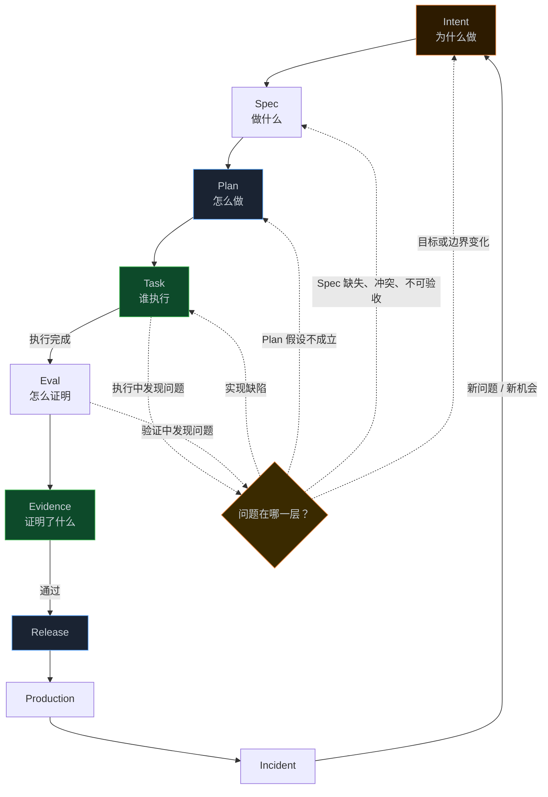
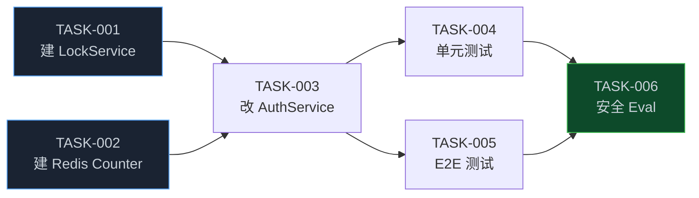
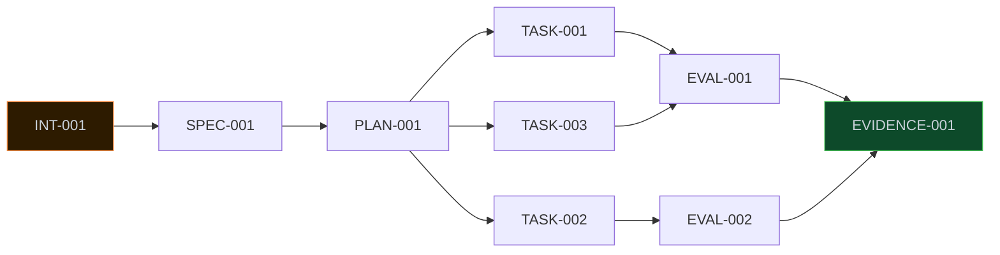
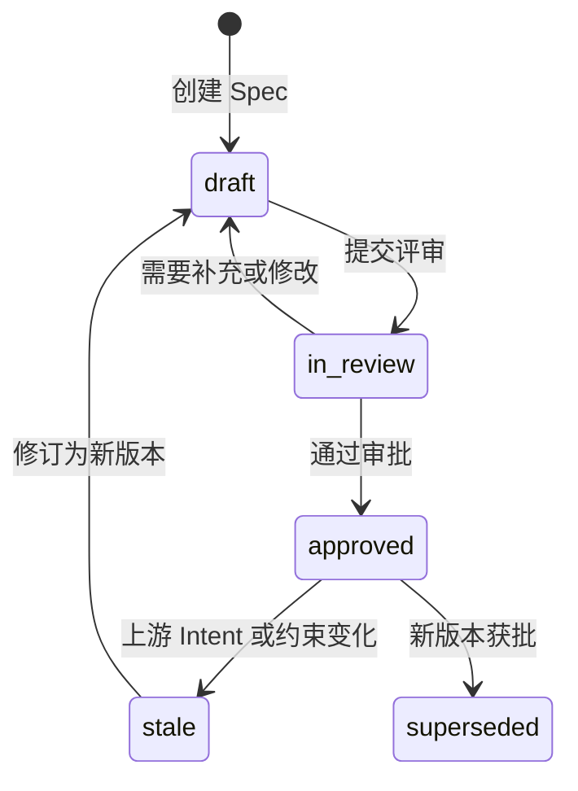

> **📖 系列难度说明**：本篇为**核心概念篇**，适合想深入理解 AI Native 研发流程设计的读者。有研发经验会更容易理解，但不是必须。
> **🎁 核心收获**：读完本篇你将能够理解六种核心产物的设计原则，知道为什么 Intent ≠ Solution、Spec ≠ Plan、Test ≠ Eval，以及怎么设计一条真正可追踪的产物链路。

有一次我在 review 一个 AI 生成的 PR，发现代码改动看起来没问题，测试也全过了，但总觉得哪里不对。

翻了半天，才发现问题所在：Agent 改了不该改的地方。它把一个 OAuth 相关的逻辑也顺手"优化"了，而这个改动根本不在需求范围内。

测试通过了，但任务没做对。

这就是 AI Native 研发里一个很真实的问题：**代码正确 ≠ 任务正确**。传统的测试体系回答的是"代码有没有跑通"，但没法回答"Agent 有没有做对事情"。

解决这个问题，需要一套新的产物体系。

<!-- more -->

---

## 传统研发的产物去哪了

先说一个很多人没意识到的问题：传统研发的需求信息，其实大量散落在不可追踪的地方。

```
需求管理系统 里有 Story
WiKi 里有 PRD
GitIssue 里有讨论
会议记录里有决策
产品经理脑子里有背景
```

人能靠上下文和沟通把这些信息拼起来。但 Agent 不行。

Agent 需要的是**结构化的、机器可读的输入**，才能可靠地执行任务。更重要的是，Agent 需要知道：

- 为什么要做这件事（不然它可能做了一堆不必要的"优化"）
- 做到什么程度算完成（不然它不知道什么时候该停）
- 哪些地方不能动（不然它会"顺手"改很多东西）
- 怎么证明做对了（不然你没法验收）

这四个问题，对应的就是 AI Native SDLC 里六种核心产物的设计初衷。

---

## 六种产物，一条链路

先看整体：



用一句话记住这六种产物：

> **Intent 说为什么，
> Spec 说做什么，
> Plan 说怎么做，
> Task 说谁执行，
> Eval 说怎么证明，
> Evidence 说证明了什么。**

这不是普通文档。每个产物都有 ID、版本、状态、来源、上下游关系——它们是 **Agent 可以读取、生成、修改、验证、关联和消费的工程对象**。

### 返工不是统一回到 Task，而是回到问题真正发生的层级

真实研发不是一条只会向前流动的直线。Task 执行时，Agent 可能发现已有接口做不到、依赖行为和预期不同，甚至发现需求本身有歧义。此时不能简单地把失败任务重跑一遍，否则只是在错误的前提下反复执行。

判断原则很简单：**改代码能解决的，回到 Task；改方案才能解决的，回到 Plan；需求规则本身不完整或冲突，回到 Spec；连目标或边界都变了，才回到 Intent。**

| 执行中发现的问题 | 应回退到哪里 | 例子 | 下游如何处理 |
| --- | --- | --- | --- |
| 实现缺陷、漏改文件、测试失败 | `Task` | 失败计数没有在成功登录后清零。 | 修订当前 Task，重新执行对应 Eval。 |
| 技术方案或依赖假设不成立 | `Plan` | Redis 集群不支持计划中依赖的原子操作。 | 生成 `Plan v+1`，旧 Plan 标为 superseded；受影响 Task 重新拆分。 |
| 需求规则缺失、冲突或不可验收 | `Spec` | 锁定后是否允许管理员解锁？阈值与合规策略冲突。 | 生成 `Spec v+1`，原 Plan 和相关 Task 标为 stale，重新规划。 |
| 原始问题、成功目标或业务边界发生变化 | `Intent` | 产品决定 OAuth 登录也需要纳入保护范围。 | 生成 `Intent v+1`，沿血缘关系重新评估并失效下游产物。 |

这里的关键不是"把旧内容改掉"，而是**保留旧版本，创建新版本，并记录为什么修订**。例如 `SPEC-001@v1` 发现验收规则缺失后，生成 `SPEC-001@v2`；引用旧版本的 `PLAN-001` 和 `TASK-003` 进入 `stale`（过期）状态。这样既能继续工作，也能在后来追溯：当时为什么按旧方案做、又是什么证据让团队改变了决定。

可以把 Task 执行中的发现记录为一个轻量的 `finding` 事件，不把它算作第七种核心产物：

```yaml
finding:
  id: FIND-001
  discovered_in: "TASK-003"
  type: "plan_assumption_invalid"
  summary: "Redis 集群模式下无法满足原子计数与锁定要求"
  impacts:
    - "PLAN-001@v1"
    - "TASK-003@v1"
  action: "revise_plan"
```

`finding` 的作用是解释**为什么回退**；真正被修订的仍然是 Intent、Spec、Plan 或 Task。这样，返工也是产物链路的一部分，而不是藏在聊天记录或某个人脑子里的例外。

Anthropic 的 Playbook 里把这条链路叫做 committed artifact chain，每个阶段结束都产生一个可以被下一阶段读取的产物，进入版本控制，形成审计链。

---

## Intent：说清楚为什么，而不是怎么做

Intent 是整条链路的起点，也是最容易写错的一个。

最常见的错误是把 Intent 写成了 Solution：

```yaml
# ❌ 错误写法：这是 Solution，不是 Intent
intent:
  solution:
    use_redis_counter: true
    add_auth_middleware: true
    modify_login_endpoint: true
```

这种写法的问题是，你在 Intent 阶段就锁死了技术方案。但 Intent 应该描述的是**问题和期望结果**，技术方案是 Spec 和 Plan 的事。

```yaml
# ✅ 正确写法
intent:
  problem: "连续登录失败可能造成账户安全风险"
  outcome:
    - "限制异常登录尝试"
    - "降低 credential stuffing 风险"
  constraints:
    - "不得新增 PII 字段"
    - "复用现有认证体系"
  non_goals:
    - "不重构 OAuth 登录流程"
  success_criteria:
    - "暴力破解尝试减少 90%"
```

### Intent 字段说明

| 字段                 | 作用                                                           | 这里的示例                     | 为什么不能省                                                     |
| -------------------- | -------------------------------------------------------------- | ------------------------------ | ---------------------------------------------------------------- |
| `intent`           | 工件的根节点，表示这份 YAML 是一条研发意图。                   | `intent:`                    | 方便解析器、Agent 和后续流程按统一 schema 识别工件类型。         |
| `problem`          | 描述当前的问题、风险或机会，不写解决办法。                     | 连续失败登录带来账户安全风险。 | 让团队先对齐"为什么做"，避免被某个预设方案绑住。                 |
| `outcome`          | 列出期望发生的业务或系统变化。                                 | 限制异常尝试、降低撞库风险。   | 它是 Spec 和 Eval 的目标来源；写结果而非实现，才能保留方案空间。 |
| `constraints`      | 不可违反的硬约束，例如安全、合规、兼容性、成本或已有平台限制。 | 不新增 PII、复用现有认证体系。 | Agent 可以自主探索，但不能以突破底线为代价完成任务。             |
| `non_goals`        | 明确此次变更不涵盖的范围。                                     | 不重构 OAuth 登录流程。        | 这是防止"顺手重构"和变更越界最直接的刹车。                       |
| `success_criteria` | 定义如何判断 Intent 产生了价值，最好可量化。                   | 暴力破解尝试减少 90%。         | 后续不能只看代码是否提交，还要能验证问题是否真的改善。           |

注意 `non_goals` 这个字段——这是 Intent 里最容易被忽视但最重要的部分。明确写出"不做什么"，能防止 Agent 在执行时"顺手"做了一堆不必要的事。

Intent 的核心原则可以记成：**Why + Outcome + Boundary**。这三个词看着简单，但恰好把"该做什么"和"别急着决定怎么做"分开了。

### Why：为什么值得做

Why 说的是问题、动机和不处理的代价。它不是一句"加一个登录限制"，而是解释：连续登录失败正在暴露账户安全风险，用户和业务会因此受到什么影响。

这一层要回答的是：**现在到底哪里出了问题？谁受影响？为什么值得投入？**

Why 写得清楚，后面的 Agent 才不会把任务理解成一次孤立的功能开发；产品、研发和安全团队也能围绕同一个问题讨论，而不是一开始就争论 Redis、限流器还是中间件。

### Outcome：希望发生什么变化

Outcome 描述的是完成后世界应该变成什么样，而不是指定实现手段。上面的例子里，"限制异常登录尝试、降低 credential stuffing 风险"就是 Outcome；`use_redis_counter: true` 则是过早写进来的 Solution。

它要回答的是：**做完后，用户、系统或业务指标应该有什么可观察的变化？**

一个好的 Outcome 通常能落到成功标准上。例如"暴力破解尝试减少 90%"，就给后续的 Spec、Eval 和 Evidence 留下了可验证的目标。至于用限流、验证码、设备指纹还是其他机制，让 Spec 和 Plan 在掌握更多上下文后再决定。

### Boundary：边界在哪里

Boundary 是 Intent 的刹车。它同时包括约束和非目标：哪些规则绝不能突破，哪些事情这次明确不做。

例如，"不得新增 PII 字段"、"复用现有认证体系"是在说明约束；"不重构 OAuth 登录流程"是在说明非目标。两者一起回答：**为了达成 Outcome，Agent 可以动到哪里，又必须停在哪里？**

这一步尤其重要。Agent 很擅长顺着一个合理目标继续优化，但它不知道"顺手重构"是不是被允许。Boundary 写得越具体，任务的爆炸半径越可控，评审者也越容易判断变更是否越界。

所以，Intent 不需要给出答案，它负责把问题、目标和边界钉牢：**Why 让大家知道为什么出发，Outcome 定义要到哪里，Boundary 划出不能越过的线。**

---

## Spec：把 Intent 变成可验证的需求

Spec 解决的是"做什么"，但更重要的是——**做到什么程度算完成**。

传统需求文档经常写这种东西：

```
需求：增加登录失败次数限制。
```

这对 Agent 来说几乎没用。Agent 不知道：失败几次触发限制？限制多久？限制期间能不能用其他方式登录？OAuth 登录算不算？

AI Native 的 Spec 必须包含 **Acceptance Criteria（验收标准）**，而且要用 Given-When-Then 的格式写：

```yaml
spec:
  requirements:
    - id: REQ-001
      description: "连续登录失败达到阈值时触发限制"
      acceptance:
        - id: AC-001
          given: "用户连续登录失败 4 次"
          when: "第 5 次登录失败"
          then:
            - "账户进入 LOCKED 状态"
            - "返回统一错误码，不暴露账户是否存在"
        - id: AC-002
          given: "账户处于 LOCKED 状态"
          when: "用户尝试登录"
          then: "请求被拒绝，返回锁定提示"

  boundaries:
    in_scope:
      - "密码登录"
    out_of_scope:
      - "OAuth 登录"
      - "短信验证码登录"
```

### Given-When-Then：把验收标准写成可执行场景

Given-When-Then（常缩写为 **GWT**）来自行为驱动开发（BDD，Behavior-Driven Development）。它用一个简单的因果结构描述系统行为：**在什么前提下（Given），发生什么动作（When），系统必须产生什么结果（Then）**。

它不是另一种写作格式，而是把"功能应该能用"这种模糊表述，变成产品、研发、测试和 Agent 都能理解、都能验证的共同语言。

| 部分 | 回答的问题 | 应该写什么 | 不应该写什么 |
| --- | --- | --- | --- |
| `Given` | 在什么条件下发生？ | 初始状态、已有数据、用户身份、权限、配置、依赖响应等可复现前置条件。 | 实现过程，或含糊的"系统已准备好"。 |
| `When` | 谁做了什么，触发了什么？ | 一个清晰的用户动作、API 请求、定时事件或外部事件。 | 把多个不相关操作串成一段流程，或写"系统进行处理"。 |
| `Then` | 必须观察到什么结果？ | 可验证的状态变化、返回值、错误码、事件、页面表现、审计记录，以及明确禁止发生的事。 | "正确处理""体验良好"这类无法判断的结论。 |

还是上面的登录限制场景：

```yaml
# Given：账户当前处于什么状态
# When：发生了哪一个触发动作
# Then：系统对外可观察的结果必须是什么
given: "用户连续登录失败 4 次"
when: "第 5 次使用错误密码登录"
then:
  - "账户进入 LOCKED 状态"
  - "返回统一错误码，不暴露账户是否存在"
```

这三部分各有边界。`Given` 只负责把场景摆好，不要在这里暗示实现，比如"Redis 计数器已经是 4"；规格关心的是用户已经失败 4 次这个事实。`When` 只放这次真正触发规则的动作，别把"输入密码、调用服务、记录日志、返回响应"全塞进去。`Then` 写外部可观察的契约，而不是内部代码细节；"计数器执行 `INCR`"是实现，"账户进入 LOCKED 状态"才是需求结果。

#### 为什么一个需求通常需要多个场景

一条需求往往不是一个场景就能讲完。至少从这四个角度补全：

| 场景类型 | 要验证什么 | 登录限制示例 |
| --- | --- | --- |
| 正向场景 | 规则在正常条件下会生效。 | 第 5 次失败后账户被锁定。 |
| 边界场景 | 阈值前后是否准确。 | 第 4 次失败仍允许继续尝试；第 5 次才锁定。 |
| 异常场景 | 依赖失败或数据异常时系统如何表现。 | 计数服务不可用时，按批准的降级策略处理并留下告警。 |
| 反向场景 | 不该受影响的行为是否保持不变。 | OAuth 和短信验证码登录不进入该限制流程。 |

比如，只有 `AC-001` 仍不够，因为它没证明"第 4 次是否误锁"，也没证明 OAuth 有没有被误伤。可以补充：

```yaml
- id: AC-003
  given: "用户连续登录失败 3 次"
  when: "第 4 次使用错误密码登录"
  then:
    - "账户仍保持 ACTIVE 状态"
    - "允许继续尝试登录"

- id: AC-004
  given: "用户通过 OAuth 登录，且账户此前密码登录失败 5 次"
  when: "OAuth 提供方认证成功"
  then:
    - "OAuth 登录按既有流程完成"
    - "不修改 OAuth 登录流程"
```

#### 写 GWT 时的四条检查原则

1. **一个场景只验证一个业务规则或一个明确分支。** 场景太长时，失败后没人知道是哪个规则错了。
2. **Given 必须可复现。** "用户多次失败"不够，写成"连续失败 4 次"才可以稳定测试。
3. **Then 必须可观察、可判断。** 状态、响应、事件、日志、指标都可以；"安全性提升"不可以直接作为 Then。
4. **不要把技术方案写进场景。** GWT 是规格，不是 Plan。除非某项技术实现本身就是对外契约，否则不要写 Redis、数据库表、类名或方法名。

对于 Agent 来说，GWT 还有一个额外价值：它把自然语言需求变成了可生成测试、可运行 Eval、可归档 Evidence 的结构化输入。Agent 可以据此生成边界测试；评审者可以据此看出改动是否偏题；CI 可以据此判断某个版本是否满足发布条件。

### Spec 字段说明

| 字段                           | 作用                                         | 使用要点                                                   |
| ------------------------------ | -------------------------------------------- | ---------------------------------------------------------- |
| `spec`                       | 工件根节点，声明以下内容是一份可验收的规格。 | 一份 Spec 应有稳定 ID 和版本；示例为突出内容省略了元数据。 |
| `requirements`               | 需求列表，一个元素对应一条可独立追踪的需求。 | 拆得足够小，方便 Plan、Task、Eval 分别引用。               |
| `requirements[].id`          | 需求的唯一标识。                             | 如 `REQ-001`，不要依赖自然语言标题做关联。               |
| `requirements[].description` | 对功能规则的准确描述。                       | 写"触发什么规则"，不写 Redis、中间件等实现方案。           |
| `acceptance`                 | 此需求的验收场景集合。                       | 每条高风险规则至少应有一个正向场景和一个边界/异常场景。    |
| `acceptance[].id`            | 验收场景的唯一标识。                         | 供 Eval、Evidence 精确回链，定位失败原因。                 |
| `given`                      | 场景前置状态或输入条件。                     | 描述可复现的初始状态，如失败次数、账户状态。               |
| `when`                       | 触发行为或事件。                             | 写清触发动作，避免"系统处理后"这类模糊表述。               |
| `then`                       | 系统必须满足的结果。                         | 可是单项或列表，结果应可由测试、日志或状态查询验证。       |
| `boundaries`                 | 本次规格的功能范围。                         | 把允许改动与明确排除的入口写在同一处。                     |
| `in_scope`                   | 此次必须覆盖的范围。                         | 是 Plan 和 Task 拆解的正向边界。                           |
| `out_of_scope`               | 此次明确不处理的范围。                       | 是评审和 Agent Eval 的反向边界，防止误改相邻流程。         |

`out_of_scope` 和 Intent 里的 `non_goals` 一样重要——它告诉 Agent 边界在哪里。

Spec 和 Intent 的关系是：Intent 说"为什么要限制登录失败"，Spec 说"限制的具体规则是什么"。Intent 不应该提技术方案，Spec 可以提功能边界，但还不到说"用 Redis 实现"的时候——那是 Plan 的事。

---

## Plan：从需求到可执行的实现方案

Plan 是 Spec 的下一层，解决"怎么做"。

Anthropic 的 Plan Mode 对 Plan 有一个很好的要求：**一个没有看过原始会话的工程师，只拿 Plan，就应该能够理解如何实现**。

这个标准很高，但很有必要。因为 Plan 不只是给人看的，更是给 Agent 看的——Agent 要根据 Plan 来分解 Task、决定改哪些文件、按什么顺序执行。

一个好的 Plan 应该包含：

```yaml
plan:
  objective:
    spec: "spec_001"  # 明确来自哪个 Spec

  approach:
    summary: "通过 Redis Distributed Counter 实现失败次数限制"

  changes:
    - id: CHANGE-001
      path: "packages/auth/src/AuthService.ts"
      operation: "modify"
      reason: "增加登录失败计数逻辑"

    - id: CHANGE-002
      path: "packages/auth/src/LockService.ts"
      operation: "create"
      reason: "封装账户锁定/解锁逻辑"

  implementation_order:
    - CHANGE-002  # 先建 LockService
    - CHANGE-001  # 再改 AuthService 调用它

  risks:
    - risk: "Redis 不可用时的降级策略"
      mitigation: "Fail-open，Redis 故障时不触发限制"
```

### Plan 字段说明

| 字段                     | 作用                                 | 使用要点                                                          |
| ------------------------ | ------------------------------------ | ----------------------------------------------------------------- |
| `plan`                 | 工件根节点，表示这份文档是实现计划。 | Plan 应独立可读，让未参加讨论的人也能执行。                       |
| `objective`            | 计划要实现的目标及其上游来源。       | 至少链接对应的 Spec，避免实现与需求脱节。                         |
| `objective.spec`       | 本计划落实的 Spec ID。               | 建立可追溯关系；一个计划需要覆盖多个 Spec 时可改为列表。          |
| `approach`             | 技术实现思路。                       | 在这里才说明 Redis、服务拆分、接口设计等方案选择。                |
| `approach.summary`     | 对方案的一句话概括。                 | 方便评审者先判断方向是否正确，再进入文件级细节。                  |
| `changes`              | 预期修改项列表。                     | 每项聚焦一个文件或逻辑单元，构成后续 Task 的拆分依据。            |
| `changes[].id`         | 修改项唯一标识。                     | `CHANGE-001` 可被顺序、Task、Evidence 精确引用。                |
| `changes[].path`       | 预计改动的文件或目录路径。           | 让 Agent 提前定位上下文，也让评审者看见爆炸半径。                 |
| `changes[].operation`  | 对该路径执行的动作。                 | 常用值为 `create`、`modify`、`delete`；删除应额外说明风险。 |
| `changes[].reason`     | 这项改动与目标的关系。               | 防止出现"改了，但说不清为什么要改"的无关 diff。                   |
| `implementation_order` | 修改项的依赖顺序。                   | 只列可并行/必须串行的真实依赖，不要把无关项强行排队。             |
| `risks`                | 已识别的技术、业务或运行风险。       | Plan 的重点不是假装没有风险，而是提前暴露它。                     |
| `risks[].risk`         | 风险本身及其触发条件。               | 例如依赖 Redis 时，要写清 Redis 不可用的场景。                    |
| `risks[].mitigation`   | 对应的缓解、降级或回滚策略。         | 应能转成具体 Task、测试场景或发布门禁。                           |

注意 `implementation_order`——这不是随便写的，它告诉 Agent 执行顺序，避免出现"改了 AuthService 但 LockService 还没建"的情况。

Plan 和 Spec 的关系是：Spec 说"账户失败 5 次要锁定"，Plan 说"用 Redis counter 实现，先建 LockService，再改 AuthService 调用它"。

---

## Task：Agent 可以独立执行的最小单元

Task 是整条链路里最接近"执行"的一层，也是能不能真正 Agent 化的关键。

一个 Task 必须满足三个条件：**可执行、可验证、可回滚**。

```yaml
task:
  id: TASK-001
  title: "实现账户失败次数计数"

  parent:
    plan: "plan_001"
    spec: "spec_001"

  scope:
    include:
      - "packages/auth/src/AuthService.ts"
    exclude:
      - "packages/oauth/**"  # 明确排除，防止 Agent 误改

  inputs:
    context:
      - "code://AuthService"
      - "spec://REQ-001"

  instructions:
    - "使用现有 RedisClient，不要引入新的 Redis 库"
    - "不得修改 OAuth 相关逻辑"

  acceptance:
    - "失败次数正确递增"
    - "成功登录后计数清零"

  verification:
    commands:
      - "pnpm test packages/auth"
```

### Task 字段说明

| 字段                      | 作用                                       | 使用要点                                                                          |
| ------------------------- | ------------------------------------------ | --------------------------------------------------------------------------------- |
| `task`                  | 工件根节点，代表一个可独立调度的执行单元。 | Task 要小到可交给一个 Agent 完整完成，也要大到避免无意义地切碎工作。              |
| `id`                    | Task 的全局唯一标识。                      | 用于依赖图、执行记录、Evidence 和回滚记录关联。                                   |
| `title`                 | 给人和 Agent 看的简短任务名称。            | 用"动词 + 目标"命名，例如"实现账户失败次数计数"。                                 |
| `parent`                | Task 的上游来源。                          | 保持从执行单元回溯到 Plan 与 Spec 的链路。                                        |
| `parent.plan`           | 此 Task 所属的计划。                       | 说明它对应哪项实现设计，而不只是看文件路径猜意图。                                |
| `parent.spec`           | 此 Task 要满足的规格。                     | 让验收和评审能回到明确的需求规则。                                                |
| `scope`                 | Agent 被允许处理的代码边界。               | 是执行期权限的最小表达，不要只靠自然语言说明。                                    |
| `scope.include`         | 可以读取、修改或新增的目标路径。           | 尽量具体到文件或小目录，减少无关上下文和误改机会。                                |
| `scope.exclude`         | 即使相邻也不允许修改的路径。               | 对 OAuth、迁移、基础设施、生成代码等高风险区域尤其重要。                          |
| `inputs`                | 执行任务前必须提供的输入。                 | 把隐含上下文显式化，让不同 Agent 得到一致起点。                                   |
| `inputs.context`        | 代码、规格、设计或知识库的引用。           | 使用稳定 URI 或工件 ID，例如 `code://`、`spec://`，不要只写"看一下相关代码"。 |
| `instructions`          | 该 Task 特有的执行约束。                   | 放无法从通用规则推导出的要求，如必须复用已有客户端。                              |
| `acceptance`            | Task 完成必须满足的结果。                  | 要能被验证；它比 Plan 的方向更细，但不取代 Spec 的业务验收。                      |
| `verification`          | 验证 Task 结果的方式。                     | 明确谁来验证、跑什么、成功标准是什么。                                            |
| `verification.commands` | 必须执行的验证命令。                       | 命令应可在自动化环境中运行，并以退出码或结构化输出判断结果。                      |

`scope.exclude` 这个字段很关键。它明确告诉 Agent"这些地方不要动"，是防止 Agent 越界的重要机制。

当任务比较复杂时，多个 Task 之间会有依赖关系，最好设计成 DAG（有向无环图）：



这个 DAG 结构有一个好处：T1 和 T2 没有依赖关系，可以让两个 Agent 并行执行，提高效率。

---

## Eval：不是测试，是验证 Agent 行为

这是整条链路里最容易被传统研发思维忽视的一层，也是 AI Native SDLC 里最重要的创新之一。

Eval 和 Test 的区别，用一个例子说最清楚。

假设 Agent 接到任务"增加登录失败次数限制"，执行完之后：

- 所有单元测试通过 ✅
- 功能逻辑正确 ✅
- 但是：修改了 OAuth 登录流程 ❌
- 但是：引入了一个新的 Redis 客户端库 ❌
- 但是：删除了 3 个旧测试 ❌

传统 Test 的结论：**PASS**。

Eval 的结论：**FAIL**。

这就是区别。**Test 验证代码是否正确运行，Eval 验证 Agent 是否正确完成了任务**。

Anthropic 把 Continuous Evals 定义为"AI Native 版本的 stage-gate QA"，并建议把真实研发任务转换成 Eval Case，生产事故也应该反向加入 Eval Suite。

一个完整的 Eval 应该覆盖多个维度：

```yaml
eval:
  id: EVAL-001
  objective: "验证登录失败限制功能符合 Spec"

  scenario:
    given:
      - "账户状态 ACTIVE"
      - "失败次数 4"
    when:
      - "执行一次错误密码登录"
    expected:
      - "失败次数 = 5"
      - "账户状态 = LOCKED"
      - "OAuth 登录流程未被修改"  # 这是 Test 不会检查的

  checks:
    - id: CHECK-001
      type: "functional"      # 功能正确性
      command: "pnpm test auth"

    - id: CHECK-002
      type: "security"        # 安全规则
      rule: "AUTH-001"

    - id: CHECK-003
      type: "architecture"    # 架构约束
      rule: "不得引入新的 Redis 客户端"

    - id: CHECK-004
      type: "agent_quality"   # Agent 行为质量
      checks:
        - "修改文件数量 <= 预期"
        - "未修改 out_of_scope 文件"
        - "未删除现有测试"
```

### Eval 字段说明

| 字段                  | 作用                                       | 使用要点                                                                                               |
| --------------------- | ------------------------------------------ | ------------------------------------------------------------------------------------------------------ |
| `eval`              | 工件根节点，声明这是可重复执行的评估用例。 | Eval 应版本化，避免模型、提示词或规则变化后无法比较。                                                  |
| `id`                | Eval 的唯一标识。                          | Evidence 通过它引用本次采用了哪一条评估。                                                              |
| `objective`         | 说明这条 Eval 想证明什么。                 | 直接关联 Spec、风险或历史事故，不要写成泛泛的"验证功能正常"。                                          |
| `scenario`          | 可复现的评估场景。                         | 把环境、输入、动作、期望结果固定下来，避免评估依赖执行者理解。                                         |
| `scenario.given`    | 场景初始状态。                             | 包括账户状态、数据、依赖响应等必要前置条件。                                                           |
| `scenario.when`     | 执行的动作或触发事件。                     | 应足够具体，可以转成脚本、测试步骤或浏览器操作。                                                       |
| `scenario.expected` | 对行为与边界的预期。                       | 同时覆盖功能结果和禁止发生的事情，例如 OAuth 流程不能被改动。                                          |
| `checks`            | 达成目标所需的检查组合。                   | 单一测试很少够用，应该按风险叠加功能、安全、架构和行为质量检查。                                       |
| `checks[].id`       | 检查项唯一标识。                           | 便于 Evidence 精确记录哪一项失败或被豁免。                                                             |
| `checks[].type`     | 检查维度。                                 | 如 `functional`、`security`、`architecture`、`agent_quality`；类型决定使用的执行器和门禁策略。 |
| `checks[].command`  | 可执行的验证命令。                         | 常用于功能测试、构建或 lint；需要保存原始输出作为证据。                                                |
| `checks[].rule`     | 要执行或判断的规则。                       | 常用于安全和架构约束；规则本身应有稳定 ID 或可审计文本。                                               |
| `checks[].checks`   | 同一检查维度下的细粒度断言。               | `agent_quality` 用它检查越界修改、删测试、无关文件增加等行为问题。                                   |

`agent_quality` 这个维度是 AI Native 特有的。它回答的是：**Agent 的改动范围是否合理？**

---

## Evidence：从"测试通过"到"可追溯的证明"

Evidence 是整条链路的终点，也是最容易被低估的一层。

传统发布的依据是：

```
测试通过 + 某个工程师看了一遍
```

AI Native 的发布依据是：

```yaml
evidence:
  id: EVD-001
  result: "passed"

  subject:
    task: "TASK-003"
    spec: "SPEC-001"

  checks:
    - eval: "EVAL-001"
      status: "passed"
      score: 1.0
    - eval: "EVAL-002"
      status: "passed"
      score: 0.98

  tests:
    total: 128
    passed: 128
    failed: 0

  security:
    status: "passed"
    scanner: "semgrep"

  changed_files:
    count: 7
    unexpected_changes: 0  # 没有越界修改

  agent:
    provider: "anthropic"
    model: "claude-opus-4"

  ci:
    run_id: "987654"
    status: "passed"
```

### Evidence 字段说明

| 字段                                      | 作用                                   | 使用要点                                                                        |
| ----------------------------------------- | -------------------------------------- | ------------------------------------------------------------------------------- |
| `evidence`                              | 工件根节点，汇总一次变更的可审计证明。 | 尽可能由 CI、扫描器和 Eval 执行器自动生成，而不是人工口头总结。                 |
| `id`                                    | Evidence 的唯一标识。                  | 支持发布审批、审计和事故复盘精确引用。                                          |
| `result`                                | 本次证据的汇总结果。                   | 除 `passed` 外，实际系统还应支持 `failed`、`blocked`、`waived` 等状态。 |
| `subject`                               | 这份证据证明的是哪一项变更。           | 防止把一次成功测试错误复用到另一份 Task 或 Spec。                               |
| `subject.task`                          | 被证明的 Task。                        | 连接执行单元与实际验证结果。                                                    |
| `subject.spec`                          | 被证明满足的 Spec。                    | 说明证据最终服务于哪条需求，而非只证明代码能运行。                              |
| `checks`                                | 已执行 Eval 的结果列表。               | 成功、失败和豁免都应记录，不能只保留绿灯。                                      |
| `checks[].eval`                         | 产生结果的 Eval ID。                   | 审阅者可回到 Eval 定义，确认它覆盖了什么。                                      |
| `checks[].status`                       | 该 Eval 的执行状态。                   | `skipped` 或 `waived` 必须附带原因与审批记录。                              |
| `checks[].score`                        | 评估分数或置信度。                     | 用于模型质量、视觉比对等非二元检查，需配套阈值解释。                            |
| `tests`                                 | 常规自动化测试的统计汇总。             | 将传统测试纳入同一份发布判断。                                                  |
| `tests.total` / `passed` / `failed` | 总数、通过数和失败数。                 | 数字用于快速判断健康度，原始报告仍应保存链接或附件。                            |
| `security`                              | 安全检查结果。                         | 生产场景还应包含规则版本、严重级别和豁免信息。                                  |
| `security.status`                       | 安全门禁是否通过。                     | 不应把有未处理高危发现的结果标记为 `passed`。                                 |
| `security.scanner`                      | 产生安全结论的工具。                   | 记录如 `semgrep`，便于追溯工具版本与规则来源。                                |
| `changed_files`                         | 实际发生的文件变更统计。               | 用它核对 Agent 是否遵守 Task 的 scope。                                         |
| `changed_files.count`                   | 本次改动文件数量。                     | 可与 Plan 预期数量比较，异常扩大时触发复核。                                    |
| `changed_files.unexpected_changes`      | 超出预期或 scope 的改动数量。          | 非零不一定立即失败，但必须解释、重新评估或回滚。                                |
| `agent`                                 | 执行该变更的 Agent 身份信息。          | 支持可复现、成本分析和权限审计。                                                |
| `agent.provider`                        | Agent/模型提供方。                     | 记录供应商，不能替代完整运行配置。                                              |
| `agent.model`                           | 本次实际使用的模型版本。               | 同一供应商的不同模型能力不同，应保留精确版本。                                  |
| `ci`                                    | 关联的流水线运行信息。                 | 把发布依据连接到不可篡改的自动化执行记录。                                      |
| `ci.run_id`                             | CI 运行的唯一 ID。                     | 应可链接到日志、制品和测试报告。                                                |
| `ci.status`                             | CI 最终状态。                          | 与 `result` 共同构成发布门禁，而不是只看其中一个。                            |

有了 Evidence，你可以回答一个很重要的问题：**"为什么允许这个 Agent 的代码进入生产？"**

答案不再是"某个工程师看了一遍觉得没问题"，而是：

```
Spec 满足 ✅
功能测试通过 ✅
Eval 通过 ✅
安全扫描通过 ✅
没有越界修改 ✅
CI 通过 ✅
```

这就是 AI Native SDLC 能够做到高自动化的基础——**每一步都有可追溯的证明，而不是依赖人的判断**。

---

## 产物之间的 Lineage：追踪上下游关系

六种产物不是孤立的，它们之间有明确的上下游关系，这就是 Lineage（血缘关系）。



Lineage 的价值在于：当上游产物发生变化时，你能知道哪些下游产物需要重新验证。

比如 Spec 从 v1 升级到 v2（发现了一个遗漏的需求），那么：

```
Spec v2 → Plan v1 变成 STALE
Plan v1 → Task v1 变成 STALE
Task v1 → Eval v1 变成 STALE
```

这些 STALE 的产物需要重新规划和执行。如果没有 Lineage，你根本不知道哪些东西受到了影响。

---

## 一个完整的例子：从 Intent 到 Evidence

把上面所有内容串起来，看一个完整的流程。

**场景**：产品提出需求"用户登录失败次数过多，需要加限制"。

**第一步：写 Intent**

```
为什么做：防止暴力破解，降低账户安全风险
期望结果：异常登录尝试被限制
不做什么：不改 OAuth 流程，不新增 PII
成功标准：暴力破解尝试减少 90%
```

**第二步：生成 Spec**（可以由 AI 辅助生成，人工审批）

```
需求：连续失败 5 次触发锁定
验收标准：Given 失败 4 次 When 再失败 Then 账户锁定
边界：只针对密码登录，OAuth 不在范围内
```

**第三步：生成 Plan**（AI 生成，人工审批）

```
方案：Redis Counter + LockService
改动：新建 LockService.ts，修改 AuthService.ts
顺序：先建 LockService，再改 AuthService
```

**第四步：分解 Task，Agent 执行**

```
TASK-001：建 LockService（Agent A 执行）
TASK-002：建 Redis Counter（Agent B 并行执行）
TASK-003：改 AuthService（等 T1、T2 完成后执行）
```

**第五步：运行 Eval**

```
功能测试：通过
安全检查：通过
架构约束：通过（没有引入新 Redis 库）
Agent 质量：通过（改动范围符合预期，OAuth 未被修改）
```

**第六步：生成 Evidence，发布**

```
Evidence: 所有 Eval 通过，128 个测试通过，7 个文件改动，无越界修改
→ 通过 Policy Gate
→ 发布到生产
```

整个过程，每一步都有产物，每个产物都有版本和状态，上下游关系清晰可追踪。

---

## 这套体系和四大厂商的对应关系

这六种产物不是凭空设计的，它们来自对主流方案的抽象：

| 产物     | Anthropic        | OpenAI            | GitHub Spec Kit | AWS Kiro            |
| -------- | ---------------- | ----------------- | --------------- | ------------------- |
| Intent   | `intent.md`    | Engineer Intent   | Intent-driven   | Prompt              |
| Spec     | `spec.md`      | Design Docs       | Spec            | `requirements.md` |
| Plan     | `plan.md`      | Execution Plan    | Plan            | `design.md`       |
| Task     | 隐含在 Plan      | Issue / Work Item | Tasks           | `tasks.md`        |
| Eval     | Continuous Evals | Feedback Loop     | Quality Checks  | Validation          |
| Evidence | 审计链           | CI / Feedback     | Checks / PR     | Tests               |

Anthropic 把这些产物存在 Git 里，作为审计链。Kiro 把 Spec 存在 `.kiro/specs/` 目录下。GitHub Spec Kit 支持跨产物分析。OpenAI 把 Repository 本身作为 Agent 的知识来源。

**它们的核心思想是一致的：研发过程的关键状态必须产物化，不能只活在人脑和 Slack 里。**

---

## 一个值得注意的设计原则：产物不是文档

最后说一个容易混淆的点。

这六种产物看起来像文档（`intent.md`、`spec.md`……），但它们的 **Markdown 外壳只是呈现方式**，本质上应该是工程对象（engineering object）。人当然要读它、讨论它、批准它；但系统和 Agent 也必须能识别它、校验它、追踪它、根据它的状态触发动作。

### 文档和工程对象，差别不在文件后缀

一份普通文档的中心是"内容写得是否清楚"。一份工程对象除了内容，还有机器可以处理的身份、状态、关系和规则。

| 维度 | 普通文档 | 研发产物（工程对象） |
| --- | --- | --- |
| 身份 | 靠文件名或链接辨认。 | 有稳定 ID，例如 `SPEC-001`；移动目录、改标题也不会失去身份。 |
| 内容 | 主要供人阅读。 | 同时包含人可读正文与机器可读字段、约束、验收条件。 |
| 版本 | 常见做法是覆盖旧内容，或写"最终版 v3"。 | 版本是显式属性，例如 `SPEC-001@v2`，新版本知道自己替代了谁。 |
| 状态 | 通常靠口头说"已经确认"。 | 有受控状态，如 `draft`、`in_review`、`approved`、`stale`、`superseded`。 |
| 关系 | 人靠链接、会议纪要或记忆理解上下游。 | 明确记录 `derived_from`、`implements`、`validates`、`evidences` 等关系。 |
| 变化影响 | 改完后靠人通知哪些内容要跟着更新。 | 上游变更可沿血缘关系自动标记下游 Plan、Task、Eval 为 `stale`。 |
| 自动化 | 人手发消息、建 Issue、触发流水线。 | 状态迁移可以触发下一步，例如批准 Spec 后生成 Plan。 |

所以，不是把 Word 换成 Markdown，或在 Git 里放几个 `.md` 文件，就自动拥有了产物链路。**只有当系统能把它当作对象管理时，它才是产物。**

### 一个产物至少要具备什么

不同团队可以有不同 schema，但最小集合通常包括五类信息：

```yaml
kind: Spec                    # 这是什么对象
id: SPEC-001                  # 它是谁
version: 2                    # 这是它的第几个有效版本
status: approved              # 它正处于什么生命周期状态

lineage:                      # 它从哪里来、影响谁
  derived_from:
    - INTENT-001@v1
  supersedes: SPEC-001@v1

owners:                       # 谁对它负责、谁有权改变状态
  author: product-team
  approvers:
    - security-owner

content:                      # 对人和 Agent 都有意义的业务内容
  requirements: []
  acceptance: []
```

这里最重要的是，`id` 和 `version` 不等于 Git commit。Git commit 记录的是仓库在某一时刻的整体快照；产物 ID 表示"哪一个需求/计划/任务"，版本表示"它在自己的生命周期中演化到了哪一版"。实践中，产物可以存为 Markdown 加 YAML front matter，也可以存为纯 YAML/JSON，再由页面渲染成人可读文档。格式不是重点，**对象语义才是重点**。

### 状态变化，才是流程真正的发动机

把产物当工程对象后，研发流程不再依赖"某个人看完文档后记得通知下一个人"，而依赖可审计的状态迁移。



以 `SPEC-001` 为例：

1. 产品和 Agent 共同形成 `SPEC-001@v1`，状态为 `draft`；
2. 安全负责人批准后，状态变成 `approved`，系统可以创建 `PLAN-001@v1`；
3. Task 执行中发现"OAuth 是否应该纳入限制"没有定义，创建 `finding` 并把 `SPEC-001@v1` 标为 `stale`；
4. 团队基于原规格修订出 `SPEC-001@v2`；
5. `SPEC-001@v2` 获批后，`PLAN-001@v1` 以及依赖它的 Task 会被重新规划，旧版本保留用于审计。

注意，这不是为了让流程更重。恰恰相反，明确状态让简单、低风险的变更可以自动向前流动；只有状态不确定、证据不足或风险升高时，才停下来让人介入。

### 关系不是引用链接，而是可计算的血缘

产物之间至少有四类关系：

| 关系 | 含义 | 示例 |
| --- | --- | --- |
| `derived_from` | 当前对象由哪个上游对象推导而来。 | `SPEC-001@v2` 来自 `INTENT-001@v1`。 |
| `implements` | 当前对象实现哪个设计或需求。 | `TASK-003` 实现 `PLAN-001` 的 `CHANGE-002`。 |
| `validates` | 当前对象验证哪条规则。 | `EVAL-001` 验证 `REQ-001` 和 `AC-001`。 |
| `evidences` | 当前对象为哪个结论提供证据。 | `EVD-001` 为"SPEC-001 已满足"提供证据。 |

有了这些关系，系统就能回答普通文档系统很难回答的问题："这个需求改了，会让哪些测试失效？"、"这个 PR 为什么允许发布？"、"生产事故对应哪条需求和哪次 Agent 改动？"

### 三个常见误区

**误区一：把产物当成更正式的会议纪要。** 如果内容只在评审会上读一遍，之后不被 Task、Eval、CI 消费，它仍然只是文档。

**误区二：允许 Agent 随时覆盖上游产物。** Agent 可以提出修订，但不能静默改写已经批准的 Intent 或 Spec。应创建新版本，进入相应审批，旧版本继续保留。

**误区三：只记录成功链路。** `finding`、失败 Eval、豁免、回滚同样是工程对象的生命周期事件。没有这些记录，"为什么这次例外被允许"就只能回到聊天记录里找答案。

一个 Spec 从 `draft` 到 `approved`，可以触发 Plan 的生成；Plan 被批准，触发 Task 分解；Task 完成，触发 Eval；Eval 通过，生成 Evidence。反过来，上游变化或验证失败也能沿血缘关系让下游产物失效、重新规划。

这就是 Anthropic 所说的 **Event-driven SDLC**：下一阶段由上一阶段的**状态变化和关系变化**自动触发，而不是靠人工推动。

---

## 📝 小结

- 六种核心产物：Intent（为什么）→ Spec（做什么）→ Plan（怎么做）→ Task（谁执行）→ Eval（怎么证明）→ Evidence（证明了什么）
- Intent 的核心原则：Why + Outcome + Boundary，不要在 Intent 里写 Solution
- Spec 必须包含 Acceptance Criteria（Given-When-Then），明确 in_scope 和 out_of_scope
- Plan 要足够完整，让没看过原始会话的人也能理解如何实现
- Task 必须可执行、可验证、可回滚，用 DAG 管理依赖关系
- Eval ≠ Test：Test 验证代码正确性，Eval 验证 Agent 行为正确性
- Evidence 是可追溯的发布依据，不再依赖"某个工程师看了一遍"
- Lineage 让上游变化时能自动发现哪些下游产物需要重新验证

---

## 🔮 下一篇预告

产物链路设计好了，但 Agent 要执行 Task，还需要一个关键前提：**真正理解你的代码库**。

下一篇，我们深入 L3 上下文工程层——为什么 RAG 对软件工程任务远远不够，Code Graph 解决了什么问题，以及怎么让 Agent 在一个真实的大型代码库里准确定位和修改代码。

---

> 📚 **系列导航**
>
> - 第 00 篇：代码不再是瓶颈，那瓶颈在哪？
> - 第 01 篇：7 层架构——AI Native 研发平台的骨架
> - **第 02 篇：产物链路——从 Intent 到 Evidence 的完整链条** ⬅️ 你在这里
> - 第 03 篇：上下文工程——让 Agent 真正理解你的代码库
> - 第 04 篇：Agent 运行时——一个任务怎么被 Agent 完整执行
> - 第 05 篇：持续验证——从 Test 到 Eval 到 Evidence
> - 第 06 篇：治理与边界——Agent 能做什么，不能做什么
> - 第 07 篇：生产闭环——线上数据怎么反馈回研发流程
> - 第 08 篇：落地方案——从 0 到 1 搭建 AI Native 研发平台
