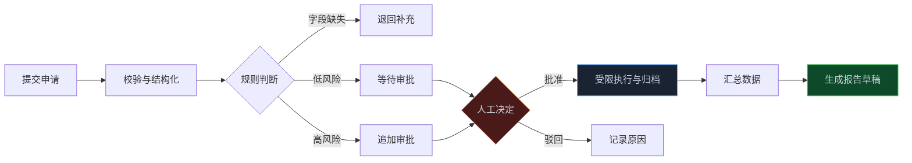
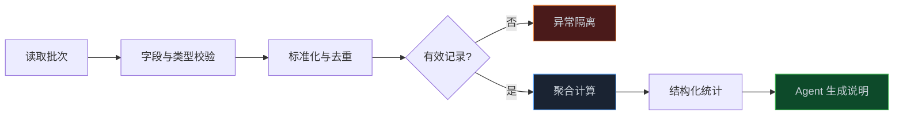

> **📖 系列说明**：前一篇把 Agent 的安全边界收紧了。这一篇开始让它进业务流程：从一张申请表出发，处理审批、数据整理和报告生成。重点不是做一个会聊天的机器人，而是搭出一条能留痕、能中断、也能恢复的流程。
> **🎁 读完你会得到**：一套拆分业务流程的方法；一个可追溯的审批状态机；数据处理和报告生成的职责边界；以及把它们放进 dsh 时必须补上的权限、审计和异常恢复设计。

有些公司里的流程，表面上很简单。

员工填一张活动申请表，运营核一下预算，负责人点个同意；月底再从几份 Excel 里抄数据，写成周报，发到群里。

真正做过的人都知道，麻烦不在某一步，而在这些小事连起来之后：申请漏了字段，金额写成了字符串，审批人出差，脚本重跑了一次，报告里的数字和表格对不上。

这时候把 Agent 接进来，最危险的想法是："让它自己处理完。"

业务自动化不是把决定权交给模型。它应该把人从重复劳动里抽出来，同时把关键决定留在规则和人手里。

<!-- more -->

---

## 自动化之前，先分清谁该做决定

先拿一个常见的活动申请流程举例。申请人填写活动名称、预算、日期和说明；系统检查字段，识别申请理由，按金额和部门找到审批人；审批通过后写入执行清单；每天晚上汇总成一份进度报告。

把它画出来，大概是这样：



这条链路里，Agent 很有用，但它并不该包办一切。

| 环节 | 更合适的执行者 | 原因 |
|---|---|---|
| 必填字段、金额阈值、审批人路由 | 代码和业务规则 | 结果必须稳定、可测试 |
| 申请说明提炼、材料分类、异常原因归纳 | Agent | 这里有大量非结构化文字 |
| 最终批准、付款、对外发送、删除数据 | 人工审批 + 受限工具 | 有不可逆的业务后果 |
| 统计、去重、金额求和 | 代码 | 不能让模型"估算"数字 |
| 报告标题、摘要、风险说明 | Agent | 把已算清的事实讲成人话 |

一个简单判断法：**如果同样输入必须得到同样结果，就别让模型做最终裁判。**

模型可以告诉你"这份申请看起来像一次线下活动，预算说明里缺少场地报价"。但"预算是否超过 5 万"、"需要谁批准"、"能不能写入财务系统"，应该由明确规则决定。

这并不限制 Agent，反而让它更容易用好。它不再背着不该背的责任，专心处理人最耗时间、规则又写不全的那部分。

---

## 审批流不是一条消息，是一个状态机

很多审批 Agent 的第一版都长这样：模型读完申请，调用 `approve`，流程结束。

问题是，真实审批不会这么直。申请会被退回补材料，会被拒绝，也会在执行时报错。没有状态，系统只能靠聊天记录猜现在进行到哪里；一旦会话中断，谁也说不清该不该重跑。

先把状态写出来。别急着写提示词。

```text
draft → submitted → validating → pending_approval
      ↘ returned ──────────────────────────┘

pending_approval → approved → executing → completed
                 ↘ rejected
executing → failed → retrying / 人工接管
```

一条申请至少要保存这些信息：

```typescript
interface RequestRecord {
  id: string
  type: 'event'
  applicantId: string
  rawInput: string
  payload: {
    title: string
    budgetCents: number
    eventDate: string
    reason: string
  }
  status: 'draft' | 'submitted' | 'validating' | 'returned'
    | 'pending_approval' | 'approved' | 'rejected'
    | 'executing' | 'completed' | 'failed'
  approverId?: string
  decision?: 'approved' | 'rejected' | 'returned'
  decisionComment?: string
  batchId?: string
  createdAt: string
  updatedAt: string
}
```

这里有两个看似不起眼的点。

`rawInput` 要保留。后面有人质疑"这个字段是谁改的"，你得能回到原始申请，而不是只留下 Agent 提取后的结果。

金额不要存成 `50000.00` 这样的浮点数，存最小货币单位更稳，比如 `budgetCents: 5000000`。报表里再格式化成人能读的金额。业务系统最怕的是算着算着多出一分钱。

在 dsh 里，面向模型的能力通过 `ctx.tools` 注册。Agent 最好只拿到它当前状态真正需要的工具。例如，申请尚未批准时，它能创建草稿、提交、查询状态，却没有执行付款或写入正式系统的能力。

```typescript
import type { Context } from '@deepseek-ai/cordis'

export const name = 'approval-tools'
export const inject = ['tools']

export function apply(ctx: Context) {
  ctx.tools.register({
    name: 'submit_event_request',
    description: '提交活动申请。信息不完整时返回缺失字段，不会绕过审批。',
    parameters: {
      type: 'object',
      properties: {
        title: { type: 'string', description: '活动名称' },
        budgetCents: { type: 'integer', description: '预算，单位为分' },
        eventDate: { type: 'string', description: '活动日期，格式 YYYY-MM-DD' },
        reason: { type: 'string', description: '申请理由' },
      },
      required: ['title', 'budgetCents', 'eventDate', 'reason'],
    },
    async execute(input) {
      const validation = validateRequest(input)
      if (!validation.valid) {
        return {
          accepted: false,
          missingFields: validation.missingFields,
          message: '申请尚未提交，请补充缺失信息。',
        }
      }

      const request = await createPendingRequest(input)
      return {
        accepted: true,
        requestId: request.id,
        status: request.status,
        message: '申请已提交，正在等待审批。',
      }
    },
  })
}
```

上面代码有意没有注册 `approve_request` 给普通 Agent。批准或驳回应当来自审批工作台、受控的管理员工具，或已有的企业审批系统。模型可以解释申请、提醒审批人、查询结果，但不该给自己盖章。

如果确实要做"低金额自动通过"，也别把判断写在提示词里。把阈值、部门和时间条件放在版本化的规则配置中，并记录命中的规则版本。这样政策改了，旧申请为什么通过，仍然查得出来。

---

## 让 Agent 读懂申请，让规则决定去向

申请人写的内容往往很乱："下周想做个客户交流会，大概三万多，场地还在问，麻烦先走一下。"

这正是 Agent 的工作。它可以抽取可能的日期、预算和缺失材料，输出一个结构化草稿；不过，草稿只是草稿。

一个比较稳的做法是把两个阶段分开：

```text
原始说明
  → Agent 提取候选字段
  → 代码校验格式、范围和必填项
  → 业务规则计算审批链
  → 创建待审批记录
```

模型输出建议用结构化格式，但接收端仍要校验。比如金额必须是非负整数，日期必须能解析，申请人身份必须来自登录态，而不是模型从对话里猜出来。

当审批人做出决定，这个决定也应该成为一条可追溯的事实。dsh 的会话日志遵循"模型可见即已记录"的原则；对业务流程而言，还应把申请 ID、审批决定、操作者和执行结果写进独立的业务审计记录。会话记录告诉你 Agent 看到了什么，业务审计记录告诉你一笔申请后来发生了什么。两者别混为一谈。

| 需要追溯的问题 | 应该查哪里 |
|---|---|
| Agent 为什么建议补充场地报价 | 会话轨迹、工具输入输出 |
| 谁在什么时间批准了申请 | 业务审批记录 |
| 批准后向哪个系统写入了什么 | 工具审计日志、执行结果 |
| 为什么某次重跑没有重复创建记录 | 批次记录、幂等键 |

这层区分在事故发生时特别重要。否则你会拿着一大段聊天记录，还是无法回答审计最关心的问题：谁批准了，系统究竟执行了没有。

---

## 数据处理：让代码算数，让 Agent 解释

审批处理到一半，通常就会碰到数据问题。有人从 CRM 导出 CSV，有人从表单系统拿 JSON，字段名不统一，日期格式也五花八门。

别把整份原始表格直接塞给模型，让它"整理一下"。数据量一大，成本和上下文都撑不住；更关键的是，统计结果无法稳定复现。

把数据管道拆成几步：



前六步都应该由确定性代码完成。Agent 接触的是最后的结构化统计，以及经过脱敏、筛选后的异常摘要。

```typescript
interface BatchSummary {
  batchId: string
  period: { from: string; to: string }
  total: number
  approved: number
  rejected: number
  pending: number
  totalBudgetCents: number
  invalidRows: Array<{
    row: number
    code: 'invalid_date' | 'invalid_budget' | 'duplicate'
  }>
}

function summarizeRequests(rows: unknown[], batchId: string): BatchSummary {
  const validRows = []
  const invalidRows = []
  const seen = new Set<string>()

  for (const [index, row] of rows.entries()) {
    const normalized = normalizeRequest(row)
    if (!normalized.valid) {
      invalidRows.push({ row: index + 1, code: normalized.code })
      continue
    }
    if (seen.has(normalized.idempotencyKey)) {
      invalidRows.push({ row: index + 1, code: 'duplicate' })
      continue
    }
    seen.add(normalized.idempotencyKey)
    validRows.push(normalized.value)
  }

  return buildSummary(validRows, invalidRows, batchId)
}
```

这里最值得保留的是 `batchId` 和 `idempotencyKey`。

`batchId` 是一次运行的编号。每天定时跑、手动补跑、失败后重试，都应该有不同批次。看到一份报告时，你才能知道它来自哪次处理。

`idempotencyKey` 则解决"重复执行"。一个简单实现可以由来源系统 ID、记录更新时间和处理类型拼出来。相同键已经成功处理过，就不再写一次；否则定时任务超时重试，很容易把同一笔审批反复推给人，或者重复写进业务系统。

还有一个常被忽略的原则：**坏数据应该隔离，不应拖垮整批任务。**

第 18 行日期不合法，正确结果不是让 5 万条记录都失败，而是处理其余有效记录，单独输出异常清单。Agent 可以把异常原因归纳成一句话，提醒运营补数据；但"这行是否合格"依然由校验函数说了算。

---

## 报告生成：数字是事实，文字才交给模型

日报、周报、月报是最容易被 AI 改造的环节，也是最容易悄悄出错的环节。

模型很会把一堆信息写得像模像样。可只要它把 23 写成 32，报告再流畅也没有价值。

所以报告最好分为两层：

- **事实层**：程序聚合出的 JSON，包含统计周期、口径、数字、数据来源和异常数。
- **表达层**：Agent 根据这份 JSON 写摘要、风险提示和待跟进事项。

给 Agent 的输入可以长这样：

```json
{
  "period": "2026-08-17 至 2026-08-23",
  "source": "event_request_daily",
  "submitted": 42,
  "approved": 31,
  "rejected": 4,
  "pending": 7,
  "totalBudgetCents": 18650000,
  "invalidRowCount": 3,
  "rules": [
    "不得改写统计数字",
    "数据缺失时说明未统计到，不得猜测",
    "所有结论必须引用输入字段"
  ]
}
```

模型拿到的是事实，不是原始数据库。它可以写出这样的内容：

> 本周收到 42 份活动申请，其中 31 份已批准，7 份仍待处理。待处理申请主要集中在场地报价和预算明细缺失；数据导入发现 3 条异常记录，已隔离待补充。

数字不是模型算的，模型只是把数字组织成读者看得懂的话。

如果报告要进入正式邮件、飞书群或客户系统，再加一道预览或审批。内部日报可能允许自动发送；对外口径、财务金额、涉及客户的信息，最好把 "生成草稿" 和 "正式发送" 做成两个独立动作。这样即便 Agent 的措辞不够妥当，也不会直接流出去。

报告模板也值得版本化。不要每周临时换一段提示词。模板 ID、统计口径和数据批次一起写入记录，三个月后有人问"为什么那周的通过率算法不一样"，你还有地方可查。

---

## 把第 08 篇的安全边界带进流程

上一章讲的沙箱、审批策略、最小权限和审计日志，在业务自动化里不能只停在口号上。

可以按角色拆几个 preset：

| Agent | 能做什么 | 不该拥有的权限 |
|---|---|---|
| 数据分析 Agent | 读取脱敏数据、运行聚合、输出异常清单 | 写正式业务表、调用外部网络 |
| 报告 Agent | 读取汇总 JSON、写报告草稿目录 | 修改统计数据、直接对外发送 |
| 流程协调 Agent | 创建申请、查询状态、提醒审批人 | 批准申请、执行付款、删除记录 |
| 执行 Agent | 在已批准的范围内调用受限业务接口 | 读取无关部门数据、扩大执行范围 |

工具调用前后依旧要走 `tools/pre-execute` 和 `tools/post-execute`。前者适合检查申请是否真的处于 `approved` 状态、目标系统是否在白名单、当前操作者是否有角色；后者记录结果、耗时和错误摘要。

在 headless 定时任务里，别把"没人点审批"理解成"全部放行"。更稳的策略是：只读、聚合、写草稿可以自动运行；涉及写入正式系统、发消息、改权限的动作，在没有明确放行规则时自动拒绝并通知负责人。

审计日志至少应带上这些字段：

```text
时间戳、会话 ID、申请 ID、批次 ID、操作者、工具名、审批决定、执行结果、错误摘要
```

参数要脱敏。比如身份证号、手机号、访问令牌，不应该为了"方便排查"完整写进日志。能用摘要和关联 ID 定位的，就别留下原文。

---

## 定时任务最怕的不是失败，是悄悄失败

流程一旦开始按天或按周运行，问题就从"能不能跑"变成"出了问题谁知道"。

建议给每次运行留下一个运行记录：开始时间、结束时间、批次 ID、处理数量、成功数量、异常数量、报告位置和最终状态。失败时保留失败点和可重试信息，别只留一句 `something went wrong`。

```text
scheduled → running → succeeded
                    ↘ partial_failed → retrying
                    ↘ failed → needs_human
```

重试不是简单再跑一次。写入类动作要先查幂等键；无法确认上次是否成功的外部调用，要进入人工核对，而不是盲目补发。尤其是发邮件、创建工单、扣费、更新库存，这些场景重复一次就可能造成业务事故。

通知也要克制。告警消息告诉负责人"批次 B20260823-01 有 3 条数据异常，报告未发送"就够了。敏感客户信息、完整附件和内部错误栈，不该直接出现在群里。

说到底，自动化跑得越久，越不能靠人每天盯着。可观测、幂等和人工接管入口，都是它能长期运行的前提。

---

## 上线前，拿这张清单过一遍

**业务与数据**

- [ ] 每个状态的进入条件、离开条件和负责人都已明确
- [ ] 金额、日期、权限、审批链等关键判断由代码和规则执行
- [ ] 输入有字段校验、类型转换、去重和异常隔离
- [ ] 每次运行都有批次 ID，重跑不会产生重复业务记录

**审批与权限**

- [ ] Agent 不能绕过审批直接执行高风险操作
- [ ] 批准、驳回、退回补充都有明确记录
- [ ] 不同 Agent 使用不同 preset，权限只给到完成任务所需范围
- [ ] headless 场景对自动放行和自动拒绝有书面规则

**报告与运行**

- [ ] 报告数字来自结构化统计，模型不能自行改写
- [ ] 报告记录统计周期、数据来源、批次 ID 和模板版本
- [ ] 对外发送、正式写入前有预览或人工确认
- [ ] 失败任务可重试、可查询，也能转人工接管
- [ ] 工具调用、审批决定和执行结果都可按申请 ID 追溯

别一上来就改造整个公司流程。挑一个高频、规则相对清楚、结果容易量化的环节先跑通，比如每周活动申请汇总或客户资料导入。把异常收集一两周，再决定哪些步骤适合继续自动化。这样风险小，也更容易证明它到底省了多少时间。

---

## 📝 小结

- 业务流程自动化不是让 Agent 自己做主，而是让它处理非结构化信息，把确定性决定留给代码、规则和人
- 审批流要先建状态机，再接 Agent；申请、决定、执行和失败都要留下可追溯记录
- 数据处理应分成校验、标准化、去重、异常隔离和聚合，模型只读处理后的结果
- 报告遵循"先算清楚，再写成人话"：数字来自事实层，Agent 负责表达层
- 批次 ID 与幂等键能避免定时重跑造成重复写入，是长期运行的基础
- 第 08 篇的沙箱、审批、最小权限和审计日志，必须原样带进业务流程

---

## 🔮 下一篇预告

通用的审批、数据处理和报告能力搭好之后，下一步看一个离用户更近的场景：智能客服。

它不只是"能回答问题"。知识库从哪里来、多轮对话怎么记、什么时候必须转人工、怎样避免模型编造政策，才决定它能不能真正上线。

下一篇，我们从 0 搭一个能上线的智能客服系统。

---

> 📚 **系列导航**
> - 第 01 篇：凭什么说它是下一代 Agent 框架？
> - 第 02 篇：10 分钟跑起来：从安装到第一个任务
> - 第 03 篇：插件开发入门：从 Hello World 到真正有用的插件
> - 第 04 篇：工具开发实战：给 Agent 装上你自己的工具
> - 第 05 篇：架构深度解析：一条消息进来，dsh 内部发生了什么
> - 第 06 篇：多 Agent 协作：子代理、工作流与 Teams
> - 第 07 篇：研发场景落地：CI 集成、代码审查与测试分析
> - 第 08 篇：安全与权限：让 Agent 在可控边界内工作
> - **第 09 篇：业务流程自动化：审批流、数据处理与报告生成** ⬅️ 你在这里
> - 第 10 篇：中小企业实战（一）：从 0 搭一个能上线的智能客服系统
> - 第 11 篇：中小企业实战（二）：内部知识库问答 Agent，让文档真正被用起来
> - 第 12 篇：中小企业实战（三）：销售流程自动化，报价跟进周报一键搞定
