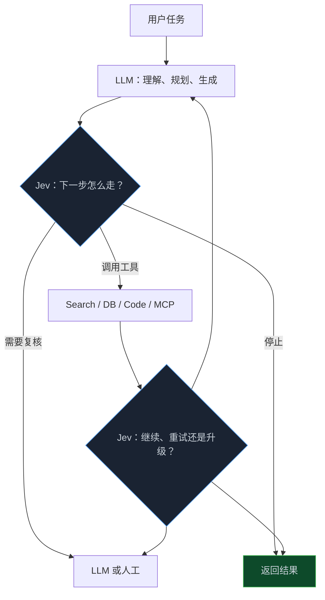

> **📖 系列难度说明**：本篇为**入门导读**。没有写过 Agent 也能读；已经在做 LLM 应用的读者，可以重点看决策层、概率校准和边界部分。
> **🎁 核心收获**：读完你会知道 Jev 解决的到底是什么问题、它与 LLM/规则/人工分别如何分工，以及后续该从哪一篇开始读。

一个 Agent 收到用户请求后，先让 LLM 判断要不要搜资料；搜完后，再让 LLM 判断该调用哪个工具；工具报错了，又让 LLM 判断重试、换路还是停下。

这些判断通常不需要一段漂亮解释。程序真正想要的，只是：`search`、`retry`、`stop`，或者“转人工”。

如果软件需要的是决策，为什么还要先让模型生成一段文字？

Jev 想解决的，就是这层问题：不负责写内容，而是在有限的动作空间里，给软件一个带概率的结构化判断。

<!-- more -->

---

## Jev 是什么：先别把它和杰文斯悖论混在一起

这里先把一个容易绕进去的名字说清楚。

本系列谈的 **Jev**，是 TypeSafe AI 推出的决策模型，官方称它为 **System One Model**。它的工作方式不是聊天，而是接收上下文和预先定义好的问题，返回软件可直接使用的选择、分数或真伪判断，并附上概率与置信度。

```text
用户消息、任务状态、工具结果
              ↓
             Jev
              ↓
选择 / 分数 / 真伪 + 概率
              ↓
          软件控制流
```

比如客服系统看到“上个月重复扣费，退款一直没到账”，真正需要的可能不是一段安抚用户的话，而是：该交给账单组、技术组、销售组还是风控组。写回复的工作可以交给 LLM；把工单送到哪里，则是一个受限的决策问题。

还有一个很像的词：**Jevons Paradox（杰文斯悖论）**。它来自经济学，讲的是“单位成本下降，使用规模反而可能上升”。TypeSafe 用 Jev 这个名字，也确实借用了这层含义。不过，模型本身和经济学概念不是一回事。后面讲到成本、Agent 调用量和基础设施时，我们会再回到这个话题。

> 💡 **来源**：[TypeSafe 发布文章](https://typesafe.ai/blog/introducing-system-one-models-and-jev) — Jev 被定义为面向软件的类型化概率决策模型；[IEEE Micro 对杰文斯悖论的讨论](https://ieeexplore.ieee.org/abstract/document/10989062) — 解释效率提升为何不必然降低总资源需求。

---

## 从“生成字符串”到“做类型化决策”

大语言模型最擅长的事情，是根据上下文继续生成 token。你问它“下一步该怎么办”，它可以给出很聪明的回答，也可以按 JSON 格式输出。可程序接到之后，仍然要面对几个问题：字符串能不能解析？字段是否合法？模型是不是凭空写了一个不存在的工具名？这次的“我很确定”到底能不能信？

Jev 的思路是把问题倒过来：先由程序声明允许的结果，再让模型在这个范围里判断。

```text
传统 LLM
上下文 → 生成文字 / JSON → 解析与校验 → 执行

Jev
上下文 + 候选决策 → 选择与概率 → 执行
```

看起来只是少了几步，工程含义却不一样。前者的重点是“模型说了什么”；后者的重点是“程序允许模型做哪些选择”。

| 你要解决的问题 | 更自然的方式 |
|---|---|
| 写邮件、总结文档、解释原因、生成代码 | LLM 生成文本 |
| 客服该路由到哪里 | 决策模型或分类器 |
| Agent 下一步选哪个工具 | 决策模型或规则 |
| 某项政策是否满足 | 决策模型 + 业务校验 |
| 金额、权限、硬性合规条件 | 普通代码和明确规则 |

这不是“Jev 比 LLM 强”或“LLM 已经过时”。它更像一次职责拆分：LLM 负责开放式理解、推理和表达；决策模型负责把受限判断交给程序。规则足够清楚时，甚至不该调用 AI，直接写代码就行。

对于刚入门的读者，先记住一句话就够了：**Jev 不是更小的 ChatGPT，而是试图成为软件里的智能分支。**

---

## Jev 在 Agent 和工作流里应该放在哪

一个能做事的 Agent，通常不只有一个模型。它需要理解目标、规划步骤、调用工具、读取结果、判断是否继续，还要在风险高时停下来。

把这些都压到同一个 LLM 上，当然可以跑起来。但很多步骤其实是“是不是”“选哪一个”“要不要再试一次”。它们频率高、结果受限，而且往往不值得等待一整段自然语言生成。

Jev 比较适合嵌在这些路口：



落到实际系统里，常见位置有这些：

- 用户意图识别和工单路由；
- 选择搜索、数据库、代码执行等工具；
- 判断工作流该继续、重试、暂停还是结束；
- 对 LLM 结果打分，决定是否需要复核；
- 根据风险和不确定性决定自动执行还是人工升级。

你可以把它想成一个带模糊判断能力的 `if`。普通 `if` 要求条件写得极其明确；Jev 处理的是“文本里看起来像重复扣费”“这次工具失败是否值得重试”这类难以完全穷举、但候选动作有限的问题。

> 💡 **来源**：[Vercel 对 Jev 的介绍](https://vercel.com/blog/ai-gateway-jev-model-launch) — 列举了工具选择、重试/停止、风险评分、输出验证等软件内决策场景；[iajev Playground](https://iajev.com/) — 展示工单路由、意图识别、工具选择等可交互示例。

---

## 概率不是装饰：它决定系统怎样对待不确定性

假设模型只返回一句“交给账单组”。程序其实还缺一个关键信息：它到底有多大把握？

Jev 的产品主张之一，就是每个判断都有概率或置信度。这样，软件不必把模型输出当作绝对命令，而是可以把不确定性写进控制流。

```python
if confidence >= 0.90:
    route_to_billing()
elif confidence >= 0.70:
    request_more_context()
else:
    escalate_to_human()
```

这个模式对新手很好理解：把“AI 猜一下”改成“AI 给建议，程序按把握大小处理”。对做过生产系统的人，重点会更进一步：阈值不能凭感觉拍；不同错误的代价不同；每次升级、重试和人工审核都要被记录，之后才能回看策略是否真的有用。

更深一层是 **概率校准（calibration）**。模型说 90% 的时候，在足够多的同类样本里，正确率是否真的接近 90%？只有接近，0.9 这个阈值才有工程意义。一个准确率很高、但总在错的时候自信满满的模型，反而可能比普通分类器更危险。

TypeSafe 将其训练目标称为 RLCD（Reinforcement Learning for Calibrated Decisions）。这是厂商对产品方向的描述；校准究竟做到什么程度，仍需在具体业务数据和独立评测里验证。

---

## 先把边界画清：类型安全不等于决策正确

Jev 的宣传中有“不能幻觉”之类的说法。更准确的翻译是：如果调用前已经限定 Schema、候选项和输出类型，它不会突然给你一个候选集合外的工具名，也不会把枚举字段写成不合法的格式。

这个保证很实用，但范围很窄。

```text
候选项：账单组 / 技术组 / 销售组 / 风控组

类型安全保证：结果一定在这四项之内
不保证：模型一定选对其中那一项
```

所以生产系统仍要保留业务规则、状态校验、权限边界、回滚机制和人工兜底。尤其涉及资金、账号权限、安全处置、医疗或法律判断时，模型只能参与建议或分流，不能悄悄变成最后的责任主体。

性能数字也一样要带着前提读。TypeSafe 在自家工作流评测中报告过大幅速度和成本优势，但这些结论来自特定任务、特定接口包装和厂商评测设置。真正要问的是：在**你的**候选动作、你的数据分布、你的延迟要求和你的失败成本下，它是否比规则、传统分类器、JSON Mode 或一次普通 LLM 调用更合适。

这也是本系列的基调：不把 Jev 当成万能答案，而是把它作为一个值得严肃测试的新组件。

> 💡 **来源**：[Learn Jev 对概念与主张的拆解](https://learnjev.com/concepts) — 区分类型约束、实测结果与尚未公开的实现细节；[RL Research 的独立分析](https://www.rlresearch.ai/blog/is-jev-an-llm/) — 提醒类型安全和置信度都不能替代任务完成率与真实结果验证。

---

## 这个系列会教你什么

Jev 不是一个单独的 API 技巧。真正把它放进系统，需要理解决策接口、概率策略、Agent 路由、评测和成本边界。这个系列会沿着这条线往下走。


| 篇号 | 核心问题 | 你能获得什么 |
|---|---|---|
| 01 | Jev 到底是什么 | 建立模型、LLM、规则与人工的分工视角 |
| 02 | 它怎么表达一个决策 | 理解 Choice、Score、真伪判断与接口边界 |
| 03 | 概率怎么落到代码里 | 设计阈值、复核、升级和审计策略 |
| 04 | Agent 的哪些地方值得接入 | 工具路由、工作流分支、输出验证的架构方法 |
| 05 | 怎么知道它真的有用 | 评测集、校准曲线、任务完成率与失败归因 |
| 06 | 更快更便宜以后怎么办 | 成本反弹、AI FinOps 和技术选型清单 |

### 你适合从哪篇开始读？

| 你的情况 | 建议读法 |
|---|---|
| 刚接触 AI Agent，想先理解全貌 | 从第 01 篇顺序读 |
| 已在做客服、分类或路由 | 第 01、02、03 篇 |
| 正在做 Agent 工具调用或多步骤工作流 | 第 01、03、04 篇 |
| 需要验证供应商性能或准备上线 | 直接看第 05 篇 |
| 负责预算、平台或技术选型 | 第 01、05、06 篇 |

---

## 📝 小结

- Jev 是面向软件内受限决策的模型：输入上下文和候选结果，输出选择、分数或真伪判断，并给出概率。
- 它不替代 LLM；更合适的分工是 LLM 负责理解和生成，Jev 负责路由、分支、评分与升级判断，硬规则继续由代码承担。
- 概率的价值在于让系统按不确定性分层处理，但置信度只有经过业务数据校准后才值得信任。
- 类型安全保证输出形态受约束，不保证决策本身正确；高风险动作仍需要验证与人工兜底。
- 这个系列会从决策接口一路讲到 Agent 集成、评测、成本和治理，重点始终是：它在你的系统里是否真的划算、可靠且可控。

---

## 🔮 下一篇预告

Jev 说自己不生成字符串，而是返回 Choice、Score 和真伪判断。

可这三种结果究竟长什么样？一个 API 中的“类型化决策”，和 LLM 的 JSON Mode 到底差在哪？下一篇我们把输入、候选项、输出和最容易踩的边界逐个拆开。

---

> 📚 **系列导航**
> - **第 01 篇：不生成文字，AI 怎样直接为软件做决策？** ⬅️ 你在这里
> - 第 02 篇：Jev 的 Choice、Score 与真伪判断：决策接口到底怎么设计？
> - 第 03 篇：把概率接进控制流：自动执行、复核还是升级人工？
> - 第 04 篇：Jev 放进 Agent：工具路由、工作流分支与输出验证
> - 第 05 篇：别被“更快更便宜”带偏：怎样评测 Jev 的真实收益？
> - 第 06 篇：Jev 决策模型选型与治理：成本、边界和落地清单
