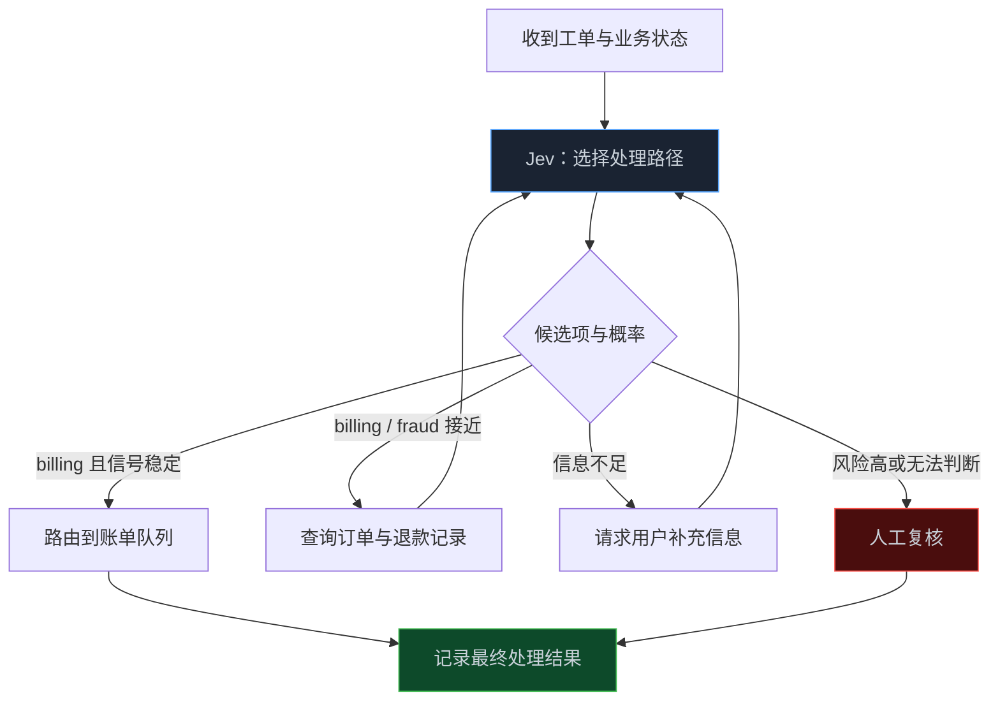

> **📖 系列难度说明**：本篇为**进阶实战**。看过上一章的 Choice、Score、Noul 就能读；做过生产系统的读者，可以重点看阈值设计、校准验证、熔断和审计。
> **🎁 核心收获**：读完你能把模型的概率变成一套可解释的执行策略，而不是在代码里随手写下一个 `0.9`。

先看一段最普通的 LLM 对话流。

```text
用户：我的订阅上个月被扣了两次钱，退款还没有到账。

LLM：我理解你遇到了重复扣费和退款延迟的问题，建议联系账单团队处理……
```

这段回答读起来没问题，但程序真正要执行的动作只有一个：**把工单转给谁？**

接上 Jev 后，同一段用户消息会变成这样：

```text
用户消息
   ↓
Jev：billing = 0.82
   ↓
程序：接下来怎么办？
```

答案不是“Jev 说是账单组，那就直接转单”。`0.82` 只是一个信号。程序还要判断：这是低风险路由吗？订单记录是否齐全？第二个候选项离它有多远？如果转错，能不能轻易改回来？

所以一个更接近真实系统的流程是：

```text
Jev 选择 billing，概率 0.82
   ↓
订单与退款状态完整吗？
   ├─ 否：补查记录或询问用户
   └─ 是：这次路由的错误代价高吗？
           ├─ 低：转给账单组
           └─ 高：交给 LLM 复核或人工审核
```

很多系统会把上面的判断压缩成一行：

```python
if confidence > 0.9:
    execute()
else:
    human_review()
```

代码很短，责任却被藏起来了。`0.9` 从哪里来的？转错一次的损失有多大？模型说 90% 时，现实里真有 90% 的正确率吗？如果今天的数据分布变了，这条线还成立吗？

这一篇要讲的，就是 Jev 返回某个选择和概率以后，程序该怎么继续走：什么时候自动执行，什么时候补证据，什么时候交给 LLM 复核，什么时候必须升级人工。

<!-- more -->

---

## 先别急着相信 0.82

上一章里，我们把一次 Jev 调用写成了“上下文 + 问题 + 候选项”。模型返回结果时，通常不只是一个选择，还会带概率分布或置信度信号。

```text
billing       0.82
fraud         0.10
technical     0.05
human_review  0.03
```

初看很直观：`billing` 的 82% 最高，似乎该直接路由。但这里至少混着三件不同的事。

**第一，它选的是谁。** 这只是当前候选项中的第一名。

**第二，它领先多少。** 如果第二名是 0.80，第一名 0.82 并不稳；如果第二名只有 0.10，含义就不同。单看最高分，容易忽略这种差距。

**第三，这个概率是否可信。** 模型说 82%，不等于历史上所有报 82% 的案例有约 82% 是对的。只有经过校准验证，这个数字才有资格参与自动化策略。

可以把它记成一句不太严谨、但很实用的话：

```text
选择 = 它想让你做什么
概率差距 = 它在候选项间有多犹豫
校准 = 它的把握值能不能信
```

对小任务来说，第一项足够。可一旦选择会触发退款、账号处置、内容下架或关键业务动作，后两项就不能缺席。

> 💡 **来源**：[TypeSafe 发布文章](https://typesafe.ai/blog/introducing-system-one-models-and-jev) — 将概率与置信度作为结构化决策输出的一部分；[Learn Jev 对校准的说明](https://learnjev.com/concepts) — 强调置信度只有与长期实际正确率匹配时，才适合进入自动化策略。

---

## 一条概率该走哪条路，不由概率单独决定

“高概率自动执行，低概率转人工”是一个不错的起点，但不够完整。因为同样是 82%，不同动作的错误代价天差地别。

把低优先级客服工单错分一次，通常只是多花一点处理时间；把不符合条件的退款直接放行，可能造成资金损失；把安全告警忽略掉，后果更大。概率没有变，策略必须变。

更可靠的思考方式是同时看三件事：

```text
模型信号：选择、概率、与第二名的差距
动作风险：做错后会造成什么损失，能否回滚
业务证据：关键事实是否由可信系统确认
```

这会自然得到一张比“0.9 阈值”更有用的表：

| 当前情况 | 更合适的下一步 |
|---|---|
| 低风险，概率高，事实完整 | 自动执行 |
| 低风险，概率接近，缺少少量信息 | 向用户补问或调用一个确定性查询 |
| 中风险，概率高，但需要解释或交叉检查 | 交给 LLM 或第二个判断器复核 |
| 高风险，即使概率很高 | 走业务规则与人工审批 |
| 模型输出异常、候选项冲突或系统状态不完整 | 拒绝执行，进入安全兜底 |

这里有个容易反直觉的点：**高置信度不一定意味着能自动执行。**

例如模型对“用户希望注销账号”的判断有 99% 把握，也不代表系统可以直接注销。是否执行还要看身份验证、冷静期、数据保留策略和权限。模型只能帮你理解意图，不能跳过系统本该存在的硬约束。

---

## 从一个客服路由，走一遍完整控制流

先用一个风险比较低的例子把逻辑走通。用户提交了重复扣费问题，系统要决定路由、补充信息还是交给人工。



注意图里没有“低于阈值就失败”。模型不确定时，系统可以**获取更好的证据**，而不是硬着头皮执行或立即把所有事情塞给人工。

比如 `billing` 和 `fraud` 的概率接近，下一步就不该继续猜，而应查询：这笔订单是否真的出现重复扣款？退款是否已经发起？账号是否有异常登录？这些是数据库能够给出的确定事实。查完以后，带着新状态再做一次决策，或者直接交给已有的规则。

这就是决策模型在工作流中的正确姿势：它负责指出“当前最值得走哪条信息路径”，而不是替代所有事实来源。

---

## 先定义策略，再把策略写成代码

阈值最好不是散落在业务代码里的魔法数字。先把策略写清楚，再让代码实现策略。

下面的例子没有绑定具体 Jev SDK，重点是把风险、概率和证据状态拆开：

```ts
type Action = "route_billing" | "ask_for_evidence" | "review_by_llm" | "human_review";

type DecisionSignal = {
  choice: "billing" | "fraud" | "technical" | "human_review";
  probability: number;
  runnerUpProbability: number;
};

type CaseState = {
  refundStatus: "none" | "pending" | "completed" | "unknown";
  hasVerifiedOrder: boolean;
  actionRisk: "low" | "medium" | "high";
};

function chooseNextAction(signal: DecisionSignal, state: CaseState): Action {
  const margin = signal.probability - signal.runnerUpProbability;

  if (!state.hasVerifiedOrder || state.refundStatus === "unknown") {
    return "ask_for_evidence";
  }

  if (state.actionRisk === "high") {
    return "human_review";
  }

  if (signal.choice === "billing" && signal.probability >= 0.85 && margin >= 0.25) {
    return "route_billing";
  }

  if (signal.probability >= 0.65) {
    return "review_by_llm";
  }

  return "human_review";
}
```

这段代码有几个值得保留的设计。

**先查硬条件。** 订单是否存在、状态是否可信、权限是否满足，这些不能由概率盖过去。

**把概率和差距一起看。** `0.85` 如果第二名是 `0.84`，并不比 `0.66` 对 `0.10` 更适合自动执行。

**让中间区域有去处。** 不是“自动”就是“人工”两级，而是可以补证据、调用更擅长解释的 LLM、或走独立验证器。

**把动作风险显式写出来。** 这样当业务把某条路径从低风险改成高风险时，审核者能清楚看到自动化边界如何变化。

真实系统里，阈值通常还应按决策类型、用户群、地区、时间段或模型版本分开管理。重点不在把配置做得多复杂，而在于：每一个阈值都要能说清它保护了什么、代价是什么、由谁调整。

---

## 校准不是一张漂亮图，而是一笔长期账

假设系统把所有预测概率在 0.8 到 0.9 的路由单独取出来，过一段时间再看最终结果：其中有多少真的路由正确？

```text
模型报 80%~90% 的案例：1,000 条
最终处理正确：860 条
实际正确率：86%
```

这说明这一概率区间大致可信。反过来，如果只有 620 条正确，那么模型报出的把握明显偏高；把 `0.85` 当成自动执行线就很危险。

最基础的校准检查可以从分桶开始：

| 预测概率区间 | 样本数 | 实际正确率 | 观察 |
|---|---:|---:|---|
| 0.90~1.00 | 320 | 0.94 | 可继续观察 |
| 0.80~0.90 | 1,000 | 0.86 | 基本接近 |
| 0.70~0.80 | 1,400 | 0.63 | 偏高，需要收紧策略 |
| 低于 0.70 | 780 | 0.51 | 不应自动执行 |

这张表不要求一开始就做得像论文评测。哪怕先从一类低风险工单、几百条人工确认过的样本开始，也比“感觉 0.9 很安全”更可靠。

几个细节会决定这件事是否有用：

- **真值要独立。** 别用同一个模型给出的答案再评价同一个模型。
- **样本要覆盖边缘案例。** 只看简单样本，任何模型都会显得很自信。
- **按版本看。** 换模型、改候选项、改上下文，旧阈值不一定还能用。
- **按损失看。** 一个整体准确率不错的模型，可能恰好在高风险人群上表现很差。

TypeSafe 将 RLCD 描述为面向校准决策的训练方向，这解释了为什么概率是 Jev 的产品重点。但是否校准、在哪些业务上校准到什么程度，仍然只能由你的真实结果来回答。

> 💡 **来源**：[Learn Jev 对校准的说明](https://learnjev.com/concepts) — 指出高准确率不等于置信度可靠，校准需要按概率区间对照真实结果；[RL Research 的分析](https://www.rlresearch.ai/blog/is-jev-an-llm/) — 强调置信度并非正确性证书，评测应使用独立真值并覆盖误导性与缺失信息场景。

---

## 人工升级不是失败，是系统的一部分

不少团队把“转人工率”当作模型没做好。但在高代价领域，人工升级恰恰是系统诚实的表现。

真正该看的不是“人工比例越低越好”，而是这几个数字的组合：

```text
自动执行率：系统替你省下多少重复操作
自动执行准确率：放出去的动作是否可靠
人工升级命中率：送给人工的是否真是难例
错误逃逸率：本该拦住却自动放行了多少
处理时延与总成本：安全策略有没有把流程拖垮
```

如果人工升级率降低了，但错误逃逸率升高，系统并没有变好，只是把风险从人工队列推到了用户身上。

实际设计时，可以给人工队列附上“为什么升级”的结构化理由：概率不足、候选项差距太小、缺少关键证据、命中业务规则、模型输出异常。这样审核人员不必从头猜，也能反过来帮助团队找到最需要改进的决策接口。

人工不只是最后一道墙，还是系统的标注来源。经过审核的难例会成为下一轮校准、候选项调整和规则完善的高价值数据。

---

## 给自动化加上刹车：预算、权限与熔断

概率策略解决的是“这一单怎么走”，但生产系统还需要考虑“今天整个系统是不是该停一下”。

即使每次决策都正常，模型版本更新、上游数据异常、攻击输入或某个队列积压，也可能让错误在短时间内放大。至少应准备三类刹车：

| 刹车 | 它拦什么 | 一个简单做法 |
|---|---|---|
| 权限边界 | 模型越权执行 | 高风险动作必须经过业务授权和人工审批 |
| 预算边界 | 重试或 Agent 循环无限消耗 | 限制单任务调用次数、Token 和总金额 |
| 熔断边界 | 某类决策突然异常 | 错误率或人工升级率异常时，暂时关闭自动执行 |

例如，某个新模型版本上线后，`billing` 的自动路由错误率连续半小时明显升高。此时最稳妥的动作不是继续等待模型“自己恢复”，而是把该路径切到“全部复核”或“全部人工”，同时保留输入和版本信息排查。

这也是为什么前一篇反复强调版本与最终结果：没有决策日志，就没有可靠的熔断信号；没有可回滚的策略配置，就只能靠改代码救火。

---

## 📝 小结

- 概率不是自动执行许可；它至少要和候选项差距、动作风险、可信业务证据一起判断。
- 同一个 `0.82`，面对低风险工单和高风险资金动作，应该走不同策略。
- 比起只分“自动/人工”，更稳的工作流会加入补充信息、确定性查询和 LLM 复核等中间路径。
- 阈值应是可解释、可版本化的策略，而不是代码里的魔法数字。
- 校准要用长期、独立的最终结果验证；模型自报的置信度不是正确性证明。
- 人工升级、预算限制、权限控制和熔断，都不是自动化的对立面，而是让自动化能持续运行的条件。

---

## 🔮 下一篇预告

现在我们已经知道，Jev 适合放在“该走哪条路”的节点上，也知道概率如何决定自动、复核与人工升级。

下一篇把镜头拉远：一个 Agent 有搜索、数据库、代码、浏览器和多个子 Agent 时，Jev 具体该插在哪些路口？工具路由、工作流分支和 LLM 输出验证，又该怎样组合才不会把系统做成一团难以调试的黑盒？

---

> 📚 **系列导航**
> - 第 01 篇：不生成文字，AI 怎样直接为软件做决策？
> - 第 02 篇：Jev 的 Choice、Score 与真伪判断：决策接口到底怎么设计？
> - **第 03 篇：把概率接进控制流：自动执行、复核还是升级人工？** ⬅️ 你在这里
> - 第 04 篇：Jev 放进 Agent：工具路由、工作流分支与输出验证
> - 第 05 篇：别被“更快更便宜”带偏：怎样评测 Jev 的真实收益？
> - 第 06 篇：Jev 决策模型选型与治理：成本、边界和落地清单
