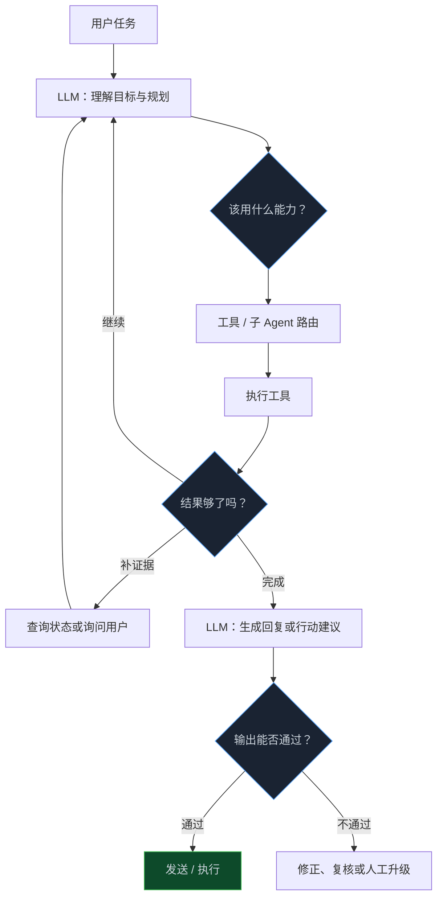
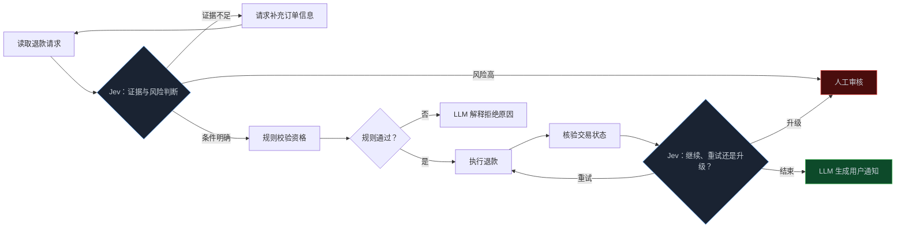

> **📖 系列难度说明**：本篇为**架构实战**。适合已经理解决策接口和概率策略、准备把它接进 Agent 或工作流的读者。
> **🎁 核心收获**：读完你能判断 Agent 的哪些路口适合用 Jev，如何让规则、LLM、决策模型和人工分工，以及怎样避免把一个可控工作流做成新的黑盒。

一个 Agent 有搜索、数据库、浏览器、代码执行、文件系统和好几个子 Agent。用户问一句话，它到底先调用哪个？工具失败后，是重试、换工具、补问，还是直接停？LLM 写完答案后，又该不该立刻发出去？

如果每个路口都让同一个 LLM 自己想一遍，系统能跑，但会越来越慢、越来越贵，也越来越难解释。

可如果把每个判断都交给 Jev，事情也不会变简单。它不负责规划，不知道怎么完成开放任务，更不该替代权限和业务规则。

关键不是“要不要用 Jev”，而是：**在 Agent 的哪几个路口，受限决策真的值得被拆出来。**

<!-- more -->

---

## 先看 Agent 里真正存在的三种路口

从用户视角看，一个 Agent 像是在连续思考；从系统视角看，它其实不停地来到岔路口。



图里的三个菱形，就是 Jev 最可能发挥作用的位置：

1. **工具或子 Agent 路由**：下一步该交给谁；
2. **工作流分支**：继续、重试、补证据、暂停还是停止；
3. **输出验证**：LLM 给出的内容或动作，是否满足已定义的条件。

它们有一个共同特点：候选动作是有限的，外层代码知道每个动作意味着什么，而且错误后有明确的下一步。这正是上一章讲“概率进入控制流”的落脚点。

反过来看，如果任务是“为新产品写一份有说服力的发布稿”“分析这段陌生代码的架构问题”，候选答案并不封闭，仍然应由 LLM 负责。Jev 不是 Agent 的大脑，更像是大脑旁边几个需要快速、稳定作答的岔路口。

---

## 第一处：工具路由，但别让模型决定所有权限

工具路由是最容易理解的用法。一个 Agent 接到任务后，候选能力可能是：搜索公网、查内部知识库、查数据库、运行代码、读取文件、问用户，或者转给某个专门子 Agent。

```text
用户：客户问“为什么本月账单比上个月高？”

候选能力：
- knowledge_base：查套餐与计费说明
- database：查该客户用量与账单状态
- web_search：查外部公开资料
- ask_user：补充账户信息
- human_review：升级人工
```

让 LLM 直接从所有工具中自由选择，灵活，但容易出现两个问题：它可能选到不该使用的工具，也可能为了做一个简单判断生成很长的中间解释。Jev 可以在**已经允许的候选集**里选下一步。

不过顺序不能颠倒。正确的结构是：

```text
权限与规则过滤
        ↓
Jev 在可用工具中路由
        ↓
执行工具
        ↓
记录结果与代价
```

例如，普通用户没有权限查询其他账户，即使模型认为数据库查询“最有帮助”，代码也不该把数据库工具放进候选集。权限、地域限制、数据分级、预算上限这些属于硬约束，必须由普通代码先处理。

下面这段示意代码刻意把“筛选候选集”和“模型选择”拆开：

```ts
type Tool = "knowledge_base" | "billing_db" | "web_search" | "ask_user" | "human_review";

type RequestContext = {
  userRole: "customer" | "support" | "admin";
  accountId?: string;
  hasConsent: boolean;
};

function availableTools(context: RequestContext): Tool[] {
  const tools: Tool[] = ["knowledge_base", "ask_user", "human_review"];

  if (context.userRole === "support" && context.accountId && context.hasConsent) {
    tools.push("billing_db");
  }

  return tools;
}

// Jev 只在 availableTools(context) 返回的候选项里做选择。
```

对新手来说，这叫“先列出能用的工具，再让 AI 选”；对做过权限系统的人，这意味着能力发现与授权决策必须分层。不要让一个概率模型替你补安全边界。

> 💡 **来源**：[Vercel 对 Jev 的介绍](https://vercel.com/blog/ai-gateway-jev-model-launch) — 将“选择 Agent 的下一项工具或子 Agent”列为典型使用位置；[iajev Playground](https://iajev.com/) — 提供 Agent 工具选择的交互范例。

---

## 第二处：把工作流从“模型循环”变成“有路标的循环”

Agent 工具调用失败后，最容易写成一段无边界的循环：LLM 看见错误，尝试一下；还不行，再尝试一下；最后不知道它是在认真修复还是在原地消耗 Token。

Jev 可以把这种模糊的“再想想”收敛成少数几个显式分支：

```text
continue       继续当前计划
retry          用相同动作再试一次
replan         回到 LLM，换一条计划
get_evidence   先查状态或补充信息
ask_user       向用户提问
escalate       升级人工或专门处理队列
stop           安全终止
```

这不是要把 Agent 变成死板的流程图。LLM 仍然可以在 `replan` 节点里做开放式规划；Jev 做的是给循环装上清楚的路牌，让每一次转向都可记录、可统计、可设上限。

以“自动退款助手”为例：



图里有个很重要的分工：**Jev 可以建议“下一步查什么”或“是否升级”，但退款资格必须由业务规则确认，退款完成必须由交易状态确认。**

这也解释了为什么工作流状态不能只存在 LLM 的对话历史里。订单号、已尝试次数、工具返回码、是否已通知用户、当前策略版本，都应该放在可读写、可审计的外部状态中。否则 Agent 换一次模型、压缩一次上下文，就可能忘掉自己已经退款过一次。

---

## 第三处：让 Jev 当守门人，但不要让它单独当法官

LLM 很会生成，也就意味着它可以生成看起来合理、实际却不满足业务要求的内容。比如客服回复声称“退款已经成功”，可数据库里根本没有退款记录；又或者代码 Agent 说“测试已经全部通过”，而它只跑了一个测试文件。

这类问题适合在输出前插入验证节点。

```text
LLM 输出
   ↓
提取待验证命题
   ↓
Jev 判断：是否有证据支持？是否触发风险？
   ↓
规则 / 数据库 / 工具进行最终核验
   ↓
通过、修正或升级
```

这里的关键是“提取待验证命题”。不要把一大段 LLM 回复原样交给另一个模型，然后问“这对吗？”那只是在做模糊的模型互审。

更可靠的方式，是把要验证的条件写成具体命题：

```text
命题 1：订单系统中存在退款成功记录。
命题 2：回复中的退款金额与订单金额一致。
命题 3：当前回复没有承诺超出客服权限的补偿。
```

其中命题 1 和 2 应由数据库、金额计算等确定性系统直接回答；Jev 更适合参与命题 3 这类有语义边界、却难以穷举规则的判断。最终输出是否通过，应该由多种证据共同决定。

| 检查对象 | 优先使用什么 | 原因 |
|---|---|---|
| 金额、日期、权限、订单状态 | 普通代码或可信数据源 | 有明确真值，不该交给模型猜 |
| 是否命中预定义格式或敏感词 | 规则 / Schema 校验 | 成本低、可重复、可解释 |
| 回复是否承诺了不该承诺的内容 | Jev 或专用语义判断器 | 语义复杂、候选结论有限 |
| 长文是否完整回应用户意图 | LLM 审阅 + 人工抽检 | 开放性较强，难以完全规则化 |

把 Jev 放在这一层，不是为了宣布“零幻觉”，而是让系统更早发现需要再验证的输出。类型安全能保证它不会生成一个未知类别；它不能保证自己的判断就是事实。

> 💡 **来源**：[TypeSafe 发布文章](https://typesafe.ai/blog/introducing-system-one-models-and-jev) — 将评分、验证、护栏和提示注入检测列为决策模型的应用方向；[RL Research 的分析](https://www.rlresearch.ai/blog/is-jev-an-llm/) — 提醒模型输出仍要由环境或业务状态独立核验。

---

## 一个可以落地的最小编排骨架

把上面三处接起来，不需要一开始就搭多 Agent 大系统。一个最小的 Agent 编排器，可以只有四层：

```text
1. 硬规则层：权限、预算、Schema、幂等、业务真值
2. 决策层：Jev 选择工具、分支与升级路径
3. 推理层：LLM 规划、解释、生成内容
4. 执行层：MCP、API、数据库、代码与人工队列
```

它们的调用方向不是固定单行，而是有责任边界：

```ts
type NextStep = "use_tool" | "get_evidence" | "replan" | "escalate" | "finish";

async function runStep(state: WorkflowState): Promise<WorkflowState> {
  enforceGuards(state); // 权限、预算、幂等、输入完整性

  const candidates = nextStepCandidates(state);
  const signal = await decideWithJev(state, candidates);
  const step = applyConfidencePolicy(signal, state);

  switch (step) {
    case "use_tool":
      return appendToolResult(state, await executeAllowedTool(state, signal.choice));
    case "get_evidence":
      return appendEvidence(state, await queryTrustedSource(state));
    case "replan":
      return appendPlan(state, await planWithLlm(state));
    case "escalate":
      return enqueueHumanReview(state, signal);
    case "finish":
      return verifyAndFinalize(state);
  }
}
```

这段代码里，Jev 不是拿到整个系统的控制权。它只能在 `nextStepCandidates` 给出的候选项中判断；`enforceGuards` 和 `verifyAndFinalize` 仍由确定性代码控制；LLM 只在需要规划和生成时介入。

这种拆分有一个直接收益：出问题时你能回答“是谁做了什么决定”。是权限规则拦住了，还是候选工具设计不对，还是决策模型信号不足，还是 LLM 的计划本身有问题？系统不再只有一个不可解释的“AI 决定了”。

---

## 三个常见误区：别把分工又揉回去

### 1. 每一步都问 Jev

如果候选动作只有一个，或规则已经能完全判断，就不需要调用 Jev。比如 API 返回 429 后按固定退避策略重试，调用次数达到上限后停止，这些都是普通代码该做的事。

决策模型应该用在“规则太脆、候选动作有限、错误代价可控且值得判断”的位置。否则你只是在给工作流新增一层延迟和成本。

### 2. 用 Jev 为 LLM 的每句话盖章

输出验证的价值来自挑出会产生实际影响的命题。让一个模型评审另一个模型的全部长文，既贵又难以定位问题，还可能形成相互确认的回音室。

优先验证外部可核验、会触发动作或涉及风险的部分。不能机械验证的开放性质量，再用人工抽检和用户反馈补上。

### 3. 让候选动作跨越不同风险等级

把 `send_email`、`issue_refund`、`delete_account`、`human_review` 平铺在同一个候选集中，看起来很灵活，实际会把低风险与高风险动作混在一起。更好的方式是分阶段：先让模型判断意图和风险，再由规则决定哪些动作在当前权限下可以进入下一轮候选集。

```text
意图识别 → 风险评分 → 权限过滤 → 受限动作选择 → 最终状态核验
```

候选集越贴近当前状态、权限和风险等级，模型越容易做对，系统也越好审计。

---

## 📝 小结

- Jev 在 Agent 中最适合放在三类路口：工具/子 Agent 路由、工作流分支、LLM 输出验证。
- 权限、预算、幂等、金额和业务状态等硬约束必须先由代码处理，再让 Jev 在允许的候选集内做判断。
- Jev 可以让 Agent 循环拥有明确的继续、补证据、重试、重规划、升级和停止路径，但不替代 LLM 的开放式规划。
- 输出验证要落到具体命题：事实由可信系统核验，语义风险可交给 Jev，开放质量仍需要 LLM 或人工参与。
- 先把规则、决策、推理和执行分层，才能在出问题时知道应改哪一层。

---

## 🔮 下一篇预告

把 Jev 接进 Agent 后，系统看起来会更快、更便宜，也更可控。可“看起来”这三个字很危险。

下一篇我们不再看 Demo，而是谈验证：怎样用任务完成率、校准、失败样本、成本和延迟，判断 Jev 到底在你的工作流里带来了真实收益，还是只是多加了一个新组件？

---

> 📚 **系列导航**
> - 第 01 篇：不生成文字，AI 怎样直接为软件做决策？
> - 第 02 篇：Jev 的 Choice、Score 与真伪判断：决策接口到底怎么设计？
> - 第 03 篇：把概率接进控制流：自动执行、复核还是升级人工？
> - **第 04 篇：Jev 放进 Agent：工具路由、工作流分支与输出验证** ⬅️ 你在这里
> - 第 05 篇：别被“更快更便宜”带偏：怎样评测 Jev 的真实收益？
> - 第 06 篇：Jev 决策模型选型与治理：成本、边界和落地清单
