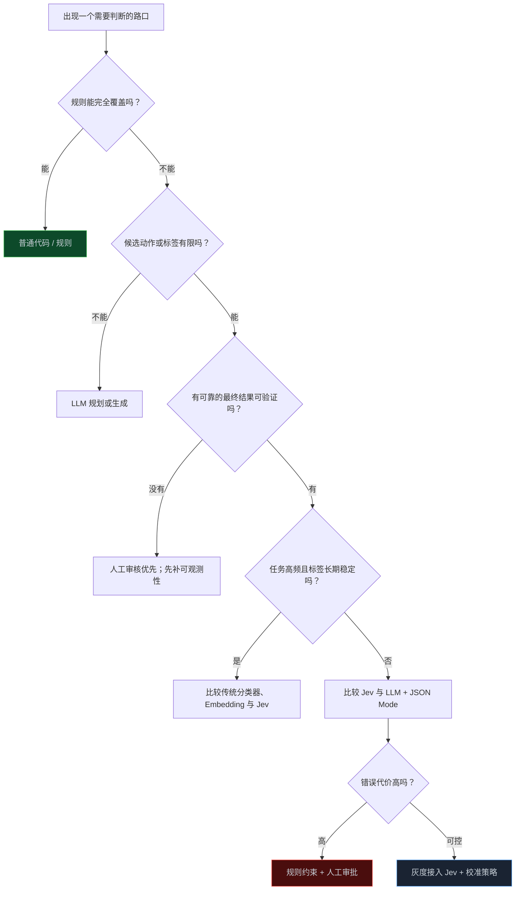

> **📖 系列难度说明**：本篇为**综合与收尾**。适合读完前面内容、准备做技术选型或把试点推进到生产环境的读者。
> **🎁 核心收获**：一张选型决策树、一份上线前清单，以及一套从成本、权限、评测到治理的完整判断框架。

读完前面几篇，你已经知道 Jev 能做什么：它能在有限候选项里选择工具、给风险打分、判断该继续还是升级人工。

可真正开始做项目时，问题会变得更现实：这个判断是不是普通规则就能做？传统分类器会不会更便宜？LLM 的 JSON Mode 已经够不够？接入 Jev 后，调用量会不会越滚越大？

说到底，Jev 不是一个“看到 AI 就该接”的组件。它只有在合适的路口，才值得占据系统的一席之地。

这篇不再讲某个 API 怎么调，而是解决最后一个问题：**什么时候该用 Jev，接入以后又该怎样管住它。**

<!-- more -->

---

## 先承认一件事：很多判断根本不需要 Jev

假设用户发来“帮我查一下订单”。如果订单号格式错误、用户没有权限、请求次数超过上限，这些都应该由普通代码直接处理。它们有明确规则，有确定答案，调用模型只会增加成本和不确定性。

反过来，“这段用户描述更像账单问题、技术故障还是欺诈风险？”就没那么适合写死规则。关键词可能重叠，表达也五花八门，但最终可走的队列有限。这类任务才是 Jev 擅长的位置。

把常见方案并排看，会更容易做判断：

| 方案 | 最适合解决什么 | 优点 | 不适合什么 |
|---|---|---|---|
| 普通规则 | 权限、金额、格式、硬性条件 | 快、便宜、可解释 | 语义模糊、表达多样的输入 |
| 传统分类器 / Embedding | 标签稳定、数据量够、任务高频 | 成本低、延迟稳定 | 类别经常变化、需要丰富上下文 |
| LLM + JSON Mode | 抽取、总结、生成结构化内容 | 灵活、表达力强 | 高频、候选动作有限的快速判断 |
| Jev 决策模型 | 路由、分支、风险评分、升级判断 | 类型化输出、概率信号、便于接控制流 | 开放式规划、写作、需要生成新内容 |
| 人工审核 | 高风险、低频、没有可靠真值的案例 | 最能处理例外与责任归属 | 大规模重复性任务 |

这不是一张“谁更高级”的排行表。一个成熟系统往往同时拥有这五种部件：规则负责硬边界，Jev 负责模糊路口，LLM 负责理解与生成，人工处理高风险和例外，传统模型则在稳定、高频的任务里提供低成本能力。

> 💡 **来源**：[Learn Jev 的概念页](https://learnjev.com/concepts) — 提醒微调分类器、Embedding、JSON Mode 与受约束解码仍有成熟场景，应在同一任务下比较质量、成本、延迟与失败路径。

---

## 一张决策树，先决定要不要引入模型

技术选型不必从“Jev 和 LLM 哪个更强”开始。先从任务本身问起。



这棵树里最容易被跳过的是“有可靠的最终结果可验证吗”。没有真值，模型可以做演示，却很难安全地自动化。你无法知道它的概率是否校准，也无法判断人工是否经常推翻它，更无法解释一次高置信错误。

所以，最适合先接 Jev 的，不一定是最炫的 Agent，而是那些有明确动作、明确后果、明确结果记录的场景：工单路由、工具选择、补证据或升级人工、内容进入不同审核队列。

---

## 五个真实场景，分别该怎么选

### 场景一：客服工单路由

用户说“我被扣了两次钱，退款也没到账”。候选结果是 `billing`、`technical`、`fraud`、`human_review`。

这很适合 Jev：表达变化大，候选队列有限，人工最终路由和改派记录可做真值。要保留的底线是：用户权限、订单归属、账户状态仍由业务系统校验；Jev 只负责建议走哪条处理路径。

### 场景二：Agent 要不要重试 API

工具返回 429、网络超时或权限错误时，很多团队会让 LLM“判断要不要重试”。其实大多数场景不用。

```text
429 → 按退避策略重试
401 / 403 → 停止并提示权限问题
参数校验失败 → 修正参数，不重试原请求
```

这是规则的工作。只有当错误信息混杂、多个补救路径都可能成立，例如“先查数据源、换工具、补问用户还是重新规划”，Jev 才值得参与。

### 场景三：自动退款

这类场景常被误以为适合“高置信度自动执行”。实际上，模型可以帮助判断意图、证据是否完整、是否应补充信息；退款资格、金额、次数和权限必须由确定性规则和可信交易状态决定。

这里的 Jev 更像分诊台，不是出纳台。

### 场景四：代码 Agent 选择下一步

代码 Agent 在搜索、读取文件、跑测试、修改代码、请求澄清之间选择。任务本身开放，规划仍交给 LLM；但在某些局部路口，Jev 可以判断“下一步更像查代码、查文档还是跑测试”“失败后该重试、补证据还是升级”。

如果项目很小、工具很少，这层不一定值得加。等工具集、调用频率和失败成本一起上来，才会开始体现价值。

### 场景五：合规或安全审核

Jev 可以给内容风险打分、将案例分到不同审核队列，也可以检测是否需要人工复核。但它不应成为唯一裁决者。法律义务、策略版本、审计记录、申诉流程和最终责任，都必须放在模型之外。

这五个场景给出一个共同结论：**Jev 最适合决定“下一步交给谁、查什么、停还是继续”，不适合绕过事实系统和责任边界直接做最终高风险动作。**

---

## “更快更便宜”为什么可能让总成本更高

这里要回到另一个名字很像、但含义不同的概念：**杰文斯悖论**。

它说的不是“效率没有价值”，而是单位成本下降后，使用规模可能扩大得更快。AI 里尤其容易出现这种情况：一次推理更便宜，于是更多产品默认接入 AI；工具调用更快，于是 Agent 的步骤变多；一个 Copilot 提升开发速度，于是团队交付更多需要长期运行的服务。

```text
单次调用更便宜
        ↓
更多功能、更多用户、更多工作流开始调用
        ↓
Token、工具、GPU、监控与人工复核一起增长
        ↓
总成本未必下降
```

这也是为什么不能只看 Jev 的单次价格或延迟。它可能把原来由大模型完成的判断变得更便宜，也可能让团队更愿意在每一个路口都调用一次模型，最终把节省全部吃掉。

对 Agent 来说，这个风险更明显。一次聊天可能只调用一次模型；一个 Agent 任务则可能规划、选择工具、执行、验证、重试，再重复多轮。若每个节点都因为“很便宜”而默认开启，总调用量会快速膨胀。

> 💡 **来源**：Do Tuan Anh，《The Jevons Paradox in AI Infrastructure: Efficiency, Rebound, and the Limits of Cost Reduction》— 将企业 AI 成本拆为基础设施、API Token 与按席位订阅三类，并讨论效率提升如何通过部署扩张带来反弹；[Luccioni 等人的研究](https://arxiv.org/abs/2501.16548) — 指出 AI 效率改善的间接需求效应不能被直接能耗指标掩盖。

---

## 不要只看 Token：企业 AI 至少有三本账

模型接入后，成本很少只躺在一个账单里。上一篇评测文章讲了端到端成本；放到组织层面，还要把成本拆成三类看：

| 成本账本 | 典型项目 | 容易遗漏什么 |
|---|---|---|
| 基础设施账 | GPU、云推理、向量库、存储、监控、网络 | 自托管后持续的容量与运维投入 |
| 用量账 | LLM/Jev/API Token、Embedding、多模态调用 | 每个团队各自调用，汇总后才发现增长 |
| 订阅账 | 编程助手、办公 Copilot、领域 AI 工具 | 按部门采购，被归为软件许可而非 AI 支出 |

Jev 接入经常会影响第二本账，也可能间接推高第一本账：更多低成本决策让工作流扩大，工作流扩大又需要更多日志、监控、队列和数据基础设施。它还可能和第三本账叠加——团队买了 Copilot，又接了自建 Agent 和多个决策 API。

所以 ROI 不该写成：

```text
节省的人工工时 - Jev 调用费
```

而应更接近：

```text
业务收益
- 模型与工具调用
- 基础设施与运维
- 人工复核与异常处理
- 评测、审计与治理成本
- 错误导致的返工和风险损失
```

这不是让预算表变复杂，而是避免在试点阶段看见“每次调用只要几分钱”，上线半年后才发现云账单、人工复核和订阅费用已经散落到多个部门。

---

## 三层治理：先看见，再优化，最后管理需求

如果决定接入 Jev，治理不必一上来就做成大平台。先按三个层次把最关键的事情补齐。

### 第一层：可见性

每次决策至少记录这些字段：模型和策略版本、候选项、概率、最终动作、是否人工升级、最终业务结果、端到端时延和估算成本。

在团队层面，把基础设施、Token/调用量和订阅支出汇总。否则你只能看到“某个 API 账单上涨”，看不到到底是新工作流更多了、旧工作流重试变多了，还是某个部门批量开了新工具。

### 第二层：架构优化

先压低不必要的每次成本：规则能处理的别调用模型；重复上下文用缓存；简单路由优先用更小、更便宜的能力；控制上下文长度；高频确定查询缓存结果；给 Agent 设调用次数和预算上限。

这里有个底线：优化不能偷偷降低业务质量。比如为了省钱把所有低置信度案例都直接拒绝，账单会变好看，用户体验和完成率却可能变差。成本优化必须和上一章的完成率、错误逃逸率一起看。

### 第三层：需求治理

效率优化之后，真正决定总账单的是需求是否失控。可以先做三件简单的事：

- **成本归属**：让发起高频工作流的产品团队看到自己产生的调用成本；
- **预算与告警**：按产品、工作流或租户设置用量上限，在接近阈值时提醒；
- **变更审批**：新增高风险动作、新模型版本或大规模自动化范围前，要求提供评测结果和回滚方案。


前两层解决“看不见”和“单次太贵”，第三层才处理“为什么总调用量一直涨”。这也是杰文斯悖论在工程实践里的真正启发。

---

## 上线前的十分钟清单

最后给一份可以直接带进评审会的清单。它不要求每项都完美，但如果多数问题都答不上来，先别急着把 Jev 放到生产主链路。

### 任务与接口

- [ ] 候选动作是否有限、互斥，并且能直接映射到代码或队列？
- [ ] 是否为证据不足、无法判断或高风险案例提供了安全出口？
- [ ] 哪些条件必须由规则和可信数据源确认，而不是由模型猜？

### 质量与风险

- [ ] 是否有独立的最终结果，可以验证决策是否真的帮助完成任务？
- [ ] 是否测过高置信度错误、边界案例、缺失信息和对抗输入？
- [ ] 是否定义了自动执行、补证据、LLM 复核和人工升级的边界？

### 系统与成本

- [ ] 模型、策略、候选项、最终动作和业务结果是否都能追溯？
- [ ] 是否设置了权限、幂等、预算、重试次数和熔断开关？
- [ ] 是否把模型调用、工具调用、基础设施、人工复核和订阅成本一起算入 ROI？
- [ ] 新增工作流会不会因为“单次便宜”而把总调用量放大？

如果这些问题大多能回答清楚，Jev 才不只是一个好看的 Playground，而可能成为系统中可控、可维护的决策层。

---

## 📝 小结

- Jev 不是默认选择。先判断规则、传统分类器或 LLM + JSON Mode 是否已足够，再决定是否需要决策模型。
- Jev 适合候选动作有限、语义判断难以写死、结果可独立验证的路由、分支、评分和升级场景。
- 资金、权限、金额、业务状态等硬约束应始终由确定性代码和可信系统控制。
- 单次调用更便宜，不代表总成本下降；更多工作流、更多模型和更多订阅可能触发杰文斯式反弹。
- 管理 AI 成本要同时看基础设施、用量和订阅三本账，并把可见性、架构优化和需求治理连起来。
- 最终选型标准不是“是不是用了 Jev”，而是系统是否在质量、风险、成本和可维护性之间取得了更好的平衡。

---

## 🎉 系列收尾

六篇文章走到这里，Jev 决策模型的核心脉络已经完整了：从它到底是什么，到怎样设计 Choice、Score 和真伪判断；从如何把概率接进控制流，到怎样嵌入 Agent、验证效果、管理成本和风险。

如果只记住一句话，我希望是这一句：

> **让 LLM 负责理解与生成，让规则守住硬边界，让 Jev 处理受限的模糊路口，让人保留最终责任。**

这不是唯一架构，却是一个足够清醒的起点。

---

> 📚 **系列完整导航**
> - 第 01 篇：不生成文字，AI 怎样直接为软件做决策？——理解 Jev、LLM、规则与人工的分工
> - 第 02 篇：Jev 的 Choice、Score 与真伪判断：决策接口到底怎么设计？——把业务判断收敛成可执行的接口
> - 第 03 篇：把概率接进控制流：自动执行、复核还是升级人工？——用校准与风险策略处理不确定性
> - 第 04 篇：Jev 放进 Agent：工具路由、工作流分支与输出验证——让决策层服务于可控的 Agent 编排
> - 第 05 篇：别被“更快更便宜”带偏：怎样评测 Jev 的真实收益？——从准确率走向端到端任务验证
> - **第 06 篇：Jev 决策模型选型与治理：成本、边界和落地清单** ⬅️ 你在这里
