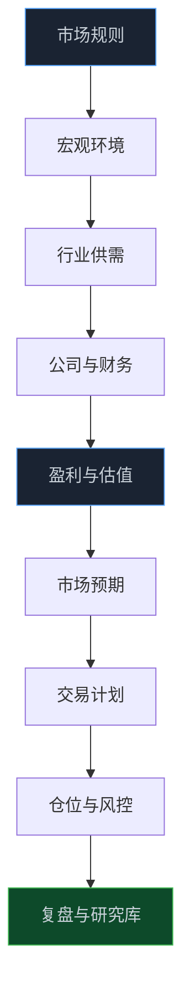
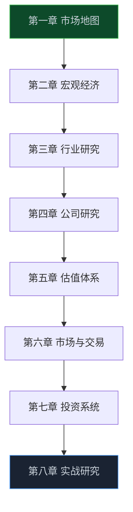

> **📖 系列说明**：这是一套面向真实市场的研究课。默认你已经见过 K 线、PE、成交量这些词，但还没有把它们连成一套能反复使用的判断框架。
>
> **🎁 学完后的目标**：面对一家 A 股公司，你能在 1～3 小时内完成第一轮研究：知道该看什么、哪些结论还缺证据、什么信息会推翻原来的判断。
>
> **⚠️ 重要提示**：课程只讨论研究方法与风险管理，不构成任何证券投资建议。市场有风险，决策和损益都应由投资者自行承担。

你可能见过这种场面：一家公司利润增长，股价却跌了；一只低 PE 股票看着便宜，一年过去还在原地；某个行业突然走强，新闻里全是利好，追进去却赶上高开低走。

问题往往不在于少学了一个指标，而在于只看到了股票，没有看到它身后的市场、行业和预期。

这套课不打算教你用某个信号预测明天涨还是跌。它更关心另一件事：**市场为什么愿意用现在的价格，给一家公司的未来定价？**

<!-- more -->

---

## 这门课想解决什么问题

看盘软件把信息铺得很满：分时图、资金流、涨跌榜、估值指标、新闻快讯。信息多不等于判断更稳。

真正棘手的是把碎片重新串起来：宏观环境会怎样影响利率和流动性？行业处在扩张、成熟还是出清阶段？公司的利润有没有变成现金？市场已经把多大的增长写进价格里？自己的判断错了，应该在哪个节点承认错误？

课程沿着这条链条展开：

它不是一条单向的流水线。研究一家公司时，你会不断往回追问：利润为什么变了？是需求、价格、成本，还是会计处理？行业变了，又是供需、竞争，还是利率与风险偏好变了？

学到后面，K 线、财报、估值和新闻不再是几套互不相干的语言，而会成为同一张研究地图上的不同图层。

---

## 为什么从“市场”而不是从“选股”开始

买股票，买的是一家企业未来现金流的一部分；但二级市场里的价格，还会被制度、流动性、风险偏好和不同类型资金共同塑造。

所以，“公司好不好”与“这段时间股价涨不涨”不是同一个问题。一家优秀公司也可能因为估值过高、预期被打满、市场风险偏好下降而下跌；一家经营普通的公司，也可能在供需反转或情绪驱动下快速上涨。

课程前几课会先把市场的地基补上：不同板块怎么交易、集合竞价和连续竞价在发生什么、ETF、融资融券、回购、分红、减持和解禁会如何改变供需。交易规则不是背诵题。规则一变，原来的经验可能就失效。

例如，沪深交易所的《交易规则（2026 年修订）》已于 2026 年 7 月 6 日施行，盘后固定价格交易的适用范围和部分交易安排都有更新。学习制度时，请以交易所最新正式文件为准，而不是把旧文章当成规则本身。

> 💡 **来源**：[上海证券交易所交易规则（2026 年修订）](https://www.sse.com.cn/lawandrules/sselawsrules2025/stocks/exchange/c/c_20260424_10816482.shtml) — 官方交易规则文本，应作为制度学习与核对的优先依据。
>
> 💡 **来源**：[读懂上市公司报告](https://investor.sse.org.cn/warning/activities/report/index.html) — 交易所投资者教育栏目，为年报阅读与信息披露研究提供基础材料。

---

## 课程不是把人分级，而是让能力自然长出来

刚开始，你会从一只股票、一个指标、一次交易里得到直观感受。往后走，需要把注意力从“它涨没涨”移到“它为什么值得这个价格”。再往后，单家公司也不够了：行业比较、组合暴露、回撤来源和复盘记录，都会进入判断。

熟悉代码或数据的读者，可以把课程中的指标、筛选逻辑和研究模板做成自己的工具；更重视基本面的读者，也能直接用公开披露材料搭起研究框架。方法不要求所有人做同样的模型，但要求每个结论都回答同一组问题：

- 这件事的证据来自哪里？
- 数据口径、时间范围和假设是什么？
- 市场可能已经预期了什么？
- 如果我错了，最早会从哪里看出来？

这叫“证据链”。它比一句“我觉得这家公司不错”更慢一点，却能让判断更可检查，也更容易复盘。

---

## 80 课怎么学

全课分为 8 章、80 课。每一章解决一个完整问题；每课尽量保持同一节奏：核心概念、真实案例、数据或公告怎么读、常见误区、研究视角、一个可完成的练习，最后留下可复用的检查清单。

建议不要追进度。每学完一章，挑一家真实上市公司或一个行业，把新框架用一遍。你第一次做得很粗糙没关系，重要的是留下版本。以后再回看，才知道自己错在事实、假设、估值、仓位，还是执行。

---

## 完整目录

### 第一章：A 股市场地图

这部分先解决“我到底在什么市场里交易”。理解股票、参与者和制度，后面才不会把一切涨跌都归结为“主力”。

#### 第一篇：股票到底是什么：从代码重新认识股权

从股权、上市公司与二级市场讲起，弄清买入一只股票时，自己究竟拥有了什么。

#### 第二篇：A 股市场有哪些参与者

认识散户、公募、私募、保险、量化和产业资本，理解不同资金为何会在同一时刻做出不同选择。

#### 第三篇：沪深京三大市场分别是什么

梳理上海、深圳、北京证券市场的定位与上市公司结构，建立市场全貌。

#### 第四篇：主板、创业板、科创板与北交所

比较不同板块的服务对象、上市门槛、风险特征和交易安排，知道公司为什么会选择不同板块。

#### 第五篇：A 股交易规则应该怎么看

用最新交易规则拆解交易时段、申报与成交机制，避免用过期经验理解市场。

#### 第六篇：T+1、涨跌幅与集合竞价

理解几项关键制度怎样改变日内价格、交易节奏和实际可执行的买卖计划。

#### 第七篇：融资融券与卖空机制

说明杠杆和融券的基本逻辑、约束与风险，避免把它们误当成简单的上涨或下跌工具。

#### 第八篇：ETF、指数与被动资金

从指数编制到 ETF 申赎，理解被动资金如何影响行业与个股的供需。

#### 第九篇：IPO、再融资、回购与分红

把公司融资、回报股东和资本运作放在同一张资本循环图里理解。

#### 第十篇：ST、退市与风险识别

认识风险警示和退市机制，建立买入前先排除重大风险的底线。

### 第二章：宏观经济：给市场画一张天气图

宏观不是用来猜点位的。它帮助我们理解增长、价格、利率和流动性，怎样改变企业盈利与估值的背景。

#### 第一篇：GDP：增长从哪里来

从消费、投资、净出口与产业结构理解经济增长，并判断哪些行业更受益。

#### 第二篇：CPI 与 PPI：价格变化传到利润表的路径

追踪消费端和生产端价格变化，理解成本压力如何在产业链里传导。

#### 第三篇：PMI：如何读懂景气度信号

学会从 PMI 的新订单、生产、库存等分项，观察企业经营的边际变化。

#### 第四篇：M1 与 M2：货币到底在反映什么

区分不同货币口径背后的活钱与广义流动性，避免只看一个数字下结论。

#### 第五篇：社会融资：信用扩张与收缩

理解信贷、债券和非标融资的变化，如何影响企业融资与经济活动。

#### 第六篇：利率为什么会影响股票估值

从折现率和融资成本出发，解释利率变化为何会重估不同类型公司的价格。

#### 第七篇：国债收益率：无风险利率这把尺子

把国债收益率放回资产定价框架，理解它为何是估值的重要基准。

#### 第八篇：汇率：外部价格与企业经营的连接

分析汇率变化对出口、进口成本、外币负债和市场风险偏好的影响。

#### 第九篇：财政变量如何进入行业与公司

沿着财政支出、税费和项目投资的传导路径，看政策如何影响真实需求。

#### 第十篇：货币条件、流动性与风险偏好

区分资金“多不多”和市场“敢不敢买”，理解流动性与情绪并非同一件事。

#### 第十一篇：经济周期：别把阶段性变化当成永恒趋势

把增长、通胀、利率与盈利放进周期框架，训练对市场阶段的判断力。

### 第三章：行业研究：先看赛道，再看选手

行业决定了公司能跑多快，也决定了它会面对怎样的竞争与周期。很多时候，选对行业比在行业里挑出“看起来最便宜”的公司更重要。

#### 第一篇：行业生命周期：导入、增长、成熟与出清

识别行业所处阶段，因为同一个估值指标在不同阶段的含义可能完全不同。

#### 第二篇：行业空间：市场到底有多大

从渗透率、客户数量、客单价和替代关系估算增长边界，而不是只听故事。

#### 第三篇：供需关系：价格和利润如何被推着走

理解供给、需求、库存与价格的联动，找到利润变化真正的驱动力。

#### 第四篇：竞争格局：谁在赚钱，谁在让利

通过份额、价格、利润率和资本开支，判断行业是在改善还是陷入竞争。

#### 第五篇：行业集中度：龙头优势从哪里来

用集中度和份额变化观察龙头是否具备持续的定价权与资源优势。

#### 第六篇：产业链：把上下游放到一张图里

沿产业链追踪价值、成本和库存，避免孤立地研究一家公司。

#### 第七篇：周期行业：别在利润最高时迷信低 PE

用供需、库存和产能周期理解周期股，避免把周期高点的利润当成常态。

#### 第八篇：成长行业：增长、渗透率与估值

研究行业渗透、竞争位置和盈利兑现，判断增长能否支撑高估值。

#### 第九篇：防御行业：稳定现金流也有价格

分析需求韧性、分红能力和估值边界，理解防御并不代表没有风险。

### 第四章：公司研究：把生意看明白

研究公司不是背主营业务。要能说清它卖什么、客户为什么买、利润从哪里来、竞争者为何难以复制，以及报表里的利润有多少是真的变成了现金。

#### 第一篇：商业模式：公司靠什么持续赚钱

拆开收入来源、客户关系、成本结构和复购逻辑，看清利润是怎样产生的。

#### 第二篇：护城河：优势能不能穿越竞争

检验品牌、成本、技术、渠道和网络效应是否真能抵御竞争，而不只是一句标签。

#### 第三篇：管理层与公司治理：谁在替股东做决定

从治理结构、激励、资本配置和信息披露，判断管理层与股东利益是否一致。

#### 第四篇：三张财务报表：从结构看企业

把资产负债表、利润表和现金流量表连起来，建立理解企业经营的基本语言。

#### 第五篇：ROE：股东资本的赚钱效率

拆解净资产收益率，分辨高 ROE 来自好生意、高杠杆还是一次性因素。

#### 第六篇：ROIC：增长背后的资本质量

用投入资本回报率检查增长是否真的创造价值，而不是越扩张越消耗资本。

#### 第七篇：毛利率：议价能力与竞争的温度计

从毛利率变化追踪产品结构、成本压力和行业竞争强度。

#### 第八篇：现金流：利润为什么不等于现金

理解应收、存货、资本开支与自由现金流，识别纸面利润和真实造血能力的差异。

#### 第九篇：利润质量与财务风险信号

通过异常应收、存货、减值、关联交易等线索，建立财务风险检查表。

#### 第十篇：年报阅读：从一份披露还原生意

按业务、客户、产品、成本、资本开支和风险的顺序，完成一次年报阅读。

### 第五章：估值体系：价格和价值之间差了什么

估值不是找出一个神奇数字，而是在不同假设下判断价格是否透支、是否留有安全边际，以及未来需要什么条件才能兑现。

#### 第一篇：PE：低市盈率为什么不一定便宜

回到盈利持续性与周期位置，理解市盈率背后究竟在给什么定价。

#### 第二篇：PB：哪些公司更适合看净资产

说明市净率在金融、资产重和周期行业中的用法与局限。

#### 第三篇：PS：收入估值何时有意义

在利润尚未稳定时，用收入增长和单位经济模型检验市销率是否站得住。

#### 第四篇：PEG：增长与估值怎样一起看

把盈利增长放进估值判断，但不把 PEG 当成自动得出结论的公式。

#### 第五篇：EV/EBITDA：企业价值口径的适用边界

理解资本结构差异，并学会在重资产或跨公司比较中正确使用这一指标。

#### 第六篇：DCF：把未来自由现金流折回今天

从收入、利润率、资本开支与折现率搭起 DCF 的基本模型，理解假设比公式更重要。

#### 第七篇：相对估值：和谁比、比什么

选择真正可比的公司和口径，避免用表面相似的企业制造错误结论。

#### 第八篇：绝对估值：假设如何影响结果

用企业自身的现金流能力与资本成本估值，并揭示敏感假设的位置。

#### 第九篇：安全边际：给不确定性留位置

把不确定性写进买入标准，而不是在判断失误后才寻找解释。

#### 第十篇：估值区间：悲观、基准与乐观情景

用多情景推演替代单点目标价，让估值成为决策范围而非预测承诺。

### 第六章：市场与交易：读懂价格背后的行为

技术分析在这里不是预测工具，而是一种观察供需、趋势、流动性与预期变化的语言。基本面回答“买什么”，市场结构会帮助回答“怎么等”。

#### 第一篇：K 线：一个周期内的买卖博弈

从开高低收和成交量读出一个时间窗口内多空力量的结果。

#### 第二篇：趋势：上涨、下跌、横盘与反转

用高低点、突破和回撤识别趋势状态，而不是执着于预测每一次转折。

#### 第三篇：成交量：参与程度和分歧在哪里

结合量价关系观察资金参与和市场分歧，理解放量与缩量各自意味着什么。

#### 第四篇：换手率：流通筹码在怎样交换

从换手与流通盘的关系观察筹码交换，但不过度解读所谓“主力痕迹”。

#### 第五篇：技术指标：它们究竟在测量什么

拆解均线、MACD、RSI 等指标的计算含义，知道指标能提供什么、不能提供什么。

#### 第六篇：资金：成交额、融资与 ETF 流向该怎么读

把不同资金数据放进市场结构中看，避免用单一“资金流”替代研究。

#### 第七篇：筹码：股东结构、解禁与回购

分析股权结构与供给变化，识别解禁、增减持和回购可能带来的影响。

#### 第八篇：市场情绪：恐惧、修复与亢奋

从市场宽度、成交、涨跌停和热点持续性观察情绪，而不把情绪当成确定性信号。

#### 第九篇：题材与主题：产业趋势和短期炒作怎么分

用产业证据、盈利路径和资金节奏区分长期趋势与短线题材。

#### 第十篇：预期差：为什么利好也可能下跌

理解股价交易的是预期变化，学会比较事实本身和市场原先的期待。

### 第七章：投资系统：让判断能执行、能承受

研究不等于交易。真正落到账户上，还要解决风格、买点、仓位、退出与组合的问题。没有这部分，再好的研究也可能被一次失控的仓位抵消。

#### 第一篇：价值投资：赚价格回归价值的钱

理解价值投资依靠的定价偏差与等待条件，而不是把低估值等同于价值。

#### 第二篇：成长投资：赚盈利兑现和估值重估的钱

围绕收入增长、竞争优势和盈利兑现，建立成长投资的判断框架。

#### 第三篇：趋势投资：赚趋势延续的钱

明确趋势投资依赖的市场行为、入场条件与纪律，不把它包装成预测能力。

#### 第四篇：周期投资：赚供需反转的钱

从供需、库存、产能和价格拐点出发，构建周期投资的研究节奏。

#### 第五篇：事件驱动：催化剂与时间窗口

评估事件是否足以改变盈利、估值或预期，并给判断设定清晰的时间边界。

#### 第六篇：量化投资：因子、统计与纪律

认识量化方法如何从数据中寻找规律，也理解回测并不等同于未来收益。

#### 第七篇：仓位管理：观点强度不等于满仓理由

把胜率、赔率、相关性和承受能力放进仓位决策，避免单一判断决定账户命运。

#### 第八篇：风险管理：把可能的亏损先写下来

在买入前明确逻辑失效、价格失控和流动性风险的应对办法。

#### 第九篇：组合管理：相关性、暴露与分散

从行业、风格和因子暴露理解组合，而不是只数自己持有了多少只股票。

#### 第十篇：最大回撤：收益之外，账户能否活下来

用最大回撤检验策略与仓位是否匹配自己的风险承受范围。

### 第八章：实战研究：进入研究员模式

最后十课把前面的知识收进一套能重复使用的工作流。目的不是写出一篇漂亮报告，而是让每一次研究都留下证据、假设、观察项和证伪条件。

#### 第一篇：如何完成一家公司的第一轮研究

用固定问题快速建立公司画像，判断是否值得投入更多研究时间。

#### 第二篇：如何研究一个行业并建立比较框架

围绕产业链、竞争格局、供需和关键指标，形成可横向比较的行业视图。

#### 第三篇：如何读年报、季报与公告

建立披露材料的阅读顺序，抓住影响投资逻辑的新增事实与风险。

#### 第四篇：如何做一份可复核的估值模型

让收入、利润、现金流和估值假设都有出处，任何人都能追溯你的计算过程。

#### 第五篇：如何建立股票池，而不是追热门名单

用行业、质量、估值和触发条件筛选公司，把注意力放在长期跟踪上。

#### 第六篇：如何维护观察名单和关键跟踪指标

为每家公司留下关键数据、事件和阈值，等待真正改变判断的信号。

#### 第七篇：如何写清一笔投资逻辑

把买入理由、市场预期、催化剂、风险与持有期限写成可检查的判断。

#### 第八篇：如何设置证伪条件与退出规则

提前定义什么事实会推翻观点，让退出成为研究纪律而不是临场情绪。

#### 第九篇：如何做投资复盘，定位真正的问题

把结果拆回研究、估值、仓位和执行，找出可以改进的环节。

#### 第十篇：如何建立自己的投资研究数据库

沉淀公司、行业、模型、日志与复盘，让每次研究成为下一次判断的基础。

---

## 学完后，你应该多了一套什么能力

不是“更会猜涨跌”。市场从来不承诺这件事。

你应该能把一段新闻、一张财报或一次异动，放回到完整的框架里：它影响的是事实、预期，还是估值？影响的是一家公司的短期利润，还是长期竞争力？这件事值得行动，还是只值得记录和继续观察？

说到底，这套课想培养的是一种习惯：**用证据提出判断，用条件管理不确定性，用复盘替代自我安慰。**

下一课从最基础也最容易被忽略的问题开始：股票到底是什么？

---

> 📚 **课程导航**
>
> - **课程导读：从看股票到看懂市场：课程介绍与学习地图** ⬅️ 你在这里
> - 第一章：A 股市场地图
> - 第二章：宏观经济：给市场画一张天气图
> - 第三章：行业研究：先看赛道，再看选手
> - 后续课程将按章节持续完善
