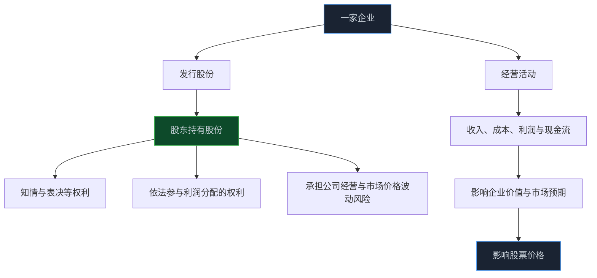
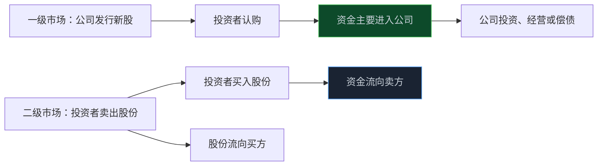

> **系列难度说明**：本篇是**第一章·第一篇**。适合已经会看行情、却还没把“买股票”这件事想透的读者。
>
> **核心收获**：读完后，你会知道股票、股权、上市公司、一级市场和二级市场之间的关系；也能分清“公司赚了钱”“股价涨了”“我赚了钱”这三件并不总是同步的事。
>
> **重要提示**：本文只用于投资者教育，不构成任何证券投资建议。文中案例均为简化示意，不能据此买卖任何证券。

打开行情软件，一串代码后面跟着价格、涨跌幅、成交额。绿的、红的，数字每秒都在变。

很容易把股票当成一种会涨会跌的商品：低了买，高了卖。可要是只停在这里，后面学多少 K 线、PE、资金流，都会有点悬空。

因为你买的不是代码。

你买的是一家公司的极小一部分所有权。

<!-- more -->

---

## 先把最容易被忽略的一句话说清楚

买入一家上市公司的股票后，你就成了这家公司的股东之一。持股再少，这个身份也成立。

当然，少数股东无法像控股股东那样决定公司战略，更不可能直接指挥管理层。但股东身份不是一句宣传语。它对应着一组权利：知情、表决、依法参与利润分配等；这些权利通过公司法、证券法、公司章程和交易所规则落到具体机制上。

> **来源**：[证券法律法规——证券投资者维权](https://www.csrc.gov.cn/csrc/c100211/c1452103/content.shtml) — 中国证监会投资者教育材料指出，购买上市公司股票意味着拥有相应股份并成为股东。
>
> **来源**：[股东权益话你知](https://www.csrc.gov.cn/beijing/c105536/c1257404/content.shtml) — 中国证监会北京监管局的投资者教育材料梳理了知情权、表决权、利润分配权等基本股东权利。

把这件事放到生活里想，会好理解一些。

你和很多人共同出资开了一家店。店里有产品、员工、客户、库存、贷款，也有未来可能赚到的钱。你占的份额不大，但店经营得更好、可分配利润更多、未来更值得期待时，你手里的那一小份通常也更有价值。

上市公司就是把这种“份额”标准化、可交易化了。股票是这份股权的凭证和交易单位。

这张图里有一个顺序不能倒过来：公司先经营，经营结果和市场预期再影响价格。价格可以暂时脱离经营，但很难永远脱离。

---

## 一股股票，到底意味着多大份额

假设一家公司一共发行了 10 亿股股票。你以每股 20 元买入 50 股，一共投入 1,000 元。

你持有的权益比例是：

\[
\frac{50}{10\text{ 亿}} = 0.000005\%
\]

这个比例小得几乎感觉不到，但它帮你建立一个很重要的尺度感：**股票价格说的是“一份股权值多少钱”，持股比例说的是“你拥有公司多少”。**

如果股价从 20 元涨到 25 元，你的 50 股在市场上的可交易价值从 1,000 元变成了 1,250 元。这里增加的 250 元，来自市场对这 50 份股权重新报价，不是公司直接往你的账户里打了 250 元。

反过来，如果公司赚钱，钱也不会自动等比例流进每个股东的账户。公司可能把利润留在账上补充营运资金、偿还债务、扩产、收购，也可能在满足条件后以现金分红等方式回报股东。它还可能经营得不错，但市场担心未来增长放缓，股价照样下跌。

所以要从一开始就把三件事分开：

| 看到的现象 | 它真正描述的是什么 | 不能直接推出什么 |
| --- | --- | --- |
| 公司净利润增长 | 某个会计期间的经营结果 | 股价一定上涨 |
| 公司宣布分红 | 经决策后的利润分配安排 | 分红后总回报一定更高 |
| 股价上涨 | 市场愿意用更高价格交易股份 | 公司当期经营一定变好了 |
| 你账户浮盈 | 当前市价高于你的成本 | 这部分收益已经落袋 |

对写代码的人来说，可以把它想成三个不同的状态：企业经营数据、市场报价、个人账户结果。它们相互关联，但绝不是同一个变量。把它们混在一起，是很多投资判断变形的起点。

---

## 公司拿到钱，和你在市场上买股票，是两回事

“我买了一只股票，是不是在给公司送钱？”

有时是，有时不是。区别在一级市场和二级市场。

### 一级市场：公司在融资

公司首次公开发行股票，也就是常说的 IPO，或者后来再融资、配股、定向增发时，新增股份会由投资者认购。资金在扣除相关费用后进入公司，用于招股说明书或相关文件披露的用途，或者补充经营所需资金。

这里的重点是：**公司在发行新股份，投资者在为公司提供资本。**

原有股东的持股比例可能因此被稀释。不是“公司股数变多了，大家都一样”，而是分母变大了；若你不参与认购，所占比例会下降。至于这笔钱是否真的创造了更多价值，要回到公司后续的项目回报、现金流和资本配置上判断。

### 二级市场：投资者之间交换股份

绝大多数日常买卖发生在二级市场。你通过券商买入的股票，通常来自另一位愿意卖出的投资者。成交后，股份从卖方账户转到买方账户，资金反向流动；公司并不会因为这笔普通的二级市场成交，直接收到对应的买入资金。

不过，二级市场并不只是“炒来炒去”。它提供了流动性和持续定价：早期股东、机构和普通投资者能交易；公司未来融资时，也会受到市场定价和流动性环境的影响。

这个区别看似基础，后面读“定增”“配股”“可转债”“大股东减持”时却特别有用。它们都会改变股份、资金或控制权的结构，但影响路径并不一样。

---

## 股价和公司价值，为什么经常看起来不像一回事

一只 10 元的股票未必便宜，一只 200 元的股票也未必贵。

原因很简单：每股价格没有告诉你公司一共分成了多少份。要把价格乘上总股本，才得到市场常说的市值：

\[
\text{市值} = \text{股价} \times \text{总股本}
\]

上面的示例公司若有 10 亿股、股价 20 元，市值就是 200 亿元。若它把股票按一拆二，变成 20 亿股，同时每股价格理论上调整到 10 元，市值并不会因为“股价腰斩”而凭空少掉一半。

市值也不等于公司银行账户里的现金，更不等于“公司值多少钱”的最终答案。公司可能有大量债务、现金、少数股东权益，未来还会持续产生或消耗现金。后面学企业价值、PE、PB、DCF 时，会一点点拆开这些问题。

这一篇只先留住一个判断：

> **股价是市场对一股股份的即时报价；价值是你基于企业未来现金流、风险和假设作出的判断。两者会互相靠近，也会长期拉开距离。**

市场价格永远在动。价值判断也不是刻在石头上的，它要随着利润、竞争、利率、行业供需和新信息不断更新。把“价格”和“价值”分开，不会让人自动买到好公司，却能少掉很多看图追涨杀跌时的错觉。

---

## 股东的回报从哪里来，又会在哪里落空

从长期看，股东回报大致有三条路径。

**一条是分红。** 公司在符合条件并履行决策程序后，将部分可分配利润以现金等方式回报股东。分红不是免费午餐：除权除息会影响股价表现，而且企业把现金分出去后，能用于再投资的钱会减少。真正要问的是，公司留下的钱能不能带来比股东自己配置资金更高的回报。

**一条是回购。** 公司用自有资金回购股份，具体用途和后续处理需要看公告。若回购股份被注销，在其他条件不变时，总股本减少，剩余每股对应的权益会发生变化；但回购是否划算，依然取决于回购价格、资金来源和公司当时更需要钱做什么。

**还有一条是市场价格变化。** 当公司的盈利能力、成长空间、资本效率或市场愿意给予的估值改善时，股价可能上涨。这里没有“必然”，因为市场总是在提前交易未来；好消息若早已被预期，公布当天也可能下跌。

监管层对上市公司现金分红有明确规范，分红安排和信息披露应当回到公司的具体公告与制度文本上核对，不能只看软件里的股息率标签。

> **来源**：[上市公司监管指引第 3 号——上市公司现金分红（2023 年修订）](https://www.csrc.gov.cn/csrc/c100028/c7449654/content.shtml) — 证监会发布的现金分红监管规则，强调健全常态化分红机制与提高投资者回报。
>
> **来源**：[上市公司信息披露管理办法](https://www.csrc.gov.cn/csrc/c101953/c7547359/content.shtml) — 上市公司定期报告和可能对投资决策产生重大影响的信息应依法披露；研究应优先回到法定披露材料。

把这三条路径合在一起，你会发现“只要公司好，买入就能赚钱”少了几个关键条件：买入价格不能过高，经营改善需要兑现，市场也要愿意重新定价，而且你得在波动中把仓位和时间放在自己能承受的范围内。

---

## 从今天起，别只问“这只股票能不能买”

如果你刚开始研究一家公司，可以先不碰复杂模型，先花 15 分钟回答下面几个问题：

1. 它卖什么，主要客户是谁？
2. 它靠什么赚钱：卖产品、收服务费、赚利差，还是做平台抽佣？
3. 总股本、流通股本和市值是多少？
4. 它最近一年赚的钱，经营现金流有没有跟上？
5. 公司把钱用于分红、回购、扩产、并购，还是偿还债务？
6. 你看到的消息来自法定公告、公司宣传，还是二手转述？

这六个问题不负责给出买卖答案。它们做的是更基础的事：把注意力从代码拉回企业。

公告到哪里找？优先使用法定信息披露平台和交易所披露页面。对 A 股公司而言，年报、半年报、季度报告、招股说明书和临时公告，才是研究事实的原始材料；行情软件的摘要适合建立线索，不适合替代核对。

> **来源**：[上海证券交易所定期报告](https://www.sse.com.cn/disclosure/listedinfo/regular/) — 可查询上交所上市公司的定期报告等披露信息。
>
> **来源**：[巨潮资讯网](http://www.cninfo.com.cn/new/commonUrl?url=disclosure/list/notice) — 中国证监会指定的上市公司信息披露网站，提供公告查询与股东大会网络投票等服务。

---

## 你需要带走的，不是一句口号

“买股票就是买公司”这句话没错，但很容易被说得太轻飘。

它不意味着只要公司名字响亮就能买，也不意味着研究了公司便能忽略市场。它真正要求的是：每次看见一个代码，先问这家公司在做什么、靠什么获得现金、我以什么价格买入了多少份所有权、市场又在提前交易什么。

从这一刻起，股票不再只是涨跌幅。

它是一份带着权利、风险、现金流和预期的所有权合同。后面关于行业、财务、估值、交易的内容，都会从这里开始生长。

---

## 小结

- 股票代表上市公司的一部分股权；买入后，你成为公司的股东之一。
- 公司经营、市场价格和个人账户收益彼此相关，但不能互相替代。
- 一级市场解决公司融资，二级市场主要解决投资者之间的股份交易与流动性。
- 每股价格不能单独判断贵贱，至少要结合总股本、市值、企业经营和未来预期。
- 研究的第一步不是寻找代码，而是回到公司公告和真实业务，确认你究竟在买什么。

---

## 下一篇预告

同一家公司，散户、公募、保险资金、量化资金和产业资本，看到的可能完全不是同一个机会。

下一篇聊聊：**A 股市场有哪些参与者？他们为什么会买、为什么会卖？**

---

> **课程导航：第一章·A 股市场地图**
> - **第一篇：股票到底是什么：从代码重新认识股权** ← 你在这里
> - 第二篇：A 股市场有哪些参与者
> - 第三篇：沪深京三大市场分别是什么
> - 第四篇：主板、创业板、科创板与北交所
> - 第五篇：A 股交易规则应该怎么看
> - 第六篇：T+1、涨跌幅与集合竞价
> - 第七篇：融资融券与卖空机制
> - 第八篇：ETF、指数与被动资金
> - 第九篇：IPO、再融资、回购与分红
> - 第十篇：ST、退市与风险识别
