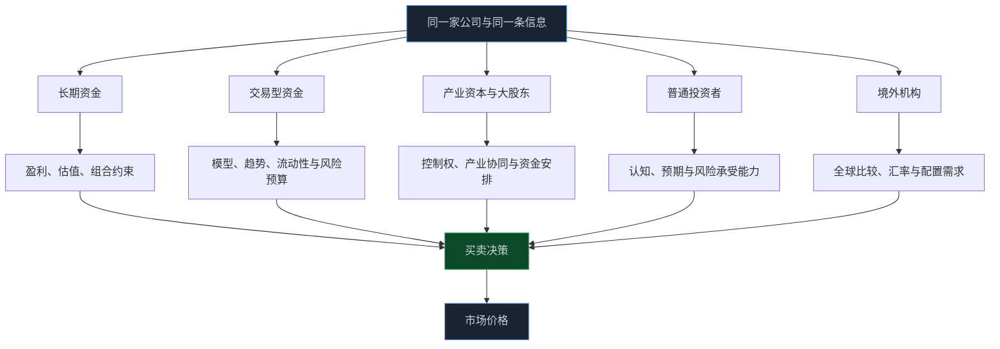

> **系列难度说明**：本篇是**第一章·第二篇**。不要求你会读资金流数据；只要愿意把“谁在交易、为什么交易”想明白，就能用上。
>
> **核心收获**：读完后，你会知道 A 股有哪些主要参与者、各自受什么目标和约束驱动，以及为什么“机构买了”从来不是一个完整的买入理由。
>
> **重要提示**：本文只用于投资者教育，不构成任何证券投资建议。机构持仓、股东变动和资金数据都有口径与披露时滞，不能单独作为买卖依据。

同一份业绩预告出来，有人觉得超预期，追着买；有人觉得增长见顶，选择卖；还有人可能根本不关心业绩，只是在按模型调仓。

屏幕上只显示了一笔成交。成交背后，却可能是三种完全不同的判断。

所以看 A 股，别急着问“主力在干什么”。这个词听着省事，实际没什么解释力。你更该问：**这笔钱是谁的？它想赚什么钱？它能拿多久？它最怕什么？**

<!-- more -->

---

## 一张成交单，至少有两种理由

任何一笔成交，都有买方和卖方。可它们不一定有谁“看对”、谁“看错”。

假设一只消费股发布了一份利润增长 15% 的年报。一个长期基金经理可能认为品牌和渠道仍在改善，愿意继续持有；一只量化产品发现短期波动率上升，模型要求降低仓位；控股股东因为个人资金安排减持一部分；一位普通投资者看到“利润增长”四个字才决定买入。

四个人面对的是同一家公司、同一份公告，做的却不是同一道题。

- 长期基金在比较未来几年盈利与当前估值；
- 量化策略在执行风险模型和交易规则；
- 大股东处理的是持股集中度、资金需求或资产安排；
- 普通投资者可能在交易一条刚刚看到的消息。

股价就是在这些不同时间尺度的决策里形成的。它不只回答“公司好不好”，还在不断回答“现在有多少人愿意用什么价格承担这份不确定性”。

这不是说每一类资金都能被贴上固定标签。公募里也有交易更积极的产品，个人投资者里也有耐心做基本面研究的人。分类的意义，是帮我们看见“约束”——资金来源、考核方式、仓位上限、赎回压力、信息披露和持有期限，会让同一类公司在不同人眼里变成不同资产。

---

## 普通投资者：人数多，目标也最多样

A 股中的自然人投资者数量庞大。中国结算定期发布证券登记结算统计年鉴，里面能看到投资者账户、登记证券等基础统计；这提醒我们，市场并不是少数几类机构在封闭房间里彼此交易。

> **来源**：[中国证券登记结算统计年鉴 2024](http://m.chinaclear.cn/zdjs/tjnb/202506/542ecc4ea6e14595ac34be6843c7ebb5/files/2024%E5%B9%B4%E7%BB%9F%E8%AE%A1%E5%B9%B4%E6%8A%A5.pdf) — 中国结算发布的登记结算统计资料，包含投资者与证券登记存管等基础数据。

“散户”这个词常被说得很轻。其实它只是一个很宽的集合：有人用闲钱做长期配置，有人盯着盘中波动，有人只买熟悉行业，有人通过 ETF 参与市场，也有人第一次开户就把全部资金压在一只热门股上。

普通投资者的优势并不在于信息更快。机构有研究团队、数据库和调研渠道，速度很难比。但个人没有季度排名压力，不一定会因为短期赎回被迫卖出，也可以只研究自己真正理解的少数公司或行业。

短板也很明确：资金集中、信息筛选能力有限、交易成本容易被忽略，最难的是情绪。上涨时容易把运气当能力，下跌时又容易把波动当成公司出了问题。

所以个人投资者最重要的不是模仿机构的交易频率，而是建立自己的约束：仓位上限、信息来源、买入逻辑和证伪条件。后面第七章会专门解决这些问题。

---

## 公募基金：拿着别人的钱，也背着公开的规则

公募基金是很多人最熟悉的机构参与者。它们向公众募集资金，按照基金合同约定投资股票、债券或其他资产。你买基金时买的是基金份额，不是基金组合里的某一只股票；基金经理是在替全体持有人管理组合。

这层关系决定了公募的行为常常比想象中复杂。

基金经理会研究公司和行业，但还要处理基金合同约束、投资范围、仓位要求、流动性、净值波动、申购赎回和相对业绩比较。哪怕他依旧看好一家公司，也可能因为组合集中度太高、股票流动性不足、基金遭遇赎回，或者需要把组合风格调回目标区间而卖出。

公募的持仓并非神秘信息。基金需要按监管要求披露定期报告，投资者可以通过基金公告、基金季报、半年报和年报了解组合的一部分信息。不过，披露是定期的，看到时往往已有时滞；而且季末持仓不等于整个报告期内的交易轨迹。

> **来源**：[公开募集证券投资基金信息披露管理办法](https://www.csrc.gov.cn/csrc/c106256/c1653985/content.shtml) — 证监会规定公募基金信息披露义务人应依法披露基金信息，保护基金份额持有人合法权益。
>
> **来源**：[证券投资基金季度报告的内容与格式](https://neris.csrc.gov.cn/falvfagui/rdqsHeader/mainbody?navbarId=1&secFutrsLawId=adac60c2f9ce439a8d5492537a1ccc67) — 证监会对基金季度报告的编制与披露作出规范。

看公募持仓时，别只问“它有没有买”。多追两步：它持有多久？占基金净值多少？这只股票在同类基金中是共识，还是少数基金经理的差异化判断？基金看中的盈利逻辑，现在还成立吗？

持仓是研究线索，不是跟单指令。

---

## 私募、保险、社保和养老金：同是机构，钱的性格不一样

机构不是一个统一人格。

**私募证券基金**的策略差异很大。有的专注基本面选股，有的做市场中性、套利、期货衍生品或量化交易；产品的开放频率、杠杆安排、回撤约束和投资者结构也可能不同。你看到某家私募出现在前十大流通股东里，并不能自动推导它在做长期价值投资。

**保险资金、社保基金和养老金等长期资金**，通常更强调负债端匹配、长期回报、流动性和风险控制。它们可能更在意分红、现金流、资产负债表质量和估值安全边际。但“长期”也不是承诺永远不卖：资产配置变化、风险预算调整和公司基本面恶化，都可能带来交易。

这一层有个很实用的提醒：不要用“机构”两个字抹平目标差异。

| 参与者 | 资金或考核的典型特点 | 可能更关注什么 | 不能简单推断什么 |
| --- | --- | --- | --- |
| 公募基金 | 净值公开、持有人申赎、相对比较 | 盈利趋势、估值、组合风格 | 买入后必然长期持有 |
| 私募基金 | 策略差异大、产品约束各异 | 绝对收益、因子、交易机会或基本面 | 一定比个人更“聪明” |
| 保险等长期资金 | 重视期限匹配与稳健性 | 现金流、分红、信用与波动 | 不会因为风险变化而卖出 |
| 社保、养老金等 | 更看重长期保值增值与安全性 | 长期回报、治理、风险控制 | 出现在名单里就是买点 |

你不用凭空猜测它们的具体交易意图。最稳妥的做法，是把公开持仓、基金报告、股东名册和公司公告当作待验证的事实，再回到公司的经营、估值和自己的风险边界。

---

## 量化资金：它不一定“知道内幕”，但会严格执行规则

一看到股价突然放量，很多人喜欢解释成“量化在收割”。这类说法大多没法证实，也很难用于研究。

量化投资的核心是把决策规则写得更明确：可能是估值、质量、动量、波动率、成交量、行业暴露等因子，也可能是套利、做市或执行算法。模型接收数据，按预设规则给出买卖或调仓指令。

这有点像线上系统的自动扩缩容：它不需要“喜欢”某台服务器；当指标越过阈值，就按策略执行。量化资金对价格、成交量和波动的变化更敏感，交易频率也可能更高。市场快速变化时，许多相似策略同时调整仓位，短期波动会被放大。

不过，量化不是一个单独的神秘阵营。不同策略的期限、容量、风控和交易成本模型差异巨大。把每一根阴线都归因于量化，和把每一根阳线都归因于“主力吸筹”一样，都是用一个模糊标签跳过了研究。

对普通投资者真正有用的结论更朴素：交易计划要考虑流动性和波动。小盘股、低成交额股票和情绪极端阶段，买卖的实际成交价格可能和你看到的最新价差很多；仓位过大时，想退出也未必能按计划退出。

---

## 产业资本与大股东：他们离公司最近，也不等于永远看对

产业资本包括控股股东、实际控制人、公司高管、关联方，以及可能存在业务协同的其他企业。它们往往更了解公司经营，也可能对控制权、战略布局、融资安排和股权激励有直接诉求。

于是，增持、减持、回购、股权质押、解禁等事件都会吸引市场关注。

但“内部人最懂公司，所以跟着买卖就行”同样靠不住。大股东减持可能来自个人资金需求、股权结构安排或其他非经营原因；增持也可能规模有限，不能代替对基本面和价格的判断。真正有价值的工作，是读公告：谁在变动、变动多少、原因是什么、是否涉及控制权变化、公司同期的经营和估值处在什么位置。

上市公司、控股股东、实际控制人及其他信息披露义务人需要依法履行披露义务。对研究者而言，这些文件比截图和传言可靠得多。

> **来源**：[上市公司信息披露管理办法](https://www.csrc.gov.cn/csrc/c101953/c7547359/content.shtml) — 规则明确了上市公司及相关信息披露义务人的披露要求，研究股东与控制权变化应优先核对法定公告。

这里还要把两个词拆开：**产业资本的行为**反映的是特定主体的决策；**公司价值**反映的是企业未来现金流和风险。两者有联系，不能画等号。

---

## 境外机构、券商与被动资金：别把“外资”当成一个按钮

境外机构可以通过合格境外投资者制度、互联互通等合规渠道参与境内市场。它们可能从全球资产配置、行业比较、汇率、风险偏好和流动性角度看待 A 股。

> **来源**：[合格境外机构投资者和人民币合格境外机构投资者境内证券期货投资管理办法](https://www.csrc.gov.cn/csrc/c101862/c1022466/content.shtml) — 证监会等部门发布的制度文件，对合格境外投资者参与境内证券期货投资作出规定。

“外资买入”不等于“公司一定更好”，“外资卖出”也不等于“基本面坏了”。一笔跨市场资金的变化，可能来自汇率、全球风险事件、地区资产配置再平衡，甚至只是产品申赎。

券商自营、做市和各类 ETF、指数产品也会参与定价。尤其是被动产品，它们的买卖很大程度上由指数调整、申赎和跟踪规则驱动，而不是基金经理临时对某家公司下了一个“看多”判断。

这会让市场出现一个看上去有点反直觉的现象：一家公司基本面没有当天突变，股价却因指数调整、ETF 申赎或组合再平衡出现较大的短期成交。把它记在“资金与市场结构”的问题里就好，不必急着把它写成企业基本面结论。

---

## “主力资金”可以看，但别让它替你思考

很多行情软件都会给出“主力净流入”“散户净流入”之类的数字。它们通常基于成交单大小、价格方向等规则做统计分类，而不是市场参与者亲自报上姓名。

同一机构可以拆单，个人也可能通过不同账户交易；大单未必来自机构，小单也未必来自散户。不同软件的口径还可能不同。

所以，这类数据最多回答一个窄问题：**在它自己的统计口径下，某段时间的成交呈现了怎样的方向和规模特征？**

它回答不了：谁一定在买、这笔钱计划拿多久、这家公司是否值得当前价格。

如果一定要看资金数据，把它放在最后。先看公司公告和财报，再看行业供需与估值，最后才把成交额、换手率、ETF 份额、融资余额或股东变化作为辅助证据。顺序反过来，很容易从一条资金曲线里看出自己原本就想相信的故事。

---

## 一次练习：给一只股票画出“参与者地图”

挑一只你已经关注的 A 股公司，不需要立刻判断买卖。打开最近一期年报、季报或股东资料，花 20 分钟做一张简单表：

| 你要找的事实 | 去哪里找 | 你要追问的问题 |
| --- | --- | --- |
| 控股股东、实际控制人 | 年报、公司公告 | 谁掌握控制权？是否有质押、减持或增持计划？ |
| 前十大股东与流通股东 | 定期报告 | 机构持仓是集中还是分散？这个信息有多大时滞？ |
| 基金持仓 | 基金定期报告、公开披露平台 | 是少数基金持有，还是同类产品的共识？ |
| 回购、分红、解禁、增减持 | 公司临时公告 | 它改变的是现金、股份供给，还是控制权结构？ |
| 成交额、换手率与流通盘 | 行情和交易所数据 | 这只股票的流动性是否匹配你的计划仓位？ |

做完以后，写一句不超过 50 字的话：

> 这只股票目前最可能由哪些类型的参与者定价？我还缺哪一条关键信息？

这不是为了猜测每一笔成交的身份。它是训练你在看价格前，先看市场结构。

---

## 小结

- A 股价格由不同目标、不同期限、不同约束的参与者共同形成，不存在一个可以解释一切的“主力”。
- 普通投资者的优势在于灵活和耐心，真正需要防范的是信息筛选不足、仓位失控与情绪化交易。
- 公募、私募、保险等机构都不是同一种资金；公开持仓有参考价值，但存在时滞，也不等于完整交易逻辑。
- 量化、被动产品和跨市场资金可能影响短期供需，却不能替代对公司基本面的研究。
- 看见股东变动或“资金流”时，先核对公告、口径和时间，再讨论它对企业价值和价格的意义。

---

## 下一篇预告

认识了参与者，下一步得把他们放进具体市场里。

上海、深圳、北京三家证券交易所，各自承担什么角色？为什么有的公司在主板，有的公司在创业板、科创板或北交所？

下一篇聊聊：**沪深京三大市场分别是什么。**

---

> **课程导航：第一章·A 股市场地图**
> - 第一篇：股票到底是什么：从代码重新认识股权
> - **第二篇：A 股市场有哪些参与者** ← 你在这里
> - 第三篇：沪深京三大市场分别是什么
> - 第四篇：主板、创业板、科创板与北交所
> - 第五篇：A 股交易规则应该怎么看
> - 第六篇：T+1、涨跌幅与集合竞价
> - 第七篇：融资融券与卖空机制
> - 第八篇：ETF、指数与被动资金
> - 第九篇：IPO、再融资、回购与分红
> - 第十篇：ST、退市与风险识别
