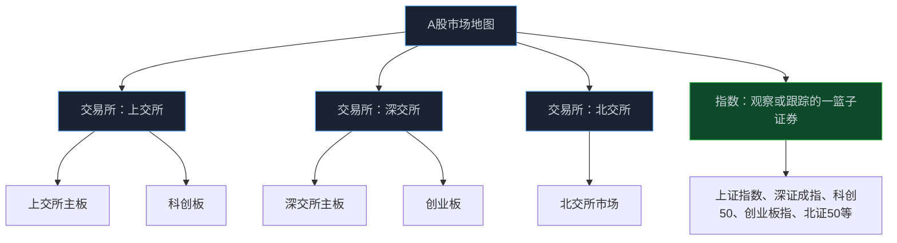

> **系列难度说明**：本篇是**第一章·第三篇**。适合刚开始建立 A 股市场地图的读者，也适合想弄清“交易所、板块、指数”三者区别的人。
>
> **核心收获**：读完后，你能说清沪市、深市、北交所各自是什么，理解交易所和板块不是一回事，并知道市场归属会怎样影响研究入口、流动性和交易规则。
>
> **重要提示**：本文只用于投资者教育，不构成任何证券投资建议。不同市场和板块的投资者适当性、交易安排与规则会更新，交易前应以交易所最新业务规则和券商提示为准。

第一次看行情列表，很多人会有这种感觉：`600`、`000`、`300`、`688`、`8` 开头的代码混在一起，像不同编号的文件夹。

看久了，还会听到更多简称：沪市、深市、北交所；主板、创业板、科创板；上证、深证、北证。它们听起来都像“市场”，很容易混成一团。

其实只要先拆开三个词，地图就清楚了：**交易所是场地，板块是场地里的分区，指数是用来观察或跟踪的一篮子证券。**

<!-- more -->

---

## 先别背代码，先分清三层结构

把 A 股想成一座城市会更直观。

上海证券交易所、深圳证券交易所和北京证券交易所，是三座不同的交易场所。上市公司在符合对应制度要求后，其证券可以在相应场所交易。交易所负责组织交易、审核或安排发行上市相关工作、制定业务规则、监管信息披露等一系列市场运行事务。

主板、创业板、科创板和北交所，则是服务不同类型、不同发展阶段企业的市场分层。其中，主板分别设在上交所和深交所；科创板设在上交所；创业板设在深交所；北交所则是独立的证券交易所，主要服务创新型中小企业。

指数又是另一回事。上证指数、深证成指、科创 50、创业板指、北证 50，都是按特定规则从市场中挑选样本后计算出来的指标。指数涨了，不代表这个交易所的每只股票都涨；一只股票被纳入或调出指数，也不改变它在哪个交易所上市。

后面看到一句“创业板走强”，你就能知道它说的是深交所的一个板块；看到“科创 50 上涨”，你也不会误以为科创板所有公司都同步上涨。

---

## 沪市：不是“上海的股票”，而是上交所组织的市场

上交所是全国性证券交易所。对投资者而言，它最常见的股票市场分区是主板和科创板。

上交所主板覆盖的公司类型很广。你会在这里看到金融、能源、制造、消费、交通运输等许多行业的企业。它不是一个“传统行业专属区”，也不能因为一家公司在沪市主板，就直接推断它成长慢、估值低或分红高。

科创板则是上交所内服务科技创新企业的板块。它在发行上市、交易和信息披露等方面有自己的制度安排。科技创新是它的定位，不是对公司质量的自动认证。科技公司也可能还没盈利、研发投入很高、商业化周期很长；这些特征会让研究重点更偏向技术路径、产品验证、市场空间和现金消耗，而不只是看当期利润。

> **来源**：[上海证券交易所](https://www.sse.com.cn/) — 上交所官网提供主板、科创板、上市公司、交易与监管等官方信息入口。
>
> **来源**：[上交所科创板专栏](https://star.sse.com.cn/) — 科创板官方信息平台，提供发行上市、上市公司披露与市场服务信息。

有人把沪市股票简单称为“`60` 或 `68` 开头的股票”。这可以当作快速识别线索，却不该当作研究结论。代码只帮助你定位市场入口；它无法告诉你公司是否有竞争力、利润能否兑现，或者估值是否合理。

---

## 深市：主板与创业板共同组成另一套市场空间

深交所同样是全国性证券交易所，其市场体系包含主板和创业板。深市上市公司里，制造业、消费、医药、电子、软件、新能源等行业都很常见，但“行业常见”不等于“市场专属”。

创业板面向成长型创新创业企业。研究这类公司时，增长速度往往更显眼，估值也更容易受未来预期影响。可增长不是护城河的同义词。收入高增可能来自行业景气、价格上行、并表或低基数；能不能转化为稳定现金流和资本回报，要继续追踪。

深市主板也不是过去“中小板”的简单别名。市场制度和板块安排会随监管规则调整，拿旧文章里的分类去解释今天的市场，容易把概念讲错。学习时要先回到深交所当前公布的市场体系和业务规则。

> **来源**：[深圳证券交易所市场体系](https://www.szse.cn/marketServices/listing/select/marketSystem/index.html) — 深交所官方页面介绍其全国性交易所定位和市场体系。
>
> **来源**：[深圳证券交易所创业板](https://www.szse.cn/certificate/secondb/) — 深交所创业板官方信息入口。

如果你做过软件架构，会发现这里很像“同一个平台下的不同运行环境”：共用一部分基础设施和监管框架，但各自有不同的准入条件、用户边界和运行规则。不能把一套配置原封不动搬到另一套环境里。

这也是为什么，同样是 A 股，研究一只主板股票和研究一只创业板股票时，除了业务与财务，还要确认它适用哪些交易、披露和投资者适当性规则。

---

## 北交所：服务创新型中小企业，不是“迷你版沪深市场”

北京证券交易所的定位很明确：主要服务创新型中小企业。它与全国中小企业股份转让系统之间存在制度衔接，但北交所本身是独立的证券交易所，不能把它直接等同于“新三板”。

> **来源**：[北京证券交易所本所简介](https://www.bse.cn/company/introduce.html) — 北交所官方介绍明确其主要服务创新型中小企业，并说明其与全国股转系统的衔接关系。
>
> **来源**：[关于高质量建设北京证券交易所的意见](https://www.csrc.gov.cn/csrc/c100028/c7429809/content.shtml) — 证监会文件将北交所定位为多层次资本市场的重要一环，强调服务创新型中小企业。

很多人第一次接触北交所，会只盯着“公司规模较小”“成交不如沪深活跃”这类印象。它们有时确实会影响交易体验，却不是公司优劣的判断。中小企业可能处在一个很有潜力的细分赛道，也可能客户集中、产品单一、抗风险能力较弱；大公司同样可能估值昂贵、增长乏力。

研究北交所公司，除了常规的商业模式、财务报表和估值，还应更重视几个问题：

- 公司的核心客户和供应商是否集中；
- 单一产品、单一技术或单一行业景气变化，会带来多大影响；
- 日常成交额和可交易股本，是否匹配自己的计划仓位；
- 公司处于融资、扩产还是盈利兑现阶段；
- 自己是否符合相关投资者适当性要求。

流动性不是“成交少就一定不好”。它是一种现实约束：当你想买或卖时，市场上有没有足够对手方、买卖价差是否能承受、仓位过大时能否按计划退出。对中小市值或成交活跃度较低的股票，这个问题会更早影响结果。

---

## 交易所不同，会不会让同一家公司变成另一种公司？

不会。公司的客户、产品、技术、管理层和现金流，不会因为证券代码换了前缀就发生本质变化。

但市场归属确实会改变研究和交易的外部环境：

| 你要看的维度 | 市场归属可能带来的差异 | 研究时应该怎么做 |
| --- | --- | --- |
| 发行上市 | 不同板块服务对象与上市标准不同 | 看公司为何适合当前板块，不把板块名称当质量标签 |
| 交易安排 | 涨跌幅、申报、盘后交易、投资者适当性等可能不同 | 每次交易前核对最新规则，不凭旧经验操作 |
| 流动性 | 参与者结构、流通盘、指数产品和成交活跃度不同 | 让仓位大小匹配成交额与退出能力 |
| 估值比较 | 投资者偏好与可比公司池可能不同 | 先按商业模式和行业找可比，再看市场分层 |
| 信息入口 | 交易所披露专区与公告页面不同 | 优先查法定披露，不依赖二手摘要 |

最容易犯的错，是把市场身份变成一个筛选器：“只买沪市”“创业板一定高风险”“北交所就是流动性差”。这些说法最多是粗糙的印象，不能代替对一家公司、一份公告和一条规则的具体分析。

真正值得保留的是这个顺序：**先看公司，再看它所在行业，最后把交易所和板块规则作为理解价格与风险的环境变量。**

---

## 代码能帮你找到门，但不能替你走进去

行情软件通常会用证券代码、交易所标签和板块标签帮助定位证券。对初学者来说，代码前缀确实是一个快速入口；但市场一直在更新，代码规则、存量证券和新证券安排也可能有例外。

更可靠的工作习惯是：

1. 从行情页面确认证券简称、交易所和所属板块；
2. 跳到交易所官网或法定信息披露平台，核对公司公告；
3. 阅读最新定期报告，确认主营业务、风险和股本结构；
4. 交易前再核对该证券适用的投资者适当性和交易规则。

巨潮资讯网是中国证监会指定的上市公司信息披露网站，可作为查询沪深上市公司公告的重要入口。北交所公司则应优先从北交所及相关法定披露渠道检索公告。

> **来源**：[巨潮资讯网](http://www.cninfo.com.cn/new/index.jsp) — 中国证监会指定的上市公司信息披露网站，提供上市公司公告、公司资讯和股东大会网络投票等服务。

这套流程比记住一串代码慢几十秒，但能挡住很多低级误判。比如把指数当股票、把 ETF 当成公司、把同名简称的不同证券混在一起，或者对不适用的交易规则想当然。

---

## 一次练习：用 15 分钟把市场地图装进脑子

打开任意行情软件，随意找三家你没研究过的 A 股公司：一只上交所证券、一只深交所证券、一只北交所证券。不要比较谁更值得买，只做信息定位。

| 要记录的内容 | 你要回答的问题 |
| --- | --- |
| 交易所与板块 | 它在哪个交易所、哪个板块交易？ |
| 主营业务 | 公司靠卖什么产品或服务赚钱？ |
| 总市值与日均成交 | 它的体量和流动性大致如何？ |
| 最近一期公告 | 最近发生了什么可能影响经营或股本的事？ |
| 风险提示 | 公司自己在报告里提示了哪些风险？ |
| 适用规则 | 交易前还要核对哪些权限或交易安排？ |

做完后，你会发现“沪深京”不再只是三个地名，而是三套需要放进研究框架的市场环境。

---

## 小结

- 上交所、深交所和北交所是三个交易场所；主板、科创板、创业板和北交所体现了不同的市场分层与服务定位。
- 指数是按规则选出的证券组合，不等于交易所，也不等于某个板块的全部股票。
- 上交所包含主板和科创板，深交所包含主板和创业板；北交所主要服务创新型中小企业，并与全国股转系统存在制度衔接。
- 交易所和板块不会改变公司的生意本质，却会影响规则、流动性、投资者结构、信息入口和估值环境。
- 代码前缀只适合做定位线索；研究与交易应回到最新规则、法定公告和公司的真实经营。

---

## 下一篇预告

交易所是场地，板块是分区。可主板、创业板、科创板和北交所到底分别在服务什么样的公司？投资者面对的门槛和风险又有什么区别？

下一篇聊聊：**主板、创业板、科创板与北交所。**

---

> **课程导航：第一章·A 股市场地图**
> - 第一篇：股票到底是什么：从代码重新认识股权
> - 第二篇：A 股市场有哪些参与者
> - **第三篇：沪深京三大市场分别是什么** ← 你在这里
> - 第四篇：主板、创业板、科创板与北交所
> - 第五篇：A 股交易规则应该怎么看
> - 第六篇：T+1、涨跌幅与集合竞价
> - 第七篇：融资融券与卖空机制
> - 第八篇：ETF、指数与被动资金
> - 第九篇：IPO、再融资、回购与分红
> - 第十篇：ST、退市与风险识别
