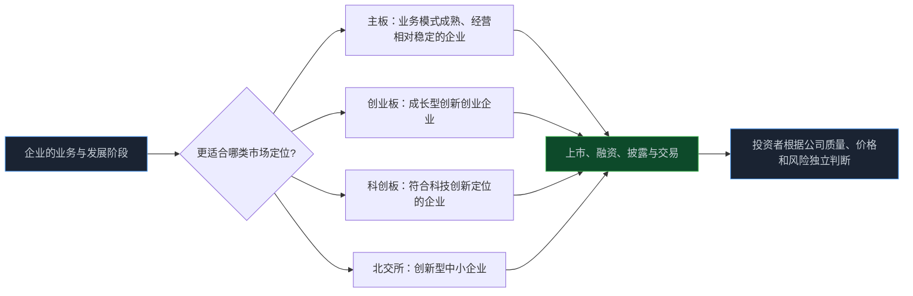
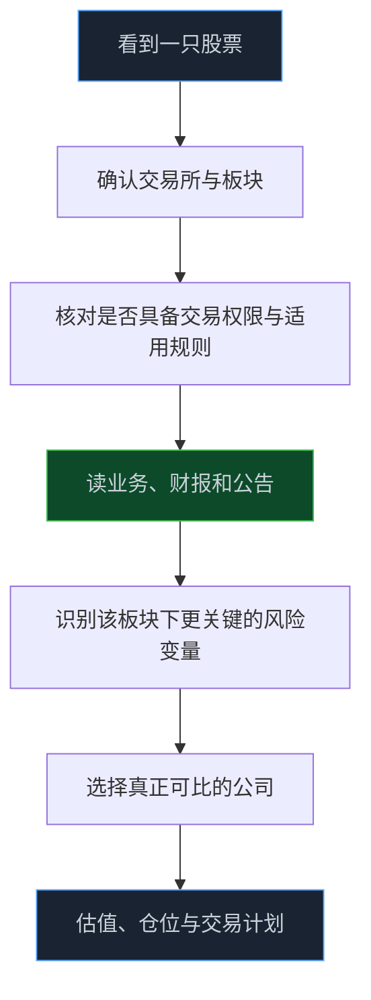

> **系列难度说明**：本篇是**第一章·第四篇**。看过上一节“沪深京三大市场”即可继续，不需要先背上市规则。
>
> **核心收获**：读完后，你能区分主板、创业板、科创板和北交所的服务定位，知道不同板块的常规涨跌幅与个人投资者适当性要求，也不会把“在哪个板上市”误当成公司好坏的结论。
>
> **重要提示**：本文只用于投资者教育，不构成任何证券投资建议。投资者适当性、交易规则和上市标准可能调整；实际参与前，请以交易所最新规则、券商系统提示和风险揭示文件为准。

同样是做芯片的公司，一家在科创板，一家在创业板；同样是制造企业，一家在主板，一家在北交所。

很多人会立刻开始排序：科创板更“科技”，创业板更“成长”，主板更“稳”，北交所更“小”。这些印象不是完全没有来由，但拿它们直接给公司打分，往往会看偏。

板块解决的是：**什么类型的企业可以在这里融资、披露和交易。**

投资真正要解决的是：**这家公司现在值不值得以这个价格承担它的风险。**

两件事有关，却不是同一件事。

<!-- more -->

---

## 为什么一套 A 股市场要分成四个板块

企业不是在同一个阶段长大的。

有的公司已经有成熟的产品、稳定的客户和持续的利润；有的公司收入增长很快，却还在大量投入研发；有的公司扎根细分行业，规模不大，但技术、客户关系或区域渠道很有特色。

如果所有企业都用一套上市标准、交易制度和投资者准入要求，市场要么会把早期创新企业挡在门外，要么会让不适合承受高波动的投资者暴露在过高风险里。

主板、创业板、科创板与北交所的分层，试图在企业融资需求、信息披露、市场定价和投资者保护之间做不同安排。它不是给企业颁发“优等生证书”，更像为不同类型的业务提供不同运行环境。

证监会关于首次公开发行股票注册管理的规则，也强调发行人申请上市需要符合相应板块定位。对投资者来说，板块定位是研究公司的起点，而不是研究的终点。

> **来源**：[首次公开发行股票注册管理办法](https://www.csrc.gov.cn/csrc/c101953/c7121923/7121923/files/%E9%99%84%E4%BB%B61%EF%BC%9A%E9%A6%96%E6%AC%A1%E5%85%AC%E5%BC%80%E5%8F%91%E8%A1%8C%E8%82%A1%E7%A5%A8%E6%B3%A8%E5%86%8C%E7%AE%A1%E7%90%86%E5%8A%9E%E6%B3%95.pdf) — 规则要求发行人申请首次公开发行股票并上市时符合相关板块定位，并对不同板块作出差异化安排。

---

## 主板：别把“成熟”理解成“没有风险”

主板分别设在上交所和深交所，覆盖行业范围很广。很多业务模式相对成熟、经营规模较大、市场认知度较高的公司会在这里上市，但这不是一张“稳赚不赔”的名单。

成熟企业常见的研究重点，和早期成长企业确实不太一样。你可能会更多关注：

- 收入和利润能不能稳定增长；
- 经营现金流是否能覆盖资本开支；
- 资产负债表是否承受得住周期波动；
- 分红、回购与再投资，哪一种资本配置更合理；
- 行业已经成熟后，公司还能靠什么提高回报率。

主板公司里既有现金流稳定的行业龙头，也有处于周期下行、转型失败或治理存在问题的企业。公司所在主板，最多说明它适用了主板的制度安排；它不能替你完成商业模式、财务质量和估值判断。

上交所已发布《上海证券交易所股票上市规则（2026 年 4 月修订）》。规则会持续更新，所以看主板公司时，别从几年前的经验贴里找交易和披露结论。

> **来源**：[上海证券交易所股票上市规则（2026 年 4 月修订）](https://www.sse.com.cn/lawandrules/sselawsrules2025/stocks/mainipo/c/c_20260424_10816589.shtml) — 上交所主板上市规则的官方文本与更新入口。

---

## 创业板：增长故事要落到可验证的经营数据上

创业板设在深交所，服务成长型创新创业企业。这里的“成长”常常意味着收入增速、市场空间和行业渗透率更容易成为价格讨论的中心。

不过，增速是结果，不是原因。

一家公司营收增长 50%，可能因为新产品真正打开了市场，也可能因为行业短期缺货、产品降价换量、并购并表，或者去年基数太低。看创业板公司，不能只把增长率写进表格，要继续追问：增长由销量、价格、客户扩张还是会计合并驱动？毛利率和经营现金流有没有跟上？研发投入能否形成产品能力？

创业板的常规涨跌幅限制为 20%，首次公开发行上市股票在上市后的前 5 个交易日不设价格涨跌幅限制。更大的日内波动空间，并不会让价值判断失效，反而要求投资者对估值、仓位和退出流动性更敏感。

新申请开通创业板交易权限的个人投资者，一般需要满足申请前 20 个交易日证券账户及资金账户内资产日均不低于人民币 10 万元、参与证券交易 24 个月以上等条件，并按要求完成风险揭示。具体认定口径由券商依规执行。

> **来源**：[创业板投资者适当性管理实施办法问答](https://investor.szse.cn/investor/knowledge/t20200513_577026.html) — 深交所投资者教育页面说明新开通创业板权限的个人投资者条件与风险揭示要求。
>
> **来源**：[深圳证券交易所创业板交易特别规定](https://www.szse.cn/lawrules/rule/repeal/rules/P020231230545310237980.pdf) — 创业板交易特别规定的官方文本。

适当性门槛不是“达到资产要求就更适合交易”的认证。它只是参与规则的一部分。真正的门槛在于：如果一只股票连续出现大幅波动，你的研究能否解释它，你的仓位是否允许你冷静处理它。

---

## 科创板：研究科技，不是只研究“科技概念”

科创板设在上交所，服务符合科技创新定位的企业。它允许市场对研发投入高、商业化周期较长、不同盈利状态的科技企业进行定价，这使得传统“看当期净利润、给一个 PE”有时不够用。

研究科创板公司，常常需要把视角往前移一点：技术路线是否有替代风险？产品处在验证、放量还是成熟阶段？客户导入是否可持续？研发费用是形成了产品能力，还是只是维持竞争位置？未来几年的资本开支和现金消耗能否承受？

这并不是说科创板不需要利润。恰恰相反，越是利润还没有完全体现的公司，越要对收入质量、单位经济模型、毛利率趋势和自由现金流保持警惕。远期空间越大，估值对假设越敏感；一两个关键变量没有兑现，价格波动往往也会更大。

科创板股票在常规交易日适用 20% 的涨跌幅限制；首次公开发行上市股票在上市后的前 5 个交易日不设价格涨跌幅限制。个人投资者新开通科创板股票交易权限，通常需要满足申请前 20 个交易日证券账户及资金账户内资产日均不低于人民币 50 万元、参与证券交易 24 个月以上等条件，并完成风险承受能力评估和风险揭示。

> **来源**：[聚焦科创板投资者适当性管理](http://edu.sse.com.cn/tib/qa/c/4752417.shtml) — 上交所投资者教育材料说明科创板个人投资者准入条件与风险揭示要求。
>
> **来源**：[科创板股票交易特别规定](https://www.sse.com.cn/lawandrules/sselawsrules/repeal/rules/c/10118601/files/f6fc4a1d4c1f469183a013c4dc36a535.pdf) — 科创板股票交易的官方特别规定。
>
> **来源**：[上海证券交易所科创板股票上市规则（2026 年 4 月修订）](https://www.sse.com.cn/lawandrules/sselawsrules2025/stocks/staripo/c/c_20260424_10816592.shtml) — 科创板上市规则官方文本与更新入口。

“硬科技”不是估值豁免权。技术名称再前沿，也要回到客户为什么付费、公司能赚到多少钱、竞争对手能否追上，以及现在的价格已经包含了多少乐观预期。

---

## 北交所：小公司不等于小机会，也不等于低风险

北交所主要服务创新型中小企业。这里有很多处在细分行业、专业化程度较高的公司。它们可能在一个窄但有壁垒的市场里做得很好，也可能受到客户集中、产品单一、规模较小和流动性不足的约束。

这类公司的研究要更具体。比如一家工业零部件公司收入增长很快，不能只看“专精特新”标签，还要确认它的主要客户是否集中、是否依赖单一大客户采购、技术是否容易替代、扩产后订单是否足以消化、应收账款会不会随增长失控。

北交所股票的常规涨跌幅限制为 30%。波动区间更大，不等于收益空间更大；它同时意味着估值错误、流动性变化或情绪冲击可能更快地反映到账户里。对于成交活跃度相对较低的证券，买卖价差和退出难度也是实际风险的一部分。

个人投资者参与北交所股票交易，适用投资者适当性管理。北交所现行适当性管理办法和券商风险揭示文件，是确认自己能否参与及相关要求的优先依据；市场上常见的“50 万元资产、2 年交易经验”是常见准入表述，但应由券商按照最新规则和账户情况认定。

> **来源**：[北京证券交易所投资者适当性管理办法](https://www.bse.cn/jygl_list/200018386.html) — 北交所发布的投资者适当性管理规则与公告。
>
> **来源**：[热点问答：北交所股票交易规则篇](https://www.bse.cn/qt/200025234.html) — 北交所官方问答说明股票竞价交易的价格涨跌幅限制等交易安排。

北交所不是沪深市场的“低配版”，也不是只要小市值就容易被低估。它要求投资者把流动性、研究覆盖度和企业经营的不确定性，一起装进风险预算里。

---

## 一张表先建立直觉，交易前再回到规则

下表只整理常见情形，便于建立大方向。新股上市、风险警示证券、停复牌、盘后交易等具体情况可能适用特别安排，任何一次实际下单都应再核对交易所最新规则。

| 板块 | 所在市场 | 服务定位的关键词 | 常规涨跌幅限制 | 新开通个人权限的常见要求 | 研究时更容易忽略的点 |
| --- | --- | --- | --- | --- | --- |
| 主板 | 上交所、深交所 | 业务模式成熟、经营相对稳定 | 10% | 通常无板块单独的资产与交易经验门槛 | 成熟不代表低估，也不代表不会遇到周期与治理风险 |
| 创业板 | 深交所 | 成长型创新创业企业 | 20% | 20 个交易日日均资产 10 万元、24 个月交易经验等 | 高增长能否变成现金流与资本回报 |
| 科创板 | 上交所 | 符合科技创新定位的企业 | 20% | 20 个交易日日均资产 50 万元、24 个月交易经验等 | 技术路径、商业化进度与远期假设的敏感性 |
| 北交所 | 北京证券交易所 | 创新型中小企业 | 30% | 常见为 20 个交易日日均资产 50 万元、24 个月交易经验等 | 客户集中、流动性和小规模经营的脆弱性 |

表中的数字不是让你挑“波动最大”的板块，而是让你明白：同样一笔 10% 的价格变化，在不同制度和流动性环境下，后续可能面对的交易选择并不一样。

还有一个容易混淆的点：没有直接交易权限，不等于完全无法获得相关市场的风险暴露。部分公募基金、ETF 等产品可能投资相关板块证券，但产品本身也有自己的投资范围、跟踪误差、费率和风险。买基金不是绕开风险，而是把直接选股风险转换成另一种组合风险。

---

## 不要把板块当成选股器，试着这样用它

面对一家公司，板块信息真正能帮你完成四件事。

**确认你该看哪些风险。** 主板公司可以重点看成熟期的资本配置和周期波动；成长板块公司要多看产品验证、收入质量和现金消耗；北交所公司还要把流动性和客户集中度放到更靠前的位置。

**确认你适用哪些规则。** 交易权限、涨跌幅、申报方式和新股安排，会影响你的实际操作，不是行情软件里一个可忽略的角标。

**找到合理的可比对象。** 板块可以提供线索，但可比公司应当先在商业模式、盈利质量、增长阶段和资本结构上相似。把一家成熟制造公司只拿去和热门科技公司比估值，结论通常没有意义。

**理解市场在交易什么预期。** 科创板和创业板的价格，往往对远期增长和技术兑现更敏感；主板某些行业可能更看重现金流、分红和周期位置；北交所公司则可能同时受成长预期与流动性折价影响。这里说的是“可能”，不是机械公式。

顺序很重要。先因为“它在科创板”就买，和先因为“它在北交所”就回避，本质上都是把标签放在了研究前面。

---

## 一次练习：同一行业，跨板块做一轮比较

找一个你能看懂的行业，例如设备制造、医药、软件或消费。各找一家公司：主板、创业板、科创板或北交所中任选两到三家，不要求每个板块都齐全。

用下面四个问题做一页笔记：

1. 它们卖的是相似产品，还是只是同一个行业名称？
2. 目前更关键的变量是什么：现金流、增长、研发兑现、客户集中，还是流动性？
3. 估值差异更多来自业务质量，还是来自市场对未来的不同预期？
4. 如果你真要交易，板块规则和成交活跃度会怎样改变你的仓位上限？

这份练习的目的不是找出“哪个板块最好”，而是训练你看见：**板块是背景，公司才是主体，价格和仓位决定最终结果。**

---

## 小结

- 主板、创业板、科创板和北交所服务不同类型企业，分层不是公司质量的排行榜。
- 主板更常见成熟经营问题；创业板更需要验证增长质量；科创板更需要拆解技术与商业化；北交所更要重视中小企业经营与流动性约束。
- 常规情形下，主板、创业板和科创板、北交所的价格涨跌幅限制不同；新股和特殊证券可能适用特别安排。
- 创业板、科创板和北交所设有投资者适当性要求。达到门槛只代表满足参与条件，不代表风险承受能力足够。
- 板块信息应该帮助你找风险、读规则、选可比，而不是替你做买卖判断。

---

## 下一篇预告

市场地图、参与者和板块都认识了，接下来要把视线放到真正会影响下单的一层：交易规则。

为什么一笔订单有时成交，有时撤单？盘前、盘中、收盘后分别在发生什么？交易规则更新后，旧经验为什么可能失效？

下一篇聊聊：**A 股交易规则应该怎么看。**

---

> **课程导航：第一章·A 股市场地图**
> - 第一篇：股票到底是什么：从代码重新认识股权
> - 第二篇：A 股市场有哪些参与者
> - 第三篇：沪深京三大市场分别是什么
> - **第四篇：主板、创业板、科创板与北交所** ← 你在这里
> - 第五篇：A 股交易规则应该怎么看
> - 第六篇：T+1、涨跌幅与集合竞价
> - 第七篇：融资融券与卖空机制
> - 第八篇：ETF、指数与被动资金
> - 第九篇：IPO、再融资、回购与分红
> - 第十篇：ST、退市与风险识别
