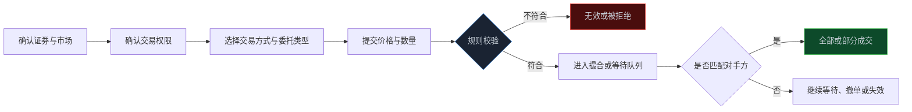
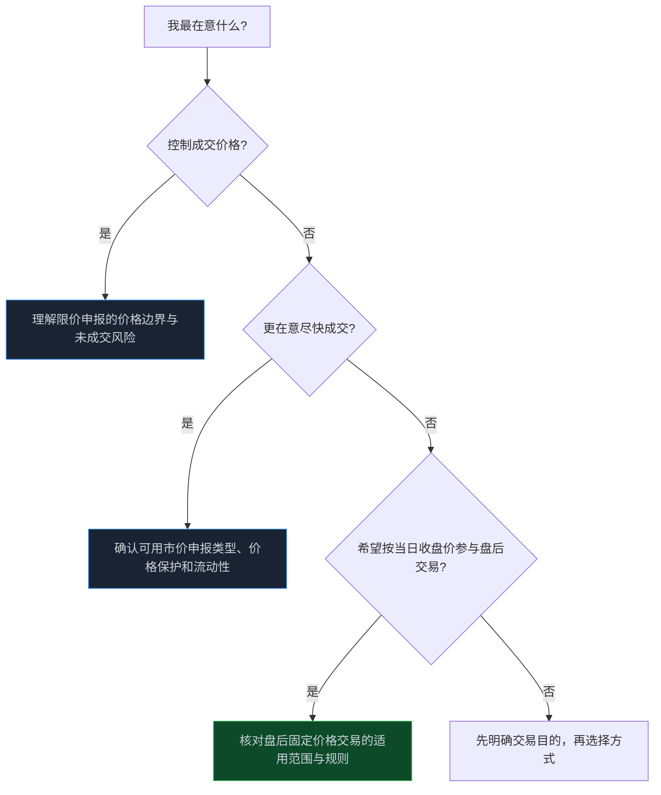
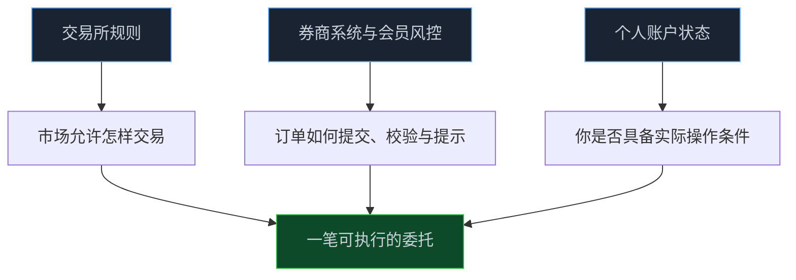

> **系列难度说明**：本篇是**第一章·第五篇**。不要求你背交易条款，但会要求你在下单前知道自己受哪套规则约束。
>
> **核心收获**：读完后，你会知道一笔交易从委托到成交经过哪些规则节点，能用“交易所—证券—交易方式—时段—规则版本”的顺序核对信息，也能分辨哪些内容该记住、哪些内容应在交易前查最新规则。
>
> **重要提示**：本文只用于投资者教育，不构成任何证券投资建议。交易规则、券商系统功能和投资者适当性要求可能更新；实际下单前，请以交易所现行规则、券商交易端说明和风险揭示文件为准。

很多交易亏损，看起来像判断错了，实际上是规则没搞清楚。

你以为挂出去就一定能成交，结果订单排在队列后面；你以为可以撤单，发现委托已经进入不能撤的阶段；你以为收盘价就是最后一笔成交价，实际某些证券的收盘形成机制并不是你想的那样。

规则不负责告诉你买什么，却决定了你能不能按自己的计划买卖。

这就像写程序时的接口约定。业务逻辑再漂亮，参数类型、调用时机、错误分支没弄清，系统照样会在最关键的地方出问题。

<!-- more -->

---

## 交易规则不是一本书，而是一条执行链

你在 App 上点下“买入”，看到的是一个按钮。市场真正收到的是一条委托：买什么证券、买多少、用什么价格、在哪种交易方式和什么时段提交。

之后，它可能成交、部分成交、继续等待、被撤销，或者因为不符合规则而无效。每一步都由规则决定。



所以，学习交易规则不是记几个时间点，而是每次都能回答五个问题：

1. 我交易的是哪一类证券，在哪个交易所或板块？
2. 我有没有对应交易权限，账户状态是否满足要求？
3. 当前属于哪种交易方式和交易时段？
4. 价格、数量、申报类型和撤单是否符合规则？
5. 成交后，资金和证券在什么时间变成可用、可卖或可取？

后面几篇会分别讲 T+1、涨跌幅、集合竞价、融资融券和 ETF。本篇先把阅读规则的骨架搭起来。

---

## 第一层：先找对“你正在交易的东西”

A 股不是一个完全统一的交易对象。股票、ETF、封闭式基金、可转债、REITs、存托凭证，可能出现在同一个行情软件里，但适用的交易安排不一定相同。

就算都是股票，主板、创业板、科创板、北交所的交易制度也可能不同。规则里写的“股票”，有时是一般性安排；有时又会在板块特别规定、风险警示证券安排或新股期间规则中出现例外。

这也是为什么不能只在网上搜一句“股票能不能当天卖”“几点可以撤单”，然后拿答案套到所有证券上。

一个更可靠的定位顺序是：

```text
证券简称与代码
  ↓
交易所与板块
  ↓
证券类别
  ↓
是否属于新股、风险警示证券、停复牌证券等特殊状态
  ↓
当前可用的交易方式
  ↓
对应的现行规则与券商提示
```

比如，你看到的是 ETF，收盘阶段的形成机制就未必和股票完全一样；你面对的是风险警示证券，就不能机械照搬普通股票的经验；你交易的是新上市证券，更要确认是否处于无价格涨跌幅限制等特殊期间。

先定位对象，再找规则。这和排查线上故障先确认运行环境、版本和输入条件是一个道理。

---

## 第二层：同一句“交易规则”，必须问它是哪一年的版本

规则会更新，而且更新后，旧的经验贴往往还在网上流传。

2026 年 7 月 6 日起，沪深北交易所修订后的交易规则已施行。上交所、深交所和北交所都发布了新的规则文本与配套解读。你不需要把每一项改动背下来，但要养成一个习惯：**看到涉及交易时段、价格限制、收盘机制、申报或撤单的结论，先核对它对应哪一版规则。**

上交所本轮修订扩大了盘后固定价格交易的适用范围，覆盖全部 A 股和 ETF；基金收盘阶段的交易机制也有调整；主板风险警示股票的涨跌幅限制安排同步变化。它们都说明一件事：交易制度不是永远不动的背景板。

> **来源**：[上交所修订发布《上海证券交易所交易规则》](https://star.sse.com.cn/aboutus/mediacenter/hotandd/c/c_20260424_10816474.shtml) — 上交所公布 2026 年交易规则修订要点，并说明规则自 2026 年 7 月 6 日起施行。
>
> **来源**：[上海证券交易所交易规则（2026 年修订）](https://www.sse.com.cn/lawandrules/sselawsrules2025/stocks/exchange/c/c_20260424_10816482.shtml) — 上交所现行交易规则文本。
>
> **来源**：[深圳证券交易所交易规则（2026 年修订）](https://www.szse.cn/lawrules/rule/allrules/bussiness/t20260424_620190.html) — 深交所公布的现行交易规则，文件明确自 2026 年 7 月 6 日起施行。
>
> **来源**：[北京证券交易所修订发布交易规则](https://www.bse.cn/important_news/200028215.html) — 北交所公布 2026 年交易规则修订情况与规则获取入口。

这里有个简单但好用的原则：

- **概念可以长期记忆**：撮合、委托、成交、撤单、结算、适当性；
- **数字必须临近交易时核对**：时间、比例、数量、价格范围、权限和特殊证券安排。

把具体数字当成常识，最容易在规则更新后出错。

---

## 一笔委托里，藏着四个容易被忽略的约束

### 价格：不是你想填多少就能填多少

限价委托会要求你给出价格，但这个价格并非无限自由。它要落在证券适用的价格范围内，还可能受到涨跌幅、有效申报价格范围和交易方式本身的限制。

价格限制的目的不是替投资者判断贵不贵，而是让撮合和价格发现能在可控的秩序里进行。你觉得某只股票值 100 元，不代表在当前规则与当前时点就可以直接报出 100 元。

### 数量：不是每次想买几股都行

最基础的单位规则是“申报数量”。不同证券、不同市场和不同申报方式，对单笔数量、最小变动单位、零股卖出等都会有规定。

这类规则平时不显眼，却会在你处理小额仓位、分批建仓、卖出剩余零股时直接影响操作。别把交易软件默认填好的数量当成所有情形都适用的规则。

### 时间：同一天里，规则也在切换

盘前、开盘集合竞价、连续竞价、收盘集合竞价和盘后交易，可能对应不同的撮合、撤单和价格形成安排。市场不是从开盘到收盘只运行一种模式。

下一篇会把这些时段逐一拆开。现在只要先记住：下单时不但要看“今天是什么日子”，还要看“现在是什么阶段”。

### 成交：提交成功，不等于成交成功

委托显示“已报”，意思通常是订单已经进入系统等待处理；它不是成交确认。若买入价低于市场可卖价格，或卖出价高于市场可买价格，订单可能一直等待；若只匹配到一部分对手方，就会部分成交。

交易所的规则和撮合机制决定订单如何排队、以什么价格成交。对个人投资者来说，最实用的认知是：**订单的状态要看成交回报，不能只看是否点击成功。**

---

## 限价、市价、盘后固定价格：不是“高级按钮”，而是不同的交易意图

最常见的是限价申报：你写明愿意接受的最高买入价或最低卖出价。它的优点是你能控制价格边界，代价是可能完全不成交或只成交一部分。

市价申报更强调尽快成交，但不同市场接受哪些市价申报方式、如何保护价格、剩余未成交部分怎样处理，都要按规则和券商交易端支持的类型来理解。市价不等于“任何价格都可以接受”，更不是在流动性差的证券中可以忽略冲击成本的理由。

盘后固定价格交易则服务于另一种需求：在规定时段内，以当日收盘价进行申报和成交。2026 年规则调整后，上交所盘后固定价格交易的适用范围扩大至全部 A 股和 ETF；具体的申报时段、适用证券和委托限制，仍应在操作前从交易所规则及券商端核对。



不要为了“看起来更专业”去选择不理解的申报方式。一个能解释清楚的限价单，通常比一次模糊的冲动下单更有价值。

---

## 交易所规则、券商规则和你的账户设置，三者要一起看

交易所规则决定市场层面的底线：什么证券可以怎样交易，订单如何进入撮合，哪些行为不被允许。

券商作为会员和受托方，还会在交易端提供具体功能、风险提示、权限开通、委托入口与风控校验。同一项交易所制度，在不同券商 App 上可能呈现为不同按钮、不同菜单名称或不同的二次确认步骤。

你的账户设置也会影响可操作范围：是否开通板块权限、是否持有可卖证券、可用资金多少、是否存在冻结资金或未完成委托、风险测评状态如何，都会改变“我能不能下这笔单”的答案。



遇到“为什么我买不了”时，别急着把它归结为系统故障。按这个顺序排查更快：证券是否适用对应规则？板块权限是否开通？委托价格和数量是否合规？可用资金或可卖数量是否足够？该时段是否接受这种委托？

这套排查路径，也比在群聊里问“怎么突然不能买了”更容易得到可靠答案。

---

## 规则的目的，是降低操作意外，不是消除投资风险

理解规则后，仍然会亏钱。规则不会替你判断公司质量，也不会阻止你在高估值时买入，更不会保证流动性一直充足。

但规则能减少另一类本可避免的损失：

| 常见误解 | 可能出现的问题 | 更好的做法 |
| --- | --- | --- |
| “下单成功就是买到了” | 委托未成交或只成交一部分，仓位与计划不一致 | 看订单状态、成交回报和剩余委托 |
| “撤单一定来得及” | 订单已成交，或进入不接受撤单的阶段 | 下单前了解所处交易时段与委托限制 |
| “价格能填出来就会有效” | 报价超过有效范围，形成无效申报 | 确认证券状态与适用价格规则 |
| “同一规则所有证券都一样” | 用股票经验处理 ETF、新股或风险警示证券 | 先确认证券类别与特殊状态 |
| “交易所规则看过一次就够了” | 新规施行后仍按旧机制操作 | 遇到具体问题时核对现行官方文本 |

规则的价值很像安全带：它不能让路上没有风险，却能避免你因为一个本可预见的动作失误，把问题放大。

---

## 一份交易前规则清单

以后在交易任何自己不熟悉的证券前，不妨花两分钟过一遍：

```text
[ ] 我确认了证券类别、交易所、板块和当前特殊状态
[ ] 我具备交易权限，账户状态正常
[ ] 我知道当前交易时段和拟使用的交易方式
[ ] 我理解价格、数量、涨跌幅及撤单的相关限制
[ ] 我知道委托成功、部分成交和完全成交分别意味着什么
[ ] 我知道成交后资金与证券的可用、可卖安排
[ ] 我查看的是交易所现行规则与券商提示，不是旧截图
```

如果其中有一项答不上来，最稳妥的动作不是“先试试”，而是先不下单。规则问题查清了再做决定，成本往往远低于一次错误交易。

---

## 小结

- 交易规则决定一笔委托能否进入市场、如何撮合、何时成交或撤销，不负责判断证券是否值得买。
- 读规则要先定位证券、交易所、板块、特殊状态和交易方式，不能把一条经验套给所有品种。
- 2026 年 7 月 6 日起，沪深北交易所修订后的交易规则已施行；涉及具体数字和时段时，应优先核对最新官方文本。
- 价格、数量、时段和成交状态，是每次委托最核心的四组约束。
- 交易所规则、券商系统和个人账户状态共同决定一笔订单能否真正执行。

---

## 下一篇预告

交易规则的骨架有了，接下来拆最容易让人误操作的几个节点。

为什么今天买入的股票通常不能今天卖？涨跌幅限制到底怎么计算？盘前和收盘前的集合竞价，又是在怎样形成价格？

下一篇聊聊：**T+1、涨跌幅与集合竞价。**

---

> **课程导航：第一章·A 股市场地图**
> - 第一篇：股票到底是什么：从代码重新认识股权
> - 第二篇：A 股市场有哪些参与者
> - 第三篇：沪深京三大市场分别是什么
> - 第四篇：主板、创业板、科创板与北交所
> - **第五篇：A 股交易规则应该怎么看** ← 你在这里
> - 第六篇：T+1、涨跌幅与集合竞价
> - 第七篇：融资融券与卖空机制
> - 第八篇：ETF、指数与被动资金
> - 第九篇：IPO、再融资、回购与分红
> - 第十篇：ST、退市与风险识别
