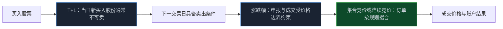
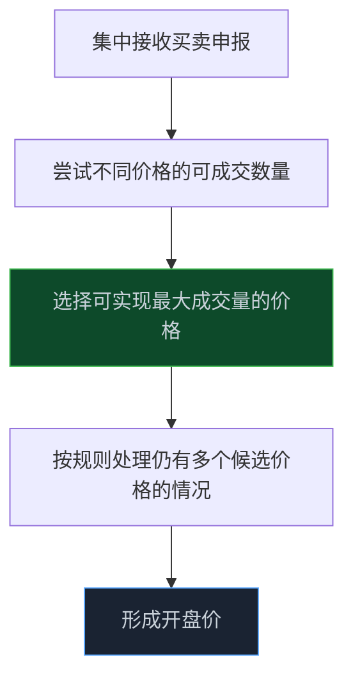

> **系列难度说明**：本篇是**第一章·第六篇**。读完上一节交易规则的框架后，可以直接进入本篇。
>
> **核心收获**：读完后，你能区分“可买”“可卖”“可取”三种账户状态，理解不同板块常规涨跌幅的意义，也能说清开盘和收盘集合竞价是怎样影响价格形成的。
>
> **重要提示**：本文只用于投资者教育，不构成任何证券投资建议。本文讨论的是 A 股股票竞价交易的常见安排；ETF、可转债、新股、风险警示证券、停复牌证券等可能适用特别规则。实际交易前，请以交易所现行规则与券商交易端提示为准。

你早上刚买进一只股票，午后它突然大涨。想卖掉锁住利润，交易软件却不让卖。

这不是系统卡住了，也不是券商故意拦你。大多数 A 股股票采用 T+1 回转交易安排：**当天新买入的股份，通常要到下一个交易日才能卖出。**

再看另一个场景。你看到盘前竞价里价格一路跳高，觉得要高开，开盘后却很快回落。不是有人“骗了你”，而是集合竞价和连续竞价本来就在解决不同的问题。

T+1、涨跌幅、集合竞价，表面上是三个术语，实际上一起规定了：你什么时候能动、一天最多能动多大、价格又是怎样被撮合出来的。

<!-- more -->

---

## 先把三件事放到一张图里

一笔股票交易从买入到卖出，至少会经过三个约束层：



- **T+1** 管的是新买入的股票何时可以卖；
- **涨跌幅限制** 管的是日常情况下价格能在多大范围内波动；
- **集合竞价** 管的是开盘和收盘阶段，订单如何集中形成一个价格。

它们不是预测工具。它们只是在市场高波动时，替你划出操作边界。

---

## T+1：限制的是当日新买的股份，不是让你一天什么都做不了

最常见的误解是：“T+1 就是今天买了，今天什么都不能动。”

不准确。

假设你昨天已经持有 1,000 股某股票，今天上午又买入 500 股。午后你仍然可以卖出昨天持有的 1,000 股；不能在当天卖出的，是今天新买入的那 500 股。

所以，持仓页面里的“持仓数量”“可卖数量”和“当日买入”要分开看。它们不是同一个字段。

```text
昨日持仓：1,000 股
今日买入：  500 股
持仓总数：1,500 股
当日可卖：1,000 股
```

这也是很多人第一次做日内调仓时会误判仓位的地方。你以为自己能立刻退出 1,500 股，实际可卖的可能只有 1,000 股。行情越剧烈，这个差别越重要。

上交所现行交易规则明确，投资者当日买入的股票除交易所另有规定外，不得在当日卖出。科创板股票同样遵循这一基本安排。新股前几个交易日不设日涨跌幅限制，也不代表它变成了 T+0。

> **来源**：[上海证券交易所交易规则（2026 年修订）](https://www.sse.com.cn/lawandrules/sselawsrules2025/stocks/exchange/c/c_20260424_10816482.shtml) — 上交所现行交易规则对股票回转交易、竞价时段和价格涨跌幅限制作出规定，规则自 2026 年 7 月 6 日起施行。
>
> **来源**：[深圳证券交易所交易规则（2026 年修订）](https://www.szse.cn/lawrules/rule/allrules/bussiness/t20260424_620190.html) — 深交所公布的现行交易规则与附件入口，规则自 2026 年 7 月 6 日起施行。

### 股票、资金、可取资金，不要混成一个概念

卖出股票后，交易软件里的资金状态也常让人困惑。

- **可用资金**：通常可以继续用于当日买入其他证券；
- **可取资金**：能否转出到银行卡，取决于结算与券商资金安排；
- **可卖数量**：你当前能卖出的证券数量，受 T+1 和原有持仓影响。

不同券商对界面字段的命名可能不同。不要只凭“账户余额增加了”就默认资金已经可以全部转出；也不要因为卖出所得还能买别的股票，就误以为股票买入也能当天卖出。

对于做过后端或数据工程的人，这很像状态机：同一笔资产会依次经历“已委托、已成交、可用、可卖、可取、已结算”等状态。看到数值变化之前，先确认它处在哪个状态。

---

## 涨跌幅：它是日内价格边界，不是风险上限

“涨停了就安全”“跌停了就跌不动了”，这两句话都经不起推敲。

日常竞价交易中，常见板块的价格涨跌幅限制如下。这里仅用于建立基本直觉；新上市证券、风险警示证券和其他特殊情形可能适用不同安排。

| 常见证券范围 | 日常竞价交易的涨跌幅限制 | 你真正该理解的事 |
| --- | ---: | --- |
| 沪深主板普通股票 | 10% | 一天的边界较窄，不代表隔夜没有跳空风险 |
| 创业板股票 | 20% | 更大的价格空间，会放大仓位和估值错误的影响 |
| 科创板股票 | 20% | 远期预期变化常更敏感，20%不是“更容易赚钱” |
| 北交所股票 | 30% | 波动与流动性风险要一起看，不能只看涨跌幅数字 |

主板风险警示股票、首次公开发行上市股票在特定期间，以及其他特殊证券，可能适用不同价格限制或特别安排。尤其是沪深交易所 2026 年修订交易规则后，主板风险警示股票的日涨跌幅安排已经调整；遇到 ST、*ST、新股或复牌等情形，直接以该证券当日的交易提示和现行规则为准，不要套普通股票的表格。

> **来源**：[上交所修订发布《上海证券交易所交易规则》](https://www.sse.com.cn/aboutus/mediacenter/hotandd/c/c_20260424_10816474.shtml) — 上交所公布的修订说明包括主板风险警示股票涨跌幅安排调整等内容。
>
> **来源**：[深圳证券交易所创业板交易特别规定](https://docs.static.szse.cn/www/disclosure/notice/general/W020200612831351578076.pdf) — 深交所创业板竞价交易常规涨跌幅限制为 20%。
>
> **来源**：[北交所股票交易规则问答](https://www.bse.cn/qt/200025234.html) — 北交所官方问答说明其股票竞价交易常规涨跌幅限制为前收盘价的 30%。

### 10%、20%、30%，对仓位意味着什么

假设账户有 10 万元，一次性买入 5 万元股票。

- 若当日价格波动 10%，账面变化约为 5,000 元；
- 若当日价格波动 20%，账面变化约为 10,000 元；
- 若当日价格波动 30%，账面变化约为 15,000 元。

这只是静态演示，没有考虑隔夜跳空、连续波动、成交价格偏离和手续费。它要说明的是：**波动空间翻倍时，仓位承受的压力也会直接放大。**

涨跌幅限制不是损失上限。股票可以连续多个交易日下跌；在无涨跌幅限制期间，价格可能出现更大波动；即使没有跌停，流动性不足也可能让你无法在预期价格成交。

所以别把“今天最多跌 10%”翻译成“最多只会亏 10%”。真正的风险要看持有期间、仓位、基本面变化和退出能力。

---

## 新股不设涨跌幅，不等于没有边界

首次公开发行上市的股票，在不同市场和板块可能存在无价格涨跌幅限制的特别期间。科创板和创业板的首次公开发行上市股票，上市后的前 5 个交易日不设价格涨跌幅限制；北交所新上市股票也有其特别安排。

“无涨跌幅限制”常被误读成“价格可以无限冲”。实际上，交易所仍会设置有效申报价格范围、盘中临时停牌等机制。对于科创板、创业板等无涨跌幅限制期间的股票，价格相对开盘价达到特定幅度时可能触发盘中临时停牌；恢复交易后，市场仍在继续定价。

你真正需要知道的不是临停的具体阈值，而是两个事实：

1. 没有日涨跌幅限制时，价格发现更快，错误定价也会更快地反映出来；
2. 新股上市早期缺少足够的历史交易数据，估值锚往往更弱，不能把短时价格表现当成企业价值结论。

> **来源**：[创业板投资者常见问题解答（一）](https://www.csrc.gov.cn/csrc/c100210/c1498837/content.shtml) — 证监会投资者教育材料说明，创业板首次公开发行上市股票前 5 个交易日不设价格涨跌幅限制，之后适用 20%限制。
>
> **来源**：[科创板股票交易特别规定](https://www.sse.com.cn/lawandrules/sselawsrules/repeal/rules/c/10118601/files/f6fc4a1d4c1f469183a013c4dc36a535.pdf) — 科创板股票交易的特别规定与投资者适当性、价格机制相关条款。

这类证券尤其考验一个能力：当市场给不出稳定锚点时，你有没有自己的研究锚点。没有估值区间、没有仓位上限、没有退出条件时，盯盘只会让情绪替代判断。

---

## 集合竞价：不是“谁挂得高谁就赢”

开盘前和收盘前，市场不会像盘中一样一笔一笔持续撮合，而是把一段时间内的买卖申报集中起来，寻找一个可以成交数量尽量大的价格。这就是集合竞价。

它要解决的问题很朴素：在开盘或收盘这个关键节点，把分散订单汇总，形成一个更有代表性的价格。

对普通投资者来说，集合竞价不是用来竞猜的，而是用来理解两个事实：

- 盘前看到的价格和委托量，是尚未最终撮合的订单状态；
- 最终开盘价或收盘价，要看整体买卖申报在规则下如何匹配，不由一笔大单单独决定。

### 开盘集合竞价：把隔夜信息装进一个开盘价

隔夜出了业绩预告、行业消息或海外市场波动，所有人不能在夜里立刻交易，只能等到下一个交易日。开盘集合竞价给了市场一个集中处理这些信息的窗口。

在沪深股票竞价交易的常见安排中，开盘集合竞价时段为 9:15 至 9:25。9:15 至 9:20 可申报也可撤销；9:20 至 9:25 可以申报，但通常不接受撤销。具体证券和交易方式存在例外，交易前仍要看券商系统提示。

最后形成的开盘价，遵循的不是“最大买单价格”，而是一个优先顺序：尽可能实现最大成交量；在满足最大成交量的价格中，让买方和卖方都能尽量匹配；若仍有多个价格符合条件，再按规则确定价格。

不用记住每一个数学细节。只需知道，集合竞价是在求一个**可成交量最大的平衡点**。



所以，盘前某个价格上的虚拟成交量变化，不是对全天走势的承诺。它只能说明在那个时点、那个口径下，订单暂时呈现的供需关系。

### 连续竞价：盘中价格在订单流里不断更新

开盘后进入连续竞价，买卖委托会持续进入系统并和对手方匹配。此时，价格变化更像实时订单流的结果：愿意出更高价的买方，或者愿意接受更低价的卖方，都可能推动最新成交价变化。

这就是为什么盘中价格会不断跳动。它不是“市场重新给公司做一次完整估值”，而是当前订单簿上买卖双方在有限流动性里的即时协商结果。

### 收盘集合竞价：收盘价也需要一套形成机制

在沪深股票竞价交易的现行常见安排中，14:57 至 15:00 为收盘集合竞价时段。收盘价不仅影响当天涨跌幅、技术图形和很多产品的净值计算，也可能影响指数跟踪和组合调仓，因此它并不是无关紧要的最后三分钟。

收盘集合竞价期间，订单按集合竞价规则集中形成收盘价。你如果在这个阶段下单或试图撤单，必须先确认该证券适用的具体规则，不能照搬连续竞价时的操作习惯。

> **来源**：[上海证券交易所交易规则（2026 年修订）](https://www.sse.com.cn/lawandrules/sselawsrules2025/stocks/exchange/c/c_20260424_10816482.shtml) — 现行规则规定了竞价交易的开盘集合竞价、连续竞价与收盘集合竞价时段。
>
> **来源**：[深圳证券交易所交易规则（2026 年修订）](https://www.szse.cn/lawrules/rule/allrules/bussiness/t20260424_620190.html) — 深交所现行规则及附件是核对深市证券竞价时段与申报安排的优先依据。

---

## 别把竞价当成短线信号发生器

集合竞价里最常见的两种冲动是：看到高开就追，看到低开就慌。

问题在于，价格只告诉你结果的一部分，不告诉你原因。高开可能是基本面预期改善，也可能只是隔夜情绪、低流动性、指数调仓或短期订单失衡。低开同样如此。

更有用的做法是把集合竞价当作一条待解释的数据：

| 你看到的现象 | 不该直接得出的结论 | 更值得追问的问题 |
| --- | --- | --- |
| 明显高开 | “今天一定强” | 高开的信息来源是什么？成交额与换手是否支持？估值是否已透支？ |
| 明显低开 | “公司一定出事” | 是公司公告、行业变化、市场情绪，还是外部风险偏好变化？ |
| 竞价量放大 | “主力已经确认方向” | 量来自哪些订单结构？开盘后是否持续？全天流动性如何？ |
| 收盘异动 | “明天必然延续” | 是否与指数、ETF、调仓或收盘集合竞价有关？ |

如果你做数据分析，这里最容易犯的错误叫“只看单点，不看上下文”。竞价数据是一个时间截面；把它和公告、行业、估值、全天成交以及更长周期的价格结构放在一起，才有解释价值。

---

## 一次练习：用规则复盘一次你见过的波动

找一只你曾经因为“高开”“跌停”“买了卖不掉”而困惑过的股票，回看那天的行情和公告。不要急着分析涨跌原因，先写下面五件事：

1. 它属于哪个交易所、哪个板块，当天适用的常规涨跌幅是多少？
2. 它是否处在新股、风险警示、停复牌等特殊状态？
3. 你当时持有的是昨日仓位，还是当天刚买入的仓位？可卖数量是多少？
4. 开盘价和收盘价分别在哪个撮合阶段形成？
5. 那天真正改变你结果的，是公司信息、交易规则、仓位大小，还是情绪化操作？

把答案写下来。你会发现很多“市场太奇怪”的体验，拆开后其实是规则、流动性和计划没有对齐。

---

## 小结

- A 股股票的 T+1 主要限制当天新买入股份的卖出；已有持仓仍可按规则卖出，资金可用与可取也要分开看。
- 涨跌幅限制是日常价格边界，不是收益或损失上限；连续波动、隔夜跳空和流动性都可能放大实际风险。
- 主板、创业板、科创板和北交所的常规涨跌幅安排不同；新股、风险警示股票等特殊情形要核对现行规则。
- 集合竞价通过集中订单寻找最大可成交量对应的价格，用于形成开盘价和收盘价；盘前盘口不是全天走势的承诺。
- 下单前先确认账户可卖数量、当前交易时段和证券状态，比盯着一根分时线更重要。

---

## 下一篇预告

T+1 让你不能随意日内回转，融资融券却会让账户多出杠杆和融券卖出的可能。

它们到底是在放大机会，还是在放大你本来就没管好的风险？

下一篇聊聊：**融资融券与卖空机制。**

---

> **课程导航：第一章·A 股市场地图**
> - 第一篇：股票到底是什么：从代码重新认识股权
> - 第二篇：A 股市场有哪些参与者
> - 第三篇：沪深京三大市场分别是什么
> - 第四篇：主板、创业板、科创板与北交所
> - 第五篇：A 股交易规则应该怎么看
> - **第六篇：T+1、涨跌幅与集合竞价** ← 你在这里
> - 第七篇：融资融券与卖空机制
> - 第八篇：ETF、指数与被动资金
> - 第九篇：IPO、再融资、回购与分红
> - 第十篇：ST、退市与风险识别
