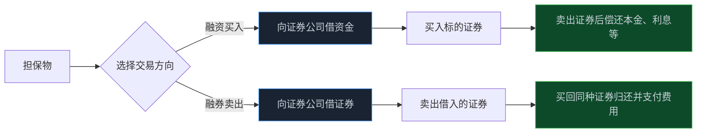
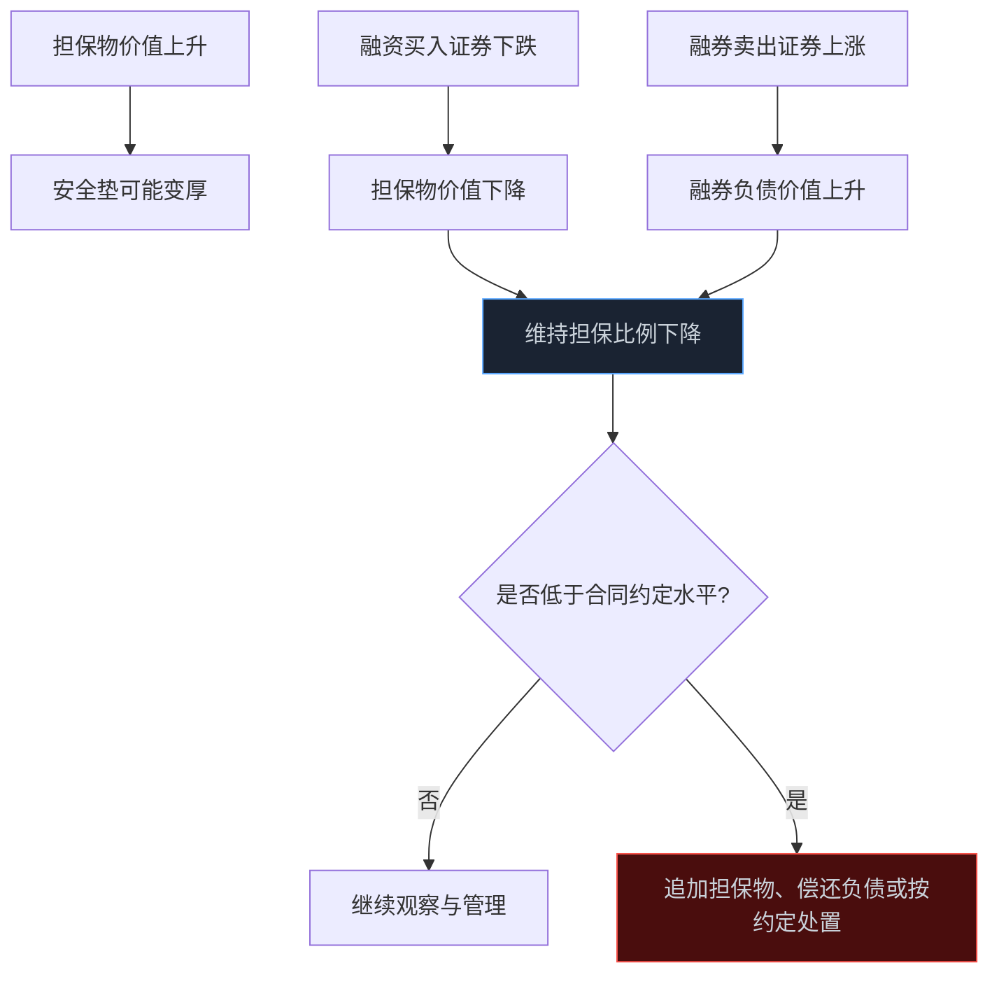

> **系列难度说明**：本篇是**第一章·第七篇**。即使暂时不打算开通两融账户，也值得读完，因为融资余额、融券余额和可融券标的会出现在很多市场数据里。
>
> **核心收获**：读完后，你能分清融资买入和融券卖出，理解保证金、维持担保比例和强制平仓的关系，也知道为什么两融数据只能作为市场结构线索，不能替代公司研究。
>
> **重要提示**：本文只用于投资者教育，不构成任何证券投资建议。融资融券包含杠杆与强制平仓风险，具体资格、期限、利率费率、担保比例、标的范围和处置安排由现行规则及证券公司合同确定；实际参与前请完整阅读风险揭示书与业务协议。

你看好一只股票，却没有足够资金，于是想到“融资买入”。

你判断一只股票价格可能下跌，又听说可以“融券做空”。

听起来像多了两个方向：涨能赚，跌也能赚。可一旦把“借”这个字认真拆开，事情就没那么轻松了。

融资融券的本质，不是多一种看涨看跌的表达，而是把自己的判断放进一份带有资金成本、担保要求、期限和强制处置条款的合同里。

判断对了，收益可能被放大；判断错了，错误也不会客气。

<!-- more -->

---

## 先把名字拆开：一个借钱，一个借券

融资融券由两件方向相反的事组成。

- **融资买入**：你提供担保物，向证券公司借入资金，再买入符合条件的证券；
- **融券卖出**：你提供担保物，向证券公司借入符合条件的证券，先卖出，再买回同种证券归还。

交易所对融资融券的定义很直白：投资者向有会员资格的证券公司提供担保物，借入资金买入证券，或者借入证券并卖出。

> **来源**：[融资融券专栏｜上海证券交易所](https://www.sse.com.cn/services/tradingservice/margin/home/) — 上交所对融资融券交易作出定义，并提供标的证券、余额和业务规则等公开信息。
>
> **来源**：[证券公司融资融券业务管理办法](https://www.csrc.gov.cn/csrc/c106256/c1654005/content.shtml) — 中国证监会关于证券公司融资融券业务的基础监管规则。



这两条路径都不是“免费加速器”。融资有资金利息和相关费用；融券有证券借入费用、券源可得性和买回归还的压力。更关键的是，担保物价值会跟着市场变动。价格一旦朝不利方向走，账户的安全垫会迅速变薄。

---

## 融资买入：你不只是买了股票，还背上了一笔债

假设你有 10 万元担保物，符合条件后又借入 5 万元资金，合计买入 15 万元证券。

如果证券上涨 10%，持仓市值从 15 万元变成 16.5 万元。忽略利息和费用，账面增加 1.5 万元。相对你最初的 10 万元担保物，变化是 15%。

但下跌时同样放大：证券下跌 10%，持仓市值变成 13.5 万元，账面减少也是 1.5 万元，债务却不会跟着减少。你不仅承担市场亏损，还要面对借款利息和担保比例下降。

```text
不使用融资：10 万元买入，股价下跌 10%，账面减少 1 万元
使用融资：15 万元买入，股价下跌 10%，账面减少 1.5 万元

差别不在于“更容易赚钱”，而在于同一段价格波动被放大了。
```

这还是一条平滑的价格路径。现实更麻烦：价格可能连续下跌、流动性可能变差、公司可能突然披露负面公告。融资账户不是等你慢慢想清楚再处理；当担保比例触及合同约定的警戒或补仓条件时，证券公司可能要求追加担保物，未按约定补足时还可能执行强制平仓。

所以融资真正的风险，不是亏损本身，而是亏损发生时你失去主动权。

---

## 融券卖出：先卖后买，风险方向完全翻过来

融券卖出的逻辑是：先借到证券并卖出，之后再买回同种证券归还。

假设你借入并卖出 1,000 股，卖出价是每股 20 元，得到 2 万元。之后：

- 若股价跌到 15 元，你用 1.5 万元买回 1,000 股归还，价格方向上获得 5,000 元差额；
- 若股价涨到 30 元，你需要 3 万元才能买回同样的 1,000 股归还，价格方向上损失 1 万元。

它和普通买入最大的不同，在于损失方向没有天然的价格下限。普通买入最坏情况下，证券价格理论上可以跌向零；融券卖出如果股价持续上涨，买回成本会不断上升。

当然，实际融券交易还受多层限制：不是每只证券都能作为融券标的，不是每个时点都有足够券源，你也需要满足适当性和担保要求。融券卖出后要归还的是同种、同数量的证券，不是把卖出得到的现金放着就算完成。

> **来源**：[上海证券交易所融资融券交易实施细则（2023 年修订）](https://www.sse.com.cn/lawandrules/sselawsrules2025/trade/specific/margin/c/c_20250616_10782015.shtml) — 上交所现行两融交易细则，明确融资融券交易、标的证券和申报等业务安排。
>
> **来源**：[深圳证券交易所融资融券交易实施细则（2023 年修订）](https://investor.szse.cn/lawrules/rule/allrules/bussiness/t20230217_598777.html) — 深交所现行两融交易实施细则与发布通知。

这也解释了为什么“我觉得它已经涨很多了，所以去融券”是一个危险的逻辑。贵不等于立刻下跌，市场可以在高估值状态停留很久；而你的融券期限、费用、担保物和情绪承受能力都有边界。

---

## 保证金和维持担保比例：两融账户真正的仪表盘

两融账户里最重要的不是“赚了多少”，而是担保物能不能覆盖你的负债和风险。

可以把它理解成一个持续更新的安全系数：账户内现金和担保证券的价值会随着价格变化，融资负债和融券负债也会随市场价格、利息费用等变化而变化。证券公司会依据合同和规则计算维持担保比例，并在达到约定条件时发出补仓或处置信号。

不必把某一个比例背成固定常数。不同证券公司的合同、标的折算率、客户资质和监管要求，都会影响实际数值。真正应该理解的是它的方向：



一旦进入补仓或强制平仓路径，交易不再由你的研究节奏主导。你可能被迫在价格最差、流动性最紧的时候卖出。这就是杠杆和普通持仓之间最本质的区别：普通持仓可以等待研究结论兑现，两融头寸还要先满足风险合同的时间表。

---

## 标的证券和券源：不是所有股票都能融资，也不是所有股票都能融券

两融交易只覆盖符合条件的标的证券，交易所会公布并定期调整标的范围。即使一只证券在标的名单中，是否能实际融券，还取决于证券公司当时是否有可出借的券源、风控安排和客户账户情况。

这意味着两件事：

- 融资余额高，不代表所有投资者都能轻松借到资金；
- 融券余额低，也不等于市场上没有人看空，可能只是券源、费用、适当性或风险约束限制了融券交易。

交易所和结算机构公开两融标的、余额与相关信息。这些数据能帮助你观察市场的杠杆使用和部分供需结构，但不能直接翻译为“后市必涨”或“后市必跌”。

> **来源**：[融资融券业务规则｜上海证券交易所](https://www.sse.com.cn/lawandrules/sselawsrules2025/trade/specific/margin/) — 上交所两融规则专区，提供现行业务细则、标的调整通知等资料。
>
> **来源**：[深圳证券交易所融资融券标的证券信息](https://www.szse.cn/disclosure/margin/object/index.html) — 深交所公布的融资融券标的证券信息入口。
>
> **来源**：[融资融券与转融通｜中国证券登记结算有限责任公司](https://www.chinaclear.cn/zdjs/rrzrqyzrt/law_list.shtml) — 中国结算提供融资融券、证券出借及转融通登记结算相关规则资料。

这里再补一个容易混淆的概念：**融券**是投资者向证券公司借证券卖出；**转融通**是为证券公司融资融券业务拓宽资金和证券来源的一套制度安排。两者相关，但不该混着解释。

而且市场制度会调整。证监会曾在 2024 年依法批准暂停转融券业务，并继续强化融券业务的逆周期调节。研究融券数据时，更要注意数据背后的制度环境，而不是拿不同时期的余额做简单横比。

> **来源**：[证监会依法批准暂停转融券业务](https://www.csrc.gov.cn/csrc/c100028/c7493852/content.shtml) — 证监会说明暂停转融券业务及强化融券逆周期调节的背景与安排。

---

## 两融数据怎么看：它是温度计，不是方向盘

行情软件经常展示“融资余额”“融资买入额”“融券余额”“融券卖出量”。这些数字有价值，但只能回答有限的问题。

| 数据 | 它大致反映什么 | 它无法单独证明什么 |
| --- | --- | --- |
| 融资余额 | 市场中仍未偿还的融资负债规模 | 某只股票一定会上涨 |
| 融资买入额 | 某个时段通过融资买入的活跃程度 | 买入者的研究逻辑一定正确 |
| 融券余额 | 尚未归还的融券头寸对应的规模 | 市场一定看空这家公司 |
| 融券卖出量 | 某时段融券卖出的交易行为 | 后续价格一定下跌 |

更好的读法是把数据放回上下文：

- 融资余额上升，是因为股价上涨带来的担保物变化，还是新增杠杆资金进入？
- 融券变化，是公司基本面分歧、指数或套利活动，还是券源变化造成的技术性波动？
- 这只证券的成交额和流通盘，能不能承受较大的两融头寸？
- 如果市场反向波动，集中去杠杆会不会放大价格下跌？

两融余额更像市场风险偏好的温度计。温度升高值得观察，但不能凭温度计决定要往哪里开车。

---

## 为什么杠杆最容易把“对的研究”做成“错的交易”

假设你对一家公司长期判断正确：行业需求会改善，利润会在两年后上台阶。

可市场不会按你的时间表走。中间可能先经历估值收缩、季度业绩低于预期、行业库存去化或大盘风险偏好下降。如果你满仓融资，哪怕终局判断正确，也可能在中途因维持担保比例不足被动平仓，根本等不到逻辑兑现。

这不是研究能力的问题，而是期限不匹配：

```text
你的研究期限：两年
融资合同与风险约束：每天都在重新计算
市场波动：随时发生
```

普通持仓的核心问题是“判断是否正确”；杠杆持仓还多了一层“我能不能活到判断兑现”。

因此，融资最常见的误用不是不了解利率，而是把不确定的长期观点，装进没有足够安全垫的短期风险框架里。

---

## 开通权限之前，先完成一次不下单的压力测试

证券公司会依据规则和合同对两融客户进行适当性、征信、风险承受能力等评估。满足开户要求，不等于适合使用杠杆。

如果你只是想了解自己是否具备条件，先做一个纸面压力测试，不要急着开户或下单：

1. 假设持仓连续下跌 10%、20%、30%，账户担保物和负债各会怎样变化？
2. 假设你需要追加担保物，现金来自哪里？是不是本来就留作生活备用金？
3. 假设证券停牌、跌停或流动性下降，你能否在计划价格及时处置？
4. 假设判断需要半年才兑现，利息、费用和维持担保比例能不能撑住？
5. 假设融券标的持续上涨，你的买回成本和心理承受能力上限在哪里？

这五个问题没有标准答案。任何一个问题只能靠“再借一点”解决，就已经说明风险没有被真正管理。

---

## 小结

- 融资买入是借资金买证券，融券卖出是借证券先卖后买回归还；两者都建立在担保物与合同约束之上。
- 杠杆会放大收益，也会放大亏损、利息费用、流动性问题和被动平仓风险。
- 融券不是随时、对任何股票都可操作；标的范围、券源、适当性和证券公司风控都会限制实际交易。
- 维持担保比例决定两融账户的安全垫。一旦触及补仓或处置条件，交易主动权可能迅速消失。
- 两融余额是观察市场结构的辅助数据，不能替代对公司、行业、估值和风险的研究。

---

## 下一篇预告

两融让你看到杠杆和做空，ETF 则提供了另一种更常见的参与方式：不押注单一公司，而是买入一篮子证券。

指数如何选样？ETF 的份额申赎为什么会影响市场供需？被动资金又会在什么时候放大波动？

下一篇聊聊：**ETF、指数与被动资金。**

---

> **课程导航：第一章·A 股市场地图**
> - 第一篇：股票到底是什么：从代码重新认识股权
> - 第二篇：A 股市场有哪些参与者
> - 第三篇：沪深京三大市场分别是什么
> - 第四篇：主板、创业板、科创板与北交所
> - 第五篇：A 股交易规则应该怎么看
> - 第六篇：T+1、涨跌幅与集合竞价
> - **第七篇：融资融券与卖空机制** ← 你在这里
> - 第八篇：ETF、指数与被动资金
> - 第九篇：IPO、再融资、回购与分红
> - 第十篇：ST、退市与风险识别
