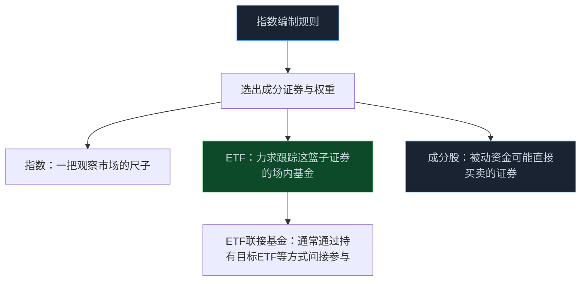
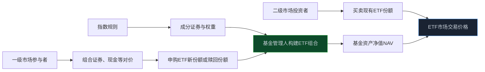

> **系列难度说明**：本篇是**第一章·第八篇**。即使你从未买过 ETF，也能从“指数怎么选股”开始理解；如果你已经在看 ETF 份额、资金流和折溢价，本篇会帮你把它们放回同一条机制里。
>
> **核心收获**：读完后，你会分清指数、ETF、ETF 联接基金和成分股；理解二级市场买卖与一级市场申购赎回的差别；也知道被动资金为什么会在指数调整和申赎高峰时影响个股供需。
>
> **重要提示**：本文只用于投资者教育，不构成任何证券投资建议。ETF 仍会波动、可能出现折溢价和跟踪偏离，也可能面临行业集中、流动性、跨境市场和基金运作风险；买入前应阅读基金法律文件与公告。

你看到一只热门行业 ETF 连续放量，很多人会说：“资金都去这个赛道了。”

这句话只说对了一半。

ETF 里的资金确实会流向一篮子证券，但它未必是基金经理看完每家公司后，临时拍板要买。很多时候，指数已经把“买什么、买多少、什么时候调仓”的大框架写进规则里了；ETF 做的是尽量跟上这套规则。

所以想看懂被动资金，先别问“资金在追什么”，先问：**这只 ETF 跟踪什么指数？指数是怎样把这些股票放进篮子里的？**

<!-- more -->

---

## 先把四个名字拆开：指数、ETF、联接基金和成分股

它们经常一起出现，却不是同一种东西。

**指数**是一套公开或可查的规则。它会规定样本空间、选样方法、权重计算、定期调整与临时调整等。指数本身不是公司，也不是一个可以直接开户买入的证券账户。

**成分股**是被指数规则选进篮子的证券。比如一个宽基指数可能覆盖多个行业，一个行业指数可能集中在某条产业链，主题指数则可能围绕某类业务或概念。

**ETF** 是在交易所上市交易的基金份额。它通常以跟踪某个指数为目标，把一篮子成分证券包装成一个能像股票一样买卖的产品。

**ETF 联接基金** 则通常通过持有目标 ETF 或相关资产，让场外基金投资者间接获得相近的指数暴露。它和 ETF 追踪同一方向，并不意味着净值、费用、交易方式和跟踪结果完全一样。



把它类比成软件项目会更容易理解：指数规则像一份构建配置，成分股是依赖清单，ETF 是按这份清单打出来的可部署包。你买 ETF，买的是一份基金份额，不是直接把每只成分股过户到自己账户。

这也是第一条重要边界：**指数上涨不代表所有成分股都上涨；买 ETF 也不等于你对其中每家公司都做了同等强度的基本面判断。**

---

## 指数不是“市场的自然样子”，它是规则的结果

许多人把沪深 300、上证指数、科创 50、创业板指当成市场本身。其实它们都是人为设计、公开运行的统计工具。

指数编制方会先定义样本空间，再通过市值、流动性、行业分类、上市时间、财务与合规条件等规则筛选证券，最后确定权重和调整周期。不同规则得到的是不同视角：有的更偏向大市值公司，有的强调行业代表性，有的聚焦某类主题，有的追踪红利、质量、成长或低波动因子。

沪深 300 的编制方案就明确了样本选择、加权方法和定期调整等安排；中证指数公司也单独发布股票指数样本调整规则。指数变化不是某个基金经理突然变心，而是规则运行到调样或再平衡节点后的结果。

> **来源**：[沪深 300 指数编制方案](https://oss-ch.csindex.com.cn/static/html/csindex/public/uploads/indices/detail/files/zh_CN/000300_Index_Methodology_cn.pdf) — 中证指数公司公布的指数方法文件，说明样本空间、选样与加权等规则。
>
> **来源**：[中证指数有限公司股票指数样本调整规则](https://oss-ch.csindex.com.cn/notice/20251114142128-%E3%80%8A%E4%B8%AD%E8%AF%81%E6%8C%87%E6%95%B0%E6%9C%89%E9%99%90%E5%85%AC%E5%8F%B8%E8%82%A1%E7%A5%A8%E6%8C%87%E6%95%B0%E6%A0%B7%E6%9C%AC%E8%B0%83%E6%95%B4%E8%A7%84%E5%88%99%E3%80%8B.pdf) — 中证指数公司对股票指数样本调整的规则说明。

所以，看到一只股票被纳入指数，不要急着把它理解为“官方认证”。它更多表示该证券在某套规则下满足了纳入条件。纳入后可能带来被动配置需求，但公司能否长期创造价值，仍要靠业务、财务、竞争和估值来回答。

反过来，被调出指数也不自动等于经营恶化。有时是市值、流动性或样本排序发生了相对变化；有时是指数方法本身调整。看清调整原因，比只看“调入/调出”四个字更重要。

---

## ETF 怎么把一篮子股票变成一个可交易的代码

大多数个人投资者参与 ETF 的方式，是在二级市场像买卖股票一样买卖基金份额。你输入代码、价格和数量，成交对手方通常是另一位愿意卖出或买入 ETF 份额的投资者。

但 ETF 和普通封闭式产品有一个关键区别：它可以通过申购和赎回在一级市场创造或注销份额。

一般情况下，符合条件的参与者可按基金合同和申购赎回清单，用一篮子组合证券、现金替代、现金差额或合同约定的其他对价，申购 ETF 份额；也可以用 ETF 份额赎回相应对价。普通投资者更常使用二级市场交易，一级市场申赎往往有较大的最小单位和更复杂的操作要求。

> **来源**：[关于 ETF 申购与赎回](https://edu.sse.com.cn/service/hotline/qa/c/4956498.shtml) — 上交所投资者教育材料说明 ETF 一级市场申购赎回的对价组成，并提示申赎申请提交后不得撤销。



这套机制的意义在于，它为 ETF 的二级市场交易价格和基金资产净值之间提供了一条连接通道。

如果 ETF 在二级市场价格明显高于其组合资产价值，具备条件的参与者可能通过申购 ETF 份额并在二级市场卖出，去利用价差；反过来，如果 ETF 价格明显低于净值，也可能存在相反方向的套利与赎回动力。套利不会保证价格时时刻刻贴着净值，但会提供一种让偏离有机会收敛的机制。

---

## 净值、交易价格和折溢价：同一只 ETF 也可能有两种“价格”

ETF 最容易让初学者困惑的一点，是交易软件上看到的价格，和基金公布或估算的净值不是一回事。

- **基金资产净值（NAV）**：由基金持有的一篮子资产价值扣除负债后计算；
- **二级市场交易价格**：投资者在交易所里实际成交 ETF 份额的价格；
- **折溢价**：交易价格相对净值的偏离。

当交易价格高于净值，通常称为溢价；低于净值，则称为折价。它们可能因为盘中供需、市场时差、流动性、申赎效率、成分证券停牌或跨境市场休市等原因出现。

把价格和净值混在一起，容易产生两种错误判断：“溢价就是基金经理做错了”“ETF 涨得比指数多就是更好”。都不对。

证监会监管部门的 ETF 纠纷案例评析也提醒过，基金净值由一篮子资产市场价值决定，二级市场价格则由市场供需形成；二者可能偏离，不能简单把二级市场价格波动等同于基金运作问题。

> **来源**：[ETF 基金净值与交易价格差异纠纷案例评析](https://www.csrc.gov.cn/ningxia/c104435/c7640232/content.shtml) — 监管部门投教材料解释 ETF 净值与二级市场价格形成机制不同，以及折溢价的风险。

对交易者来说，最实用的不是背公式，而是在买入前多看一眼：我买的是净值附近的份额，还是因为短时情绪支付了明显溢价？如果是跨境、商品或流动性较弱的 ETF，这个问题更不能省略。

---

## 被动资金为什么会买一只它“没研究过”的股票

主动基金经理买一只股票，通常会讲一套盈利预测、估值和催化剂逻辑。

被动资金不一定如此。它的首要任务是尽量跟踪目标指数：指数把某只证券纳入、提高权重，基金就需要按规则增加相应配置；指数调出、降低权重，基金则可能卖出或减少配置。

这不是“盲目交易”，而是产品承诺的一部分。投资者买入的是“跟踪这个指数”的工具，基金管理人不能因为自己不喜欢某只成分股，就随意大幅偏离指数。

于是，个股短期供需会出现一个很有意思的来源：**不是公司发生了新的经营变化，而是指数规则触发了配置变化。**

```text
指数定期调整或权重变化
        ↓
ETF 与指数基金为控制跟踪偏离而调仓
        ↓
成分股出现集中买卖需求
        ↓
短期成交额、价格和换手可能变化
        ↓
市场再根据流动性与其他资金的反应重新定价
```

这里最容易被误解的是最后一步。被动买盘可能给股价带来短期支持，但它不创造公司利润，也不保证长期估值合理。如果一家公司只是因为调入指数而短期上涨，之后仍要回到盈利、现金流和竞争格局来决定能否站稳。

同样，ETF 份额增加也不等于“所有成分股都会同比上涨”。基金可能通过申购、现金替代、期货或其他工具完成部分跟踪；各成分股权重、流动性和同时存在的主动资金方向也不同。

---

## 申购赎回：看懂“资金流入 ETF”真正意味着什么

新闻里常说“某类 ETF 获得净申购”。这句话比“交易额放大”更接近资金对基金资产规模的影响，但仍不能粗暴翻译成“明天成分股必涨”。

二级市场里，甲把 ETF 卖给乙，只是份额在投资者之间换手，基金总份额未必变化。只有一级市场发生申购或赎回，ETF 份额才会被创造或注销，基金资产规模才会相应变化。

可以把它们分开看：

| 你看到的现象 | 可能意味着什么 | 不能直接推出什么 |
| --- | --- | --- |
| ETF 成交额放大 | 二级市场份额换手更活跃 | 一定有新增资金进入基金 |
| ETF 份额增加 | 可能发生了净申购，基金规模倾向扩大 | 所有成分股次日都会上涨 |
| ETF 份额减少 | 可能发生了净赎回，基金规模倾向收缩 | 行业基本面一定变坏 |
| 成分股放量 | 可能与指数调仓、ETF 申赎或其他资金有关 | 一定是“主力建仓” |

这就是为什么研究 ETF 资金时，最好同时看：成交额、基金份额变化、净值与折溢价、成分股权重、指数调整公告，以及更重要的行业和公司基本面。

只看一条资金曲线，很容易把机械调仓当成价值发现。

---

## 跟踪误差：ETF 不是指数的复印件

ETF 的目标通常是紧密跟踪标的指数，但很难做到每一天、每一分钟都一模一样。

费用、现金头寸、申赎过程、成分股停牌、分红处理、交易成本、样本优化，以及跨境资产的时差，都会让 ETF 收益和指数收益出现偏离。这个偏离需要用跟踪偏离度和跟踪误差等指标观察。

一般来说，跟踪误差较小，说明基金在一段时间内与目标指数的偏离更小；但也要结合产品类型、市场环境和基金合同来看。对跨境 ETF、商品 ETF、债券 ETF 或流动性有限的主题 ETF，偏离来源可能和普通宽基股票 ETF 不一样。

> **来源**：[基金跟踪存误差，需理性看待](https://www.csrc.gov.cn/shenzhen/c105614/c7602050/content.shtml) — 深圳证监局投教材料说明，基金跟踪误差反映基金与标的指数收益之间的偏差，应结合具体产品理性理解。

同样跟踪一个指数的两只 ETF，也未必完全一样。比较时可以看几件事：

- 跟踪的到底是不是同一个指数版本；
- 基金规模与日均成交是否足够支撑你的交易；
- 管理费、托管费和其他成本如何；
- 跟踪偏离、跟踪误差和折溢价历史表现怎样；
- 成立时间、申赎安排和基金合同是否有特殊条款。

产品名称相似，不等于风险与体验相同。

---

## 2026 年交易规则更新后，看 ETF 还要多看一层交易机制

ETF 不只是基金，也是交易所内交易的证券。2026 年 7 月 6 日起，上交所修订后的交易规则将盘后固定价格交易的适用范围扩大至全部 A 股和交易型开放式基金，并将基金收盘阶段的交易方式调整为收盘集合竞价、通过集合竞价形成收盘价。

这意味着，看 ETF 的最后几分钟和盘后交易时，不能沿用旧的“基金收盘一直连续竞价”的理解。具体可用交易时段、申报与成交安排仍要以交易所现行规则、基金类型和券商端提示为准。

> **来源**：[上交所修订发布《上海证券交易所交易规则》](http://www.sse.com.cn/aboutus/mediacenter/hotandd/c/c_20260424_10816474.shtml) — 上交所公布 2026 年交易规则修订内容，包括 ETF 盘后固定价格交易扩围与基金收盘机制调整。

制度变化不要求你每天研究，但会影响你如何解释尾盘成交、收盘价、ETF 份额交易和某些短时价格偏离。规则是研究市场结构的底图，不是可忽略的注脚。

---

## 一次练习：别急着买，先给一只 ETF 做“产品拆解”

任意找一只你关注的 ETF，打开基金公司页面、交易所信息或基金公告，花 20 分钟回答下面的问题：

1. 它跟踪的指数全称是什么？指数编制方是谁？
2. 指数是宽基、行业、主题、红利、策略，还是跨境指数？
3. 前十大成分证券和前几大行业权重是多少？集中度高不高？
4. 你在二级市场买入时，交易价格相对净值有没有明显折溢价？
5. 最近的份额变化、成交额变化和指数调整公告，是否能解释你看到的价格异动？
6. 如果 ETF 下跌 20%，你能清楚说出是指数本身、折溢价、跟踪偏离，还是自己的买入成本造成的影响吗？

做完这张表，你不会立刻找到“最好的 ETF”，但会少把一个产品代码当成一个模糊的行业观点。

---

## 小结

- 指数是一套选样和加权规则，ETF 是力求跟踪该规则对应证券篮子的可交易基金份额。
- 个人投资者通常在二级市场买卖 ETF；一级市场的申购赎回机制让 ETF 份额供给能够变化，并为交易价格与净值之间的偏离提供收敛通道。
- ETF 的二级市场价格、基金净值和指数点位不是同一个数；折溢价与跟踪偏离都需要单独观察。
- 被动资金会因指数调样、权重调整和申赎变化而产生买卖需求，但短期供需变化不能替代公司基本面判断。
- 研究 ETF 时，至少同时看指数方法、成分股权重、基金份额、流动性、费率、跟踪误差和折溢价。

---

## 下一篇预告

ETF 的申购赎回让你看到：证券市场不仅交易现有的份额，也会不断创造、注销和重新分配资本。

公司首次公开发行、再融资、回购和分红，则是企业层面的资本循环。它们怎样改变股本、现金、股东回报和市场预期？

下一篇聊聊：**IPO、再融资、回购与分红。**

---

> **课程导航：第一章·A 股市场地图**
> - 第一篇：股票到底是什么：从代码重新认识股权
> - 第二篇：A 股市场有哪些参与者
> - 第三篇：沪深京三大市场分别是什么
> - 第四篇：主板、创业板、科创板与北交所
> - 第五篇：A 股交易规则应该怎么看
> - 第六篇：T+1、涨跌幅与集合竞价
> - 第七篇：融资融券与卖空机制
> - **第八篇：ETF、指数与被动资金** ← 你在这里
> - 第九篇：IPO、再融资、回购与分红
> - 第十篇：ST、退市与风险识别
