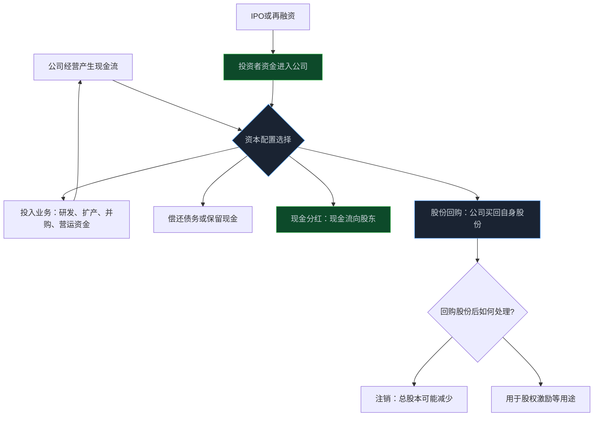
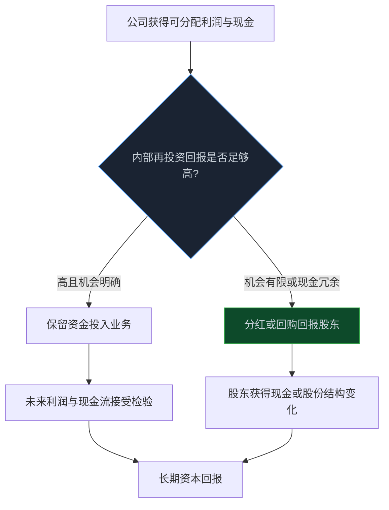

> **系列难度说明**：本篇是**第一章·第九篇**。不需要会计基础，只需要接受一个事实：公司增发、回购或分红，改变的不只是新闻标题，还会改变每股对应的权益、现金和未来的选择。
>
> **核心收获**：读完后，你能分清 IPO、再融资、回购与分红的资金和股份流向；理解“稀释”“除权”“注销”分别意味着什么；并能用资本配置而非利好利空标签阅读相关公告。
>
> **重要提示**：本文只用于投资者教育，不构成任何证券投资建议。具体发行、回购、分红方案须经相应程序并以公司公告为准，计划不等于实施结果；文中数字仅作机制演示。

一家公司宣布回购，股价上涨；另一家公司宣布定增，股价下跌；还有公司高分红，投资者却说“只是左手倒右手”。

如果只用“利好”或“利空”解释，很多事情都说不通。

因为这些公告真正回答的是同一个问题：**公司手里的钱，是继续投入生意、还给股东，还是通过发行新股份向市场再要一些？**

这就是资本配置。它比一条新闻的情绪更值得研究。

<!-- more -->

---

## 先看一张资本循环图：钱和股份到底往哪里走

上市公司不是只会经营，也会不断调整自己的资本结构。

IPO 和再融资，通常是从投资者那里筹集资金；回购和分红，通常是把公司现金以不同方式返还给股东；经营活动则决定这些资金最终是否真的转化成利润和现金流。

同样是“公司有钱”，选择却可能完全不同。一家高回报率企业，可能把多数现金留在内部扩张，反而比机械高分红更符合股东利益；另一家增长机会有限、现金却长期闲置的公司，持续不回报股东就需要被追问。

所以资本动作没有绝对的好坏，关键看三件事：**钱从哪里来、钱要去哪里、每多投入一块钱能不能创造比成本更高的回报。**

---

## IPO：公司第一次把一部分股权卖给公众

IPO，即首次公开发行股票。它让公司从非上市状态进入公开市场，并通过发行股票募集资金。

对公司来说，IPO 可能带来发展资金、公开定价、品牌影响力和更规范的信息披露要求；对投资者来说，则意味着可以通过二级市场买卖这家公司的一部分股权。

这里有个常被忽略的细节：IPO 文件里不仅要看“发行多少新股”，还要看是否存在老股东公开发售等安排。新发行股份的募集资金通常进入公司，支持招股说明书披露的用途；老股东出售已有股份，所得则流向出售股份的股东，而不是公司。

发行完成后，原有股东的持股比例可能被稀释，因为总股本增加了。稀释本身并不必然是坏事。

假设公司原有 1 亿股，IPO 新发 2,500 万股。原股东原先持有 10% 股权，若不参与其他安排，发行后持股比例会变为：

\[
\frac{1{,}000\text{ 万股}}{1.25\text{ 亿股}}=8\%
\]

比例变小了，但如果募集资金被投入高回报项目，公司整体价值增长更多，原股东持有股份的价值仍可能上升。真正的问题不是“有没有稀释”，而是“稀释换来了什么”。

发行人申请首发上市需要依法披露投资者作出价值判断和决策所需的信息，并揭示重大风险。对普通研究者来说，招股说明书不是只有新股申购时才值得看，它往往是理解公司商业模式、客户、募资用途、竞争格局和风险的高密度原始材料。

> **来源**：[首次公开发行股票注册管理办法](https://neris.csrc.gov.cn/falvfagui/rdqsHeader/mainbody?navbarId=1&secFutrsLawId=a4e08c254e3e43058cd989948f6d6fb1) — 证监会关于首发注册、发行条件和信息披露的基础规则。
>
> **来源**：[发行人申请股票首次发行上市的信息披露要求](https://www.csrc.gov.cn/jiangsu/c105409/c7408763/content.shtml) — 证监会投教材料强调，发行人应充分披露投资者决策所需信息及可预见重大风险。

---

## 再融资：上市以后，公司为什么还要继续要钱

公司上市不是融资的终点。

扩产、研发、并购、偿还债务、补充营运资金，都可能让公司再次走向资本市场。常见再融资工具包括向特定对象发行证券、向不特定对象发行证券、配股、可转换公司债券等。不同工具会对股本、负债、控制权和未来现金流产生不同影响。

先不用把名词背全，先抓住两个方向。

### 发新股：现金进公司，股份可能变多

向特定对象发行或公开发行新股，核心是公司用新增股份换取资金。对原有股东来说，若不参与，持股比例可能下降；对每股指标来说，如果新增资金尚未产生相应利润，短期每股收益也可能被摊薄。

但“定增 = 利空”同样是偷懒结论。

一家公司若用新增资金建设供不应求的产能，项目未来回报高于资金成本，新增股本可能带来更大的利润和现金流；反过来，若募资用途模糊、频繁补流、项目回报很差，或者公司本可用内部现金解决，却持续低价发行新股，原有股东就需要警惕资本配置效率。

### 发债或可转债：今天不一定稀释，未来可能会

公司发行债券，不会立刻增加普通股股本，却增加了利息和偿债压力。可转债在转股前更接近债务工具；若未来转股，则可能增加股本并改变每股权益和每股收益。

这类工具不能只看“是否稀释”。还要看债务期限、票面利率、转股条件、公司现金流覆盖能力，以及融资项目能否在负债压力上升前产生回报。

证监会的上市公司证券发行注册规则要求，发行人围绕投资者决策需求披露募集说明书或其他文件；募集资金投向、对主营业务和未来经营战略的影响，也是应该读的重点。

> **来源**：[上市公司证券发行注册管理办法](https://neris.csrc.gov.cn/falvfagui/rdqsHeader/mainbody?navbarId=3&secFutrsLawId=e8ac37f8f1fb4c4ab2a7cc481abcf977) — 证监会关于上市公司证券发行、注册与信息披露的基础规则。
>
> **来源**：[对募集资金使用和披露有何要求](https://www.csrc.gov.cn/jiangsu/c105409/c7408761/content.shtml) — 证监会投教材料说明，公司应披露募集资金投向、项目依据及其对主营业务和经营战略的影响。

---

## 配股：你不参与，也是在作出一个选择

配股是上市公司按一定比例向原股东配售新股的融资方式。它和分红最大的差别在于：配股是公司向股东要钱，不是把钱给股东。

假设某公司按“每 10 股配 2 股”的比例配股。你原本持有 1,000 股，理论上可认购 200 股。若你不参与，公司的总股本仍会因其他股东认购而增加，你的持股比例可能被稀释。

因此，遇到配股公告，不该只看配股价“便不便宜”，还要读：

- 资金具体投向什么项目；
- 项目需要多少时间、预计产生什么回报；
- 公司为何不采用债务融资或内部现金；
- 大股东是否参与认购；
- 若不参与，自己的权益比例和风险暴露会怎样变化。

配股权不是自动送来的收益。它是一项需要你作出资本配置选择的权利。

---

## 回购：公司买回自己的股份，重点不在“买了”，而在“为什么买、买完怎么办”

回购是公司用现金买回已发行的自身股份。市场常把它理解为管理层认为股价低估的信号，但回购的真实含义比这复杂得多。

回购股份可能用于减少注册资本并注销，也可能用于员工持股计划、股权激励等用途。不同用途，对总股本、每股指标和未来股份供给的影响不一样。

### 回购并注销：分母可能变小

假设公司总股本为 1 亿股，全年归母净利润为 1 亿元，每股收益为 1 元。若公司回购并注销 1,000 万股，经营利润不变时，简化后的每股收益变为：

\[
\frac{1\text{ 亿元}}{9{,}000\text{ 万股}}\approx1.11\text{ 元}
\]

这只是数学上的分母变化。它能不能真的为股东创造价值，取决于公司回购价格是否合理、资金来源是否稳健、公司是否放弃了更高回报的投资机会。

### 回购用于激励：股份不一定永久退出市场

如果回购股份后用于股权激励或员工持股计划，它们未必像注销那样永久减少总股本。研究时应继续看授予条件、解锁安排、激励对象、未来摊薄和业绩考核，而不是看到“回购”就默认每股价值立刻提高。

监管规则对回购目的、程序、进展披露和股份处理都有要求。公司公告里通常应能找到回购金额区间、价格上限、资金来源、用途、期限和进展等关键信息。

> **来源**：[上市公司股份回购规则](https://www.csrc.gov.cn/csrc/c101954/c7449683/7449683/files/%E9%99%84%E4%BB%B61%EF%BC%9A%E3%80%8A%E4%B8%8A%E5%B8%82%E5%85%AC%E5%8F%B8%E8%82%A1%E4%BB%BD%E5%9B%9E%E8%B4%AD%E8%A7%84%E5%88%99%E3%80%8B.pdf) — 证监会关于上市公司股份回购目的、程序、信息披露和注销等事项的规则。

还有一个容易忽略的点：回购需要现金。对一家负债高、经营现金流紧张的公司，回购未必是好事；对一家现金长期闲置、估值合理且没有高回报项目的公司，回购可能更值得认真评估。结论不在“回购”两个字里，在资产负债表和资本回报率里。

---

## 分红：现金真的回来了，但别把除权当成凭空收益

现金分红是公司把部分可分配利润返还给股东。它是股东回报的重要形式，但不是额外从天上掉下来的钱。

假设你持有 1,000 股，每股市价 10 元，账户股票市值约 1 万元。公司每 10 股派 1 元现金，你可以获得 100 元税前现金红利。除权除息后，在其他条件不变的简化情形下，股价会相应调整；你的总财富不会因为“拿到 100 元现金”就自动多出 100 元。

分红的意义在于：公司确认一部分现金不再由自己配置，而交回给股东自行配置。对现金流稳定、再投资机会有限的企业，这是重要的资本纪律；对仍处于高回报扩张期的企业，保留现金投入能创造更高回报的项目，可能更合理。

所以，股息率高不自动等于好公司。股息率可能因为股价下跌而被动抬高；高分红也可能挤压必要的研发、维护性资本开支或偿债能力。读分红时，至少把它放回三个数字：经营现金流、自由现金流和负债水平。

监管层要求上市公司建立和完善现金分红机制，分红政策、利润分配方案和实施安排都应通过公告核对。

> **来源**：[上市公司监管指引第 3 号——上市公司现金分红（2023 年修订）](https://www.csrc.gov.cn/csrc/c100028/c7449654/content.shtml) — 证监会关于上市公司现金分红与投资者回报机制的监管指引。
>
> **来源**：[关于进一步落实上市公司现金分红有关事项的通知](https://www.csrc.gov.cn/csrc/c100028/c1002493/content.shtml) — 证监会强调上市公司应强化回报股东意识，完善利润分配决策和披露机制。

---

## 用一张表，把“利好利空”改成研究问题

| 资本动作 | 现金的方向 | 股本可能怎样变 | 第一眼不该下的结论 | 真正需要追问的问题 |
| --- | --- | --- | --- | --- |
| IPO | 新发部分通常流入公司 | 增加 | “上市就代表公司更好” | 募资用途是什么？发行后商业模式和竞争力怎样？ |
| 再融资发股 | 通常流入公司 | 可能增加 | “增发一定利空” | 新资金能否带来高于资金成本的回报？原股东被怎样稀释？ |
| 配股 | 原股东认购资金流入公司 | 增加 | “配股价低就是捡便宜” | 不参与的稀释影响？项目回报与资金用途？ |
| 发债/可转债 | 资金流入公司 | 初期未必变化，转股后可能增加 | “不发股就没有成本” | 利息、到期偿还和未来转股压力能否承受？ |
| 回购注销 | 现金流出公司 | 可能减少 | “回购必然利好” | 回购价格、资金来源、替代用途和注销安排？ |
| 现金分红 | 现金流向股东 | 通常不变 | “派息就是白赚” | 分红是否由真实自由现金流支持？保留资金还能创造什么回报？ |

这张表可以反复用。以后看到资本动作公告，先把“涨还是跌”的情绪放一边，再沿着现金、股本、回报率和治理四条线拆解。

---

## 一次练习：把公告翻译成资本配置报告

从你关注的公司里找一份近期的回购、分红、再融资或发行公告。不要只看标题，写下以下六句话：

1. 这次动作让现金流入公司，还是流出公司？
2. 总股本、流通股本和每股指标可能怎么变化？
3. 管理层给出的用途或理由是什么？证据够不够具体？
4. 如果资金用于项目，项目预计多久开始贡献收入、利润或现金流？
5. 这项安排是否改变了原有股东的比例、控制权或未来摊薄？
6. 如果不做这件事，公司还有哪些资本配置选择，为什么没有选？

当你能把公告翻译成这六句话，就已经从“看新闻”走到了“看资本配置”。

---

## 小结

- IPO 和再融资通常让资金流入公司，但新增股份可能稀释原有股东；稀释是否值得，要看募集资金回报。
- 配股不是分红，不参与配股也意味着接受可能的持股比例变化。
- 回购要看用途：注销可能减少总股本，激励等用途则要继续关注未来股份安排和摊薄。
- 分红是公司把现金交回股东，不是凭空创造财富；分红质量要结合自由现金流、负债与再投资机会判断。
- 资本动作不是固定的利好利空，而是管理层资本配置能力的公开答卷。

---

## 下一篇预告

看完融资、回购和分红，你会发现：公司并不会永远留在市场里。经营恶化、财务压力、持续亏损和重大违法风险，都可能让一家公司进入风险警示甚至退出市场。

下一篇聊聊：**ST、退市与风险识别。**

---

> **课程导航：第一章·A 股市场地图**
> - 第一篇：股票到底是什么：从代码重新认识股权
> - 第二篇：A 股市场有哪些参与者
> - 第三篇：沪深京三大市场分别是什么
> - 第四篇：主板、创业板、科创板与北交所
> - 第五篇：A 股交易规则应该怎么看
> - 第六篇：T+1、涨跌幅与集合竞价
> - 第七篇：融资融券与卖空机制
> - 第八篇：ETF、指数与被动资金
> - **第九篇：IPO、再融资、回购与分红** ← 你在这里
> - 第十篇：ST、退市与风险识别
