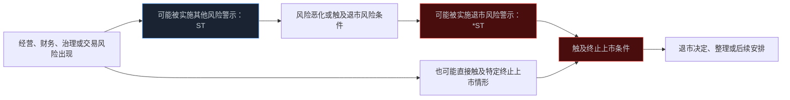
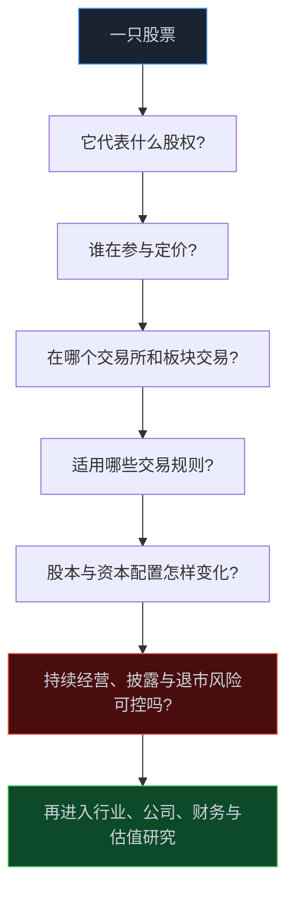

> **系列难度说明**：本篇是**第一章·第十篇**，也是第一章的收尾。它不要求你研究所有退市条款，但会帮你建立一条底线：在讨论估值和买点之前，先确认公司有没有可能失去持续上市和正常经营的基础。
>
> **核心收获**：读完后，你会分清 ST、*ST 与退市的关系，知道强制退市不只来自亏损，也能从财务、交易、规范运作和重大违法等维度识别风险；还会得到一份可复用的买入前排雷清单。
>
> **重要提示**：本文只用于投资者教育，不构成任何证券投资建议。风险警示、终止上市、退市整理与后续转让安排因交易所、板块、证券状态和规则版本而异。实际交易前，请以交易所现行上市规则、公司公告和券商风险揭示为准。

有些股票看起来很“便宜”：股价低，市值小，PE 也不高。于是有人会说，反正都跌成这样了，赌一次反转。

问题是，低价并不等于低风险。

如果一家公司已经无法正常披露年报、资金链承压、审计意见异常、持续经营能力存疑，甚至触及终止上市条件，那么你面对的就不再只是“估值会不会修复”，而是股票还能不能在熟悉的交易场所持续交易、公司还能不能正常运转的问题。

看懂 ST 和退市，不是为了制造恐慌。恰恰相反，它是为了让投资先做减法：**先排除可能让研究框架失效的风险，再讨论增长、估值和交易。**

<!-- more -->

---

## ST、*ST 和退市，不是同一个词的三种写法

市场里常把它们混着说，但层级不一样。

- **其他风险警示**通常以 `ST` 标识，提示公司存在某些重大风险；
- **退市风险警示**通常以 `*ST` 标识，提示公司存在被终止上市的风险；
- **终止上市**则意味着证券交易所依法决定终止该公司股票上市交易。

可以把它理解为三个不同阶段：风险可能已经明显出现；风险进一步发展到持续上市资格受到威胁；最终达到终止上市条件并进入相应程序。

不过，这不是一条每家公司都会按同样速度走完的固定路径。不同风险类型对应不同程序，有些情形可能更快触及终止上市。也不能因为一家公司摘掉了 ST 或 *ST，就自动认为所有经营问题都已经消失。



上图是理解框架，不是逐家公司适用的法律流程图。判断一家公司时，最重要的文件不是简称前面多了一个字符，而是交易所和公司公告里写明的：**触发了什么条款、风险何时消除、下一步可能发生什么。**

> **来源**：[《退市制度 100 问》——风险警示股票和退市整理股票](http://www.gscm.org.cn/col_tzzs/202302/EBED31C6F63E252CAC1A06A9CF16B653.htm) — 投资者教育材料将风险警示区分为退市风险警示和其他风险警示，并提示关注退市整理相关风险。
>
> **来源**：[上海证券交易所股票上市规则（2026 年 4 月修订）](https://www.sse.com.cn/lawandrules/sselawsrules2025/stocks/mainipo/c/c_20260424_10816589.shtml) — 上交所现行上市规则与附件入口，包含风险警示和终止上市相关制度安排。
>
> **来源**：[深圳证券交易所股票上市规则（2026 年修订）](https://www.szse.cn/lawrules/rule/allrules/bussiness/t20260424_620193.html) — 深交所现行上市规则与附件入口，应作为深市公司风险警示与退市判断的优先依据。

---

## 退市不是“连续亏损三年”这么简单

很多旧经验会把退市概括成“连亏几年就退市”。这句话现在既不完整，也容易误导。

强制退市的规则体系通常从多个维度约束公司持续上市资格。常见的理解框架包括：财务类、交易类、规范类和重大违法类。不同市场、不同板块的具体指标、计算口径与程序并不完全相同，不能把网络上的单一阈值机械套用。

证监会关于严格执行退市制度的意见，明确提出严格财务指标类、交易指标类、规范运作类和重大违法类强制退市标准。

> **来源**：[关于严格执行退市制度的意见](https://www.csrc.gov.cn/csrc/c100028/c7473605/content.shtml) — 证监会提出严格财务、交易、规范运作和重大违法等强制退市标准，完善常态化退市机制。

### 财务类风险：利润表之外，还要看营业收入、净资产和审计结论

亏损当然值得关注，但只盯净利润会漏掉很多问题。

一家公司可能通过非经常性损益让利润看起来不那么差，也可能收入规模不足、净资产为负、经营现金流持续失血，或者审计机构无法对财务报表给出正常意见。不同板块的规则会针对这些情形设置不同组合条件。

研究者该做的不是记住每个数字，而是连续追问：公司核心业务有没有真实收入？利润能否变成现金？资产负债表能不能支撑继续经营？审计师为什么保留意见或无法表示意见？

### 交易类风险：市场价格和流动性也是持续上市条件的一部分

如果一只股票长期处于极低价格、交易状态或其他交易指标持续不符合上市规则，可能触及交易类风险。这里讨论的不是“跌多了会不会反弹”，而是市场对这家公司持续定价与交易的基础是否仍然存在。

低价股常常吸引“便宜”的直觉，但在交易类风险面前，股价越低并不意味着安全边际越高。你还要面对流动性下降、风险警示、交易安排变化和退出不确定性。

### 规范类风险：不披露年报，也可能比亏损更快触发严重后果

有些公司不一定最先在利润表上出问题，却可能在公司治理和信息披露上失去基本秩序。例如未在法定期限内披露定期报告、内部控制失效、公司无法正常运作等情形，都可能带来规范运作层面的风险。

这一类风险特别值得重视，因为它意味着投资者连判断公司经营的基本数据都难以获得。没有可信的披露，估值模型再精致也没有输入数据。

### 重大违法类风险：它不是普通经营波动

重大违法类风险关注的是更严重的违法违规问题。它与行业景气、短期亏损不是同一个层面的变量。遇到这类公告，不能用“等一个反弹”“利空落地”这种交易语言轻轻带过，应该先读事实、监管措施、可能后果和公司回应。

---

## 风险警示股票为什么不能只按“摘帽预期”研究

市场常有人把 ST 或 *ST 当成一个特殊题材：只要业绩改善、资产重组或审计意见变化，就期待“摘帽”。

这种思路的问题在于，它把一套持续经营与信息披露风险，压缩成了一个短期事件赌局。

公司要撤销风险警示，通常需要对应触发情形已经消除，并满足交易所规则及公告披露要求。即便形式上的警示被撤销，原来的商业模式、债务压力、治理问题和盈利质量，也仍要重新验证。

可以把“摘帽”看成一次监控告警解除，不是系统从此不会再出故障。真正要问的是：告警为什么触发？这次修复的是临时问题，还是根因？有没有新的隐患被掩盖？

| 你看到的消息 | 不该直接得出的结论 | 更值得核对的事实 |
| --- | --- | --- |
| 申请撤销 ST 或 *ST | “马上恢复正常” | 触发条件是否真的消除？审计意见、债务、现金流怎样？ |
| 业绩预告扭亏 | “退市风险一定没了” | 扭亏来自主营业务、资产处置还是一次性收益？是否满足完整规则条件？ |
| 重整或重组计划 | “重组成功就翻身” | 方案是否获批、资金是否到位、业务如何恢复、原股东权益怎样变化？ |
| 股价很低 | “下跌空间有限” | 是否存在终止上市、流动性和持续经营风险？ |
| 交易异常活跃 | “资金已经认可反转” | 是基本面改善，还是短期博弈与高换手？ |

风险警示股票可能出现高波动，也可能因为交易安排和投资者适当性要求而具有不同于普通股票的交易体验。高波动不是机会的证明，它本身就是风险更高的提醒。

---

## 退市整理期不是“最后的逃生机会”

当公司进入终止上市相关程序后，市场会关注退市整理期等安排。很多人把它想成“最后还可以交易几天”，于是把注意力放在赌反弹上。

更值得关注的，是整理期背后已经发生的事实：交易所已经就持续上市资格作出或拟作出终止决定；流动性、价格波动、信息不对称和交易风险都可能明显上升。退市整理期不是为了给投资者提供新的估值机会，而是服务于退市过程中的交易与风险揭示安排。

不同交易所、不同证券状态下，整理期、交易方式、涨跌幅、适当性要求和退市后股份转让安排可能存在差异。不要用一只旧退市股的经历，推导另一家公司的路径。

北交所也单独发布了风险警示和退市整理期的投教解读，进一步说明不同市场需要看对应规则。

> **来源**：[北交所退市规则：退市风险警示和退市整理期](https://www.bse.cn/qt/200026393.html) — 北交所官方投教材料，介绍风险警示及退市整理相关规则要点。

如果你已经持有风险警示或拟退市证券，更重要的不是寻找群聊里的“最后一搏”说法，而是逐条核对公司公告、交易所决定、自己的可交易权限和仓位风险。你是否能承受最坏结果，应在任何交易之前就有答案。

---

## 退市后不等于公司立刻消失，但持股人的处境可能完全改变

终止上市不必然等于公司法人资格立即消灭。公司可能仍然存续、经营、重整、清算或在其他场所进行股份转让，具体取决于公司实际情况和相关制度。

但对持股人来说，最直接的变化是：原来在交易所公开市场上较为标准化的交易、信息披露和流动性环境可能不复存在。即使存在后续股份转让渠道，交易频率、估值透明度、流动性和操作便利性也可能显著不同。

所以，“退市后还能交易”不是安全理由。它只说明风险的形态发生了变化，并没有自动解决公司经营、债务、治理或股东回报的问题。

把它放到第一篇的核心认知里看就很清楚：你买的是企业的一部分所有权。交易所上市资格是这份所有权能够在公开市场顺畅交易的重要条件，却不是企业价值本身的全部。失去上市资格后，所有权还在不在、价值还有没有、能否变现、何时变现，是四个不同的问题。

---

## 建一个“先排雷，再研究”的最小检查表

面对任何一家公司，尤其是价格低、波动大、故事很多的公司，先花 10 分钟查这张表。

```text
[ ] 公司简称是否带 ST、*ST 或其他风险提示？触发原因是什么？
[ ] 最近一期年报、审计报告和内部控制报告是否按时披露？审计意见是什么？
[ ] 营业收入、扣非利润、经营现金流和净资产是否出现持续恶化？
[ ] 是否存在大额逾期债务、诉讼、担保、资金占用或控股股东质押风险？
[ ] 是否出现停牌、重整、重组、立案调查、交易所问询或终止上市相关公告？
[ ] 当前证券适用什么交易、涨跌幅、适当性和退市整理安排？
[ ] 我的结论来自法定公告，还是来自二手截图和讨论区？
```

这张清单不负责判断公司“值不值得买”。它只做一件更重要的事：在你花时间建立盈利预测之前，先确认这家公司有没有足够可靠的经营、披露和交易基础，让研究值得继续。

对熟悉数据的人，可以把这张表做成一个最小风控脚本：定期抓取公告标题、审计意见、风险提示与关键财务字段，触发异常就把公司从观察名单转入“待核验”。工具只能提示风险，不能替你解释风险；但它能让你少漏掉公开且重要的信息。

---

## 第一章到这里，你应该有一张市场底图了

这一章从“股票是什么”开始，最后落到“股票会不会失去上市资格”。中间经过参与者、交易所、板块、交易规则、ETF 和资本动作。

这些内容不会直接告诉你明天买什么，却能让你在看到一串代码时，先问对问题：



先把这些基础问题答清，后面讨论宏观、行业、财务和估值，才不会把一个有根本风险的证券误当成“便宜的机会”。

---

## 小结

- `ST` 通常对应其他风险警示，`*ST` 通常对应退市风险警示；二者都不等于终止上市，但都要求回到公告核对触发原因和后续条件。
- 强制退市不只与亏损有关，还可能涉及财务、交易、规范运作和重大违法等维度。
- 风险警示股票不能只按“摘帽预期”研究，应优先验证持续经营、审计意见、现金流、债务和信息披露质量。
- 退市整理期与退市后可能存在不同的交易或转让安排，但不等于风险消失，更不能替代对企业价值的判断。
- 买入前先排除重大风险，是投资研究最便宜也最重要的一步。

---

## 下一篇预告

第一章解决了“我究竟在什么市场里交易”。下一章开始，把镜头从证券市场拉远一点。

GDP、消费、投资、出口、价格和利率，这些宏观变量怎样一步步传到行业利润和股票估值？

下一篇进入第二章第一篇：**GDP：增长从哪里来。**

---

> **课程导航：第一章·A 股市场地图**
> - 第一篇：股票到底是什么：从代码重新认识股权
> - 第二篇：A 股市场有哪些参与者
> - 第三篇：沪深京三大市场分别是什么
> - 第四篇：主板、创业板、科创板与北交所
> - 第五篇：A 股交易规则应该怎么看
> - 第六篇：T+1、涨跌幅与集合竞价
> - 第七篇：融资融券与卖空机制
> - 第八篇：ETF、指数与被动资金
> - 第九篇：IPO、再融资、回购与分红
> - **第十篇：ST、退市与风险识别** ← 你在这里
