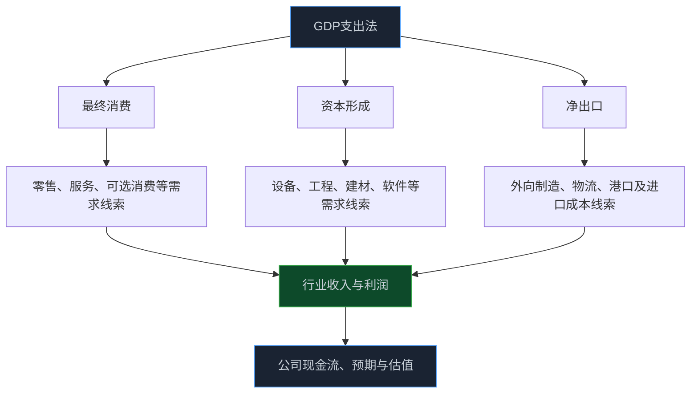

> **系列难度说明**：本篇是**第二章·第一篇**。不需要背宏观术语，只要愿意顺着“谁花钱、谁生产、谁赚钱”的链条往下追，就能读懂 GDP 对行业和公司的意义。
>
> **核心收获**：读完后，你会知道 GDP 到底在统计什么，能从支出法和生产法两条线拆开增长来源，也能避免把 GDP 增速直接当成股票涨跌的预测信号。
>
> **重要提示**：本文只用于投资者教育，不构成任何证券投资建议。GDP 是总量和阶段性指标，数据会随核算、季节调整和普查结果修订；研究时应结合行业、公司与估值信息，而不是只凭单一宏观数据下结论。

一条 GDP 数据公布后，市场里常见两种反应。

一种说：增长快了，股票该涨。

另一种说：增长慢了，要避险。

两句话都太快了。

GDP 更像经济的一张总账。它能告诉你一段时间里，消费、投资、出口和各行业大致贡献了多少增长；却不会直接告诉你哪只股票明天会上涨。总账变好了，不代表每家公司都赚钱；总账走弱，也不意味着所有行业都会同步下行。

要把 GDP 变成研究工具，关键不是记住一个增速，而是追问：**这部分增长是谁创造的？谁付了钱？需求最后会流到哪条产业链？**

<!-- more -->

---

## GDP 到底在统计什么：不是“国家赚了多少钱”

GDP，全称国内生产总值。简单说，它衡量的是一个经济体内所有常住单位在一定时期生产活动的最终成果。

这里有三个词很重要。

**国内**，看的是生产活动发生在本国经济领土内，而不是企业老板来自哪里。

**生产**，看的是新创造的价值，不是把同一件商品在不同人手里转来转去都重复算一遍。

**最终成果**，意味着中间环节不能重复计算。面粉卖给面包厂、面包再卖给消费者，如果把面粉和面包价格全部相加，就会把同一份价值算两次。GDP 要计算的是每一环新增的价值，也就是增加值。

国家统计局的指标解释中，GDP 可以从生产、收入和支出三个角度核算；理论上，三种方法描述的是同一份经济活动，只是观察角度不同。

> **来源**：[什么是国内生产总值（GDP）](https://www.stats.gov.cn/zs/tjws/tjzb/202301/t20230101_1903699.html) — 国家统计局对 GDP 的定义、核算方法和支出法构成作出说明。
>
> **来源**：[GDP 是如何进行核算的？](http://hnzdhd.stats.gov.cn/tjzs/cjwtjjd/202302/t20230220_91036.html) — 国家统计局系统对生产法、收入法和支出法 GDP 核算框架的解读。

把它放回一家公司，会更容易理解。

一家汽车厂卖出一辆车，不是整台车的售价都由自己创造。钢材、芯片、轮胎、物流和经销服务，都有各自的价值贡献。汽车厂自身的增加值，来自它把采购来的中间投入变成产品后新创造的那一部分。

所以，GDP 不是企业利润之和，更不是股市市值之和。它是一张关于整个经济“新创造了多少价值”的总账。


这也是为什么看 GDP 时，不能把它理解成一个遥远的宏观名词。它的背后，其实就是无数家公司、工厂、门店、服务机构和消费者发生的真实交易。

---

## 从“谁花钱”看增长：消费、投资和净出口

投资研究最常用的是支出法。它把 GDP 的最终使用拆成三部分：

\[
GDP = 最终消费支出 + 资本形成总额 + 货物和服务净出口
\]

公式很短，背后却是一张需求地图。

### 消费：居民和政府最终买了什么

最终消费支出包括居民消费和政府消费。日常买的食品、家电、出行、餐饮、医疗、教育和文娱服务，都可能进入居民消费；公共服务相关支出则构成政府消费的一部分。

消费走强时，最直观受影响的可能是零售、餐饮、旅游、家电、汽车、医药服务等行业。但传导从来不是整齐划一的。

比如餐饮消费回暖，对连锁品牌、食材供应、冷链物流、商场和支付服务的影响都不同。真正受益的公司，还要看门店数量、客单价、同店销售、成本结构、竞争格局和渠道位置。GDP 里的“消费增长”只告诉你需求大方向变了，不会替你筛出最能把需求变成利润的公司。

### 投资：今天花的钱，换取明天的产能和资产

资本形成总额通常包括固定资本形成和存货变动。你可以先把固定资本形成理解为企业、政府或居民为获得长期使用资产而进行的投入，例如厂房、设备、基础设施、软件系统、研发相关资产和住宅等。

投资增长时，机械设备、工程建设、工业自动化、建材、工程服务、运输设备等行业可能更敏感。但要继续问一层：这是企业主动扩产，还是为了维持存量设备？是有效需求推动，还是低回报的重复建设？投资金额增加，不自动等于上市公司利润同比增加。

存货变动也不能忽略。企业补库存时，会增加订单和生产；去库存时，哪怕终端需求没有断崖式下降，上游产出和价格也可能承压。后面的 PMI、PPI 和行业周期课程会把这条链再拆细。

### 净出口：外部需求和进口成本同时在起作用

净出口是出口减去进口。出口增长能带动外向型制造、港口航运、跨境物流和部分供应链公司；进口变化则会影响原材料、设备、能源和消费品的成本与供给。

但“出口好”不等于所有出口企业都好。汇率、海外订单结构、海外库存、关税、产品价格、海外产能和企业自身客户集中度，都会改变利润兑现的结果。



支出法最大的价值，是让你把“经济增长”拆成具体的需求来源。以后看到 GDP 数据，先不要急着判断强弱，先问：消费、投资、净出口里，哪一项在拉动，哪一项在拖累？

---

## 从“谁生产”看增长：三次产业和行业增加值

支出法看谁花钱，生产法则看谁创造增加值。

宏观数据常把经济分为三次产业：

- 第一产业，主要与农林牧渔业相关；
- 第二产业，主要包括工业和建筑业；
- 第三产业，主要是服务业。

国家统计局发布 GDP 时，通常会披露三次产业增加值和增长情况。这能帮助我们判断增长更多来自制造、建筑，还是来自服务业扩张。

不过，三次产业只是第一层粗分类。投资研究还需要继续向下拆。

第二产业增加值走强，可能是装备制造、汽车、电子、化工、能源，也可能只是某些行业的价格或产量变化；第三产业走强，可能来自交通运输、信息服务、金融、房地产服务、批发零售、文旅或医疗。一个总量指标无法替代行业数据。

例如，服务业增加值较快增长，不等于所有服务类股票都值得买；工业增加值回升，也不等于每家制造公司都会受益。你还要把宏观行业分类翻译成更具体的问题：

```text
行业增加值变化
   ↓
产量、销量、价格或服务量变化
   ↓
公司收入变化
   ↓
成本与费用如何变化
   ↓
利润、现金流与资本开支变化
   ↓
市场原先是否已经预期
```

国家统计局在年度经济运行发布中会同时给出 GDP 总量、三次产业增加值和增速。这类分项比单看总 GDP 更接近产业研究的入口。

> **来源**：[2024 年国民经济和社会发展统计公报相关数据](https://www.stats.gov.cn/xxgk/jd/sjjd2020/202501/t20250117_1958345.html) — 国家统计局发布 GDP、三次产业增加值、产业结构等年度统计信息。
>
> **来源**：[国家数据](https://data.stats.gov.cn/) — 国家统计局数据查询入口，可用于核对 GDP、产业增加值及相关宏观指标的最新发布数据。

---

## 名义 GDP 和实际 GDP：价格上涨不能冒充真实增长

假设一家餐馆去年卖出 100 万份套餐，每份 20 元；今年仍卖出 100 万份，但套餐涨到 22 元。营业收入从 2,000 万元变成 2,200 万元，增长了 10%。

可它卖出的套餐数量没有增加。

这就是为什么读 GDP 时要区分现价和不变价。

- **现价 GDP** 使用当期价格计算，里面包含数量变化和价格变化；
- **不变价 GDP** 尽量剔除价格变化，观察更接近真实产出数量的变化；
- 新闻中常说“按不变价格计算，同比增长 X%”，通常是在描述实际经济增长速度。

这不是说价格不重要。价格变化会直接影响企业收入、利润率、库存价值和名义现金流。只是当你想判断“经济到底多生产了多少”，不能把价格上涨全部当成真实增长。

同样的道理适用于公司研究。收入增长 20%，要拆出销量增长、价格变化、产品结构变化和并表因素；GDP 增长也要区分物量、价格和结构的贡献。

> **来源**：[国家统计局关于 2024 年国内生产总值最终核实的公告](https://www.gov.cn/lianbo/202512/content_7052801.htm) — 官方说明不变价 GDP 用固定基期价格衡量，以剔除价格变化影响，便于比较不同时期的实际增长。

---

## 同比、环比、累计：三个数字在回答三种问题

GDP 数据出来时，最容易看到的是同比增速。它把本期和去年同一时期比较，能减弱季节因素影响，适合看相对稳定的趋势。

环比则把本期和紧邻的上一期比较。季度环比通常需要经过季节调整，更适合观察短期变化是否加快或放缓。

累计增速则把年初到当前时点的整体表现汇总起来。它对了解全年进度有用，却容易掩盖最近一个季度的边际变化。

| 指标 | 它回答的问题 | 常见误读 |
| --- | --- | --- |
| 同比 | 比去年同一时期快还是慢 | 把基数效应当成趋势反转 |
| 环比 | 相比刚过去的时期，边际是在加速还是减速 | 忽略季节调整与短期波动 |
| 累计 | 年初至今整体运行如何 | 用累计数字掩盖最近的转弱或修复 |
| 现价总量 | 经济规模按当期价格有多大 | 把价格上涨全部当作实际增长 |
| 不变价增速 | 剔除价格后，实际产出增长多快 | 忽略价格变化对企业利润的影响 |

举个简单例子：某季度同比增速回升，可能是真实需求变强，也可能是去年同期基数很低；环比改善，可能意味着边际修复，但单个季度也可能受天气、节假日或一次性因素影响。

对投资者来说，最稳妥的读法不是挑一个最漂亮的数字，而是把同比、环比、分项和高频行业数据放在一起看。宏观数据像监控面板，单个指标报警不等于系统全貌，连续多项指标同向变化才更值得重视。

> **来源**：[解读 GDP 的注意事项有哪些？](http://stats.gd.gov.cn/cgmjjhs/content/post_4834247.html) — 统计部门解读同比与环比的不同观察用途，并提示季度数据的比较口径差异。

---

## GDP 增长，为什么股市不一定立刻上涨

这是宏观研究里最容易失望的一点。

GDP 反映的是已经发生或正在发生的经济活动；股票价格交易的却是未来盈利、利率、风险偏好和市场预期差。两者方向经常有关，但时间并不一定同步。

可以把它写成一条更完整的链：


可能出现几种看似反直觉的情况：

- GDP 数据不错，但市场此前预期更高，股价反而下跌；
- GDP 增速放缓，但市场已经充分定价坏消息，股价开始修复；
- 总 GDP 平稳，某个细分行业因供需错配或技术变化率先改善；
- 经济增长较强，但利率上行或估值过高，成长股估值承压。

所以 GDP 的作用不是给出“买入”或“卖出”按钮，而是帮助你调整研究顺序：哪些需求链需要进一步验证，哪些行业的收入假设可能要上调或下调，哪些公司原先的增长故事正在失去宏观支撑。

---

## 数据会修订：不要把初值当作最后判决

宏观数据不是一次生成、永不变化的事实。季度初步核算、年度核算、经济普查和核算方法改进，都可能带来修订。

这不是数据“不可靠”，而是统计系统会随着更完整的资料到来，更新先前估计。企业发布业绩快报后还会出年报、审计报告和更正公告；GDP 核算也有类似的版本演进。

例如，国家统计局曾依据经济普查结果和核算方法改革，对 GDP 初步核算数进行修订。做研究时，记录数据的发布日期、统计口径和版本，比只收藏一个数字更重要。

> **来源**：[关于我国国内生产总值历史数据修订结果的公告](https://www.stats.gov.cn/xw/tjxw/tzgg/202302/t20230227_1918769.html) — 国家统计局说明经济普查等基础资料会推动 GDP 历史数据修订。

对普通投资者来说，不需要每次修订都重做模型。你只要保留一个习惯：当结论依赖某项宏观数据时，写清“数据来自哪次发布、是初步值还是最终核实值、后续可能如何修订”。这就是前面课程一直强调的证据链。

---

## 一次练习：把 GDP 翻译成一张行业需求地图

找国家统计局最近一次季度或年度经济运行发布，先不看市场评论，只做一张自己的表。

| GDP 分项或行业数据 | 你看到的变化 | 可能传导到的行业 | 还需要补的证据 |
| --- | --- | --- | --- |
| 最终消费 | 增速上升或放缓 | 可选消费、必选消费、服务 | 零售额、客流、价格、同店销售 |
| 固定资产投资 | 增速上升或放缓 | 设备、工程、建材、自动化 | 分行业投资、订单、产能利用率 |
| 净出口 | 改善或走弱 | 出口制造、港口、物流 | 海外订单、汇率、库存、产品价格 |
| 工业增加值 | 加快或放缓 | 制造业产业链 | 产量、库存、PPI、公司订单 |
| 服务业增加值 | 加快或放缓 | 出行、文旅、信息服务等 | 客流、客单价、平台数据、公司收入 |

写完后，再挑一个你关注的行业，回答一句话：

> GDP 里的哪一部分，是这条产业链最重要的需求来源？它已经反映在公司收入里了吗？

这一步能把“宏观很大”变成可追踪的研究问题。

---

## 小结

- GDP 统计的是一段时间内经济活动创造的最终增加值，不等于企业利润，也不等于股市表现。
- 支出法把增长拆为最终消费、资本形成和净出口；生产法则从行业和三次产业增加值观察谁在创造增长。
- 读 GDP 时要区分现价与不变价、同比与环比、总量与结构，单个增速很难独立解释市场。
- GDP 影响股票的路径要经过行业需求、公司盈利预期、利率和风险偏好，价格通常交易的是预期差而非已公布数据本身。
- 宏观数据会修订。记录口径、版本和发布日期，比把一个数字当成永久事实更可靠。

---

## 下一篇预告

GDP 告诉我们经济总量在怎么走，但它还没有说清一个关键问题：需求增长时，企业是把价格涨上去，还是被成本推着走？

下一篇聊聊：**CPI 与 PPI：价格变化传到利润表的路径。**

---

> **课程导航：第二章·宏观经济：给市场画一张天气图**
> - **第一篇：GDP：增长从哪里来** ← 你在这里
> - 第二篇：CPI 与 PPI：价格变化传到利润表的路径
> - 第三篇：PMI：如何读懂景气度信号
> - 第四篇：M1 与 M2：货币到底在反映什么
> - 第五篇：社会融资：信用扩张与收缩
> - 第六篇：利率为什么会影响股票估值
> - 第七篇：国债收益率：无风险利率这把尺子
> - 第八篇：汇率：外部价格与企业经营的连接
> - 第九篇：财政变量如何进入行业与公司
> - 第十篇：货币条件、流动性与风险偏好
> - 第十一篇：经济周期：别把阶段性变化当成永恒趋势
