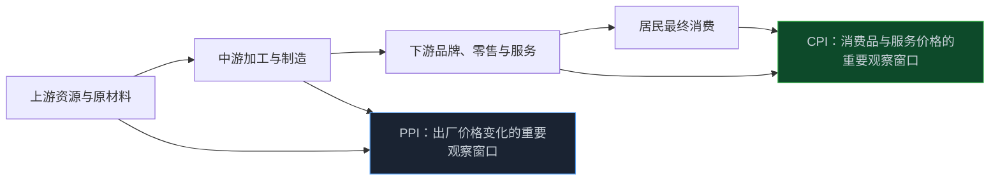
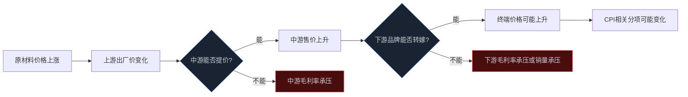

> **系列难度说明**：本篇是**第二章·第二篇**。不需要学会预测通胀，只要能把“价格涨了”继续拆成“谁的价格、谁的成本、谁有能力转嫁”，就已经进入了宏观和公司研究的连接处。
>
> **核心收获**：读完后，你会分清 CPI 和 PPI 分别在记录什么，理解价格如何沿产业链传导到收入、成本和毛利率，也能避免把“CPI 上行利好消费”“PPI 下行利空工业”当成机械公式。
>
> **重要提示**：本文只用于投资者教育，不构成任何证券投资建议。CPI、PPI 是价格指数，不是公司利润预测；行业价格、公司合同、库存周期与竞争格局差异很大，应以公开数据、公司公告和财报为准。

同样是“价格上涨”，对不同公司可能是完全相反的事。

原材料涨价，对上游资源企业可能意味着售价和利润改善；对没有议价能力的加工企业，却可能是毛利率被挤压。消费品涨价，对品牌强势的公司可能带来收入和利润提升；对需求敏感的公司，涨价反而可能让销量掉得更快。

所以，看到 CPI 或 PPI 的一个数字，不要急着套“利好”“利空”。

真正值得问的是：**这次价格变化发生在哪一段产业链？能不能传到下一段？最后是谁承担成本，谁留下利润？**

<!-- more -->

---

## CPI 和 PPI，站在产业链的两端看价格

CPI 是居民消费价格指数，关注的是居民购买生活消费品和服务时，价格整体发生了怎样的变化。

PPI 通常指工业生产者出厂价格指数，关注工业企业产品第一次离开企业、进入流通或被其他单位购买时，价格总体发生了怎样的变化。

一句更好记的话：

- **CPI 更靠近消费者的账单**；
- **PPI 更靠近工业企业的出厂价和生产链条**。

国家统计局按月发布 CPI、PPI 等价格指数。PPI 反映全部工业产品出厂价格总水平的变动趋势和程度；CPI 则用于观察与居民生活相关的商品和服务价格变化。

> **来源**：[价格统计常见问题解答](https://www.stats.gov.cn/hd/cjwtjd/202302/t20230207_1902269.html) — 国家统计局说明 CPI、PPI 等价格指数的发布频率和数据查询渠道。
>
> **来源**：[工业生产者出厂价格指数](https://www.stats.gov.cn/zs/tjws/zytjzbqs/gyscz/) — 国家统计局 PPI 专题页面，提供指标说明、编制方法和基础数据入口。



这张图只是一个方向感，不是一条自动传导线。

PPI 上涨，不一定会传到 CPI；CPI 上涨，也不一定来自 PPI。服务价格、房租、人工、汇率、供需、税费、渠道加价和季节性因素，都可能改变中间路径。

因此，CPI 和 PPI 不是两根能直接预测股价的曲线，而是两台分别放在消费端和生产端的温度计。

---

## 先别盯总指数，先看价格涨在了哪里

总 CPI 和总 PPI 适合看大方向，投资研究却往往要从分项开始。

CPI 里常见食品、衣着、居住、生活用品及服务、交通通信、教育文化娱乐、医疗保健、其他用品及服务等类别。食品和能源价格容易受天气、季节、供给扰动和国际价格影响，单月波动可能很大。

这也是为什么很多分析会同时看核心 CPI。它通常扣除食品和能源价格，试图减少短期大幅波动项目的影响，帮助观察消费端更稳定的价格趋势。

PPI 也需要拆分。按用途，常会区分生产资料与生活资料；生产资料还可继续观察采掘、原材料、加工等环节。这个分法很有用，因为它能帮助判断价格变化更像来自上游供给冲击，还是来自终端消费需求。

> **来源**：[什么是生产资料价格指数？什么是生活资料价格指数？](http://snzd.stats.gov.cn/zsjd/2022/44385.shtml) — 统计部门说明，PPI 中生产资料和生活资料的分组有助于分析价格变化的传导层次。
>
> **来源**：[核心 CPI 与分项价格解读](https://www.stats.gov.cn/xxgk/jd/sjjd2020/202510/t20251015_1961519.html) — 国家统计局月度发布中展示食品、能源与核心 CPI 对总体价格的不同影响。

可以把读数过程写成一个小流程：

```text
总 CPI / 总 PPI 有变化
        ↓
哪些分项贡献最大？是食品、能源、服务，还是工业原材料？
        ↓
变化来自需求、供给、库存、季节性、汇率或国际商品价格？
        ↓
对应的是哪条产业链？
        ↓
公司收入、成本、毛利率和现金流可能怎样变化？
```

只看总指数，很容易把“猪肉价格变化”“油价变化”或“某类工业品价格波动”误解成整个消费或制造业的普遍趋势。

---

## PPI 先动、CPI 后动？有时会，但不要把它当成钟表

常见说法是：上游原材料涨价，PPI 先上升；企业再把成本转给消费者，CPI 随后上升。

这条路径在某些行业确实存在，但现实里经常断在中间。

假设化工原料价格上涨。上游企业可能立刻提高出厂价；中游制造商如果订单强、产品紧缺，可能把成本转给品牌商；品牌商若有足够定价权，也许再提高终端售价；消费者若仍愿意购买，CPI 中相关商品价格才可能上行。

任何一环转不动，传导就会停下来。



影响传导的，通常是下面几类因素：

- **供需强弱**：行业供不应求时更容易涨价，产能过剩时更难；
- **产品差异化**：有品牌、技术、渠道或认证壁垒的企业，往往更有议价能力；
- **合同周期**：长协价格、年度定价、锁价订单都会让传导滞后；
- **库存位置**：公司手里有低价库存时，成本压力可能不会立刻出现在利润表；
- **需求弹性**：终端消费者或客户是否会因为涨价减少购买；
- **竞争格局**：同行是否跟涨，决定了单家公司能否独自提价。

所以，PPI 和 CPI 的先后关系只能提供线索。把它们看作产业链价格压力和终端价格接受度的两个观测点，会比背“PPI 领先 CPI 几个月”更有用。

---

## 价格进入利润表，至少要穿过四道门

宏观价格变化要传到上市公司利润表，通常要经过收入、成本、费用和库存这四道门。

### 收入：价格上涨，不一定带来收入上涨

收入近似可以拆成：销量 × 单价。

价格提高后，若销量稳定，收入可能增加；但如果需求弹性很高，销量下降幅度超过单价提升，收入反而可能走弱。

这在可选消费、部分耐用品和竞争激烈的消费品里尤其常见。你不能只看公司是否宣布涨价，还要看销量、渠道库存、客流、订单和市场份额有没有变化。

### 成本：原料涨价，不一定立刻压到毛利率

原材料价格变化通常会影响营业成本，但滞后时间可能不同。公司可能有库存、长协、套期保值或提前锁价；也可能在原料上涨时迅速补库，导致成本压力延后出现。

同一个行业里，库存周转快的公司和库存周转慢的公司，对 PPI 的敏感度也可能完全不同。

### 费用：服务价格和人工成本也会改变利润

CPI 更靠近终端消费，并不只影响收入。服务价格、工资、物流、租金、营销和渠道费用，都可能进入销售费用、管理费用或营业成本。

一家餐饮企业的利润，就同时受食材价格、房租、人工、客流和客单价影响。只看食品 CPI 或只看 PPI，都不够。

### 库存：价格变化先改变资产负债表，再进入利润表

价格快速下跌时，库存可能面临跌价风险；价格快速上涨时，低成本库存会在短期内改善毛利率，但补库后的成本又可能抬高。

这也是为什么周期行业的利润变化有时看起来“慢半拍”。价格已经掉头，报表里的库存成本和结算周期还在把旧价格带进当期业绩。

```text
价格变化
  ↓
订单与售价变化 / 原料采购成本变化
  ↓
库存与合同吸收一部分冲击
  ↓
收入、营业成本、毛利率变化
  ↓
费用、减值与现金流进一步变化
  ↓
净利润和市场预期调整
```

真正值得研究的，不是“CPI 涨了几个点”，而是这条链在一家公司里卡在哪一环、何时会进入财报。

---

## 三种公司，面对同一轮原料涨价，结果可能完全不同

假设铜价上涨。下面三家公司都与铜有关，却可能走出不同利润曲线。

| 公司类型 | 原料涨价的第一反应 | 接下来决定利润的变量 | 常见误判 |
| --- | --- | --- | --- |
| 上游资源企业 | 产品售价可能改善 | 产量、成本、资源品价格能否维持 | “价格涨了，利润一定等比例涨” |
| 中游加工制造商 | 原料成本上升 | 能否向客户转嫁、库存成本、订单量 | “PPI 上涨就是制造业利好” |
| 下游品牌或终端企业 | 采购成本可能上升 | 品牌定价权、销量弹性、渠道费用 | “CPI 上涨就代表消费股利润上升” |

同一轮价格上涨，还可能让上游和中游利润出现此消彼长。

这也是产业链研究的起点：不要只问一个行业“受不受益”，要问利润池正在从哪一段流向哪一段。

对开发者来说，可以把它看成一条数据管道。价格变化是上游输入，合同、库存和竞争结构是中间处理逻辑，收入与毛利率是输出。只观察输入，不检查处理逻辑，输出就很容易猜错。

---

## CPI 高低，对消费股没有一刀切答案

CPI 上行时，市场常会讨论通胀、消费修复和企业提价能力；CPI 偏弱时，又会讨论需求不足和价格竞争。

可消费股不是一个同质化群体。

对必需消费品来说，需求相对稳定，品牌和渠道强的公司可能更有能力把部分成本转给终端；对可选消费品来说，消费者可能对价格更敏感，涨价后销量压力更大；对服务业来说，价格变化又要结合客流、人工、租金和供给竞争一起看。

核心 CPI 的变化通常比单月食品价格更适合观察消费端较广泛的价格趋势，但它也不是企业盈利的替身。核心 CPI 改善，可能来自服务需求回升，也可能来自部分工业消费品价格变化；哪一类公司能受益，要继续回到细分数据和公司经营指标。

更有用的问题是：

1. 这家公司卖的商品或服务，需求弹性高不高？
2. 它能否涨价，涨价后销量是否会掉？
3. 它的主要成本来自原材料、人工、租金还是渠道？
4. 同行业竞争者会不会跟涨，还是会用低价抢份额？
5. 市场当前估值，是否已经把价格改善预期算进去了？

这五个问题，比“CPI 上涨买消费”要慢一点，却更接近利润表。

---

## PPI 变化，也不能简单映射到周期股涨跌

PPI 与工业品价格更接近，因此常被用来观察资源、化工、建材、机械和制造链的价格环境。

但 PPI 是广泛工业品价格的加权指数。一家化工公司的产品价格、一家工程机械公司的出厂价、一家电力设备公司的原材料成本，都可能与总 PPI 走出不同节奏。

PPI 上行可能来自能源、金属等上游价格上涨。这对资源企业可能是收入端的利好，却可能压缩中下游制造的利润；PPI 下行可能降低制造企业的原料成本，也可能反映终端需求不足、售价下降更快。

所以看 PPI 时，不妨同时把下面三组数据放在一起：

```text
PPI 分项价格
   +
行业产量 / 库存 / 订单
   +
公司售价、成本、毛利率和经营现金流
```

只要少了其中一组，就很容易把宏观价格变化误读成公司盈利变化。

---

## 同比、环比和基数：价格数据最常见的三个坑

CPI、PPI 都按月发布，市场很容易被一个同比数字带着走。

### 同比告诉你和去年同月相比怎样

同比适合看较长趋势，但会受到去年同期基数影响。去年价格很低，今年即使只是小幅恢复，同比也可能显得很高；去年价格很高，今年即便环比改善，同比仍可能偏弱。

### 环比告诉你最近一个月的边际变化

环比更接近短期方向，却容易受季节、节假日、天气和短期供需冲击影响。鲜菜、旅游、能源等分项尤其如此。

### 基数不是借口，是数据结构的一部分

看到“同比回升”或“同比降幅收窄”，要多问一句：是本月真的出现强劲涨价，还是去年同期基数更低？最好同时看环比、同比、两年平均变化和分项贡献。

国家统计局月度发布通常会给出同比、环比和主要分项影响。读数据时，先看贡献最大的项目，再看它是季节性、供给冲击还是更广泛的需求变化。

> **来源**：[2026 年 7 月份居民消费价格同比上涨 0.5%](https://www.stats.gov.cn/sj/zxfb/202608/t20260809_1965008.html) — 国家统计局月度 CPI 发布展示食品、服务等分项价格及其对总体 CPI 的影响。

---

## 价格数据怎样进入估值，而不只是进入利润表

价格变化最直接影响收入和成本，但它还会通过通胀预期、利率和风险偏好进入估值。

如果市场认为价格压力持续、利率环境可能变化，高估值资产对折现率的敏感度会提高；如果 PPI 上行代表工业需求和利润修复，周期行业可能获得盈利预期改善；如果 CPI 偏弱且需求不足，某些公司的收入增长假设就需要下调。

不过，估值变化往往走在利润表前面。市场交易的是未来几季甚至更远的价格、销量和利润预期，不是已经公布的 CPI 或 PPI 本身。

这条链可以写成：


因此，价格数据公布后市场不按直觉反应，并不奇怪。关键在于数据相对预期是更强还是更弱，分项结构能否验证原有的行业逻辑，以及估值里已经提前计入了什么。

---

## 一次练习：给一家公司画一张“价格传导表”

找一家你能看懂业务的公司。可以是食品饮料、化工、家电、汽车零部件、餐饮、物流或设备制造企业。然后用年报和最近一期公告，填一张表。

| 你要找的事实 | 需要回答的问题 |
| --- | --- |
| 产品价格 | 公司卖什么？售价主要由市场价、合同价还是自己定价决定？ |
| 核心成本 | 原材料、人工、能源、运费、租金，哪一项占比最高？ |
| 价格来源 | 对应看 CPI 分项、PPI 分项、商品价格还是服务价格？ |
| 传导能力 | 公司能否提价？提价会不会影响销量和份额？ |
| 库存与合同 | 成本变化多久进入报表？是否有长协、锁价或库存缓冲？ |
| 财报验证 | 毛利率、存货、应收和经营现金流是否支持你的判断？ |

最后写一句：

> 如果上游价格上涨 10%，这家公司利润最可能受益、受损，还是先受益后受损？我还缺什么证据？

这比直接判断“PPI 上行利好谁”更难一点，但它已经是在用宏观数据做公司研究了。

---

## 小结

- CPI 更接近居民消费端的价格变化，PPI 更接近工业生产端的出厂价格变化；两者都要看分项，不能只看总指数。
- PPI 向 CPI 的传导可能存在，但受供需、库存、合同、竞争和需求弹性影响，不能按固定时间表推演。
- 价格进入利润表，要经过售价、销量、采购成本、库存、费用和现金流等多个环节。
- CPI 上行不必然利好消费股，PPI 上行也不必然利好制造业；关键在于公司在产业链中的位置和定价权。
- 读价格数据要同时看同比、环比、基数和分项贡献，再把它和公司毛利率、库存、订单放在一起验证。

---

## 下一篇预告

GDP 告诉我们总需求大致走向哪里，CPI 和 PPI 告诉我们价格正在在哪一段产业链变化。

可企业自己对订单、生产、原料库存和未来经营的感受，往往会更早体现在一张问卷里。

下一篇聊聊：**PMI：如何读懂景气度信号。**

---

> **课程导航：第二章·宏观经济：给市场画一张天气图**
> - 第一篇：GDP：增长从哪里来
> - **第二篇：CPI 与 PPI：价格变化传到利润表的路径** ← 你在这里
> - 第三篇：PMI：如何读懂景气度信号
> - 第四篇：M1 与 M2：货币到底在反映什么
> - 第五篇：社会融资：信用扩张与收缩
> - 第六篇：利率为什么会影响股票估值
> - 第七篇：国债收益率：无风险利率这把尺子
> - 第八篇：汇率：外部价格与企业经营的连接
> - 第九篇：财政变量如何进入行业与公司
> - 第十篇：货币条件、流动性与风险偏好
> - 第十一篇：经济周期：别把阶段性变化当成永恒趋势
