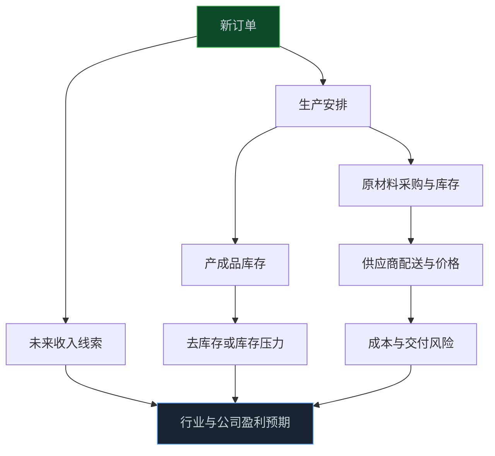

> **系列难度说明**：本篇是**第二章·第三篇**。不用记住全部 PMI 分项；只要学会沿着“订单 → 生产 → 库存 → 价格 → 利润”的顺序读数据，就能把一条月度指数变成行业研究线索。
>
> **核心收获**：读完后，你会知道 PMI 为什么被称为景气先行指标，理解 50 的真正含义，并能用新订单、生产、库存、价格和企业规模分项，判断改善是需求驱动、补库存驱动，还是只是短期波动。
>
> **重要提示**：本文只用于投资者教育，不构成任何证券投资建议。PMI 是基于企业调查汇总的扩散指数，反映的是环比方向与景气程度，不等于产量、收入或利润的绝对增速；应与工业增加值、订单、库存、价格及公司财报交叉验证。

每个月月底，PMI 总会被市场盯一眼。

数字高于 50，有人说制造业扩张；低于 50，又有人说经济要变差。可你再往下看，会发现同样是 49 点多，有时市场觉得在修复，有时却认为需求走弱；同样是 51 点多，有时是订单回来了，有时只是企业提前补了一轮库存。

问题不在于 `50` 重不重要，而在于只盯着 `50` 太省事了。

PMI 更像企业采购端的一次月度体检。它不直接回答“利润是多少”，但会比很多季度数据更早地透露：订单有没有变多、工厂有没有忙起来、原料有没有补、价格压力在哪一段。

想把它读成投资线索，关键不是问“PMI 高不高”，而是问：**订单、生产、库存和价格，能不能拼成同一个经营故事？**

<!-- more -->

---

## PMI 是什么：一份企业“最近比上个月好吗”的问卷

PMI 是采购经理指数。国家统计局对企业采购经理进行月度调查，再把调查结果汇总成指数。它覆盖采购、生产、流通等环节，既有制造业 PMI，也有非制造业商务活动指数和综合 PMI 产出指数。

它的核心不是统计“这个月生产了多少台机器”，而是询问企业：和上个月相比，生产、新订单、原材料库存、人员等情况是增加、持平还是减少。

所以 PMI 属于扩散指数。它反映的是变化方向和变化覆盖面，而不是绝对规模。

假设 100 家企业里：

- 55 家说新订单比上月增加；
- 30 家说基本持平；
- 15 家说减少。

这说明订单改善的企业多于订单走弱的企业，指数倾向位于 `50` 以上。但它不告诉你这 55 家企业的订单金额一定有多大，也不能直接推出上市公司收入一定增长了多少。

> **来源**：[什么是采购经理指数（PMI）](https://www.stats.gov.cn/zs/tjws/tjzb/202301/t20230101_1903972.html) — 国家统计局说明，PMI 是对企业采购经理月度调查结果汇总编制的指数，具有较强的预测和预警作用。
>
> **来源**：[采购经理指数专题](https://www.stats.gov.cn/zs/tjws/zytjzbqs/cgzlzs/) — 国家统计局 PMI 专题页，提供调查基础数据、指标解释和发布资料。

这就是 PMI 的价值和边界：它发布快，能看到边际变化；但它只是问卷信号，需要更多数据来验证。


---

## 50 不是及格线，它是一条“环比平衡线”

PMI 最常被提到的数字是 `50`。

- 高于 `50`，通常表示与上月相比，相关活动总体处于扩张；
- 低于 `50`，通常表示与上月相比，相关活动总体处于收缩；
- 等于 `50` 左右，表示环比变化不明显。

但 `50` 不是经济好坏的总开关，更不是股票买卖线。

制造业 PMI 从 `48.5` 升到 `49.8`，虽然还在 `50` 以下，却说明收缩幅度在减小，边际上可能正在改善。反过来，从 `52` 降到 `50.5`，仍在扩张区间，但景气是在放缓。

所以，读 PMI 要同时看两个维度：**水平**和**变化**。

| 你看到的情况 | 更接近的含义 | 不该直接得出的结论 |
| --- | --- | --- |
| `49` 升至 `49.8` | 收缩可能在收窄，需看订单是否同步改善 | “经济已经强复苏” |
| `51.5` 降至 `50.3` | 仍在扩张，但扩张速度可能放缓 | “景气一定很好” |
| `50` 附近连续波动 | 企业活动可能接近平衡、方向不明朗 | “一个小数点就代表趋势反转” |
| 多月持续高于 `50` | 扩张有一定连续性 | “所有行业都会同步受益” |
| 多月持续低于 `50` | 收缩有一定连续性 | “所有公司利润都会下降” |

国家统计局发布 PMI 时，也会同时披露制造业、非制造业和综合 PMI 的情况。综合 PMI 产出指数由制造业生产指数和非制造业商务活动指数共同构成，帮助观察企业生产经营活动的整体变化。

> **来源**：[2026 年 5 月中国采购经理指数运行情况解读](https://www.stats.gov.cn/sj/sjjd/202605/t20260531_1963825.html) — 国家统计局说明综合 PMI 产出指数由制造业生产指数和非制造业商务活动指数构成，并用于反映企业生产经营活动总体变化。

---

## 制造业 PMI：不要只看总数，先看五个核心分项

制造业 PMI 的核心分项包括生产、新订单、原材料库存、从业人员和供应商配送时间。市场研究中，还会重点追踪新出口订单、产成品库存、采购量、主要原材料购进价格、出厂价格和生产经营活动预期等指标。

它们像一份经营链条的不同截面。

### 新订单：需求有没有真的来

新订单是最值得优先看的分项之一。订单增加，意味着企业未来一段时间的生产和收入可能有支撑；订单减少，则意味着即使当期生产还不错，后续也可能承压。

但新订单改善不必然来自最终需求回暖。它也可能来自渠道补货、季节性采购、促销备货或出口订单提前释放。因此，新订单需要和新出口订单、产成品库存、零售数据、行业订单和公司公告一起看。

### 生产：工厂现在忙不忙

生产指数更接近当期生产活动。生产回升通常是积极信号，但“生产强于订单”时要多留心：企业可能在提前备货，或者订单虽然弱，生产仍受过去积压订单支撑。

订单强、生产也强，故事更完整；订单弱、生产强，则需要继续看库存是不是在被动累积。

### 原材料库存与产成品库存：企业是在补库，还是库存压力变大

原材料库存上升，有时意味着企业对未来生产更有信心，提前采购；有时也可能只是原料价格下跌，企业被动增加存货。产成品库存上升也有两面：它可能是为旺季备货，也可能是产品卖不动。

库存必须和订单、生产一起读，不能单独定性。

### 从业人员：企业有没有把改善变成扩招

从业人员指数能帮助判断企业对未来的信心是否已经落实到用工决策。企业通常不会因为一个短期订单波动就立刻大规模招人，所以就业变化相对更慢，也更需要结合其他分项观察。

### 供应商配送时间：一个容易被读反的指标

供应商配送时间延长，可能意味着订单旺、供应链忙，企业拿货变慢；也可能来自物流受阻、供给扰动或原料短缺。它不是单向“景气更好”的证据。

这正是 PMI 的难点：同一项变化需要放进上下文。看到配送变慢，还要看生产、新订单、原材料库存和价格。如果订单、生产都在走强，可能更接近需求旺；如果生产走弱、原料库存低、价格又异常波动，则可能是供给端出了问题。



---

## 四种常见组合：把 PMI 从一串数字读成经营故事

单项 PMI 容易误导，组合更有用。

| 新订单 | 生产 | 库存 | 更可能的经营状态 | 后续验证重点 |
| --- | --- | --- | --- | --- |
| 上升 | 上升 | 原料库存温和上升、产成品库存稳定 | 需求改善带动主动补库 | 行业订单、产量、公司收入与毛利率 |
| 上升 | 上升较慢 | 产成品库存下降 | 订单回暖、过去库存正在消化 | 渠道库存、价格能否企稳、补库是否持续 |
| 下降 | 上升 | 产成品库存上升 | 生产与需求错位，可能被动累库 | 未来减产、降价和利润压力 |
| 下降 | 下降 | 原料与产成品库存都偏弱 | 需求偏弱、企业缩产去库存 | 订单底部、政策与价格是否出现边际变化 |

这张表不是预测公式。企业可能因节假日、行业淡旺季、出口抢单或一次性项目出现短期偏离。它的价值在于提醒你：看到生产扩张，不要忘了问订单；看到订单回暖，不要忘了问库存；看到库存下降，也要区分主动去库还是被动去库。

对周期行业来说，这种组合尤其重要。利润往往不是在需求最热、产量最高时最好，而是供需开始改善、库存压力缓解、价格尚未完全反映的时候出现弹性。后面的行业周期课程会继续拆这件事。

---

## 非制造业 PMI：服务业不是“制造业的附属项”

非制造业通常用商务活动指数来观察总体景气，覆盖服务业和建筑业等领域。

服务业的景气驱动与制造业并不相同。出行、文旅、信息服务、金融服务、物流、餐饮、房地产服务，都更容易受居民收入、客流、政策、季节和服务供给影响。建筑业则与基建、地产项目、资金到位和施工进度关系更紧密。

因此，非制造业商务活动指数回升时，不能笼统地说“服务消费都好了”。你要继续看细分行业：是交通运输、信息服务在改善，还是建筑活动在回升？是节假日带来的短期客流，还是更广泛的收入和需求修复？

制造业、非制造业和综合 PMI 之间出现分化，也不是异常。

- 制造业偏弱、服务业偏强，可能反映内需服务活动更有韧性；
- 制造业偏强、服务业偏弱，可能与出口、工业补库或基建施工有关；
- 两者同步走强，通常意味着景气改善更广；
- 两者同步走弱，则需要更警惕需求、就业和盈利预期的共振压力。

宏观数据的意义就在这里：不是找一个万能指标，而是观察不同部门的经济活动是否在相互验证。

---

## 企业规模和行业分项：总 PMI 的平均数，会藏住分化

制造业 PMI 常会披露大型、中型和小型企业的景气情况，也会展示高技术制造业、装备制造业、消费品行业等分项表现。

总 PMI 上升，可能主要由大型企业拉动，中小企业却仍承压；高技术制造业景气向上，也不等于传统制造都同步改善。平均数很好看，不代表每个角落都一样热。

国家统计局的月度发布就会对不同规模企业和重点行业作出说明。例如，有时大型、中型企业处于扩张区间，小型企业仍在收缩；有时高技术制造业明显强于制造业总体。这类分化，对 A 股研究比总 PMI 更有提示价值。

> **来源**：[6 月份我国制造业 PMI 为 50.3%](https://www.gov.cn/lianbo/202606/content_7073759.htm) — 官方发布展示大型、中型、小型企业 PMI 及高技术、装备、消费品行业 PMI 的分化情况。

对投资者来说，看到“总 PMI 回升”后，可以多做一步：你关注的公司属于哪一类企业、哪条产业链、哪种需求来源？如果总量改善没有传到它所在的分项，宏观利好可能还停留在新闻标题里。

---

## PMI 为什么常常比 GDP 更早，但也更容易误读

GDP 多数在季度结束后公布，反映的是一段时期已经实现的经济总量。PMI 按月发布，采购经理更早感受到订单、原料和生产变化，因此它常被视作景气的先行或同步线索。

快，是它的优势；问卷属性，也是它的边界。

PMI 可能受季节性、节假日、天气、政策窗口、企业预期和样本结构影响。单月波动不必然代表趋势反转，尤其在 `50` 附近反复上下时，更不应该用一个小数点给市场下结论。

这和看线上业务监控很像。一个接口延迟升高，可能是流量增加，也可能是一次网络抖动；只有结合请求量、错误率、机器负载和持续时间，才能判断系统是否真的出问题。

读 PMI 也一样。至少做四个交叉核对：

```text
PMI 新订单与生产
    +
工业增加值、零售或出口数据
    +
行业价格、库存和高频订单
    +
上市公司收入、毛利率与经营现金流
```

四组数据说的是同一个方向，景气判断才更有可信度。

---

## PMI 数据公布后，为什么股市有时反着走

PMI 好于预期，股市不一定涨；PMI 低于 `50`，股市也不一定跌。

原因和 GDP 一样：股价交易的是预期差。

如果市场原先预期 PMI 会更低，实际数据虽然仍低于 `50`，却可能被理解为“比担心的好”；如果市场已经把强复苏写进价格，PMI 即便高于 `50`，但低于预期，也可能引发回调。

此外，市场还会同时看价格分项：订单回升是靠真实需求，还是靠价格上涨？原材料购进价格上升，是企业利润改善的前兆，还是成本压力？生产走强会不会带来库存积压？

所以，PMI 公布后更值得做的是更新假设，而不是抢答方向：


把 PMI 当作更新研究模型的输入，而不是当作盘中交易指令，通常会更稳。

---

## 一次练习：给一个行业建立“PMI 观察面板”

选一个你关注的制造行业，例如工程机械、汽车零部件、化工、家电或电子。做一个最小观察面板，每月更新一次。

| 观察项 | 你要问的问题 | 可以配合看的数据 |
| --- | --- | --- |
| 新订单 | 行业需求在改善还是走弱？ | 公司订单、招标、出口数据、零售或销量 |
| 生产 | 企业是在扩产，还是消化旧订单？ | 工业增加值、开工率、产量 |
| 原材料库存 | 企业是在主动补库，还是被动囤货？ | 商品价格、采购量、公司存货 |
| 产成品库存 | 产品卖得快不快？ | 渠道库存、周转天数、价格折扣 |
| 购进与出厂价格 | 成本和售价谁变化更快？ | PPI 分项、公司毛利率 |
| 企业规模与行业分项 | 改善发生在哪类企业？ | 细分行业 PMI、公司客户结构 |

最后只写一句判断：

> 这个行业当前更像“需求改善、主动补库、被动累库、去库存”中的哪一种？支撑判断的两条证据是什么？

如果写不出来，说明数据还不够，应该继续观察，而不是急着把 PMI 变成交易结论。

---

## 小结

- PMI 是对企业采购经理的月度调查汇总，反映环比景气方向和变化覆盖面，不等于收入、产量或利润的绝对增速。
- `50` 是扩张与收缩的临界点，但水平、环比变化和持续时间要一起看。
- 制造业 PMI 最关键的阅读顺序是新订单、生产、库存、价格和就业；单项指标脱离上下文很容易读反。
- 订单、生产和库存的组合，能帮助判断行业处于主动补库、去库存还是被动累库，但仍需用行业与公司数据验证。
- PMI 对股票的价值在于更新需求和盈利假设，而不是生成一条即时买卖信号。

---

## 下一篇预告

订单、生产和库存决定企业有没有活干；可企业账户里的资金是否活跃，又会影响它敢不敢扩张、客户愿不愿意付款。

下一篇聊聊：**M1 与 M2：货币到底在反映什么。**

---

> **课程导航：第二章·宏观经济：给市场画一张天气图**
> - 第一篇：GDP：增长从哪里来
> - 第二篇：CPI 与 PPI：价格变化传到利润表的路径
> - **第三篇：PMI：如何读懂景气度信号** ← 你在这里
> - 第四篇：M1 与 M2：货币到底在反映什么
> - 第五篇：社会融资：信用扩张与收缩
> - 第六篇：利率为什么会影响股票估值
> - 第七篇：国债收益率：无风险利率这把尺子
> - 第八篇：汇率：外部价格与企业经营的连接
> - 第九篇：财政变量如何进入行业与公司
> - 第十篇：货币条件、流动性与风险偏好
> - 第十一篇：经济周期：别把阶段性变化当成永恒趋势
