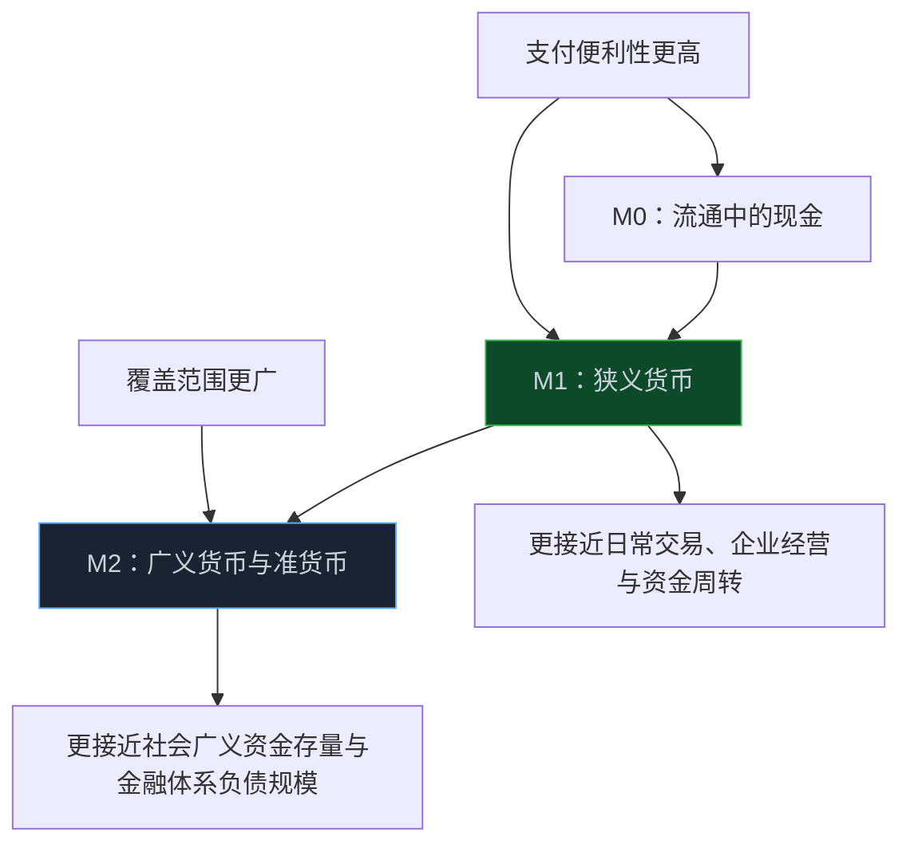
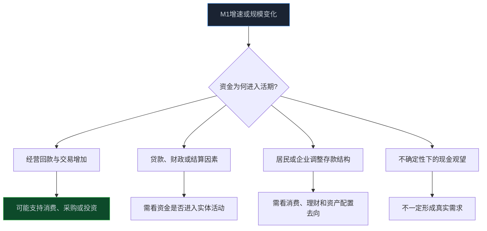

> **系列难度说明**：本篇是**第二章·第四篇**。不要求你记住每一项货币统计细目；只要能分清“钱总量有多少”和“钱愿不愿意动起来”是两回事，就能开始正确使用 M1 与 M2。
>
> **核心收获**：读完后，你会知道 M0、M1、M2 分别大致记录什么，理解 M1 统计口径调整后的可比性边界，也能把 M1、M2、存款结构和社融数据放在一起观察，而不是把一条增速直接翻译成牛市或熊市。
>
> **重要提示**：本文只用于投资者教育，不构成任何证券投资建议。货币供应量是存量统计指标，受统计口径、季节因素、财政收支、信贷派生和存款结构变化影响；分析时应以人民银行现行口径和可比数据为准。

市场里常听到一句话：M1 回升，市场要活了；M2 高增，钱很多，资产要涨。

听上去很有道理，但少了一个关键问题：这些钱到底停在哪里，又准备拿去做什么？

同样是 1 万亿元，躺在长期定期存款里、企业活期账户里、居民用于日常支付的账户里，或者刚通过贷款派生出来却还没形成投资和消费，它们对经济活动的含义并不一样。

M1 和 M2 不是“钱多钱少”的两种说法。它们试图从不同流动性层次，观察货币在经济里的停留位置和使用便利程度。

<!-- more -->

---

## 货币供应量不是纸币数量，而是一张资金存量地图

货币供应量可以理解为某一时点，社会上承担流通和支付功能的货币及准货币存量。它不是本月新发了多少贷款，也不是股票市场当天成交了多少钱，更不是每个人钱包里有多少现金。

为了观察不同流动性的资金，统计上通常会把货币分成 M0、M1、M2 等层次。层次越往后，范围越大，流动性通常越弱一些，但仍可能在一定条件下转为支付或投资资金。

在当前统计口径下，可以先建立一个简化理解：

- **M0**：流通中的现金；
- **M1**：更偏向可迅速用于支付、交易的狭义货币；
- **M2**：在 M1 基础上，加上更广范围的存款和准货币，是广义货币供应量。



这里的“更接近”很重要。M1 不是经济活力本身，M2 也不是可立即涌入股市的现金池。它们只是资金结构的两个观察窗口。

> **来源**：[货币供应量分析](https://www.stats.gov.cn/zs/tjws/zytjzbqs/hbgyl/202502/t20250226_1958808.html) — 国家统计局说明，货币供应量按流动性强弱划分为 M0、M1、M2 等层次。
>
> **来源**：[货币供应量](https://www.pbc.gov.cn/diaochatongjisi/attachDir/2025/12/2025121517172693949.pdf) — 中国人民银行货币供应量统计表，持续公布 M2、M1 与 M0 等数据。

---

## M1 的新口径：先确认版本，再讨论“活钱”

如果你读过几年前的文章，会看到一个旧公式：

```text
旧口径 M1 = M0 + 单位活期存款
```

这个公式已不适合直接用于当前数据解释。

中国人民银行自统计 2025 年 1 月份数据起，启用了修订后的 M1 统计口径。修订后的 M1 包括流通中货币（M0）、单位活期存款、个人活期存款和非银行支付机构客户备付金。

> **来源**：[中国人民银行公告〔2024〕第 17 号](https://www.gov.cn/zhengce/zhengceku/202412/content_6990650.htm) — 人民银行公告明确自统计 2025 年 1 月份数据起启用修订后的 M1 统计口径及具体组成。
>
> **来源**：[M1 统计口径“纳新”有何考量？](https://www.gov.cn/zhengce/202412/content_6990643.htm) — 官方解读说明，个人活期存款和支付机构客户备付金的支付功能增强，是纳入修订后 M1 的重要背景。

这次调整不是把“钱凭空变多”，而是让统计口径更贴近支付方式变化。过去个人活期存款和支付机构客户备付金的即时支付功能不如今天明显；随着银行卡、移动支付等发展，它们的流动性特征发生了变化。

这也带来一个研究纪律：**比较 M1 增速时，必须使用可比口径。**

人民银行在数据发布中提供了按可比口径回溯的历史 M1 数据。把修订后的 M1 增速和未经调整的旧口径历史增速直接比，很容易把统计变化误读成经济行为突然变化。

> **来源**：[2025 年金融统计数据报告](https://camlmac.pbc.gov.cn/goutongjiaoliu/113456/113469/2026011509294440745/index.html) — 人民银行说明修订后 M1 口径，并提供按可比口径回溯的历史数据。

对数据工作来说，这很像接口字段升级。新字段更适合当前业务，但你不能把新版本的数值直接和旧版本的历史序列拼起来，再宣称发现了趋势拐点。先统一 schema，结论才有意义。

---

## M1 更像“可动用的钱”，但不等于企业已经准备投资

M1 被称为狭义货币，原因在于它包含的资金通常支付便利性较高。企业活期存款增加，可能意味着经营回款更多、交易结算更活跃，或者企业暂时把资金放在便于使用的账户里；个人活期存款增加，也可能反映支付习惯、收入发放、消费安排或资产配置变化。

但同一项 M1 增加，可能来自很多不同原因：

- 企业销售回款增加，尚未用于采购或投资；
- 财政资金拨付、贷款投放或季末结算改变存款位置；
- 居民把定期存款转为活期，准备消费或配置资产；
- 企业因为不确定性上升，宁愿持有活期现金而不扩产；
- 支付体系中的资金结构发生变化。

所以，M1 回升既可能对应经济活动改善，也可能只是资金从“锁起来”变为“先观望”。要判断哪一种更接近现实，必须结合信贷、社融、PMI、新订单、居民消费和企业资本开支一起看。



“活钱”这个比喻能帮助理解，却不能替代分析。钱是否真正流向生产、消费和风险资产，仍要看后续数据。

---

## M2 更大，为什么它却常常没那么“热”

M2 是广义货币供应量。它在 M1 的基础上，覆盖更广范围的存款和准货币。你可以把它理解为金融体系中居民、企业和机构持有的广义人民币资金存量。

M2 增长通常与银行信贷、财政收支、外汇占款变化、金融机构资产负债表扩张等有关。银行发放贷款时，会在借款人账户形成存款；贷款投向、财政资金流转和存款期限选择，都会影响 M2 的规模与结构。

这里要避免一个直觉误区：M2 增加，不等于同样规模的“新增现金”正排队进入股票市场。

资金可能停在：

- 居民定期存款；
- 企业定期或其他存款；
- 金融机构存款；
- 政府和企业的结算资金；
- 尚未形成投资和消费的贷款派生存款。

M2 像水库的总蓄水量。水库变大，说明金融体系里的水更多了；但能不能灌溉到某块田，还要看闸门、渠道、地形和农户是否愿意用水。对应到经济里，就是融资需求、银行风险偏好、企业投资意愿、居民消费意愿和资产回报预期。

因此，M2 走高时，研究者更应该追问：资金是通过什么渠道形成的？停在谁的账户里？与信贷、社融、存款期限和实体需求是否匹配？

---

## M1 与 M2 的差距：能看结构，不能当成股市公式

市场喜欢看 M1 与 M2 增速的差值，也就是常说的“剪刀差”。直觉上，M1 增速相对 M2 走强，可能意味着更多资金处于活期、结算和交易状态；M2 明显快于 M1，则可能意味着广义资金增长较多，但短期交易和投资活跃度没有同步体现。

这个思路有一定参考价值，但不能机械使用，至少有三层原因。

### 第一，统计口径会变

2025 年起 M1 口径调整，任何跨口径比较都必须使用可比序列。用旧口径剪刀差和新口径剪刀差直接对比，含义已经变了。

### 第二，存款搬家不等于真实需求变化

居民或企业把定期转为活期，会抬高 M1 的相对表现；反过来，风险偏好下降、定期利率和产品收益吸引力变化，也可能让资金从活期转去定期。它反映的是资金形态变化，不直接告诉你消费、投资或股票买入已经发生。

### 第三，市场交易的是预期和资产回报，不是单一货币增速

即使 M1、M2 结构改善，若企业盈利预期偏弱、利率上行、风险偏好低或估值已经过高，股市也未必上涨。货币结构只是宏观拼图的一块。

更好的使用方式是，把剪刀差当成一个需要解释的问题：为什么出现？能否被存款、信贷、消费、PMI 和资产价格数据验证？

```text
M1 与 M2 相对变化
        ↓
存款结构是否变化？
        ↓
企业和居民资金行为有什么变化？
        ↓
信贷、社融、消费和投资有没有同步验证？
        ↓
行业订单、公司回款和资本开支是否改善？
        ↓
再讨论盈利、估值与市场价格
```

---

## 把“货币很多”翻译成公司研究，至少要多走四步

货币供应量数据离公司利润表很远，中间需要经过多次传导。

假设 M2 增长较快，可能是银行体系信用扩张、财政资金投放或存款结构变化。要影响一家公司，通常还要经历：资金是否变成融资、融资是否变成项目或消费、项目是否形成订单、订单是否转化成收入与现金流。


这条链可以解释两个常见现象：

- 宏观流动性看似不差，企业却不愿扩产，因为订单、回报率或预期不足；
- 融资条件开始改善，股价和估值先反应，财报中的收入和利润要过几季才验证。

因此，M1 和 M2 在投资中的意义，不是“出现一个数字就买”，而是帮助你判断经济里的资金是更愿意流动、停留，还是还没有找到高回报去处。

---

## 三个场景：同样的 M2 增长，市场含义可能不同

| 你看到的组合 | 可能发生的事 | 还需要看的证据 |
| --- | --- | --- |
| M2 增长较快，M1 偏弱 | 广义资金增加，但企业和居民的即时交易、投资意愿未必同步 | 定期存款、贷款投向、社融、PMI 新订单、消费数据 |
| M1 回升，M2 平稳 | 活期资金与结算活动可能改善，或存款结构在变化 | 企业回款、居民消费、财政收支、可比口径数据 |
| M1、M2 同步改善 | 货币总量和较高流动性资金都在改善 | 信贷需求、投资、订单、价格和公司收入是否验证 |
| M1、M2 同步放缓 | 信用扩张、资金活跃度或存款增长均可能转弱 | 是否受基数、政策节奏或季节因素影响 |

表格里的“可能”不能省掉。宏观分析最危险的地方，就是把相关性说成因果，把一个金融数据说成所有资产的共同解释。

人民银行每月发布金融统计数据报告，除了货币供应量，也会披露人民币贷款、存款、社会融资规模等信息。把这些数据放在一起，才更接近资金从金融体系到实体经济的真实路径。

> **来源**：[2025 年金融统计数据报告](https://camlmac.pbc.gov.cn/goutongjiaoliu/113456/113469/2026011509294440745/index.html) — 人民银行发布货币供应量、存贷款和社会融资规模等金融统计数据，并说明 M1 新口径与可比历史序列。

---

## 读数据时，别忽略季节、财政和结算

M1、M2 都是月末时点存量，容易受到月度结算、季末考核、节假日、企业发薪、税款缴纳和财政资金拨付等因素影响。

例如，企业在月末收到大额回款但尚未支付供应商，活期存款可能短期增加；财政资金从政府账户拨付到企业或居民账户，也会改变存款结构；春节前后，居民取现、奖金发放和支付节奏变化，又会让 M0、M1 出现季节性波动。

这也是 M1 新口径纳入个人活期存款后，统计解释需要更关注季节性和可比性的原因之一。

所以，研究时至少做三件事：

1. 看同比，也看环比和过去几个月趋势；
2. 与去年同期、节假日和财政收支节奏对照；
3. 把货币数据和贷款、社融、存款分部门、PMI、消费和投资数据交叉验证。

只截取一个月末增速，就像只看系统某一秒的 CPU 使用率，不足以判断整个系统是变好了还是出了问题。

---

## 一次练习：做一张“钱在哪里、钱去哪了”的月度表

下次人民银行公布金融统计数据时，不必急着看市场解读。先用官方报告填一张简表：

| 观察项 | 你要记录什么 | 要追问的问题 |
| --- | --- | --- |
| M1 | 余额、同比、环比或趋势 | 是真实交易活跃，还是口径、结算和存款结构变化？ |
| M2 | 余额、同比、环比或趋势 | 广义资金增长来自哪里？停在什么类型的账户里？ |
| M1 与 M2 相对变化 | 使用同口径历史序列比较 | “活钱”变化能否被消费、投资或订单验证？ |
| 人民币贷款 | 总量与部门结构 | 企业、居民是否真的在借钱？借钱做什么？ |
| 存款分部门 | 居民、企业、财政等结构变化 | 是存款搬家、回款结算，还是风险偏好变化？ |
| 社融 | 总量和主要分项 | 金融体系资金有没有更广泛进入实体经济？ |

最后只写一段不超过 80 字的话：

> 当前更像是“钱在增加”“钱在流动”“钱在观望”，还是“钱在进入实体需求”？支持我判断的两条数据是什么？

如果无法回答，说明还不能把 M1 或 M2 当成投资结论。

---

## 小结

- M0、M1、M2 是不同流动性层次的货币存量观察窗口，不是预测股票涨跌的单一信号。
- 自 2025 年 1 月数据起，M1 纳入个人活期存款和非银行支付机构客户备付金；历史比较必须使用可比口径。
- M1 相对更接近可迅速支付和结算的资金，M2 描述更广义的货币与准货币存量；两者都需要解释资金来源和去向。
- M1 与 M2 的相对变化能观察资金结构，但会受到口径、季节、财政、结算和存款搬家影响，不能机械套用“剪刀差”公式。
- 货币数据要经由信贷、融资、消费、投资、订单和公司回款，才能真正进入盈利和估值研究。

---

## 下一篇预告

M1 与 M2 让我们看到资金大致停在哪里；社会融资规模则继续往前追问：实体经济到底通过贷款、债券、股票还是其他渠道拿到了多少资金？

下一篇聊聊：**社会融资：信用扩张与收缩。**

---

> **课程导航：第二章·宏观经济：给市场画一张天气图**
> - 第一篇：GDP：增长从哪里来
> - 第二篇：CPI 与 PPI：价格变化传到利润表的路径
> - 第三篇：PMI：如何读懂景气度信号
> - **第四篇：M1 与 M2：货币到底在反映什么** ← 你在这里
> - 第五篇：社会融资：信用扩张与收缩
> - 第六篇：利率为什么会影响股票估值
> - 第七篇：国债收益率：无风险利率这把尺子
> - 第八篇：汇率：外部价格与企业经营的连接
> - 第九篇：财政变量如何进入行业与公司
> - 第十篇：货币条件、流动性与风险偏好
> - 第十一篇：经济周期：别把阶段性变化当成永恒趋势
