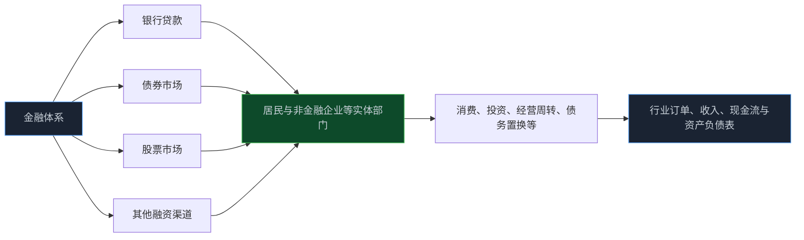
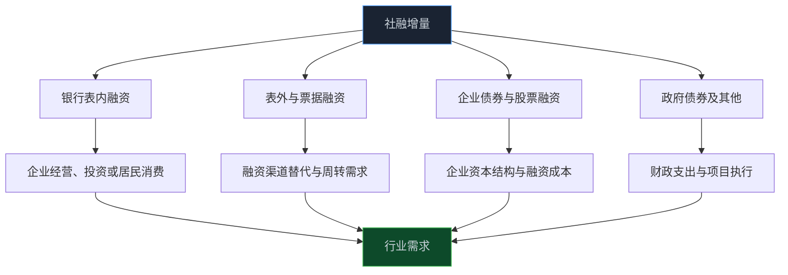

> **系列难度说明**：本篇是**第二章·第五篇**。不需要记住所有社融分项，只要能顺着“谁借钱 → 借到什么钱 → 拿去做什么 → 会不会形成盈利”追下去，就能把金融数据接到行业研究上。
>
> **核心收获**：读完后，你会分清社融增量和社融存量，知道贷款、债券、股票融资和表外融资分别在表达什么，也能避免把“社融多增”简单理解成所有行业和股票都会上涨。
>
> **重要提示**：本文只用于投资者教育，不构成任何证券投资建议。社融数据会受季节、统计口径、政府债券发行节奏、置换安排和融资结构变化影响，单月数字不应脱离分项、用途和行业需求独立解读。

金融数据出来时，经常会看到一句话：社融超预期，经济要起来了。

可社融里既有企业贷款，也有居民贷款；既有企业债券，也有政府债券；还有股票融资、委托贷款、信托贷款和票据等项目。它们流向的部门、形成订单的速度、对上市公司利润的影响，都不一样。

一家公司拿到长期贷款扩产，和居民增加短期消费贷款，和政府债券融资用于项目支出，放在社融总量里都可能是“增加”，但对应的产业链和时间表完全不同。

所以，社融最值得看的不是一个总数，而是四个问题：**谁拿到了钱？通过什么渠道？拿去做什么？资金最后有没有变成真实需求？**

<!-- more -->

---

## 社融是什么：从“金融体系给实体经济多少支持”看信用

社会融资规模，通常简称社融。它描述的是一定时期内，实体经济从金融体系获得的资金支持总额。

这里的“实体经济”主要涉及居民和非金融企业等部门；“金融体系”也不只包括银行，还包括债券市场、股票市场、保险等金融渠道。

这让社融和 M2 的观察角度不同。

- **M2** 更接近金融体系负债端和广义货币存量，关注钱以存款等形式停在体系里多少；
- **社融** 更接近金融体系资产端与实体部门负债端，关注实体部门通过哪些渠道获得了多少资金支持。

你可以把 M2 想成金融体系里的“水位”，把社融想成流向实体经济的“供水管道”。水位高不代表每根管道都在出水；管道出水多，也要看水是否真的浇到了能产生回报的地方。

> **来源**：[地区社会融资规模统计指标解释](https://www.pbc.gov.cn/diaochatongjisi/116219/116225/2805293/index.html) — 人民银行说明，社融是一定时期内实体经济从金融体系获得的资金总额，属于增量概念。
>
> **来源**：[社会融资规模构成指标的说明](https://www.pbc.gov.cn/eportal/fileDir/image_public/UserFiles/diaochatongjisi/upload/File/社会融资规模构成指标的说明（2014）.pdf) — 人民银行对社融构成项目及其统计含义作出说明。



这张图里最容易被跳过的是最后两步。资金进入实体部门，不等于已经形成订单；形成订单，也不等于一定留下利润。信用扩张能提供可能性，商业回报仍要由需求、成本、竞争和管理能力决定。

---

## 社融增量和社融存量：一个看流量，一个看存量

社融数据通常有两种读法。

**社会融资规模增量**，看的是某一个月、季度或年初至今，实体经济新增获得了多少资金。它更接近“这段时间新接上了多少水管”。

**社会融资规模存量**，看的是某个时点，实体经济累计从金融体系获得、尚存续的资金余额。它更接近“现在一共铺了多大的管网”。

```text
社融增量：本期新增加了多少融资
社融存量：期末累计存在多少融资余额
```

两者不能混着用。

某个月社融增量很高，可能受政府债券集中发行、季末贷款投放或票据季节性影响；若后续没有持续融资和经济活动支撑，存量增速未必显著上行。反过来，单月增量平淡，也不代表信用环境立刻收紧，要看存量增速、去年同期基数和全年节奏。

人民银行每月发布金融统计数据报告，会同时呈现社融增量和存量的相关信息。以最新公开数据为例，报告会将人民币贷款、外币贷款、委托贷款、信托贷款、未贴现银行承兑汇票、企业债券、政府债券和非金融企业境内股票融资等项目拆开披露。

> **来源**：[2026 年 8 月金融统计数据报告](https://wuhan.pbc.gov.cn/diaochatongjisi/116219/116225/2026091417020862747/index.html) — 人民银行发布的金融统计报告展示社融增量、存量及主要分项，适合用于观察数据结构与口径。

研究时可以先做一个简单区分：

| 你想回答的问题 | 更适合看什么 | 容易犯的错 |
| --- | --- | --- |
| 最近融资有没有边际改善 | 社融增量、分项环比与同比 | 把季节性高点当趋势 |
| 实体部门整体杠杆与资金支持规模怎样 | 社融存量及同比增速 | 忽略存量变化的滞后性 |
| 哪个部门或渠道在拿钱 | 增量分项、贷款结构与债券发行 | 只看总量，不看资金来源 |
| 融资是否变成经济活动 | 社融 + 投资、消费、订单、公司财报 | 认为融资本身等于增长 |

---

## 社融里有什么：先按“借钱方式”分类

社融分项不少，但可以先归成四组。这比背一长串名字更有用。

### 银行表内融资：人民币贷款和外币贷款

这是社融中最常被关注的一组。银行向居民和企业发放的贷款，可能用于经营周转、固定资产投资、购房、消费、贸易融资等。

贷款增加并不自动代表企业扩产。企业贷款可能用于续贷、债务置换、补充营运资金，也可能只是因为短期资金需求上升；居民贷款的变化也要区分住房相关与消费相关用途。

看人民币贷款时，最关键的是结构：企业中长期贷款、企业短期贷款和票据融资，居民中长期和短期贷款，各自表达的需求与时间表并不相同。

### 表外与票据融资：委托贷款、信托贷款和未贴现承兑汇票等

这类项目常被统称为表外融资或非标相关融资的一部分。它们的变化可能反映企业通过银行表外、信托、票据等渠道获得资金支持的情况。

但这部分受监管政策、通道规范、统计口径和存量压降影响较大。某项下降，可能是企业融资需求变弱，也可能是融资方式从表外转向表内或直接融资。只看一个项目的增减，很难直接判断实体经济冷暖。

### 直接融资：企业债券和股票融资

企业发行债券、非金融企业进行境内股票融资，属于直接融资的重要形式。

债券融资增加，可能意味着利率环境、信用利差、企业融资需求或债券市场供给发生变化；股票融资增加，则意味着企业通过股权市场补充资本。但对股票投资者来说，要同时记住：**企业股票融资进入社融，和二级市场股票价格上涨，是两件完全不同的事。**

股权融资可能帮助公司减少债务压力、支持扩产或研发，也可能稀释原有股东。第九篇讲过资本配置，社融在这里提供的是“宏观融资渠道”的视角，不能替代对单个融资方案的研究。

### 政府债券和其他项目：资金要沿财政链条继续追

政府债券也是社融的重要组成部分。它反映相关部门通过债券方式筹资，对宏观总量和融资结构会有明显影响。

但看到政府债券融资增加，不能立刻等同于某个行业订单已经增加。资金募集、预算安排、项目落地、招标采购、施工建设到企业确认收入，中间存在时间差，也会受到项目类型和执行进度影响。



---

## 社融多增，到底是“好消息”还是“结构性噪音”

社融高于预期时，市场通常会先把它理解为信用环境改善。这个方向未必错，但结论还缺三步。

### 看是谁借的：企业、居民还是相关部门

企业融资改善，可能更接近经营和投资活动；居民融资改善，可能与住房、消费或短期信贷需求有关；政府债券融资增加，则要继续追踪财政支出节奏与项目执行。

不同部门借钱，对 A 股行业的传导完全不同。企业中长期贷款走强，可能为设备、工程、工业服务提供后续线索；居民消费信贷改善，可能更接近耐用品、出行与可选消费；政府融资增加，可能需要观察基建、公共服务或相关采购链的订单。

### 看借钱期限：短期周转还是长期投资

短期贷款可能解决现金周转、备货和季节性经营；中长期贷款更可能与设备投资、项目建设、住房按揭等长期资产有关。

但期限也不能机械解释。企业拿到中长期贷款后，可能先放在账户里；短期贷款增加，也可能因为订单快速回升需要备货。融资期限只是理解资金用途的线索，不是答案。

### 看资金有没有离开金融账户，进入真实需求

这是最难也最重要的一步。

社融改善后，若 PMI 新订单、固定资产投资、工业增加值、零售、企业资本开支和上市公司收入也逐步验证，信用扩张更可能正在变成真实需求。若社融主要停留在融资置换、存款增加或金融空转环节，行业盈利的改善就可能比市场预期慢得多。

```text
社融扩张
  ↓
谁获得融资、期限和成本如何
  ↓
资金用于周转、偿债、投资还是消费
  ↓
订单、采购、施工、销量是否改善
  ↓
公司收入、回款、毛利率与现金流是否验证
```

信用数据不是终点，它只是研究链条更靠前的一环。

---

## 直接融资占比上升，对股票市场意味着什么

市场有时会把“直接融资占比上升”理解为股市一定受益。这个判断也过于简单。

直接融资包括企业债券融资和股票融资等渠道。它的意义在于，实体经济不只依赖银行贷款，也可以通过债券市场和股权市场获得资金。融资渠道更丰富，企业的资本结构选择可能更多，风险也能在不同投资者之间更有效地分散。

但站在股票持有人的角度，影响仍要逐家公司拆开：

- 公司发债，可能降低短期股权稀释，却增加未来利息和偿债压力；
- 公司增发股票，可能缓解负债、支持扩产，却可能稀释每股权益；
- 公司发行可转债，当前是债务安排，未来又可能转为股本扩张；
- 二级市场成交活跃，只是已有股份在投资者之间交换，本身不属于企业新增股权融资。

因此，社融里的股票融资数据更适合用来观察企业通过资本市场筹资的活跃程度，不适合直接用来预测某个指数涨跌。

第九篇的资本配置框架在这里仍然适用：钱进公司了吗？用在哪里？回报能否覆盖资金成本或稀释成本？

---

## 社融、M2 和信贷：不要把三张图当成同一张图

这三个指标经常同时出现，但回答的问题不同。

| 指标 | 更接近观察什么 | 常见误读 |
| --- | --- | --- |
| M2 | 金融体系中广义货币与准货币存量 | “M2 高增，钱会立刻流入股市” |
| 社融增量 | 实体经济本期新增获得的资金支持 | “社融多增，所有行业都会受益” |
| 社融存量 | 实体经济累计融资余额及其增速 | “存量高，企业盈利就一定高” |
| 人民币贷款 | 银行信贷渠道的资金投放 | “贷款增加，就是有效投资增加” |

可以用一个角度把它们放到一起：M2 看金融体系负债端形成了多少广义资金，社融看实体部门负债端获得了多少资金支持，贷款则是社融里最重要但并非唯一的渠道。

近年来，社融统计口径与融资结构会随金融市场发展而调整。例如，人民银行对社融存量统计表的说明中提到，政府债券等项目已纳入相关统计。跨年份分析时，要确认统计口径和历史数据是否可比。

> **来源**：[社会融资规模存量统计表](https://www.pbc.gov.cn/diaochatongjisi/attachDir/2025/11/2025110510032295825.pdf) — 人民银行社融存量统计表包含口径说明，并提示政府债券等项目纳入统计的历史调整。

这和上一节 M1 口径调整是同一类研究纪律：**数据结构变化时，先统一口径，再讨论趋势。**

---

## 信用扩张为什么可能先推估值，后推利润

融资环境改善时，市场可能在公司利润表变好之前就先反应。

原因在于股价交易未来。若市场预期信用条件改善会降低融资成本、支持项目投资、缓解债务压力或带来需求修复，估值和风险偏好可能先变化。真正的订单、收入和现金流，往往还要等几个月甚至更久才能出现在财报里。

这也意味着，信用扩张的交易逻辑有一个风险：如果后续订单没有兑现、项目回报不足或企业只是在借新还旧，前期估值修复可能失去基本面支撑。

不同类型公司受社融影响的方式也不同：

| 公司类型 | 社融改善可能先影响什么 | 更要验证什么 |
| --- | --- | --- |
| 高杠杆企业 | 再融资能力、债务压力和融资成本预期 | 现金流、到期债务、资产质量与利息覆盖 |
| 资本开支型制造企业 | 设备投资、扩产项目和订单预期 | 产能利用率、客户订单和投资回报率 |
| 消费与服务企业 | 居民收入、消费信心和支付能力 | 客流、销量、同店销售和价格弹性 |
| 基建与工程相关企业 | 项目资金与开工预期 | 预算执行、项目落地、应收账款和回款 |
| 金融机构 | 信贷需求、资产质量和息差环境 | 不良率、拨备、资本约束与风险偏好 |

宏观信用改善是一种“可能性提升”，不是对某家公司盈利的担保。

---

## 单月社融最常见的三个误读

### 把季节性当成趋势

年初、季末或政府债券集中发行时，社融增量可能明显波动。看单月数据之前，至少要和去年同期、过去数月均值和全年节奏对照。

### 把政府债券多增当成企业盈利已经改善

债券融资规模增加，说明筹资端发生了变化；从资金到项目、订单和收入还需要执行时间。研究相关行业时，必须补上项目开工、采购招标、施工进度和公司订单等证据。

### 把融资增长当成需求增长

企业可以借钱用于投资，也可以用于偿还旧债、补充流动性或保留现金。融资行为是需求可能发生的前置条件之一，不是需求已经发生的证明。

这些误读的共同点，是把金融变量直接跳到股价，中间跳过了企业经营。

---

## 一次练习：把社融拆成“资金去向假设表”

下一次金融数据发布后，先不要急着看市场评论。把报告里的主要分项填进下面这张表：

| 社融分项 | 本期变化 | 谁更可能获得资金 | 可能影响哪些行业 | 需要什么数据验证 |
| --- | --- | --- | --- | --- |
| 人民币贷款 | 增加或减少 | 企业、居民等 | 消费、制造、地产、金融等 | 贷款期限与部门结构、订单、销量 |
| 企业债券 | 增加或减少 | 发债企业 | 高杠杆企业、信用债相关行业 | 债券利率、用途、偿债压力 |
| 政府债券 | 增加或减少 | 相关部门与项目 | 基建、工程、公共服务等 | 支出进度、项目开工、招标采购 |
| 股票融资 | 增加或减少 | 上市或拟上市企业 | 具体融资公司及产业链 | 募资用途、稀释、资本回报 |
| 表外与票据项目 | 增加或减少 | 企业周转与特定融资需求 | 需结合行业判断 | 监管口径、融资替代、库存与回款 |

最后写一句：

> 本期社融变化更像“信用扩张”“融资渠道切换”还是“季节性脉冲”？我看到的两条经营验证证据是什么？

只要还没有经营验证，社融就应该停留在“观察名单”，而不是直接变成交易结论。

---

## 小结

- 社融记录实体经济从金融体系获得的资金支持；社融增量看本期新增融资，社融存量看累计融资余额。
- 社融不只有银行贷款，还包括债券、股票融资、表外与票据项目、政府债券等多种渠道，结构比总量更重要。
- 社融多增的核心问题是：谁借钱、借多久、用在哪、是否最终转成订单、收入和现金流。
- M2、社融和贷款分别从货币存量、实体融资与银行信贷渠道观察金融条件，不能互相替代。
- 信用扩张可能先改善预期和估值，后验证利润；若经营数据不跟上，融资数据本身无法支撑长期价值。

---

## 下一篇预告

社融解释了实体经济能否拿到资金，下一步要问：拿到这笔钱，成本是多少？

利率会改变企业的融资压力，也会改变投资者给未来现金流打的折扣。为什么同样一家公司，在利率变化时估值会被重新定价？

下一篇聊聊：**利率为什么会影响股票估值。**

---

> **课程导航：第二章·宏观经济：给市场画一张天气图**
> - 第一篇：GDP：增长从哪里来
> - 第二篇：CPI 与 PPI：价格变化传到利润表的路径
> - 第三篇：PMI：如何读懂景气度信号
> - 第四篇：M1 与 M2：货币到底在反映什么
> - **第五篇：社会融资：信用扩张与收缩** ← 你在这里
> - 第六篇：利率为什么会影响股票估值
> - 第七篇：国债收益率：无风险利率这把尺子
> - 第八篇：汇率：外部价格与企业经营的连接
> - 第九篇：财政变量如何进入行业与公司
> - 第十篇：货币条件、流动性与风险偏好
> - 第十一篇：经济周期：别把阶段性变化当成永恒趋势
