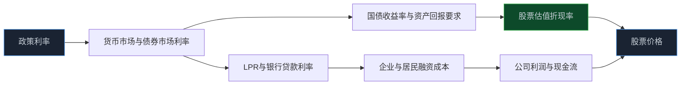
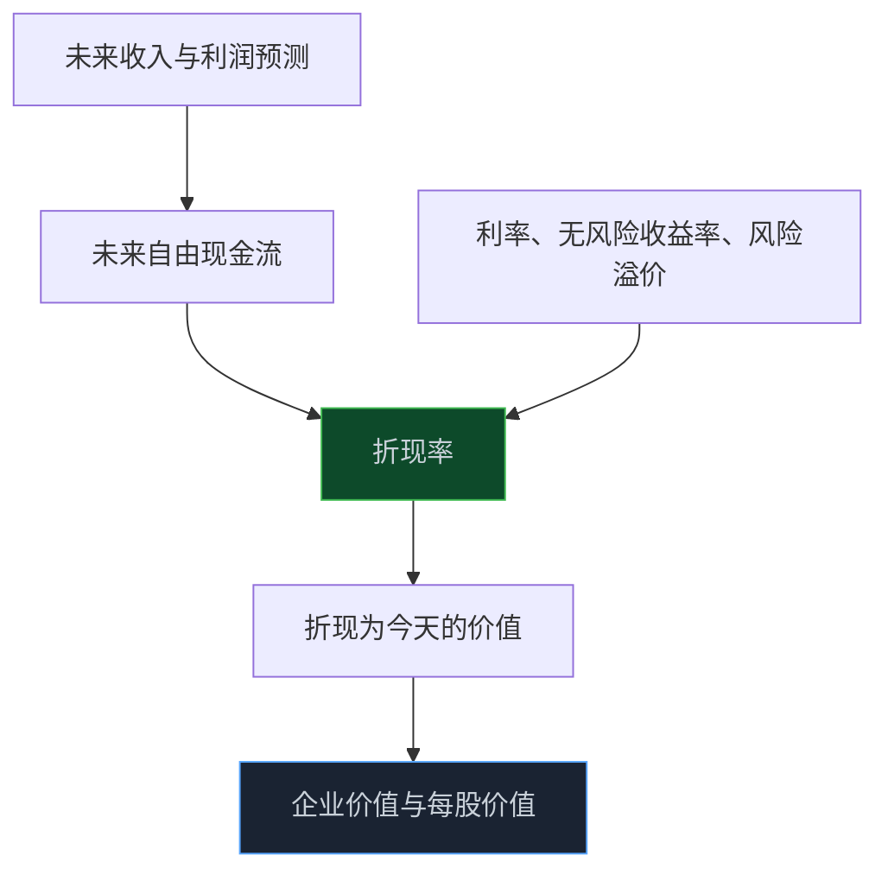
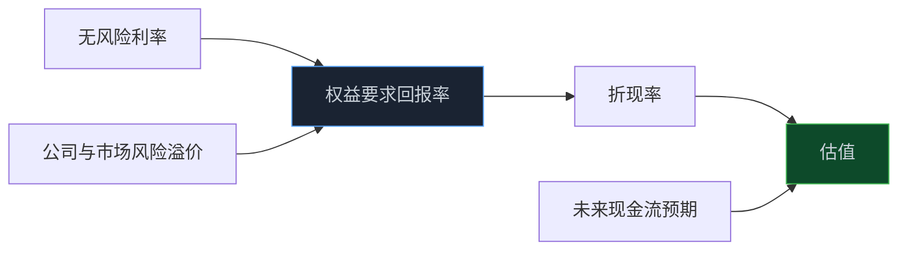

> **系列难度说明**：本篇是**第二章·第六篇**。不需要先会做 DCF 模型；只要理解“今天的一块钱”和“几年后的一块钱”不是同一回事，就能看懂利率为何会影响股票价格。
>
> **核心收获**：读完后，你会知道利率通过融资成本和折现率两条路径影响股票，理解为什么远期现金流占比高的公司通常更敏感，也能避免把“降息利好股市”当成不需要条件的结论。
>
> **重要提示**：本文只用于投资者教育，不构成任何证券投资建议。利率体系包含政策利率、市场利率、贷款利率、债券收益率等多种指标；不同公司和行业受到的影响差异很大，实际判断应结合债务结构、盈利预期和估值水平。

同样是一家公司，明年赚 10 亿元、后年赚 12 亿元的预测没有变化，股价却可能因为利率环境变化而被重新定价。

这听起来有点反直觉：公司没换产品，客户没少下单，为什么价格会变？

因为股票买的从来不只是下一季利润。

你买的是未来很多年可能产生的现金流。而利率决定了市场愿意用多高的价格，把那些未来的钱换算到今天。

利率还会影响另一件更直接的事：公司借钱的成本。债务多、扩产快、现金流紧的公司，对融资成本变化往往比现金充裕的公司敏感得多。

所以，利率影响股票，不是一个按钮，而是两条同时运行的链：**融资成本**和**估值折现**。

<!-- more -->

---

## 先把“利率”拆开：它不是一个数字

新闻里说“利率下降”时，很多人会自然想到房贷利率。可宏观与市场研究中，利率至少有几层含义：

- **政策利率**：中央银行用来传递政策取向的重要利率；
- **货币市场利率**：金融机构之间短期资金交易的价格；
- **贷款利率**：企业和居民实际借款时承担的价格；
- **债券收益率**：投资者持有不同期限、不同信用风险债券所要求的回报；
- **存款利率**：居民和企业把资金留在银行账户的机会成本。

它们会相互影响，但不一定同时、等幅变化。

以贷款市场报价利率（LPR）为例，它是银行贷款定价的重要参考。报价行按公开市场操作利率加点形成报价，由全国银行间同业拆借中心计算并公布。企业实际拿到的贷款利率，还会受到期限、信用、担保、行业、银行风险偏好和附加融资费用影响。

> **来源**：[贷款市场报价利率（LPR）](https://www.pbc.gov.cn/zhengcehuobisi/125207/125213/125440/3876551/index.html) — 中国人民银行持续发布 LPR 报价信息，是观察贷款定价参考的重要官方入口。
>
> **来源**：[贷款市场报价利率相关问题解读](https://chongqing.pbc.gov.cn/chongqing/107674/3927733/index.html) — 人民银行解读 LPR 的报价机制及其作为贷款定价参考的作用。

可以把利率体系理解成一条传导链：



人民银行已明确公开市场 7 天期逆回购操作利率为主要政策利率，并通过影响货币市场、债券市场和存贷款利率来传导政策取向。这个传导过程有时快，有时慢，也会被银行负债成本、信用风险和融资需求卡住。

> **来源**：[货币政策框架转型稳步推进](https://wuhan.pbc.gov.cn/redianzhuanti/118742/5864531/5877710/2025112617555524172/index.html) — 人民银行说明主要政策利率及其对市场、债券和存贷款利率的传导关系。

---

## 第一条路径：利率会直接改写公司的利润表

对借钱经营的公司来说，利率不是宏观背景，而是成本项。

一家企业有银行贷款、公司债、融资租赁或其他有息负债时，利率变化会通过利息支出影响利润。不过，传导速度取决于债务结构：

- 浮动利率贷款可能调整更快；
- 固定票面利率债券在存续期内未必立即变化；
- 即将到期再融资的公司，对新利率环境更敏感；
- 高信用公司和低信用公司，即使面对同一市场利率，融资成本也可能差很多。

假设两家公司经营利润都为 10 亿元。

- A 公司几乎没有有息负债，利息支出很少；
- B 公司有大量债务，每年利息支出 4 亿元。

若融资环境改善，B 公司未来再融资成本下降，利润修复的弹性可能更大；但如果利率上行或信用利差扩大，B 公司利润也更容易被利息侵蚀。

```text
营业收入
  - 营业成本与费用
  = 经营利润
  - 利息费用
  = 税前利润
  - 所得税
  = 净利润
```

这也是为什么研究利率敏感行业时，先看资产负债表比先看新闻更有用。至少要问：

1. 有息负债有多少，占资本结构比例多高？
2. 债务是短期还是长期，固定利率还是浮动利率？
3. 未来一两年有多少债务需要再融资？
4. 利息覆盖倍数是否足够？
5. 贷款拿去扩产后，项目回报能否高于资金成本？

利率下降对高负债公司不必然是利好。如果需求弱、项目回报低，借钱更便宜也未必有人愿意扩产；反过来，利率上行对低负债、高现金流公司也不一定造成同样压力。

---

## 第二条路径：利率改变未来现金流值多少钱

股票估值最朴素的逻辑是：一家公司未来能产生的现金流，换算到今天值多少钱。

用最简化的形式表示：

\[
现值=\frac{未来现金流}{(1+r)^t}
\]

其中，\(r\) 是折现率，\(t\) 是等待时间。

假设你预计一家公司 5 年后能产生 100 元可分配现金流。

- 当折现率为 \(5\%\) 时，今天的现值约为 \(78.4\) 元；
- 当折现率为 \(10\%\) 时，今天的现值约为 \(62.1\) 元。

未来现金流没有变化，只是要求回报率变了，今天愿意支付的价格就已经不同。

这就是利率影响估值最核心的地方：**利率越高，未来的钱折回今天越不值钱；利率越低，远期现金流的现值通常越高。**



别急着把这个公式当成精确算命工具。估值模型里，未来现金流、增长率和折现率都带有假设。它真正教我们的，是方向感：当市场要求的回报提高时，估值通常会承压；当要求的回报降低时，估值有扩张的可能。

---

## 为什么成长股通常更怕利率上行

不是所有公司的现金流都在同一时间到来。

成熟、现金流稳定的公司，较多利润和现金流发生在近几年；高成长公司可能当前利润不高，但市场给它高估值，是因为相信它更远的未来会产生大量现金流。

等待时间越长，折现率变化带来的影响通常越大。

| 公司类型 | 现金流特征 | 利率上行时常见压力 | 还要结合什么看 |
| --- | --- | --- | --- |
| 稳定现金流公司 | 近期现金流占比更高 | 估值可能受压，但敏感度相对较低 | 分红、债务、竞争和增长稳定性 |
| 高成长公司 | 更大价值来自远期增长 | 远期现金流折现更明显，估值波动可能更大 | 增长兑现、研发回报和估值是否已透支 |
| 高负债公司 | 利润受利息费用影响更大 | 再融资成本上升、偿债压力增加 | 债务期限、现金流和资产质量 |
| 金融机构 | 利率影响资产与负债两端 | 息差、债券估值和信用风险同时变化 | 贷款定价、存款成本与不良率 |
| 周期公司 | 利润受价格与供需主导 | 利率影响需求和资本开支，但未必是主变量 | 商品价格、库存、产能和订单 |

这里的“通常”不能省略。

成长股也可能在利率上行阶段上涨，如果盈利增速远超市场预期；高分红公司也可能下跌，如果债务压力、行业衰退或风险溢价上升。利率只是估值方程的一项，不是万能解释。

---

## 利率下降，也不是所有股票都会自动上涨

“降息利好股市”是一个方向上的简化，但现实有很多条件。

利率下降可能：

- 降低企业新增融资和再融资成本；
- 提高未来现金流的现值；
- 降低低风险资产收益率，使部分资金更愿意寻找风险资产；
- 通过居民贷款、企业投资和信用扩张支持需求。

但市场还会追问：为什么需要降？

如果降息发生在需求明显走弱、企业盈利不断下修的阶段，利润预期的下行可能压过折现率下降的估值支持。就像你把贷款利率调低了，但客户不敢借、企业没有订单，融资成本下降也很难立刻变成收入增长。

所以利率变化对股票的实际影响，要把两条路径一起看：

```text
利率下降
  ↓
融资成本下降、折现率下降
  ↓
估值可能获得支持
  ↓
但同时要问：需求、订单和盈利预期是在改善，还是恶化？
```

真正值得研究的不是“有没有降息”，而是“降息后的信用、消费、投资和企业盈利有没有跟上”。

---

## 利率、国债收益率和 LPR：为什么不能混着看

研究者常把“利率”说成一个词，实际却可能指不同指标。

| 指标 | 更接近回答什么问题 | 与股票研究的主要连接 |
| --- | --- | --- |
| 政策利率 | 货币政策的边际取向 | 影响市场利率和融资环境的方向 |
| LPR | 银行贷款定价的重要参考 | 影响企业和居民贷款利率的参考基准 |
| 国债收益率 | 不同期限低风险资金的机会成本 | 进入无风险利率和折现率假设 |
| 公司债收益率或信用利差 | 企业债务融资的市场成本 | 反映信用风险和再融资压力 |
| 存款利率 | 储蓄资金的回报与选择 | 影响居民资产配置和银行负债成本 |

国债收益率尤其重要，因为它常被用作“低风险资金回报”的参考。下一篇会专门讲期限结构和收益率曲线，这里只先留下一个判断：政策利率变化会影响市场利率，但两者不会总是同步；LPR 变化会影响部分贷款定价，但公司实际融资成本还取决于信用和合同；国债收益率会影响估值假设，但它并不等于所有公司的折现率。

> **来源**：[中国国债收益率曲线](https://yield.chinabond.com.cn/cbweb-czb-web/czb/moreInfo?locale=cn_ZH&nameType=1) — 财政部与中债提供不同期限国债收益率曲线，是观察低风险期限利率的重要官方数据入口。
>
> **来源**：[2026 年第一季度中国货币政策执行报告](https://www.pbc.gov.cn/goutongjiaoliu/113456/113469/2026051118520164705/index.html) — 人民银行提出完善市场化利率形成传导机制，引导社会综合融资成本处于较低水平。

---

## 风险溢价：利率没变，估值也可能大幅变化

估值里的折现率，不只有无风险利率。

投资者持有股票，需要承担经营、行业、治理、流动性和市场波动风险，因此通常会要求在低风险资产收益率之外，获得额外补偿。这个额外补偿可以粗略理解为风险溢价。

简化地说：

\[
权益要求回报率 \approx 无风险利率 + 风险溢价
\]

当市场风险偏好下降时，哪怕国债收益率没有明显变化，投资者也可能要求更高的风险补偿，股票估值照样下行。反过来，风险偏好改善时，即使利率不变，估值也可能扩张。

这能解释一个常见困惑：为什么利率已经下降，市场却没涨？

可能是盈利预期在下调，也可能是风险溢价在上升。利率只是折现率的一部分，不能跳过风险偏好和公司自身风险。



做估值时，最容易犯的错是把所有变化都塞进一个参数里。更好的做法是分开写：未来现金流为什么变、无风险利率为什么变、风险溢价为什么变。这样复盘时才知道自己错在业务判断，还是错在市场定价。

---

## 利率如何走进公司的三个报表

利率对公司的影响不只在利润表。

### 利润表：利息费用与财务费用

债务多、再融资频繁的公司，利率变化可能通过财务费用影响净利润。这里要区分当期已经锁定的利息成本，和未来债务重定价或新融资的成本。

### 资产负债表：债务期限与资产价格

利率变化会影响债务的期限管理，也可能影响金融资产、公允价值计量资产和投资性资产的估值。高杠杆企业最需要看短债比例、现金覆盖和债务到期安排。

### 现金流量表：利息支付与资本开支意愿

融资更便宜，可能让一些项目变得值得投资；融资更贵，则可能压缩扩产和并购。可真正决定资本开支的是项目回报率，不是利率单独下降了多少。

```text
利率变化
  ↓
债务成本与再融资条件变化
  ↓
财务费用、现金利息支出与资本开支阈值变化
  ↓
净利润、自由现金流和资产负债表风险变化
  ↓
估值与市场预期变化
```

因此，分析一家公司对利率的敏感度，最好直接从年报里找：有息负债、利率风险披露、债务到期表、财务费用、利息覆盖倍数和资本开支计划。

---

## 一次练习：给一家公司做一张“利率敏感度卡片”

找一家你关注的上市公司，最好是一家有一定债务或持续资本开支的公司。打开最近一期年报，记录下面几项：

| 要找的信息 | 你要回答的问题 |
| --- | --- |
| 有息负债 | 公司到底借了多少，短债和长债分别多少？ |
| 财务费用 | 利息支出占经营利润多大比例？ |
| 债务到期 | 未来一两年有多少债务需要续借或偿还？ |
| 融资利率与风险披露 | 固定、浮动利率各占多少？公司如何描述利率风险？ |
| 自由现金流 | 不再融资时，经营现金流能否覆盖利息和必要资本开支？ |
| 估值逻辑 | 公司价值主要来自近期现金流，还是远期增长？ |

最后写一段不超过 80 字的话：

> 利率上升 1 个百分点时，这家公司最先受影响的是财务费用、项目投资、估值，还是风险溢价？我凭什么这么判断？

这张卡片不需要精确算出目标价。它的作用是让你知道，利率变化落到具体公司时，究竟会先打在哪个位置。

---

## 小结

- 利率影响股票主要有两条路径：改变企业融资成本，也改变未来现金流的折现率。
- 利率体系包含政策利率、市场利率、LPR、国债收益率和信用利差等不同指标，不能混为一个数字。
- 远期现金流占比更高的成长公司通常对折现率更敏感；高负债公司则更容易受到融资成本和再融资条件影响。
- 降息可能支持估值，却不能自动抵消盈利下修或风险溢价上升；“降息利好股市”需要经营数据验证。
- 估值变化要拆开看：未来现金流、无风险利率和风险溢价分别为什么变化。

---

## 下一篇预告

这一篇讲了利率如何进入融资成本和折现率。下一步，我们把“低风险回报”的参照物单独拿出来。

不同期限的国债收益率为什么会一起涨跌，又为什么有时短端和长端方向不同？收益率曲线到底在表达什么预期？

下一篇聊聊：**国债收益率：无风险利率这把尺子。**

---

> **课程导航：第二章·宏观经济：给市场画一张天气图**
> - 第一篇：GDP：增长从哪里来
> - 第二篇：CPI 与 PPI：价格变化传到利润表的路径
> - 第三篇：PMI：如何读懂景气度信号
> - 第四篇：M1 与 M2：货币到底在反映什么
> - 第五篇：社会融资：信用扩张与收缩
> - **第六篇：利率为什么会影响股票估值** ← 你在这里
> - 第七篇：国债收益率：无风险利率这把尺子
> - 第八篇：汇率：外部价格与企业经营的连接
> - 第九篇：财政变量如何进入行业与公司
> - 第十篇：货币条件、流动性与风险偏好
> - 第十一篇：经济周期：别把阶段性变化当成永恒趋势
