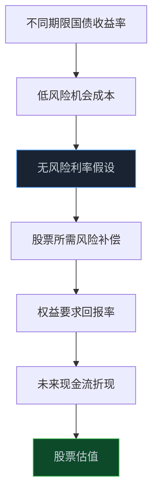
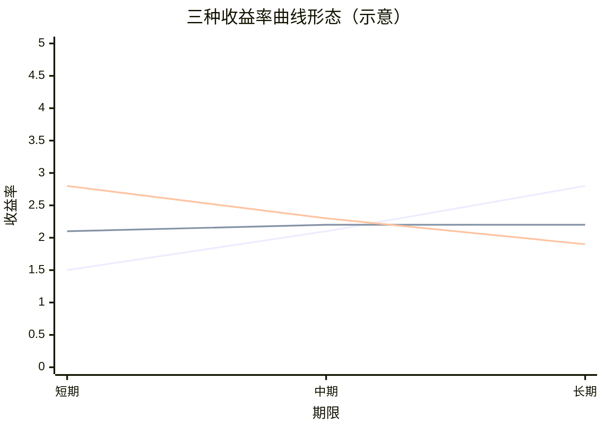

> **系列难度说明**：本篇是**第二章·第七篇**。不要求你交易国债；只要能理解债券价格与收益率为什么方向相反，就能看懂这把“无风险利率的尺子”怎样进入股票估值。
>
> **核心收获**：读完后，你会分清票面利率、债券价格和到期收益率，理解不同期限国债收益率构成的曲线，也能用短端、长端和期限利差观察市场对利率、增长与风险的不同定价。
>
> **重要提示**：本文只用于投资者教育，不构成任何证券投资建议。国债收益率会受货币政策、经济预期、债券供需、流动性和风险偏好等多种因素影响；它是资产定价的重要输入，不是预测股市的单一信号。

很多人第一次看到“10 年期国债收益率下行”，会有点困惑。

国债不是风险很低吗？为什么收益率下降反而会成为市场关注的消息？

关键在于，收益率不是债券写在发行说明书上的一个固定数字。它是市场交易出来的回报要求。投资者越愿意持有一只国债，债券价格越高；在票息固定的前提下，新买入者未来能拿到的回报率就越低。

这件事不只影响债券投资者。

国债收益率常被拿来作为低风险回报的参考。它变化时，投资者会重新比较：持有低风险债券能拿到多少回报？持有股票要承担更多波动和不确定性，应该要求多高的额外回报？

所以，国债收益率像一把不断移动的尺子。尺子变了，股票、债券、房产和许多长期资产的定价都会跟着调整。

<!-- more -->

---

## 国债收益率是什么：市场给“低风险、不同期限的钱”开的价格

国债由政府发行，通常被市场视作人民币资产中信用风险较低的债券之一。这里的“较低风险”不等于价格没有波动，也不等于买入后一定不会亏损；它只是说，相比普通企业债，市场通常更少担心发行人无法按约偿付。

国债收益率反映的是，投资者在某个时点买入并持有特定期限国债时，市场所要求的年化回报水平。常见观察期限包括 3 个月、1 年、3 年、5 年、10 年和 30 年等。

财政部与中债提供中国国债收益率曲线，可查看不同期限的收益率及其日、月、年变化。中国货币网也提供 1 年期、10 年期等政府债券收益率历史数据。

> **来源**：[中国国债收益率曲线](https://yield.chinabond.com.cn/cbweb-czb-web/czb/moreInfo?locale=cn_ZH&nameType=1) — 财政部与中债提供不同期限中国国债收益率曲线及变化数据。
>
> **来源**：[政府债券利率历史数据](https://www.chinamoney.com.cn/chinese/sddsintigy/) — 中国货币网提供 1 年期、10 年期等国债收益率的历史查询入口。

先记住一件事：国债收益率不是“国家给所有人的存款利率”，也不是企业实际借款成本。它是一条由国债市场交易形成的低风险收益率参考线。


---

## 票面利率、债券价格、到期收益率：别把三个词混成一个

国债收益率之所以容易读错，常常是因为把票面利率、交易价格和到期收益率当成了同一个东西。

### 票面利率：发行时写进合同的现金流规则

假设一张面值 100 元的国债，票面利率为 2%。在不考虑税费等复杂因素的简化场景下，它每年按约支付 2 元利息，到期归还 100 元本金。

票面利率在发行后通常不会因为二级市场交易而改变。

### 债券价格：投资者今天愿意花多少钱买它

这张国债进入市场后，投资者愿意付的价格会变。

如果市场利率下降，原来票面利率较高的债券显得更有吸引力，更多人愿意买，市场价格可能上涨；如果市场利率上升，旧债券的固定票息吸引力下降，价格可能下跌。

### 到期收益率：以当前价格买入并持有到期，隐含的综合回报

到期收益率把未来票息、本金和当前买入价格放在一起计算。它是市场更常用的比较口径。

一个简化的方向关系是：

\[
债券价格\uparrow \Rightarrow 到期收益率\downarrow
\]

\[
债券价格\downarrow \Rightarrow 到期收益率\uparrow
\]

例如，还是那张每年付 2 元利息、到期还 100 元本金的国债：

- 如果市场上有人愿意以 100 元买入，收益率大致接近票面利率；
- 如果价格被买到 105 元，未来现金流没有变，但新买入者花的钱更多，收益率会下降；
- 如果价格跌到 95 元，新买入者用更低成本获得同样现金流，收益率会上升。

这不是精确到小数点的债券定价计算，只是帮你建立最重要的方向感：**收益率下行，通常对应债券价格上行；收益率上行，通常对应债券价格下行。**

---

## 为什么国债收益率能成为“无风险利率”的参考

股票估值时，投资者不只问公司未来能赚多少，还会问：如果我不承担公司经营风险，把钱放到低风险资产里能拿到多少回报？

国债收益率就常被用来回答这个问题。

在上一节里，我们把权益要求回报率简化为：

\[
权益要求回报率 \approx 无风险利率 + 风险溢价
\]

这里的无风险利率，在人民币资产的研究中，常会参考与投资期限相匹配的国债收益率。

一家公司未来 10 年的现金流更重要时，市场可能更关注中长期国债收益率；分析短期资金成本、货币市场环境时，短期限利率更有参考意义。没有一个“永远正确”的期限选择，核心是让参考利率和你研究的现金流期限大致匹配。



但“无风险”是一个估值概念，不是一句保证。国债价格仍会波动；不同投资者的真实持有期限、再投资风险、流动性需求和汇率风险也不完全相同。把国债收益率作为参考，目的是建立一个共同起点，而不是假装世界没有不确定性。

---

## 收益率曲线：不同期限的利率，放在同一张图上

把 3 个月、1 年、5 年、10 年、30 年等不同期限国债收益率画在一张图上，就得到国债收益率曲线。

横轴是期限，纵轴是收益率。它不只告诉你“利率高不高”，还告诉你市场对不同期限资金要求的回报是否不同。

常见的形态有三种。

### 向上倾斜：长期收益率高于短期收益率

这是较常见的形态。投资者把钱锁得更久，通常会要求更多补偿，以覆盖时间、不确定性和未来利率变化风险。

### 平坦：短端和长端收益率接近

曲线变平，说明不同期限收益率差距缩小。它可能反映市场对未来增长、通胀、政策利率或债券供需的预期发生变化，但单看“平坦”两个字不能直接下结论。

### 倒挂：短期收益率高于长期收益率

短端高于长端时，常被称为倒挂。它可能反映市场对未来短期利率下行、增长放缓或风险环境变化的预期，也可能受到特定期限债券供需和政策操作影响。



上图只是示意图，不对应任何真实时点的数据。它想表达的是：**不要只看 10 年期收益率一个点，也要看它和 1 年期、短端之间的关系。**

---

## 期限利差：用一把小尺子观察曲线变化

研究中常会关注某两个期限收益率的差，例如：

\[
10年期国债收益率 - 1年期国债收益率
\]

这个差值常被称为期限利差。它变大，可能意味着曲线更陡；变小，可能意味着曲线更平。若差值为负，则短端收益率高于长端，形成倒挂。

期限利差有价值，是因为短端和长端受到的驱动并不完全相同：

- **短端**通常更贴近当前资金面、政策利率和短期流动性；
- **长端**通常还包含市场对长期增长、通胀、财政供给、资产配置与风险偏好的定价。

但别把期限利差当成一个自动预测器。长期收益率下降，可能是市场预期增长走弱，也可能是长期债券需求增加；短端上升，可能与资金面紧张有关，也可能是政策操作节奏变化。曲线形态需要和宏观数据、政策利率、债券供需、信用利差一起解释。

人民银行的金融市场运行数据也会定期披露 10 年期与 1 年期国债收益率及其利差，说明期限利差本身就是观察市场利率结构的一项公开信息。

> **来源**：[2026 年 8 月金融市场运行情况](https://wuhan.pbc.gov.cn/jinrongshichangsi/147160/147173/2026092118280622678/index.html) — 人民银行公布 10 年期国债收益率及其与 1 年期国债收益率的利差等债券市场运行数据。

---

## 国债收益率为什么会变化：不只因为“降息预期”

国债收益率变化是许多力量共同交易出来的结果。常见驱动包括：

- 对经济增长和通胀的预期；
- 对未来政策利率和资金面的预期；
- 国债发行供给与金融机构、基金、保险等投资者的配置需求；
- 市场风险偏好与避险需求；
- 海内外利率和汇率环境；
- 债券市场流动性、交易行为与期限偏好。

这意味着“10 年期国债收益率下行”并不只有一种解释。

例如，市场更担心增长放缓时，投资者可能增配低风险长期国债，推高债券价格、压低收益率；市场预期未来政策利率下降时，长期收益率也可能提前下行；但如果长期债券供给增加很快、投资者要求更高期限补偿，长端收益率也可能上行，即使短端政策环境没有明显变化。

```text
增长、通胀与政策预期
        +
国债供给与配置需求
        +
资金面与风险偏好
        ↓
不同期限国债价格变化
        ↓
不同期限国债收益率与曲线形态变化
```

把收益率变化直接等同于“经济好”或“经济差”，和把 PMI 直接等同于股市涨跌一样，都会漏掉中间层。

---

## 国债收益率下行，对股票一定是利好吗

不一定。

从估值角度看，国债收益率下行会降低低风险机会成本，可能压低折现率，对远期现金流占比高的资产形成支持。

但收益率下行的原因很重要。

| 收益率变化背后的可能背景 | 对股票估值的可能影响 | 还需要验证什么 |
| --- | --- | --- |
| 通胀回落、政策预期偏宽松 | 折现率可能下降，估值有支持 | 信贷、需求与盈利能否改善 |
| 增长预期走弱、避险需求上升 | 利率下行，但盈利预期可能同步下修 | 订单、利润预测、风险溢价是否恶化 |
| 长期资产配置需求增强 | 长端收益率下行，债券相对吸引力上升 | 是否存在供需或机构配置的技术性因素 |
| 通胀与增长预期上修 | 长端收益率可能上行，估值受压 | 企业收入和利润能否覆盖更高折现率 |
| 债券供给或期限溢价上升 | 长端收益率上行，不一定代表短期政策收紧 | 财政发行、投资者配置与曲线结构 |

利率下行支持估值，盈利下修压低价值；两股力量谁更强，决定股票最终怎么走。

这也是为什么有时债券走强、长期收益率下降，股市却同步下跌。市场可能不是在交易“资金更宽松”，而是在交易“未来盈利和风险环境更差”。

---

## 为什么 10 年期国债收益率不能直接等于股票折现率

股票估值里常用 10 年期国债收益率作为无风险利率参考，于是有人会直接把它塞进模型，认为折现率就是 10 年国债收益率。

这少了一大块：风险补偿。

股票持有人承担的是企业经营、行业竞争、杠杆、治理、流动性和市场波动风险。即使 10 年期国债收益率是 2%，一家高负债、盈利不稳定的小公司，也不可能只用 2% 折现未来现金流。

更合理的简化框架是：

\[
权益折现率 \approx 国债收益率 + 股权风险溢价 + 公司特定风险调整
\]

其中，国债收益率提供低风险回报的基准；风险溢价反映股票相对债券需要提供的额外补偿；公司特定风险则与债务、行业、治理和现金流稳定性有关。

所以，国债收益率下行只是折现率可能下降的一个来源。若风险溢价上升，整体折现率不一定下降；若公司盈利预测恶化，即使折现率下降，估值也不一定提高。

把三个变量分开写，能让研究更诚实：

```text
企业价值变化
  = 未来现金流假设变化
  + 无风险利率变化
  + 风险溢价变化
```

这不是严格的数学等式，而是一种复盘框架。它能避免所有涨跌都被粗暴归因于“国债收益率变了”。

---

## 国债收益率还会影响资产配置：股票不是唯一选择

投资者面对的不是“买股票还是不买股票”这么简单，而是在不同风险和期限的资产之间分配资金。

当低风险国债收益率较高时，一部分投资者可能更愿意持有债券，股票需要提供更高的预期回报才有吸引力；当低风险收益率较低时，未来现金流稳定、分红可预期的股票和其他风险资产可能显得更有相对吸引力。

不过，资产配置不会只由收益率水平决定。投资者还会看：

- 股票估值是不是已经很高；
- 企业盈利是否在改善；
- 债券久期风险是否过大；
- 市场波动和流动性是否可承受；
- 自己的投资期限和现金流需求是什么。

对个人投资者来说，最实用的结论不是预测收益率，而是认识机会成本：买一只股票，不是在真空中选择它，而是在放弃其他资产可能提供的回报与确定性。

---

## 一次练习：给收益率曲线写一段“市场在定价什么”的注释

打开中债或中国货币网的收益率数据页面，记录某一天的 1 年期、5 年期、10 年期国债收益率。然后做四步：

| 观察项 | 你要问的问题 |
| --- | --- |
| 1 年期收益率 | 短端资金和政策预期大致处在什么环境？ |
| 10 年期收益率 | 长期增长、通胀、资产配置与期限补偿可能在交易什么？ |
| 10 年 - 1 年利差 | 曲线是在变陡、变平，还是倒挂？ |
| 过去 1 个月变化 | 是短端、长端同时动，还是某一端变化更大？ |

再补两条验证：

1. 最近的 CPI、PMI、社融和政策利率信息，能否解释这次曲线变化？
2. 你关注的公司是受融资成本影响更大，还是受远期估值影响更大？

最后写一句：

> 当前收益率曲线更像在交易增长、通胀、政策，还是债券供需？我最缺的验证数据是什么？

如果解释不出来，保留“不确定”比硬套一个宏观故事更有价值。

---

## 小结

- 国债收益率是市场对不同期限低风险资金回报的定价，不等于票面利率，也不等于企业实际融资成本。
- 债券价格与到期收益率通常反向变化：价格上涨，收益率下降；价格下跌，收益率上升。
- 国债收益率曲线展示不同期限的收益率，短端和长端可能反映不同的政策、增长、通胀、供需与风险预期。
- 国债收益率常作为无风险利率参考进入股票估值，但股票折现率还包含风险溢价和公司特定风险。
- 收益率下行可能支持估值，也可能同时反映增长走弱和避险需求上升；必须和盈利预期、风险溢价一起解释。

---

## 下一篇预告

国债收益率帮助我们理解人民币资产的低风险回报与期限定价。可一家公司如果收入来自海外、原料依赖进口，或者背着外币债务，另一条价格线同样重要。

下一篇聊聊：**汇率：外部价格与企业经营的连接。**

---

> **课程导航：第二章·宏观经济：给市场画一张天气图**
> - 第一篇：GDP：增长从哪里来
> - 第二篇：CPI 与 PPI：价格变化传到利润表的路径
> - 第三篇：PMI：如何读懂景气度信号
> - 第四篇：M1 与 M2：货币到底在反映什么
> - 第五篇：社会融资：信用扩张与收缩
> - 第六篇：利率为什么会影响股票估值
> - **第七篇：国债收益率：无风险利率这把尺子** ← 你在这里
> - 第八篇：汇率：外部价格与企业经营的连接
> - 第九篇：财政变量如何进入行业与公司
> - 第十篇：货币条件、流动性与风险偏好
> - 第十一篇：经济周期：别把阶段性变化当成永恒趋势
