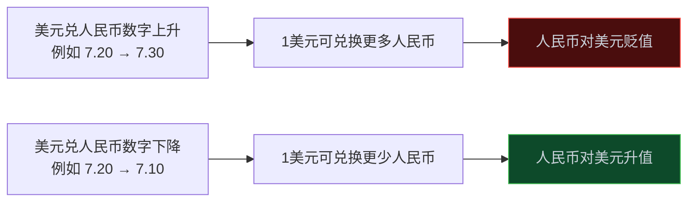
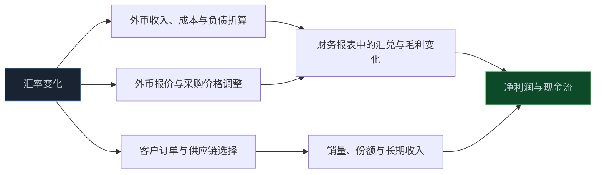
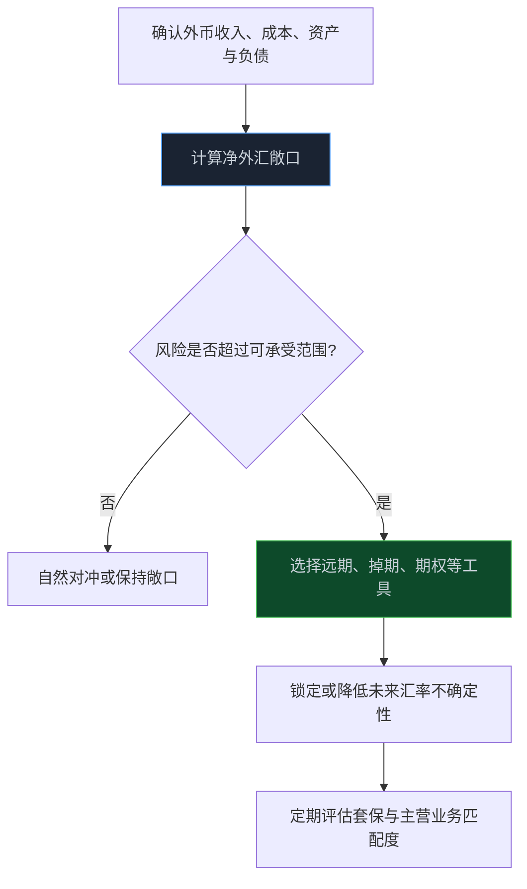
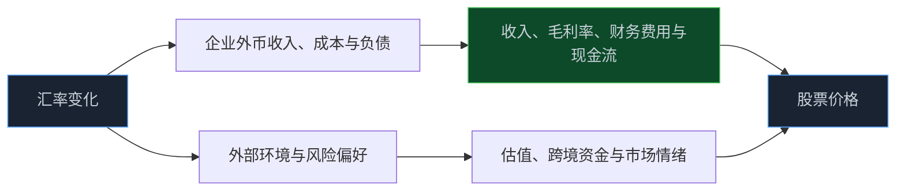

> **系列难度说明**：本篇是**第二章·第八篇**。不需要预测人民币对美元会到哪里；只要能分清企业是收外币、付外币，还是借外币，就能把汇率从新闻标题变成公司研究的一项变量。
>
> **核心收获**：读完后，你会正确理解人民币升值和贬值的报价方向，知道汇率如何经由出口收入、进口成本、外币资产负债和市场风险偏好影响公司，也能用“币种—敞口—套保—传导”四步检查一家公司的真实汇率敏感度。
>
> **重要提示**：本文只用于投资者教育，不构成任何证券投资建议。汇率受到国内外增长、利率、通胀、国际收支、市场预期和风险偏好等多重因素影响，双向波动是常态；文中案例仅用于说明机制，不代表任何投资判断。

一家公司出口很多，人民币贬值，是不是就一定受益？

不一定。

它也许用美元收款，但进口关键零部件；也许已经签了固定外币价格的长单；也许用远期合约锁住了汇率；又或者海外客户会要求分享一部分汇率带来的价格优势。真正落到利润表时，新闻里那句“人民币贬值利好出口”往往已经过度简化。

反过来，人民币升值也不必然利空出口企业。若企业依靠技术、品牌或供应链效率拿订单，汇率只是众多变量之一；若原材料和设备大量依赖进口，成本端的改善还可能抵消甚至超过收入端的压力。

汇率不是一个行业标签，而是一种跨境价格。要读懂它，需要顺着一家公司收什么币、付什么币、借什么币、如何对冲风险一路追下去。

<!-- more -->

---

## 先把报价方向搞清楚：数字上涨，不一定是“美元上涨”

国内最常见的表达之一是“美元兑人民币”。若写作：

```text
1 美元 = 7.20 元人民币
```

意思是买 1 美元需要 7.20 元人民币。

在这种报价下：

- 从 `7.20` 变为 `7.30`，买同样 1 美元需要更多人民币，通常可理解为**人民币对美元贬值**、美元相对人民币升值；
- 从 `7.20` 变为 `7.10`，买同样 1 美元需要更少人民币，通常可理解为**人民币对美元升值**、美元相对人民币贬值。

这个方向一定要先记牢。很多讨论在第一步就说反了，后面所有“利好出口、利空进口”的推导自然都会错位。



人民币汇率也不只看美元这一条线。中国实行以市场供求为基础、参考一篮子货币进行调节、有管理的浮动汇率制度。人民币对美元汇率很受关注，但它不能完整代表人民币对所有贸易伙伴货币的相对变化。

中国货币网发布的 CFETS 人民币汇率指数，就是观察人民币对一篮子货币整体变化的一个入口。研究出口竞争力或多币种收入时，只盯美元兑人民币，信息可能不够。

> **来源**：[中国人民银行关于人民币汇率的政策立场](https://www.pbc.gov.cn/goutongjiaoliu/113456/113469/2026100816231113295/index.html) — 人民银行说明我国实行以市场供求为基础、参考一篮子货币进行调节、有管理的浮动汇率制度，并强调人民币汇率双向波动特征。
>
> **来源**：[人民币汇率指数](https://www.chinamoney.com.cn/chinese/bkrmbidx/) — 中国货币网说明 CFETS 人民币汇率指数的货币篮子、权重与计算方式。

---

## 汇率先影响换算，再影响竞争，最后才可能影响利润

汇率传导没有一条人人相同的路径。它至少包含三层。

### 换算效应：同样一笔外币，折成人民币变了

假设一家出口企业收到 `100` 万美元货款。

- 当美元兑人民币为 `7.20` 时，折合收入约为 `720` 万元；
- 当美元兑人民币为 `7.30` 时，折合收入约为 `730` 万元。

在美元金额、销量、产品价格和其他条件不变时，人民币贬值会提高这笔美元收入折算成人民币后的金额。

但这只是报表换算的第一层。若企业同时要支付美元采购款、美元运费或美元债务，另一边的成本与负债也会发生变化。

### 价格效应：客户和供应商会不会重新谈价

汇率变了，企业不一定把所有影响留在自己手里。

出口商面对海外客户时，可能选择降低外币报价争取订单，也可能保持外币价格不变，把汇率变化留在利润里；进口商面对海外供应商时，可能承担更高成本，也可能通过谈价、替代采购或调价分担压力。

价格效应取决于产品稀缺性、品牌、客户集中度、合同期限和竞争格局。汇率只给出一段价格变化，企业能留住多少，要看议价能力。

### 数量效应：价格变动会不会改变订单和需求

人民币贬值可能使以外币计价的中国产品相对更便宜，理论上有助于出口竞争力；人民币升值则可能降低进口商品和设备的人民币成本。

不过，订单不会因为汇率变化立即重新分配。海外需求、产品质量、交付能力、关税、当地合规、供应链安全和竞争对手价格，往往比短期汇率更重要。



因此，看到汇率变动时，先把“折算效应”和“竞争效应”分开。前者可能较快反映在报表，后者通常更慢，也更依赖企业自身能力。

---

## 出口企业：收外币不等于天然受益

把一家企业叫作“出口股”，信息仍然太粗。

真正要问的是：出口收入占比多少？主要结算币种是什么？原材料和设备是否也用外币采购？外币价格是固定还是浮动？企业有没有套期保值？

假设一家制造企业有以下结构：

```text
美元收入：70%
美元采购成本：45%
人民币人工、租金和制造费用：40%
其他币种与人民币收入成本：15%
```

它的净美元敞口不是 70%，而更接近“美元收入减去美元成本”之后的余额。人民币贬值可能增加人民币口径收入，也会增加美元采购成本；最终影响要看两边的差额、结算时点和套保安排。

出口企业还常见三种不同策略：

| 企业做法 | 汇率变化时的可能表现 | 研究时要看什么 |
| --- | --- | --- |
| 外币售价基本不变 | 换算影响可能更快进入人民币收入 | 外币收入占比、结算周期、净外币敞口 |
| 主动下调外币报价抢份额 | 部分汇率优势可能让给海外客户 | 订单、销量、市场份额和毛利率 |
| 用外汇工具锁定价格 | 短期汇兑波动可能被平滑 | 套保比例、期限、套保损益和会计处理 |

所以，“人民币贬值利好出口”更准确的说法应当是：**若企业净外币收入为正、未完全对冲、外币报价和订单不被客户重新压价，人民币贬值可能对其人民币口径收入或利润形成支持。**

条件很多，才接近事实。

---

## 进口企业：成本变了，能不能传出去更关键

进口原油、金属、农产品、芯片、设备或零部件的企业，对汇率可能更敏感。

若采购以美元或其他外币结算，人民币贬值时，购买同样数量的原料需要支付更多人民币。若产品售价不能同步提高，毛利率就可能承压；人民币升值时，进口成本可能下降，利润空间则可能改善。

但进口企业也不应被简单归类为“人民币升值受益股”。原因有三点：

- 国际商品本身的美元价格可能同时变化，汇率只是其中一项；
- 企业可能提前锁价、持有库存或使用期货与外汇工具对冲；
- 下游需求较弱时，成本下降未必能完全变成利润，企业可能通过降价竞争把好处让给客户。

更接近公司研究的问题是：

```text
进口成本 = 外币商品价格 × 汇率 × 采购量
```

其中任何一项变化，都可能盖过另外两项。

比如国际油价上涨 20%，即便人民币升值 3%，整体采购成本仍可能上升。只用人民币汇率解释能源、化工或航空公司的成本，通常不够。

---

## 外币资产和外币负债：汇兑损益可能比贸易收入来得更快

企业不只在经营中收付外币，也可能持有外币现金、海外应收款、外币贷款或境外债券。

这些外币资产和负债要按会计准则折算为人民币。汇率变化会形成汇兑损益，并可能直接影响财务费用、其他收益或资产负债表项目，具体列报取决于业务性质和会计处理。

方向上可以先这样理解：

| 项目 | 人民币贬值时的常见影响 | 人民币升值时的常见影响 |
| --- | --- | --- |
| 外币现金、外币应收款 | 折算为人民币的价值可能上升 | 折算价值可能下降 |
| 外币应付款、外币采购债务 | 人民币偿债金额可能增加 | 人民币偿债金额可能减少 |
| 外币贷款或境外债 | 人民币口径债务可能上升，可能出现汇兑损失 | 人民币口径债务可能下降，可能出现汇兑收益 |
| 海外子公司净资产 | 合并报表折算可能变化 | 合并报表折算可能变化 |

这里的“可能”同样很重要。企业若已经使用远期、掉期、期权等工具对冲，实际影响会被部分抵消；若外币资产与负债规模相近，还可能存在自然对冲。

国家外汇局发布的《企业汇率风险管理指引（2024 年版）》就强调，企业应从风险敞口识别、套期保值策略、衍生交易决策和效果评估等环节管理汇率风险。

> **来源**：[企业汇率风险管理指引（2024 年版）](https://www.safe.gov.cn/beijing/file/file/20260615/7655a3727e4444e289b9602c887b6906.pdf?n=企业汇率风险管理指引（2024年版）) — 国家外汇局关于企业识别外汇风险敞口、制定套期保值策略与评估管理效果的官方指引。

对高外币负债公司来说，汇率风险不是一条宏观新闻，而是资产负债表上的刚性约束。研究时不要只看“海外收入增长”，还要查外币债务、偿债期限、利率类型和套保安排。

---

## 汇率套保：不是“赌对方向”，而是把不确定性变成可管理成本

企业做套期保值，不是为了每次都从汇率上赚钱，而是为了降低主营业务被汇率大幅扰动的风险。

常见的工具包括远期结售汇、外汇掉期和外汇期权等。举个最简单的例子：一家企业三个月后会收到 100 万美元货款，它可以通过远期合约提前锁定未来换成人民币的大致价格。这样即使三个月后汇率向不利方向波动，企业也能减少不确定性。

套保有成本，也会放弃一部分有利汇率带来的潜在收益。可对经营者来说，稳定毛利率、现金流和预算的价值，往往高于押对单次汇率方向。



对投资者来说，看到企业披露“开展外汇套期保值”，不该直接理解为利好或利空。更值得问：它要对冲什么币种和什么规模？是否与真实贸易、外币债务相匹配？公司是为了降低经营波动，还是在脱离主业做方向性交易？

---

## 汇率的宏观来源：不要把一切归因于美元指数

汇率受很多力量共同影响。常见线索包括：

- 国内外经济增长和通胀差异；
- 国内外利率水平及其预期；
- 货物和服务贸易、跨境投资等国际收支变化；
- 外汇市场供求与市场预期；
- 全球风险偏好、避险情绪和主要货币波动；
- 汇率制度与宏观审慎管理安排。

这些变量之间也会互相作用。出口改善可能增加外汇收入，利率差变化会影响跨境资产配置，风险偏好变化可能同时影响汇率、股票和债券价格。

国家外汇局按月发布国际收支货物和服务贸易数据，并定期披露外汇市场和外汇储备等信息。它们比单一汇率点位更适合作为理解外部收支的背景材料。

> **来源**：[国家外汇管理局数据解读](https://www.safe.gov.cn/safe/sjjd/) — 外汇局发布外汇储备、外汇市场交易与国际收支货物服务贸易等数据解读。
>
> **来源**：[人民币汇率中间价](https://www.chinamoney.com.cn/chinese/bkccpr/) — 中国货币网提供人民币汇率中间价及相关市场数据查询入口。

因此，解释汇率时，最好用“多变量共同定价”而不是“某一个新闻导致升值或贬值”。汇率本来就是国内外多种预期相遇的价格。

---

## 汇率与股票市场：先分企业现金流，再看风险偏好

汇率变化会通过企业经营影响股价，也会通过市场风险偏好影响估值。

### 经营链：谁的现金流先变

外币收入净敞口为正的企业、进口成本占比较高的企业、外币债务较重的企业，可能受到更直接影响。这里应回到公司业务，而不是只看所属板块。

例如，同在电子制造产业链：一家企业可能出口成品、美元收入较高；另一家企业可能进口核心设备和原材料；第三家企业主要在国内销售，汇率影响更多来自竞争对手和客户需求。它们对同一轮人民币波动的敏感度完全可能不同。

### 估值链：外部风险会不会改变资金要求的回报

汇率也会影响市场对外部环境、跨境资金和政策空间的判断。当汇率波动放大时，市场风险偏好可能变化，尤其是高估值、外币负债重或依赖海外资金的资产更容易受到关注。

但这仍不是“人民币贬值必然股市下跌”的公式。汇率变化的原因、企业盈利的韧性、国内流动性、估值水平和市场预期，都会共同决定结果。



把经营链和估值链分开，会让汇率研究更清楚：前者问企业实际会多赚还是少赚，后者问市场愿意给多高估值。两条链有时同向，有时完全相反。

---

## 四个最常见的误读

| 常见说法 | 为什么不够准确 | 更好的问法 |
| --- | --- | --- |
| “人民币贬值，出口股都受益” | 忽略进口成本、外币债务、客户议价和套保 | 公司净外币收入敞口是多少？ |
| “人民币升值，进口企业都受益” | 忽略商品美元价格、库存与终端定价压力 | 外币采购占成本多少？价格能否传导？ |
| “汇率变了，季度利润一定立刻变” | 合同、结算、库存和对冲会造成滞后 | 敞口何时结算？套保期限多长？ |
| “美元兑人民币就是全部汇率风险” | 忽略多币种贸易和有效汇率 | 主要收入、成本和债务分别以什么币种计价？ |

汇率研究真正难的地方，不是判断升还是贬，而是搞清企业暴露在什么币种、什么期限、什么方向的风险里。

---

## 一次练习：给公司做一张“外汇敞口卡片”

找一家有海外业务、进口采购或境外债务的上市公司，打开年报的“外币货币性项目”“汇率风险”“境外经营”“套期保值”相关章节，填一张卡片。

| 要找的信息 | 你要回答的问题 |
| --- | --- |
| 收入币种 | 海外收入占比多少？主要以美元、欧元还是其他币种结算？ |
| 成本币种 | 原材料、设备、运费和采购款中，外币成本占比多少？ |
| 外币资产负债 | 外币现金、应收、应付、借款分别有多少？ |
| 净敞口 | 收外币与付外币相抵后，企业更怕人民币升值还是贬值？ |
| 对冲安排 | 是否使用远期、掉期、期权或自然对冲？对冲比例和期限怎样？ |
| 财报验证 | 汇兑损益、毛利率、财务费用和经营现金流是否支持你的判断？ |

最后写一句：

> 若美元兑人民币在一个季度内朝某个方向变动 5%，这家公司最可能先受影响的是收入换算、采购成本、汇兑损益，还是市场估值？我还缺哪项披露来确认？

这张卡片的价值，不在于预测汇率，而在于把模糊的“汇率受益概念”变成能被年报验证的业务假设。

---

## 小结

- 汇率是不同货币之间的相对价格。看美元兑人民币时，数字上升通常意味着人民币对美元贬值，数字下降通常意味着人民币对美元升值。
- 汇率通过换算、价格和数量三层传导影响企业；从外币收入变化到利润变化，中间还隔着成本、合同、库存和议价能力。
- 出口企业、进口企业和外币负债企业不能简单按行业贴标签，关键是净外币敞口与套期保值安排。
- 汇率套保的目的通常是降低经营不确定性，而不是猜对方向；研究企业时应关注敞口、工具、比例与期限是否匹配。
- 汇率还会通过外部风险与市场偏好影响估值，但“汇率升贬值 → 股市涨跌”并不存在固定公式。

---

## 下一篇预告

汇率连接了国内企业与外部市场，财政则把公共部门的收入和支出带进真实需求。

一笔财政支出从预算到项目开工、采购、回款，究竟怎样传到行业和上市公司？税费变化又如何改变企业利润表？

下一篇聊聊：**财政变量如何进入行业与公司。**

---

> **课程导航：第二章·宏观经济：给市场画一张天气图**
> - 第一篇：GDP：增长从哪里来
> - 第二篇：CPI 与 PPI：价格变化传到利润表的路径
> - 第三篇：PMI：如何读懂景气度信号
> - 第四篇：M1 与 M2：货币到底在反映什么
> - 第五篇：社会融资：信用扩张与收缩
> - 第六篇：利率为什么会影响股票估值
> - 第七篇：国债收益率：无风险利率这把尺子
> - **第八篇：汇率：外部价格与企业经营的连接** ← 你在这里
> - 第九篇：财政变量如何进入行业与公司
> - 第十篇：货币条件、流动性与风险偏好
> - 第十一篇：经济周期：别把阶段性变化当成永恒趋势
