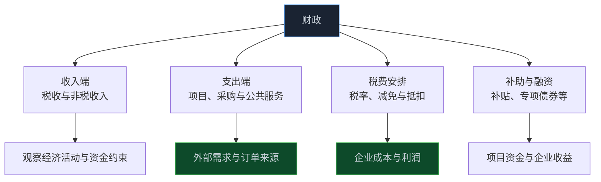
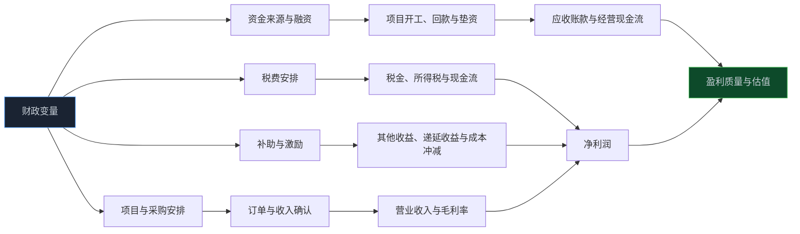

> **系列难度说明**：本篇是**第二章·第九篇**。不需要懂预算编制；只要能分清“钱从哪里来、花到哪里去、怎样变成企业收入或利润”，就能把财政数据从宏观新闻变成可以核对的研究线索。
>
> **核心收获**：读完后，你会理解财政收支、税费和政府补助的基本口径，掌握财政变量进入行业与公司的五条路径（订单、回款、税费、补助、融资），也能用“来源—项目—订单—确认—现金”五步检查一家公司的财政相关收入是否可靠。
>
> **重要提示**：本文只用于投资者教育，不构成任何证券投资建议。文章讲的是财政变量的数据口径与传导机制，不对任何具体政策作评价；文中数据来自官方公开发布，仅用于说明研究方法，可能随后续修订而变化。

打开财经新闻，你常常会看到这样一类标题：某类项目资金到位，某项税费安排调整，某类补贴继续实施。

接下来，评论区往往会出现一份“受益行业清单”。

可是，清单上的公司真的会多赚钱吗？

这里面至少隔着四道门。

第一道，钱到的是预算、还是真正开工的项目？第二道，项目会不会变成企业的订单，订单落在哪家公司？第三道，收入什么时候在财务报表里确认？第四道，确认之后，现金什么时候回来，利润有多少是真的可以持续的？

财政变量不是“利好”或“利空”这样两个词。它更像一条水管，从公共资金出发，要经过很多阀门，才能流到企业的利润表和现金流量表。

读懂这条水管，比记住一份名单有用得多。

<!-- more -->

---

## 先分清三个口径：预算、收入与支出

“财政”这个词太大，第一步是把几个常见口径拆开。

**一般公共预算**，是财政数据里最常被引用的一类。它大体包括收入和支出两端：收入主要来自税收和非税收入；支出则覆盖教育、社会保障、公共服务、基础设施等多个领域。

财政部每月会发布财政收支数据。以 2026 年 1—8 月为例：全国一般公共预算收入 `156633` 亿元，同比增长 `5.7%`；其中，税收收入 `129104` 亿元，同比增长 `6.6%`；非税收入 `27529` 亿元，同比增长 `1.5%`；国内增值税 `50179` 亿元，同比增长 `5.9%`。

> **来源**：[2026年1-8月财政收支情况](https://m.mof.gov.cn/czsj/202609/t20260918_3997709.htm) — 财政部发布的全国一般公共预算收入、税收收入、非税收入及主要税种数据。

这组数据告诉我们什么？

它能告诉我们的，是政府“收了多少钱”。税收收入和一些税种，与企业生产、销售、利润和资产交易活动有关，因此常被当作观察经济活跃度的侧面。

它没有直接告诉我们，哪家公司会多拿一份订单，也没有说明某个行业的利润会不会上升。

所以更稳妥的看法是：**财政收入数据，更像经济活动的一个“回声”；财政支出和项目安排，才更接近企业经营的外部需求；税费与补助条款，则直接作用于企业的成本和利润。**

分清口径之后，就不容易把“财政收入同比增长”直接翻译成“某个板块受益”。这两件事之间，距离很远。

---

## 路径一：从项目到订单

对多数企业来说，最直接的财政相关影响，来自公共部门的采购和项目建设。

一个项目从想法到企业收入，大致会经过这样几步：

1. 项目被列入规划或预算；
2. 完成立项、可行性研究、设计与审批；
3. 资金安排落实，通过招标、采购等程序确定供应商；
4. 企业签订合同，开始供货或施工；
5. 按进度结算、验收，确认收入；
6. 付款并形成现金回款。

这条链条很长，每一步都可能有时间差。

中国政府采购网会公开各类采购公告和中标结果；地方政府专项债券发行时，也会披露债券信息，部分披露文件会说明项目类别和资金用途。比如某地披露的采购结果里，会出现“超长期特别国债、地方政府专项债项目初步设计或可研报告编制”这类具体环节的中标信息。这提醒我们：项目前期的设计、咨询、勘察，和后期的设备、施工、运营，不是同一批公司。

> **来源**：[中国政府采购网](http://www.ccgp.gov.cn/cggg/dfgg/zbgg/202610/t20261011_27467818.htm) — 全国政府采购公告与中标（成交）结果的公开入口，可用于观察项目采购环节。
>
> **来源**：[地方政府新增专项债券项目信息披露模板](http://czt.shandong.gov.cn/module/download/downfile.jsp?classid=0&filename=798883e800804bc1b75bb7247bd3e818.pdf) — 地方财政部门披露专项债券时使用的模板，列示债券类型及项目分类。

把这条路径用在公司研究上，可以问三个问题：

- 这家公司处在项目链的哪一段：咨询设计、核心设备、施工安装，还是后期运营维护？
- 它的订单是直接来自公共部门，还是来自总承包商、项目公司或下游客户？
- 它披露的在手订单、中标金额，与未来几个季度的收入确认节奏对不对得上？

同一个“基建项目”，设计院、设备商、建筑施工企业和材料供应商面对的合同条款、毛利率和回款周期，可以完全不同。

---

## 路径二：从订单到回款

很多投资者把注意力放在“订单多不多”，却忽略了订单后面的“钱什么时候到”。

对于公共项目相关的企业，回款周期往往比普通商业客户更长，也更依赖项目进度、验收和资金安排。订单增加，收入确认也许很快增加；但应收账款同时堆高，经营现金流不一定同步改善。

看年报时，可以把几组数据放在一起：

| 观察项 | 要回答的问题 |
| --- | --- |
| 营业收入增速 | 收入是否随订单增加？ |
| 应收账款与合同资产 | 收入增长背后，欠款是否同样上升？ |
| 应收账款周转天数 | 回款速度是在变快，还是在变慢？ |
| 经营活动现金流净额 | 利润有没有变成现金？ |
| 信用减值损失 | 公司是否开始为回款风险计提？ |
| 前五大客户占比与客户类型 | 收入是否集中在少数项目或同类客户上？ |

如果收入、利润都在增长，应收账款增速却长期明显快于收入，现金流又弱，这类公司更需要弄清：增长的是业务，还是对客户的垫资。

这一点，与第四章要讲的“现金流：利润为什么不等于现金”会直接接上。财政项目只是让这个问题变得更典型。

---

## 路径三：税费，直接改写利润表

如果说订单是“外部需求”，税费就是“内部成本”。

企业的利润表里，有几类项目与税费直接相关：

- **增值税**：多数情况下是价外税，不直接计入收入和成本，但会影响企业开票、现金流和价格；
- **税金及附加**：消费税、城市维护建设税、教育费附加等，计入利润表的“税金及附加”；
- **所得税费用**：由企业利润、税前扣除、优惠安排和递延所得税共同决定；
- **研发、设备投资等相关的抵扣和优惠**：改变企业的实际税负和现金流出。

以研发费用加计扣除为例。国家税务总局对这项优惠的介绍中强调，它适用于会计核算健全、实行查账征收并能够准确归集研发费用的居民企业，企业需要按研发项目设置辅助账，准确归集可加计扣除的研发费用；盈利和亏损企业都可以依规享受。

> **来源**：[一文了解：研发费用加计扣除政策](https://www.chinatax.gov.cn/chinatax/n810356/n3010387/c5222730/content.html) — 国家税务总局对政策适用对象、核算要求与归集方式的说明。

为什么这对投资者重要？

因为同样是一家研发投入较高的公司，**税前利润、实际所得税率、净利润和现金税负之间，可能存在差距**。看“利润增长”时，要分清它来自销量、毛利率和成本控制，还是来自税率变化、优惠到期、递延所得税等一次性或阶段性因素。

年报中有两张表值得认真看：

- “所得税费用”的构成，以及“按法定税率计算的所得税费用”与实际所得税费用的调节；
- 对高新技术企业、研发费用加计扣除等税收优惠的披露。

如果一家公司利润上升，很大一部分来自税负下降，而不是业务改善，这类利润的持续性需要重新评估。

---

## 路径四：政府补助，怎样进入报表

政府补助是最容易被“误读”的财政变量。

新闻里会写：“某公司收到政府补助 X 亿元”。读者的第一反应往往是：净利润要增加了。

可是在会计上，这件事没有这么简单。

按照《企业会计准则第16号——政府补助》，政府补助分为两大类：

- **与资产相关的政府补助**：企业取得的、用于购建或以其他方式形成长期资产的补助；
- **与收益相关的政府补助**：除与资产相关的补助之外的补助。

> **来源**：[企业会计准则第16号——政府补助](https://kjs.mof.gov.cn/zt/kjzzss/kuaijizhunzeshishi/200806/t20080618_46232.htm) — 财政部发布的政府补助准则，规定补助的分类与基本会计处理。

两类补助的“落袋节奏”不一样：

| 类型 | 常见会计处理 | 对利润表的影响 |
| --- | --- | --- |
| 与资产相关 | 先确认为递延收益，随相关资产的使用寿命分期计入损益；也可冲减资产账面价值 | 收到现金时利润不一定立刻增加，影响分散在多个期间 |
| 与收益相关，补偿以后期间费用 | 先确认为递延收益，在费用发生期间计入损益 | 随费用发生分期确认 |
| 与收益相关，补偿已发生费用 | 取得时直接计入当期损益 | 当期利润可能明显增加 |

而计入损益时，又要区分“是否与企业日常活动相关”：与日常活动相关的，通常计入“其他收益”或冲减相关成本费用；与日常活动无关的，通常计入“营业外收入”。

财政部的解读也强调，会计处理要依据补助文件中的政策依据、项目性质和补助用途等实质内容来判断，不能只看名称。

所以，读到“收到政府补助”时，建议顺着三步走：

1. **看性质**：是与资产相关，还是与收益相关？
2. **看确认**：已经计入当期损益，还是挂在“递延收益”里分期确认？
3. **看依赖度**：扣除政府补助之后，公司的利润还剩多少？

最后一步尤其重要。

如果一家公司的净利润，大部分来自政府补助或一次性收益，而“扣除非经常性损益后的净利润”很低，说明它的主业赚钱能力和报表利润之间有较大差距。补助未必不好，但它不等于可重复的经营利润。

---

## 路径五：融资，决定项目有没有“弹药”

财政变量还有另一条路径：**资金来源**。

公共项目需要资金。资金可能来自财政预算安排、地方政府专项债券、金融机构贷款，以及项目自身的收入和社会资本等。资金安排是否落实、到位节奏如何，会影响项目开工和付款。

这里需要避免一个思维捷径：把“有项目”理解成“有付款”。

对于相关企业，更值得追问的是：

- 项目资金来源是否清晰，是否有对应的预算或债券资金安排？
- 项目处于前期、建设期还是运营期？
- 合同中的付款条件是按进度、验收还是项目运营后的收入？
- 公司自己是否需要垫资，垫资比例有多高？

垫资多、付款条件长的业务，会占用营运资金，使公司需要更多借款，进而影响财务费用和资产负债率。

这就是财政变量与公司资产负债表的连接点：**订单可能带来增长，也可能带来资金占用。**

---

## 五条路径放在一起：一张传导图

这张图的意思不是“财政一动，估值一定动”。

而是在提醒你：**财政变量进入公司，会同时改变收入、成本、现金流和资金占用。** 同一个事件，对不同公司的净影响可以完全不同。

---

## 宏观数据怎么用：不要把一个指标当成答案

财政收入、固定资产投资、基础设施投资、专项债券发行，这些数据都可以作为背景材料。但它们之间的关系并不是简单线性的。

举个例子。国家统计局发布的 2026 年 1—7 月份固定资产投资数据显示，全国固定资产投资（不含农户）同比下降 `6.7%`，同期知识产权产品投资同比增长 `9.1%`。

> **来源**：[2026年1—7月份全国固定资产投资基本情况](https://www.stats.gov.cn/sj/zxfb/202608/t20260817_1965054.html) — 国家统计局发布的全国固定资产投资总体及分产业、分类别数据。

这类数据的提醒是：总量下降，不意味着每个细分领域都下降；总量增长，也不意味着所有企业都受益。投资结构里，设备购置、基础设施、制造业、房地产开发和知识产权产品，彼此的节奏、主要供应商和现金流模式都不相同。

因此，用宏观数据找研究方向时，建议保持一个习惯：

- 总量数据，帮助你判断背景；
- 分项数据，帮助你找到行业；
- 企业披露的订单、合同、应收和补助，才能帮助你找到公司。

三层之间，要一层层向下验证。

---

## 四个常见误读

| 常见说法 | 为什么不够准确 | 更好的问法 |
| --- | --- | --- |
| “某类资金到位，相关行业都受益” | 资金到位不等于项目开工，也不等于订单落到某家公司 | 公司处在项目链哪一段？订单是否已披露？ |
| “收到政府补助，利润就会大增” | 补助可能分期确认，也可能只是冲减成本或资产账面价值 | 属于哪类补助？计入哪个报表科目？ |
| “订单越多，业绩越确定” | 收入确认、验收和回款都有时间差，垫资还会占用现金 | 应收、合同资产和经营现金流是否匹配？ |
| “税费优惠，净利润增长就可持续” | 优惠可能有期限、条件，也可能只是改变利润的确认方式 | 扣除税负变化与非经常性损益后，主业利润如何？ |

这四条的共同点，是都把“财政变量”和“公司经营结果”画了等号。研究的价值，恰恰在于把两者之间的空隙一格一格填上证据。

---

## 一次练习：做一张“财政相关收入核对表”

选一家业务与公共项目、税收优惠或政府补助有明显关系的上市公司，打开最近一份年报，按下面的表格逐项记录。

| 要找的信息 | 你要回答的问题 |
| --- | --- |
| 客户结构 | 前五大客户中，公共部门、国有企业、总承包商和民营客户各占多少？ |
| 订单与项目 | 年报是否披露在手订单、重大合同或项目进度？主要项目处于什么阶段？ |
| 收入确认 | 公司按时点还是按履约进度确认收入？验收和结算节点是什么？ |
| 应收与现金流 | 应收账款、合同资产、信用减值与经营现金流是否支持收入增长？ |
| 税费与优惠 | 所得税调节表怎么写？是否享受高新技术企业或研发加计扣除等优惠？ |
| 政府补助 | 补助金额多少？计入其他收益、营业外收入、递延收益，还是冲减成本？ |
| 主业利润 | 扣除非经常性损益后，净利润还剩多少？ |

最后，写一句话：

> 若这家公司未来一年的订单、回款条件和补助都不变，只看经营本身，它的利润和现金流还剩多少？我缺哪项披露才能确认？

这张表的目标，不是预测财政政策，而是把一类容易被新闻放大的变量，还原成能在年报里逐行核对的具体数字。

---

## 小结

- 财政变量不是一个整体的“利好”。它可以拆成收入、支出、税费、补助与融资，各自通过不同路径进入行业与公司。
- 财政收入数据更像经济活动的回声；真正接近企业经营的，是项目采购、税费安排和补助条款。
- 订单只是起点。收入确认、验收、应收账款、垫资和经营现金流，决定了订单是否能成为可持续的经营成果。
- 政府补助要看会计性质、确认时点和依赖度；扣除非经常性损益后的利润，更能反映主业能力。
- 用宏观数据找方向、用行业数据找赛道、用企业披露验证，是研究财政相关变量最稳妥的顺序。

---

## 下一篇预告

走到这里，我们已经看过增长、价格、景气、货币、信用、利率、汇率和财政。

它们都在讲“钱”。但还有一个问题常被混淆：**市场上的钱多，不等于投资者就愿意买。**

资金宽松和风险偏好高涨，是同一件事吗？为什么同样的流动性环境，有时候股市大涨，有时候却无人问津？

下一篇聊聊：**货币条件、流动性与风险偏好。**

---

> **课程导航：第二章·宏观经济：给市场画一张天气图**
> - 第一篇：GDP：增长从哪里来
> - 第二篇：CPI 与 PPI：价格变化传到利润表的路径
> - 第三篇：PMI：如何读懂景气度信号
> - 第四篇：M1 与 M2：货币到底在反映什么
> - 第五篇：社会融资：信用扩张与收缩
> - 第六篇：利率为什么会影响股票估值
> - 第七篇：国债收益率：无风险利率这把尺子
> - 第八篇：汇率：外部价格与企业经营的连接
> - **第九篇：财政变量如何进入行业与公司** ← 你在这里
> - 第十篇：货币条件、流动性与风险偏好
> - 第十一篇：经济周期：别把阶段性变化当成永恒趋势
