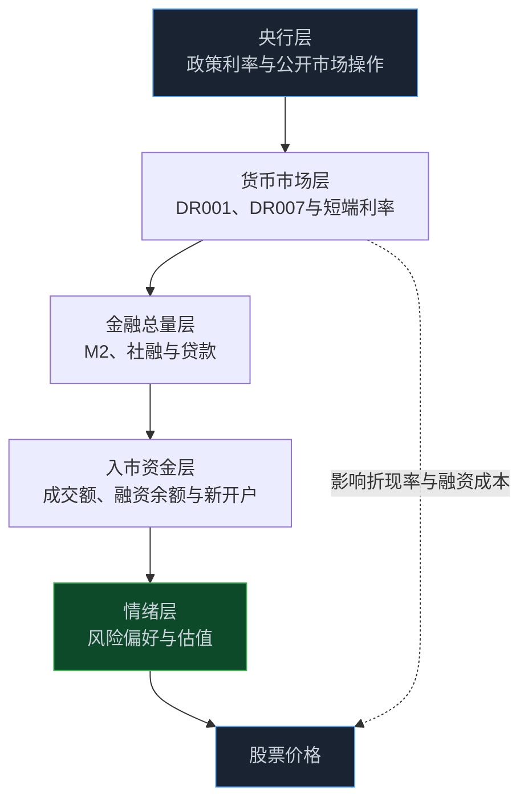

> **系列难度说明**：本篇是**第二章·第十篇**。不要求你懂货币政策操作；只要记住一句话——“流动性”说的是钱好不好拿、贵不贵，“风险偏好”说的是拿到钱的人敢不敢去买风险资产——就能顺着本篇把两件事拆开看。
>
> **核心收获**：读完后，你会分清央行层、货币市场层、金融总量层、入市资金层和情绪层五个层次的流动性，理解为什么同样的资金环境下股市可以大涨也可以冷清，并能用“股权风险溢价”和一张资金情绪仪表盘，给当前市场的松紧与冷热做一次可复核的记录。
>
> **重要提示**：本文只用于投资者教育，不构成任何证券投资建议。文中讨论的是数据口径与传导机制，不对货币政策作评价，也不预测政策或市场走向；所列数据来自官方公开发布，可能随后续修订而变化，示例数字除注明来源外均为假设。

很多人会这样理解行情：钱多了，股票就涨；钱紧了，股票就跌。

这句话有一半是对的。

资金环境确实会影响资产价格。可你只要多看几轮行情，就会发现它不够用。有些阶段，市场利率很低，银行间资金也宽松，股市却长期没人理；也有些阶段，资金面并不算特别松，成交额却一路放大，热点轮番上涨。

问题出在哪？

出在“钱多”被当成了一个单一变量。事实上，至少有两件事在同时发生：一件是**钱的供给**，也就是资金的价格和可得性；另一件是**钱的意愿**，也就是持有人愿意把钱放到多大的风险里去。

前者我们叫它货币条件与流动性，后者叫风险偏好。两者有关联，却不是同一回事。

读懂这个区别，你会少掉很多“为什么宽松了还不涨”的困惑。

<!-- more -->

---

## 先把“流动性”这个词拆开

“流动性”是金融圈里最容易被滥用的词之一。同一篇评论里，它可能指央行投放，也可能指银行间利率，还可能指股票成交活跃度。

把它拆成五层，就清楚多了。

| 层次 | 回答的问题 | 常见观察对象 |
| --- | --- | --- |
| 央行层 | 基础资金的价格和供给怎么安排 | 政策利率、公开市场操作、准备金安排 |
| 货币市场层 | 金融机构之间借钱贵不贵、紧不紧 | DR001、DR007、R001、Shibor |
| 金融总量层 | 整个经济里的货币和信用规模有多大 | M1、M2、社会融资规模、贷款 |
| 入市资金层 | 有多少钱真正流向股票等权益资产 | 成交额、融资余额、新增投资者、基金申赎 |
| 情绪层 | 持有人愿意承担多大风险 | 风险溢价、涨跌停家数、热点持续性 |

这五层是一条链，却不是一条必然传导的链。上一层宽松，下一层不一定跟着活跃；下一层很热，也不一定完全来自上一层的放松。



后面我们顺着这五层一层一层走，每一层都给你一个可以自己去查的数据入口。

---

## 第一层：央行层，政策利率是“锚”

在我国的货币政策框架里，公开市场7天期逆回购操作利率是主要政策利率，对货币市场短端利率起到引导作用。中国人民银行在《2026年第二季度中国货币政策执行报告》中提到，要平稳有序推动货币政策操作框架改革完善，更好引导货币市场短端利率围绕政策利率平稳运行。

这句话用大白话说就是：央行不直接给每笔交易定价，而是设一个“锚”，让银行之间短期借钱的利率大体围绕这个锚上下波动。

> **来源**：[2026年第二季度中国货币政策执行报告](https://www.pbc.gov.cn/goutongjiaoliu/113456/113469/2026081218034520348/index.html) — 人民银行对货币政策操作框架、政策利率与短端利率引导的官方说明。

对股票投资者来说，这一层有两个用法。

第一个用法，是把它当成“背景利率”。第六篇我们讲过，利率进入股票估值的方式，是通过折现率和融资成本；第七篇讲的国债收益率，也受短端政策利率和市场预期的影响。

第二个用法，是别把它当成“触发器”。政策利率是否变化、短端利率是否平稳，是流动性环境的一部分信息，并不会直接告诉你股市下一步怎么走。

---

## 第二层：货币市场层，看金融机构之间的“借钱价格”

要观察资金面是松还是紧，更常用的是货币市场利率。

最常见的几个名字是：

- **DR001、DR007**：存款类金融机构以利率债为质押的隔夜、7天回购利率。因为参与者是存款类机构、抵押品是利率债，被很多人视作短端资金价格的参考；
- **R001、R007**：银行间市场质押式回购利率，参与者范围更广；
- **Shibor**：由报价银行自主报出的人民币同业拆出利率计算而来，是无担保、批发性的单利利率；
- **FR007、FDR007**：回购定盘利率，由全国银行间同业拆借中心基于交易数据编制并发布。

以人民银行发布的《2026年7月金融市场运行情况》为例：2026年7月，DR001月加权平均利率为 `1.39%`，环比上升 `1` 个基点；DR007月加权平均利率为 `1.43%`，环比下降 `2` 个基点；DR001 与央行公开市场7天期逆回购操作利率的利差日均值为 `-1` 个基点。

> **来源**：[2026年7月金融市场运行情况](https://xining.pbc.gov.cn/goutongjiaoliu/113456/113469/2026082118245286995/index.html) — 人民银行发布的货币市场利率、债券与股票市场月度运行情况。
>
> **来源**：[回购定盘利率](https://www.chinamoney.com.cn/chinese/bkfrr/)、[Shibor](https://www.chinamoney.com.cn/chinese/bkshibor/) — 中国货币网提供的 FR007、FDR007 与 Shibor 的定义和数据入口。

读这类数据，有三个习惯很有用。

**看水平，更要看偏离。** 单看 DR007 是 `1.43%`，你没法判断松紧；要和政策利率比，看它是围绕政策利率平稳运行，还是明显高出，抑或明显低于。

**看波动，不只看均值。** 月末、季末、跨节日和税期，短端利率往往会有时点性的波动。一两天的跳升，不等于趋势变化。

**看期限结构。** 隔夜利率和7天利率，有时会出现不同的走势。把几个期限一起看，才能判断压力来自极短期的“借不到”，还是更长一点的“不愿借”。

货币市场利率告诉你的是金融体系内部的“水位”。它和股票之间还隔着好几层。

---

## 第三层：金融总量层，M2 和社融说的是“盘子”

再往外一层，是整个经济体里的货币和信用规模。

第四篇我们讲过 M1 与 M2，第五篇讲过社会融资规模。这里不再重复定义，只强调一件事：**总量数据回答的是“盘子多大”，而不是“钱去了哪里”。**

看一组官方数据：2026年8月末，广义货币（M2）余额 `356.81` 万亿元，同比增长 `7.5%`；社会融资规模存量 `464.8` 万亿元，同比增长 `7.2%`；同时，2026年前八个月社会融资规模增量累计为 `23.91` 万亿元，比上年同期少 `2.64` 万亿元。

> **来源**：[2026年8月金融统计数据报告](http://www.xinhuanet.com/fortune/20260914/06447ad39fda407a8da93deb2a607b64/c.html) — 人民银行发布的 M2、社会融资规模存量、增量及结构数据（新华网转载）。

你会发现，同一份报告里，存量增速和累计增量，描述的是两个角度：存量增速反映总盘子的增长，累计增量与上年同期的比较，反映新增融资的节奏。把它们混在一起，很容易得出“钱变多了”或“钱变少了”的单一结论。

更重要的是，M2 和社融并不会自动变成股票市场的购买力。

企业贷款可能用来经营周转，居民存款可能继续留在银行，债券融资可能投向基础设施或置换旧债，这些都不是直接买股票。从金融总量到股票需求，中间有很长的路。

因此，把 M2 增速当成股市的“水位计”，通常会失真。它更适合作为一个宏观背景：金融条件整体是宽松还是偏紧，信用扩张是在加速还是放缓。

---

## 第四层：入市资金层，钱真的走进股票了吗

要看资金有没有进入股票市场，需要换一组数据。

常见的观察口径包括：

- **成交额与换手率**：反映市场交易的活跃程度。成交额上升，既可能是增量资金进场，也可能只是存量资金换手加快；
- **融资余额**：投资者向证券公司借入资金买入证券后尚未偿还的金额。它反映场内杠杆资金的使用程度。上海证券交易所融资融券专栏对融资融券的交易机制有系统说明；
- **新增投资者与账户**：中国结算会发布证券市场投资者统计，其公布的数据显示，2025年末沪深市场期末投资者数量达到 `2.5` 亿，新增投资者数量为 `1386.95` 万；
- **基金申赎与ETF份额变化**：反映投资者通过产品间接入市的节奏。

> **来源**：[融资融券专栏｜上海证券交易所](https://www.sse.com.cn/services/tradingservice/margin/home/) — 融资融券交易机制、标的与风险提示。
>
> **来源**：[截至2025年末证券投资者超2.5亿，同比增5.86%](https://www.cnr.cn/jingji/gundong/20260614/t20260614_527660155.shtml) — 央广网报道的中国结算2025年投资者统计数据。

这一层最大的价值，是帮你分清**“水位”**和**“进场”**。

资金面宽松，说明有水；融资余额上升、新开户增加、成交额放大，才说明有人在往股票里放水。

不过也要小心，这几个指标都有“顺周期”的特点：行情好时，它们会一起上升，进一步强化趋势；行情差时，它们又会一起下降。这使得它们更像“结果”，而不一定是“原因”。

尤其是融资余额，它是一把双刃剑。杠杆资金进入越多，上涨时放大的效应越强，一旦价格回落，被动平仓也可能放大下跌。研究时应当同时关注融资余额占流通市值的比例、担保物集中度和维持担保比例等信息，而不是只盯一个规模数字。

---

## 第五层：情绪层，什么是风险偏好

到这一步，才轮到“风险偏好”。

风险偏好可以简单理解为：**投资者愿意为承担不确定性要求多高的回报。** 风险偏好高时，大家愿意接受更低的风险补偿，估值就容易被抬升；风险偏好低时，大家要求更高的补偿，同样的盈利也只肯给更低的价格。

它不是一个能直接测量的数，只能通过一些间接的价格来观察。其中最常用的一个概念叫**股权风险溢价（ERP）**。

最简化的算法是：

```text
股权风险溢价 ≈ 盈利收益率 − 无风险利率
            ≈ 1 / 指数市盈率 − 10 年期国债收益率
```

意思是：你买股票得到的“盈利收益率”（市盈率的倒数），比买国债这类低风险资产多出来多少。多出来的这部分，就是你为了承担股票风险所得到的补偿。

用一个**假设的例子**来感受：

| 假设 | 市盈率 | 盈利收益率 | 10 年期国债收益率 | 风险溢价 |
| --- | --- | --- | --- | --- |
| 情形 A | 20 倍 | 5.0% | 2.0% | 3.0% |
| 情形 B | 15 倍 | 6.7% | 2.0% | 4.7% |
| 情形 C | 20 倍 | 5.0% | 1.5% | 3.5% |

情形 A 和 B 对比：国债收益率不变，市盈率从 20 倍降到 15 倍，风险溢价上升，说明要求的补偿变高了——可以是股价下跌、也可以是盈利预期上升。情形 A 和 C 对比：市盈率不变，国债收益率下降，风险溢价被动升高，意味着相对于国债，股票吸引力上升。

对普通开发出身的读者，可以用几行代码做一个自己的小工具：

```python
def equity_risk_premium(pe: float, bond_yield: float) -> float:
    """pe: 指数市盈率；bond_yield: 10 年期国债收益率（如 0.02 表示 2%）"""
    earnings_yield = 1.0 / pe
    return earnings_yield - bond_yield

# 示例：市盈率 15 倍、国债收益率 2%
print(f"{equity_risk_premium(15, 0.02):.2%}")  # 4.67%
```

这个公式很粗糙。它忽略了盈利增速、通胀、盈利口径和指数成分的差异。真正的专业研究，会用预期盈利、股息率、增长率和折现模型来构造更精细的版本。

但作为一个观察工具，它很有价值：**它迫使你同时看股票的价格（估值）和低风险资产的价格（国债收益率）。** 单看某一边，都容易失真。

除了风险溢价，还有一些间接线索，也能帮助判断情绪：

- 涨跌停家数、上涨家数占比等市场宽度指标；
- 热点题材的持续时间与扩散程度；
- 新股和次新股的首日表现；
- 高估值与低估值板块的相对表现。

这些在第六章还会展开。现在只需记住：**风险偏好是价格的一部分，不是价格之外的另一个变量。**

---

## 松紧和冷热，是两条独立的轴

把“流动性松紧”和“风险偏好冷热”放在一起，可以画出一个简单的四象限。


四个象限的含义大致是：

| 象限 | 特征 | 常见表现 |
| --- | --- | --- |
| 水多且敢买 | 资金价格低、可得性强，投资者也愿意承担风险 | 成交活跃、估值扩张、杠杆资金增加；风险是情绪过热 |
| 水多但不敢买 | 资金环境宽松，但盈利预期、外部风险或信心偏弱 | 资金在债券、存款等低风险资产中停留更久；权益市场反应迟缓 |
| 水少但敢买 | 资金环境偏紧，但个别主线盈利预期强、情绪集中 | 行情集中在少数方向，结构分化明显 |
| 水少且不敢买 | 资金偏紧、情绪也低 | 成交萎缩、估值压缩、风险资产承压 |

这四个象限不是对市场阶段的精确划分，更不是择时模型。它的价值在于提醒你：当看到“流动性宽松”四个字时，要追问另一条轴——市场的风险偏好有没有跟上？

真正有用的问题不是“钱多不多”，而是**“钱多，且有人愿意拿它去承担风险吗？”**

---

## 常见误读

| 常见说法 | 为什么不够准确 | 更好的问法 |
| --- | --- | --- |
| “资金面宽松，股市必涨” | 宽松是供给条件，并不保证需求意愿 | 风险偏好有没有同步改善？盈利预期呢？ |
| “M2 增速高，说明钱要进股市” | M2 是总量，不代表资金去向 | 融资、新开户、基金申赎有没有同步变化？ |
| “融资余额创新高，就是牛市确认” | 融资余额是顺周期结果，也可能是风险积累 | 占流通市值比例多少？担保比例如何？ |
| “利率下行，所有股票都受益” | 不同久期和现金流的公司对利率的敏感度不同 | 公司盈利预期是否同时变化？ |
| “成交额放大，说明资金流入” | 成交额只代表交易量，买卖双方是对等的 | 是增量资金进场，还是存量资金换手？ |

这些误读的共同点，是把一个指标当成答案。五层数据放在一起，才有可能得到一个相对立体的判断。

---

## 一次练习：做一张“资金情绪仪表盘”

打开下面几个官方或权威的数据入口，在一张表里记录当前状态。每个月更新一次，积累几期后，你会对“松”和“冷热”有自己的体感。

| 层次 | 要记录的指标 | 数据来源 | 你的记录 |
| --- | --- | --- | --- |
| 央行层 | 主要政策利率有无变化 | 中国人民银行官网 | |
| 货币市场层 | DR001、DR007 月均值及与政策利率的偏离 | 人民银行月度金融市场运行情况 | |
| 金融总量层 | M2、社融存量同比；累计新增融资与上年同期对比 | 人民银行月度金融统计数据报告 | |
| 入市资金层 | 日均成交额、融资余额、新增投资者数量 | 交易所、中国结算 | |
| 情绪层 | 股权风险溢价（自己计算）、涨跌停家数 | 指数估值数据、行情软件 | |

填完之后，用一两句话回答：

> 当前的资金环境偏松还是偏紧？风险偏好比上个月更高还是更低？两条轴的方向是一致，还是背离？

如果出现背离——例如货币市场利率走低、融资余额却在下降——就值得再往下追问：是盈利预期变弱，还是外部风险上升，还是只是月末的季节性扰动？

这张仪表盘的目的不是预测涨跌，而是**让你在市场喧闹时，有一份冷静的、可对照的记录。**

---

## 小结

- “流动性”是一个被滥用的词。把它拆成央行、货币市场、金融总量、入市资金和情绪五层，才能知道自己在说哪一层。
- 政策利率是短端利率的“锚”，DR001、DR007 等货币市场利率反映金融机构之间的资金价格；看水平，更要看相对政策利率的偏离与波动来源。
- M2 和社融回答的是“盘子多大”，不是“钱去了哪里”；资金是否进入股票，要看成交、融资、新开户和基金申赎等入市口径。
- 风险偏好是投资者愿意为不确定性要求多少补偿，可用股权风险溢价等价格变量去间接观察，但它们只是近似，不是答案。
- 流动性松紧和风险偏好冷热是两条独立的轴。宽松不一定上涨，偏紧也不一定下跌，关键是两者是否同向、是否背离。

---

## 下一篇预告

走完这一站，第二章的每个变量，我们都已经单独看过一遍：增长、价格、景气、货币、信用、利率、汇率、财政、流动性。

可它们不是静止的，会一起随时间轮动。

同一个变量，在不同阶段的含义可能完全相反——通胀上升，在复苏期和滞胀期，对股票的意义大不相同。

下一篇作为第二章的收束，聊聊：**经济周期：别把阶段性变化当成永恒趋势。**

---

> **课程导航：第二章·宏观经济：给市场画一张天气图**
> - 第一篇：GDP：增长从哪里来
> - 第二篇：CPI 与 PPI：价格变化传到利润表的路径
> - 第三篇：PMI：如何读懂景气度信号
> - 第四篇：M1 与 M2：货币到底在反映什么
> - 第五篇：社会融资：信用扩张与收缩
> - 第六篇：利率为什么会影响股票估值
> - 第七篇：国债收益率：无风险利率这把尺子
> - 第八篇：汇率：外部价格与企业经营的连接
> - 第九篇：财政变量如何进入行业与公司
> - **第十篇：货币条件、流动性与风险偏好** ← 你在这里
> - 第十一篇：经济周期：别把阶段性变化当成永恒趋势
