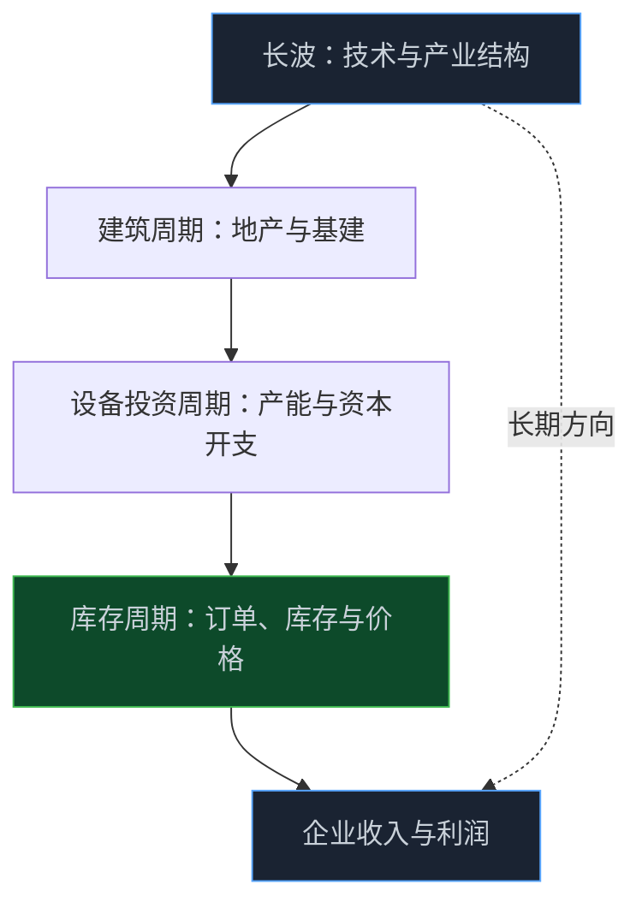
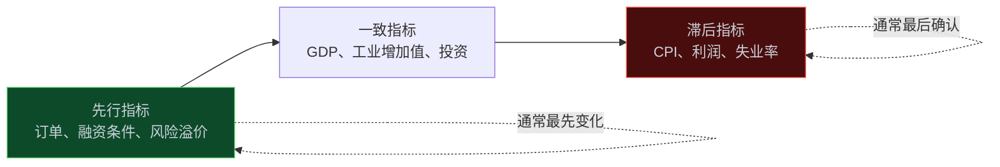

> **系列难度说明**：本篇是**第二章·第十一篇**，也是第二章的收束。不要求你预测拐点；只要能说清“增长在加速还是放缓、价格在升温还是降温、库存和盈利走到了哪一步”，就能把前十篇的零散变量串成一张有时间感的地图。
>
> **核心收获**：读完后，你会区分库存、设备投资、建筑与长波等不同周期，理解先行、一致、滞后三类指标的用法，知道投资时钟能提供什么、不能提供什么，并能用一张“周期位置卡片”给当前阶段做一份附带证据与反证的记录。
>
> **重要提示**：本文只用于投资者教育，不构成任何证券投资建议。周期判断本质上是概率判断，不存在确定的“拐点日期”；文中引用的官方数据仅用于说明方法，可能随后续修订而变化，示例数字除注明来源外均为假设。

假设你在 2026 年读到这样一组数据：上半年国内生产总值同比增长 `4.7%`，居民消费价格上涨 `1.0%`，生产者价格由负转正；规模以上工业企业 1—8 月利润同比增长 `15.7%`，但 8 月当月只增长 `4.2%`。

这是复苏，还是见顶？

不同的人会给出不同答案。看累计利润的人说“利润高增”，看单月增速的人说“动能在减弱”，看库存的人会问产成品存货为什么增长了 `11.0%`，看价格的人则想知道上游涨价会不会被下游消化。

这不是谁更聪明的问题。是**同一个经济体里，不同变量处在不同的节拍上**。

前十篇我们分别研究了增长、价格、景气、货币、信用、利率、汇率、财政和流动性，每一个变量都像一帧画面。周期要回答的，是这些画面放在时间轴上，是怎么一帧一帧换过去的。

<!-- more -->

---

## 周期不是钟摆，而是几套节拍叠在一起

“经济周期”听起来像一个固定的东西：繁荣、衰退、萧条、复苏，轮流上演。

现实更像几套长度不同的节拍同时在响。经济学里最常被提到的有四种：

| 周期 | 常见长度 | 主要驱动 | 对企业意味着什么 |
| --- | --- | --- | --- |
| 基钦周期（库存周期） | 约 3—5 年 | 企业根据需求预期调整库存 | 订单、价格和利润的短期波动 |
| 朱格拉周期（设备投资周期） | 约 7—11 年 | 设备更新与产能扩张 | 资本开支、产能利用率与折旧压力 |
| 库兹涅茨周期（建筑周期） | 约 15—25 年 | 建筑、人口与城市化 | 地产链与基建链的长期景气 |
| 康德拉季耶夫周期（长波） | 约 50—60 年 | 技术革命与产业重组 | 新旧产业更替 |

这些长度是理论上的平均值，不是日历。真实世界里，每一轮的长度、幅度和成因都不一样，周期的划分也有争议。

对投资者来说，这张表有一个更实用的用法：**别把不同节拍的变化混在一起。**

一家企业利润在一个季度里回升，可能只是库存周期里的补库；一个行业连续几年扩产，是设备投资周期在发力；而一个国家的产业结构升级，则要放在更长的时间尺度里看。拿短周期的信号去推断长周期的结论，或者反过来，都容易出错。



一般来说，离企业利润最近的，是库存周期和设备投资周期。这两层也最常出现在年报和行业研究里，后面第三章讲周期行业时会反复用到。

---

## 库存周期：最容易被观察、也最容易被误判

库存周期是最适合新手入门的一层，因为它可以拆成一个很直白的因果链：

1. 需求回暖，订单增加，企业开始补库存；
2. 补库带动生产和价格上升，利润改善；
3. 需求增速放缓，库存却还在堆积，企业开始被动累库；
4. 价格承压，企业降价、减产、去库存；
5. 库存降到较低水平，需求稍有回升，又进入下一轮补库。

这条链条对应四个常见的阶段：主动补库、被动补库、主动去库、被动去库。每个阶段，需求、库存与价格的组合都不同。

用数据看，可以用一个简化的对照表：

| 阶段 | 需求 | 库存 | 价格与利润的常见特征 |
| --- | --- | --- | --- |
| 被动去库 | 开始回升 | 下降 | 库存偏低，价格企稳，利润率先修复 |
| 主动补库 | 继续改善 | 上升 | 订单增加，价格与利润同步上行 |
| 被动补库 | 增速放缓 | 继续上升 | 需求跟不上，库存堆积，利润承压 |
| 主动去库 | 走弱 | 下降 | 降价清库，利润下滑，产能收缩 |

现在回到开头那组数据。

国家统计局发布的 2026 年 1—8 月规模以上工业企业数据显示：利润总额同比增长 `15.7%`；8 月末产成品存货 `7.36` 万亿元，同比增长 `11.0%`；产成品存货周转天数为 `21.3` 天，同比增加 `0.6` 天；8 月当月利润同比增长 `4.2%`。

> **来源**：[2026年1—8月份全国规模以上工业企业利润增长15.7%](https://www.nbd.com.cn/articles/2026-09-28/4592632.html) — 国家统计局发布的工业企业利润及主要财务指标数据（每经网转载）。
>
> **来源**：[国家统计局就2026年上半年国民经济运行情况答记者问](https://www.stats.gov.cn/sj/zxfbhjd/202607/t20260715_1964134.html) — 国家统计局对上半年增长、物价等宏观数据的官方解读。

这组数据能说明什么？

**累计利润增长较高**，说明前期盈利恢复较明显；**单月增速回落**，说明增长的节奏在变；**存货增速和周转天数同时上升**，提示库存消化可能没有同步加快。

但这些并不足以证明经济已经转入“被动补库”或“主动去库”。一个阶段的确认，需要更多的证据：订单、价格、产能利用率、上下游库存、行业分化。我们能做的，是把这些数据变成**问题**，而不是变成结论。

> 库存上升，是企业主动囤货，还是卖不出去？利润单月放缓，是基数效应，还是需求转弱？

这两个问题的答案，直接决定了你是在“看周期”，还是在“给周期贴标签”。

---

## 先行、一致、滞后：你看的数据是未来、现在，还是过去

周期判断里最容易被忽视的一点，是**数据本身的时间位置**。

国家统计局在介绍景气分析方法时，把经济指标分成三类：先行指标、一致指标和滞后指标。根据指标变动与经济周期波动之间的时间关系，先行指标通常领先于周期波动，如合同订单等；一致指标与周期同步；滞后指标则在周期变化之后才出现反应。

> **来源**：[如何进行景气分析](https://www.stats.gov.cn/zs/tjws/tjfx/202301/t20230101_1903945.html) — 国家统计局对先行、一致、滞后指数与合成指数法的说明。

把本课涉及的数据放进这个框架，大致是这样：

| 位置 | 常见指标 | 它告诉你什么 |
| --- | --- | --- |
| 偏先行 | PMI 新订单、新开工、金融条件、货币市场利率、风险溢价 | 需求与融资条件的边际变化 |
| 偏一致 | GDP、工业增加值、社会消费品零售、固定资产投资 | 经济活动本身的运行状态 |
| 偏滞后 | CPI、失业率、企业利润、财务费用、不良贷款 | 前期变化的累积结果 |

这张表的实用价值，在于避免一个常见错误：**用滞后指标判断当下，再用当下的判断去推断未来。**

例如，企业利润是典型的滞后指标之一。当你看到“利润高增长”时，经济的最强阶段可能已经过去；当你看到“利润大幅下滑”时，最差的阶段也可能正在接近尾声。股价往往不等这些数据出现就已经提前反应，这一点在下一节会详细说。



还有一个实务细节：**数据本身会被修订。** 初步核算的数据在后续可能调整，不同口径（可比口径、累计与当月、同比与环比）也会改变你看到的方向。研究时记录数据的发布时间和口径，是一个很便宜、却很有价值的习惯。

---

## 投资时钟：一个有用的地图，不是导航仪

谈周期，绕不开一个著名的框架：美林证券 2004 年提出的“投资时钟”。

它的思路很简单：用**经济增长**和**通货膨胀**两个变量，把周期划为四个阶段，并讨论各阶段哪类资产相对占优。

| 阶段 | 增长 | 通胀 | 理论上相对占优的资产（常见表述） |
| --- | --- | --- | --- |
| 复苏 | 上行 | 下行 | 股票 |
| 过热 | 上行 | 上行 | 大宗商品 |
| 滞胀 | 下行 | 上行 | 现金 |
| 衰退 | 下行 | 下行 | 债券 |

这个框架有两个很大的价值。

**第一，它逼你同时看两个维度。** 增长和通胀的组合不同，对利率、盈利和估值的含义完全不同。在上一篇里我们已经看到，同一个“流动性宽松”可能对应截然不同的风险偏好。

**第二，它给了你一套讨论宏观与资产的共同语言。** 当你读到研究报告里的“复苏早期”“滞胀风险”，至少知道它们大致指什么。

但这个框架也有明确的局限，投资者在使用时必须有所保留：

- **它源自对美国一段历史时期的回溯。** 对不同国家、不同时期、不同金融结构，适用性存在争议，不能直接照搬；
- **增长和通胀并不总是按顺序轮动。** 现实中常出现两者同时变化、方向混合或阶段被跳过的情形；
- **资产表现取决于预期，而不只是当前阶段。** 股票市场往往在复苏被数据确认之前就已提前反应；
- **阶段判断本身有滞后和误差。** 你在实时环境里看到的“当前阶段”，事后可能被重新归类；
- **不同行业对同一阶段的反应差别很大。** 资产大类层面的结论，很难直接用于个股。

因此，更稳妥的用法是：**把投资时钟当成一张“提问清单”，而不是一张“答案表”。**

看到增长和通胀的方向后，不是直接套用“该买什么”，而是追问：

> 增长回升，是需求的回升，还是低基数效应？通胀回落，是需求走弱，还是成本下降？盈利与估值，哪一个已经提前反映？

---

## 为什么股价常常比经济数据更早动

这是周期研究里最容易让新手困惑的现象：经济数据还很差，股价却先涨了；经济数据看起来很好，股价却开始回落。

原因并不神秘。

股票价格反映的是对未来现金流的预期，而经济数据——尤其是 GDP、利润、失业率这类一致或滞后指标——描述的是已经发生的事。

当市场预期“最差的时候快要过去”，哪怕当期的数据依然难看，价格也可能先行修复；反过来，当市场预期“最好的时候快要结束”，哪怕数据依然亮眼，价格也可能先行回落。

用一个**假设的例子**感受这个逻辑：

| 时点 | 经济数据 | 盈利预期的变化 | 股价的可能反应 |
| --- | --- | --- | --- |
| T0 | 增速很低，利润下降 | 开始出现“降幅收窄”的迹象 | 可能率先企稳 |
| T1 | 增速仍低，利润降幅收窄 | 预期进一步改善 | 可能继续上行 |
| T2 | 增速回升，利润转正 | 增速预期已被充分计入 | 上涨可能放缓 |
| T3 | 增速高位，利润高增长 | 市场开始担心高位回落 | 可能先行调整 |

这个表不是规律，只是一个思考框架。它想说的是：**判断股价，不是只问“经济现在好不好”，而是问“相比市场已有的预期，经济变好或变差的程度如何？”**

这和第六章“预期差”要讲的逻辑完全一致。宏观周期给你背景，预期差决定边际反应。

---

## 周期判断的三种常见偏差

研究周期时，有三类偏差特别常见，值得单独拿出来。

### 线性外推：把一个方向当作永远

当增速连续几个月上行，很容易产生“趋势会一直持续”的感觉；当数据连续走弱，又容易觉得“再也回不去”。

但周期的本质是**波动与回归**。极端的变化，往往已经包含了反向变化的种子：高库存会促使去库，高利润会吸引新增产能，低估值会改变风险溢价。

### 标签错位：用旧阶段套新环境

“这很像 20XX 年的某个阶段”是一种有价值的类比，也是一种危险的捷径。

每一轮周期的成因、政策环境、行业结构和外部条件都不相同。用历史做参照可以，但别把参照当成结论。

### 单一指标：用一个变量讲完整个周期

用 PMI 判断整个周期、用 M2 判断股市、用利润判断拐点，每一种都容易出现盲区。

周期是多个变量的组合结果。可靠的判断，更像法庭上的证据链：每个证据都有局限，但多条证据相互印证，结论才更站得住。

---

## 给开发者的一个小工具：用“方向”描述周期位置

如果你有编程背景，可以把周期位置的记录写成一个很简单的结构。目的不是自动给出答案，而是强迫自己把判断**写成可检查的形式**。

```python
from dataclasses import dataclass, field

@dataclass
class CycleSnapshot:
    date: str
    growth: str        # "up" / "down" / "flat"
    inflation: str     # "up" / "down" / "flat"
    inventory: str     # "up" / "down" / "flat"
    profit: str        # "up" / "down" / "flat"
    liquidity: str     # "looser" / "tighter" / "flat"
    evidence: list = field(default_factory=list)
    counter_evidence: list = field(default_factory=list)

def rough_phase(s: CycleSnapshot) -> str:
    """仅用增长与通胀方向给出一个粗略标签；它是提问的起点，不是结论。"""
    if s.growth == "up" and s.inflation == "down":
        return "复苏（待验证）"
    if s.growth == "up" and s.inflation == "up":
        return "过热（待验证）"
    if s.growth == "down" and s.inflation == "up":
        return "滞胀（待验证）"
    if s.growth == "down" and s.inflation == "down":
        return "衰退（待验证）"
    return "信号混合"
```

这段代码最重要的部分不是 `rough_phase`，而是 `evidence` 和 `counter_evidence` 两个字段。它们提醒你：**每一次判断，都要同时写下支持它的证据和可能推翻它的证据。**

很多人的周期判断最后失败，不是因为没有数据，而是因为没人记录过当初“如果出现什么就说明我错了”。

---

## 一次练习：做一张“周期位置卡片”

打开最近一期的官方宏观数据，用下面这张表给当前所处的位置做一份记录。每月或每季度更新一次，几期之后，你会得到一份属于自己的周期日志。

| 维度 | 要记录的内容 | 数据来源 | 你的记录 |
| --- | --- | --- | --- |
| 增长 | GDP、工业增加值、投资、消费的方向 | 国家统计局 | |
| 价格 | CPI、核心 CPI、PPI 的方向与结构 | 国家统计局 | |
| 景气 | PMI 及新订单、库存分项 | 国家统计局、中国物流与采购联合会 | |
| 库存与盈利 | 产成品存货增速、周转天数、工业企业利润 | 国家统计局 | |
| 货币与信用 | 短端利率、M2、社融、风险偏好的方向 | 人民银行、交易所 | |
| 估值与预期 | 指数估值水平、股权风险溢价 | 指数公司、行情软件 | |

填完之后，用三句话回答：

> 1. 我认为当前最接近哪个阶段？
> 2. 支持这个判断的三条证据是什么？
> 3. 如果出现什么数据，我就承认这个判断需要修正？

第三问最关键。它把一个模糊的“我觉得”，变成一条可以在未来被检验的规则。

---

## 小结

- 经济周期不是一个固定节拍，而是库存、设备投资、建筑与长波等不同节拍叠加的结果。离企业利润最近的是库存周期和设备投资周期。
- 库存周期可以拆成补库与去库、主动与被动四个阶段；用它读数据时，要把累计与当月、利润与库存、需求与价格放在一起看。
- 指标有先行、一致和滞后之分。用滞后指标确认当下、再推断未来，是周期研究中最常见的时间错位。
- 投资时钟用增长与通胀两个维度提供一张有价值的地图，但它源自特定历史样本，不能当作答案表；更好的用法是把它当成提问清单。
- 股价反映的是对未来现金流的预期，因此常常早于经济数据变化。周期给背景，预期差决定边际反应。
- 可靠的周期判断需要证据链和反证条件，而不是某个单一指标或某一段历史类比。

---

## 下一章预告

到这里，第二章“宏观经济：给市场画一张天气图”就走完了。我们画了增长、价格、景气、货币、信用、利率、汇率、财政、流动性和周期，一共十一张图。

但天气图只能告诉你今天是晴是雨，不能告诉你该往哪条路走。

同样处在复苏期，有的行业订单爆满，有的行业依然困难；同样的利率环境，有的公司现金流稳健，有的公司债务沉重。

下一章，我们从天上落到地上：**行业研究：先看赛道，再看选手。**

第一篇，先聊聊：**行业生命周期：导入、增长、成熟与出清。**

---

> **课程导航：第二章·宏观经济：给市场画一张天气图**
> - 第一篇：GDP：增长从哪里来
> - 第二篇：CPI 与 PPI：价格变化传到利润表的路径
> - 第三篇：PMI：如何读懂景气度信号
> - 第四篇：M1 与 M2：货币到底在反映什么
> - 第五篇：社会融资：信用扩张与收缩
> - 第六篇：利率为什么会影响股票估值
> - 第七篇：国债收益率：无风险利率这把尺子
> - 第八篇：汇率：外部价格与企业经营的连接
> - 第九篇：财政变量如何进入行业与公司
> - 第十篇：货币条件、流动性与风险偏好
> - **第十一篇：经济周期：别把阶段性变化当成永恒趋势** ← 你在这里
>
> **下一章：第三章·行业研究：先看赛道，再看选手**
